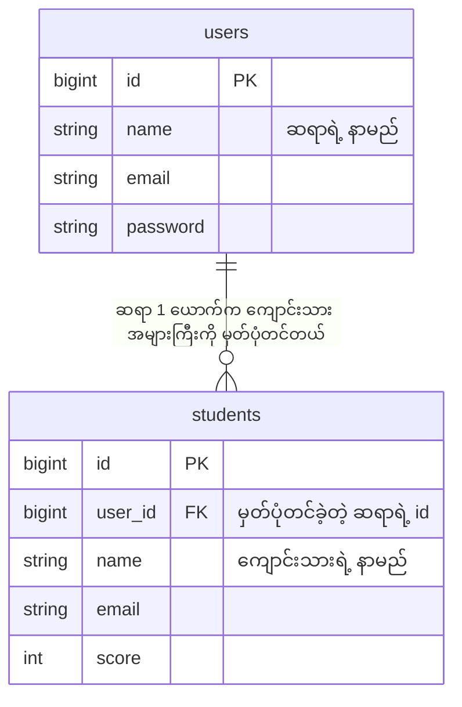
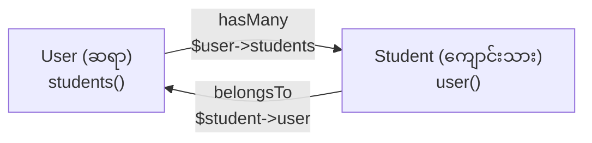
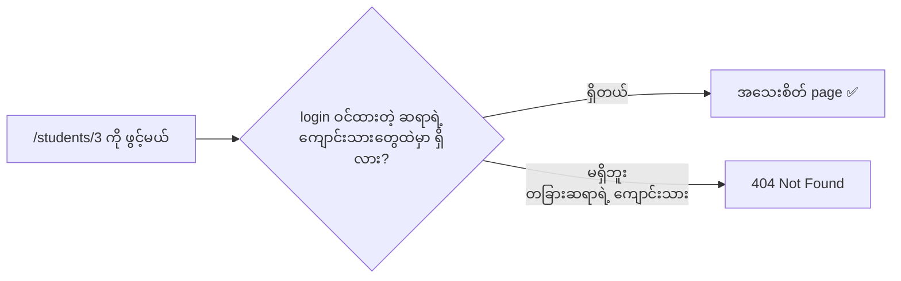
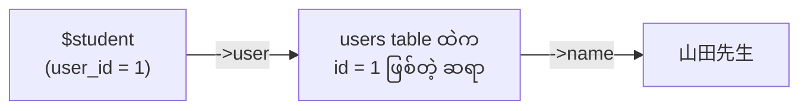
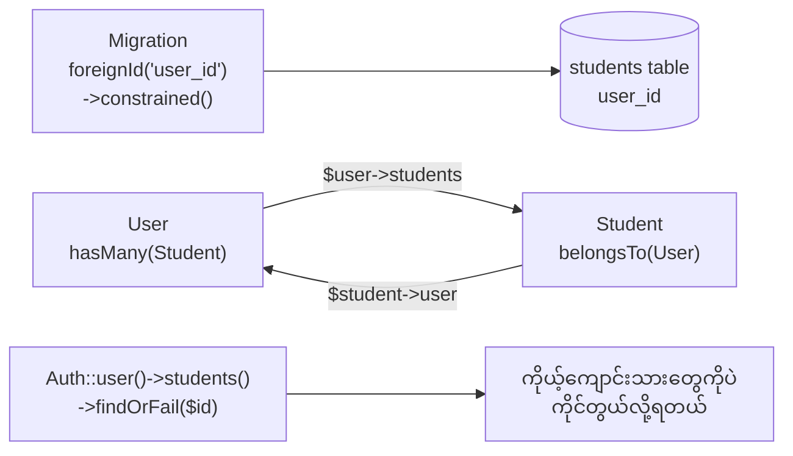

# ကျောင်းသားစီမံခန့်ခွဲမှု App ကို တည်ဆောက်ကြမယ် ④ — Relation (ဆရာနဲ့ ကျောင်းသားကို ချိတ်ဆက်ခြင်း)

> 🇯🇵 မူရင်း (ဂျပန်ဘာသာဖြင့်): [20261203_資料_1.md](<../../../1年生_データ設計とアプリ開発/後期/20261203/20261203_資料_1.md>) <!-- original-ja-link -->

ပြီးခဲ့တဲ့အခါက ဆရာတွေ login ဝင်လို့ရအောင် လုပ်ခဲ့ပါတယ်။
ဒါပေမဲ့ အခုအချိန်မှာ **ဘယ်ဆရာက login ဝင်ဝင်၊ ကျောင်းသားအားလုံးကို မြင်နေရ** ပါတယ်။
ဒီနေ့မှာတော့ ကျောင်းသားကို **ဘယ်ဆရာက မှတ်ပုံတင်ခဲ့သလဲ** ဆိုတာကို မှတ်တမ်းတင်ပြီး **ကိုယ့်ကျောင်းသားတွေကိုပဲ** စီမံခန့်ခွဲနိုင်အောင် လုပ်ပါမယ်။

## ဒီနေ့ရဲ့ ပန်းတိုင်
- 1-to-many ဆက်နွယ်မှုကို ER diagram နဲ့ table (foreign key) တို့နဲ့ ဖော်ပြနိုင်ရမယ်
- `hasMany`・`belongsTo` ကို သုံးပြီး model အချင်းချင်း ချိတ်ဆက်နိုင်ရမယ်
- login ဝင်ထားတဲ့ ဆရာရဲ့ ကျောင်းသားတွေကိုပဲ စာရင်းကြည့်၊ အသေးစိတ်ကြည့်၊ ပြင်ဆင်၊ ဖျက် လုပ်နိုင်ရမယ်

> 11/26 ရဲ့ "Login" လုပ်လို့ရတဲ့ အခြေအနေကနေ စတင်ပါမယ်။

---

## 1. ဆရာနဲ့ ကျောင်းသားရဲ့ ဆက်နွယ်မှု

### ဆရာ 1 ယောက်က ကျောင်းသား အများကြီးကို တာဝန်ယူတယ်



| ဆရာ (users) | ကျောင်းသား (students) |
|--------------|-----------------|
| 山田先生 (ဆရာ Yamada၊ id: 1) | 山田先生 ရဲ့ ကျောင်းသား 15 ယောက် |
| 佐藤先生 (ဆရာ Sato၊ id: 2) | 佐藤先生 ရဲ့ ကျောင်းသား 15 ယောက် |

ဒီလို ဆက်နွယ်မှုကို **1-to-many** (တစ်ခုနဲ့ အများ) လို့ ခေါ်ပါတယ်။

- ဆရာဘက်က ကြည့်ရင် ကျောင်းသားက **အများကြီး** (many)
- ကျောင်းသားဘက်က ကြည့်ရင် ဆရာက **1 ယောက်** (1)

### Foreign key: ကျောင်းသားဆီမှာ "ဆရာရဲ့ နံပါတ်" ကို သိမ်းထားခြင်း

ကျောင်းသား table ထဲကို **မှတ်ပုံတင်ခဲ့တဲ့ ဆရာရဲ့ `id`** ကို ထည့်မယ့် column (`user_id`) ကို ထပ်ထည့်ပါမယ်။

| id | **user_id** | name | email | score |
|----|------------|------|-------|-------|
| 1 | **1** | 田中 一郎 | … | 85 |
| 2 | **1** | 鈴木 花子 | … | 92 |
| 3 | **2** | 高橋 次郎 | … | 70 |

`user_id` က `1` ဖြစ်တဲ့ ကျောင်းသားက ဆရာ Yamada ရဲ့ ကျောင်းသား၊ `2` ဖြစ်တဲ့ ကျောင်းသားက ဆရာ Sato ရဲ့ ကျောင်းသား ဖြစ်ပါတယ်။

ဒီလို **တခြား table ရဲ့ `id` ကို ထည့်ထားတဲ့ column** ကို **foreign key** လို့ ခေါ်ပါတယ်။

> **ဘာလို့ ဆရာရဲ့ "နာမည်" မထည့်ဘဲ "id" ကို ထည့်တာလဲ?**
> နာမည်ကို ထည့်ထားရင် ဆရာက နာမည်ပြောင်းတဲ့အခါ ကျောင်းသား row တွေ အားလုံးကို ပြင်ရပါလိမ့်မယ်။
> `id` ဆိုရင်တော့ ဆရာရဲ့ နာမည်ပြောင်းသွားရင်တောင် ကျောင်းသား row တွေကို ပြင်စရာ မလိုပါဘူး။

---

## 2. လက်တွေ့ ဖန်တီးကြည့်ကြမယ်


ပြင်ရမယ့် file တွေက အောက်ပါအတိုင်း ဖြစ်ပါတယ် (`src` ထဲမှာ)။

```
src/
├─ database/
│   ├─ migrations/xxxx_add_user_id_to_students_table.php ··· 1. အသစ်ဖန်တီးမယ်
│   ├─ factories/StudentFactory.php ························· 3. user_id ထည့်မယ်
│   └─ seeders/
│       ├─ UserSeeder.php ··································· 3. ဆရာကို 2 ယောက် ဖြစ်အောင်လုပ်မယ်
│       └─ StudentSeeder.php ································ 3. ဆရာတစ်ယောက်ချင်းစီအတွက် ကျောင်းသားဖန်တီးမယ်
├─ app/Models/
│   ├─ User.php ············································· 2. students() ထည့်မယ်
│   └─ Student.php ·········································· 2. user() ထည့်မယ်
├─ app/Http/Controllers/StudentController.php ··············· 4. ကိုယ့်ကျောင်းသားတွေပဲ ဖြစ်အောင်လုပ်မယ်
└─ resources/views/students/show.blade.php ·················· 5. ဆရာရဲ့ နာမည်ကို ပြမယ်
```

---

### 1. Foreign key column ထည့်ခြင်း (Migration)

> အခု ဒီနေရာ: **🟢 1. Foreign key** → 2. Model → 3. Test data → 4. ကိုယ့်ကျောင်းသားတွေပဲ → 5. ဆရာရဲ့ နာမည်

11/12 မှာ သင်ခဲ့တဲ့ "**column ထည့်တဲ့ migration**" ကို ဖန်တီးပါမယ်။

```powershell
docker compose exec laravel php artisan make:migration add_user_id_to_students_table
```

`up()` နဲ့ `down()` ထဲကို အောက်ပါအတိုင်း ရေးပါ။

```php
    public function up(): void
    {
        Schema::table('students', function (Blueprint $table) {
            $table->foreignId('user_id')
                ->after('id')
                ->constrained()
                ->cascadeOnDelete();
        });
    }

    public function down(): void
    {
        Schema::table('students', function (Blueprint $table) {
            $table->dropForeign(['user_id']);
            $table->dropColumn('user_id');
        });
    }
```

| Code | အဓိပ္ပာယ် |
|--------|------|
| `foreignId('user_id')` | Foreign key အတွက် column `user_id` ကို ထည့်တယ် (`id` လိုပဲ ကြီးမားတဲ့ integer column) |
| `->after('id')` | `id` column ရဲ့ နောက်မှာ ထည့်တယ် (ကြည့်ရလွယ်အောင်) |
| `->constrained()` | `user_id` ထဲကို **`users` table မှာ ရှိတဲ့ `id` ကိုပဲ ထည့်လို့ရ** အောင် လုပ်တယ် (foreign key constraint) |
| `->cascadeOnDelete()` | ဆရာကို ဖျက်လိုက်ရင် အဲ့ဒီဆရာရဲ့ ကျောင်းသားတွေကိုပါ တစ်ခါတည်း ဖျက်တယ် |
| `dropForeign` → `dropColumn` | မူလအတိုင်း ပြန်ပြောင်းတဲ့အခါ constraint ကို အရင်ဖြုတ်ပြီးမှ column ကို ဖျက်တယ် |

> **`constrained()` က "`users` table" ဆိုတာကို ဘယ်လိုသိတာလဲ?**
> Column နာမည်က `user_id` ဖြစ်နေလို့ပါ။ Laravel က "`user_id` ဆိုရင် `users` table ရဲ့ `id` ပဲ" လို့ သူ့ဘာသာ နားလည်ပေးပါတယ်။

**`migrate` ကို အခုထိ မလုပ်သေးပါနဲ့။** အကြောင်းရင်းကို "3. Test data" မှာ ရှင်းပြပါမယ်။

---

### 2. Model တွေကို ချိတ်ခြင်း (hasMany・belongsTo)

> အခု ဒီနေရာ: 1. Foreign key → **🟢 2. Model** → 3. Test data → 4. ကိုယ့်ကျောင်းသားတွေပဲ → 5. ဆရာရဲ့ နာမည်

Table တွေကို ချိတ်ထားရုံနဲ့ PHP code ကနေ "ဒီဆရာရဲ့ ကျောင်းသားတွေ" ကို ထုတ်ယူလို့ မရသေးပါဘူး။
**Model ထဲမှာလည်း ဆက်နွယ်မှုကို ရေးပေးရပါမယ်။**

#### ① ဆရာ (User) ထဲမှာ "ကျောင်းသား အများကြီး" လို့ ရေးမယ်

`app/Models/User.php` ထဲမှာ ★ အပိုင်းကို ထပ်ရေးပါ။

```php
use Illuminate\Database\Eloquent\Relations\HasMany;  // ★ ထပ်ထည့် (အပေါ်ပိုင်းက use တွေ စီထားတဲ့နေရာမှာ)

class User extends Authenticatable
{
    // (မူလကတည်းက ရှိပြီးသား code တွေကို ဒီအတိုင်းထားပါ)

    // ★ ဒီကနေ ထပ်ထည့်: ဒီဆရာ မှတ်ပုံတင်ခဲ့တဲ့ ကျောင်းသားတွေ
    public function students(): HasMany
    {
        return $this->hasMany(Student::class);
    }
    // ★ ဒီအထိ
}
```

#### ② ကျောင်းသား (Student) ထဲမှာ "ဆရာက 1 ယောက်" လို့ ရေးမယ်

`app/Models/Student.php` ထဲမှာ ★ အပိုင်းကို ထပ်ရေးပါ။

```php
<?php

namespace App\Models;

use Illuminate\Database\Eloquent\Factories\HasFactory;
use Illuminate\Database\Eloquent\Model;
use Illuminate\Database\Eloquent\Relations\BelongsTo;  // ★ ထပ်ထည့်

class Student extends Model
{
    /** @use HasFactory<\Database\Factories\StudentFactory> */
    use HasFactory;

    // ★ ဒီကနေ ထပ်ထည့်: ဒီကျောင်းသားကို မှတ်ပုံတင်ခဲ့တဲ့ ဆရာ
    public function user(): BelongsTo
    {
        return $this->belongsTo(User::class);
    }
    // ★ ဒီအထိ
}
```

| Model | ရေးခဲ့တာ | အဓိပ္ပာယ် | သုံးပုံ |
|--------|----------|------|-------|
| `User` | `hasMany(Student::class)` | ဆရာတစ်ယောက်မှာ **ကျောင်းသား အများကြီး ရှိတယ်** (has many) | `$user->students` နဲ့ အဲ့ဒီဆရာရဲ့ ကျောင်းသား **အားလုံး** |
| `Student` | `belongsTo(User::class)` | ကျောင်းသားက ဆရာ 1 ယောက်ရဲ့ **အောက်မှာ ရှိတယ်** (belongs to) | `$student->user` နဲ့ အဲ့ဒီကျောင်းသားရဲ့ ဆရာ **1 ယောက်** |



> **နာမည်ပေးပုံ စည်းမျဉ်း**
> "အများကြီး" ဘက်ကို **အများကိန်း** (`students`)၊ "1 ယောက်" ဘက်ကို **အနည်းကိန်း** (`user`) နဲ့ နာမည်ပေးပါ။
> အင်္ဂလိပ်လို ဖတ်ကြည့်ရင် `$user->students` (ဆရာရဲ့ ကျောင်းသားတွေ)・`$student->user` (ကျောင်းသားရဲ့ ဆရာ) လို့ သဘာဝကျကျ ဖတ်လို့ရပါတယ်။

---

### 3. Test data ကို ပြန်ဖန်တီးခြင်း

> အခု ဒီနေရာ: 1. Foreign key → 2. Model → **🟢 3. Test data** → 4. ကိုယ့်ကျောင်းသားတွေပဲ → 5. ဆရာရဲ့ နာမည်

#### ဘာလို့ `migrate` မဟုတ်ဘဲ `migrate:fresh` ကို သုံးတာလဲ?

အခု `students` table ထဲမှာ ကျောင်းသား 30 ယောက် ရှိနေပါတယ်။
ဒီထဲကို `user_id` column ထည့်လိုက်ရင် **ရှိပြီးသား ကျောင်းသား 30 ယောက်ရဲ့ `user_id` ထဲကို ဘာထည့်ရမလဲ?**
`constrained()` ရှိနေတဲ့အတွက် `users` table မှာ မရှိတဲ့ နံပါတ်ကို ထည့်လို့ မရပါဘူး။

ဒါကြောင့် ဒီတစ်ခါမှာတော့ `migrate:fresh --seed` နဲ့ **table တွေကို ပြန်ဖန်တီးပြီး သက်ဆိုင်ရာဆရာနဲ့ ချိတ်ထားတဲ့ ကျောင်းသားတွေကို ပြန်ထည့်** ပါမယ်။
အဲ့ဒီအတွက် Seeder နဲ့ Factory ကို အရင်ပြင်ထားပါမယ်။

#### ① ဆရာကို 2 ယောက် ဖြစ်အောင်လုပ်ခြင်း (UserSeeder)

`database/seeders/UserSeeder.php` ရဲ့ `run()` ထဲမှာ ★ ဒုတိယဆရာကို ထပ်ရေးပါ။

```php
    public function run(): void
    {
        $user = new User();
        $user->name = '山田先生';
        $user->email = 'teacher@example.com';
        $user->password = 'password';
        $user->save();

        // ★ ဒီကနေ ထပ်ထည့်
        $user = new User();
        $user->name = '佐藤先生';
        $user->email = 'teacher2@example.com';
        $user->password = 'password';
        $user->save();
        // ★ ဒီအထိ
    }
```

#### ② ဆရာတစ်ယောက်ချင်းစီအတွက် ကျောင်းသား 15 ယောက်စီ ဖန်တီးခြင်း (StudentSeeder)

`database/seeders/StudentSeeder.php` ရဲ့ `run()` ကို အောက်ပါအတိုင်း ပြင်ရေးပါ။

```php
<?php

namespace Database\Seeders;

use App\Models\Student;
use App\Models\User;  // ★ ထပ်ထည့်
use Illuminate\Database\Seeder;

class StudentSeeder extends Seeder
{
    public function run(): void
    {
        // ဆရာတစ်ယောက်ချင်းစီအတွက် ကျောင်းသား 15 ယောက်စီ ဖန်တီးမယ်
        foreach (User::all() as $user) {
            Student::factory()->count(15)->for($user)->create();
        }
    }
}
```

| Code | အဓိပ္ပာယ် |
|--------|------|
| `User::all()` | ဆရာအားလုံးကို ယူလာတယ် |
| `->for($user)` | "ဒီဆရာရဲ့ ကျောင်းသားအဖြစ် ဖန်တီးပေးပါ"။ `user_id` ထဲကို `$user->id` ဝင်သွားတယ် |

#### ③ Factory ထဲကိုလည်း user_id ထည့်ခြင်း (StudentFactory)

`database/factories/StudentFactory.php` ရဲ့ `definition()` ထဲမှာ ★ စာကြောင်း 1 ကြောင်းကို ထပ်ရေးပါ။

```php
use App\Models\User;  // ★ ထပ်ထည့် (အပေါ်ပိုင်းမှာ ရေးပါ)

    public function definition(): array
    {
        return [
            'user_id' => User::factory(),  // ★ ထပ်ထည့်
            'name' => fake('ja_JP')->name(),
            'email' => fake()->unique()->safeEmail(),
            'score' => fake()->numberBetween(0, 100),
        ];
    }
```

`User::factory()` ဆိုတာ "ဆရာကို မသတ်မှတ်ထားရင် ဆရာကိုပါ 1 ယောက် ဖန်တီးပေးပါ" ဆိုတဲ့ အဓိပ္ပာယ်ပါ။
ဒီနေ့ရဲ့ Seeder မှာတော့ `->for($user)` နဲ့ ဆရာကို သတ်မှတ်ပေးထားလို့ ဆရာအသစ် ဖန်တီးမှာ မဟုတ်ပါဘူး။

#### ④ ပြန်ဖန်တီးခြင်း

```powershell
docker compose exec laravel php artisan migrate:fresh --seed
```

✅ **စစ်ဆေးရန်**: phpMyAdmin မှာ အောက်ပါ 2 ချက်ကို စစ်ကြည့်ပါ။

- `users` table ထဲမှာ ဆရာ Yamada နဲ့ ဆရာ Sato 2 ယောက် ရှိနေတယ်
- `students` table မှာ `user_id` column ရှိပြီး `1` ဖြစ်တဲ့ ကျောင်းသား 15 ယောက်၊ `2` ဖြစ်တဲ့ ကျောင်းသား 15 ယောက် ရှိနေတယ်

---

### 4. ကိုယ့်ကျောင်းသားတွေကိုပဲ ကြည့်လို့ရအောင် လုပ်ခြင်း

> အခု ဒီနေရာ: 1. Foreign key → 2. Model → 3. Test data → **🟢 4. ကိုယ့်ကျောင်းသားတွေပဲ** → 5. ဆရာရဲ့ နာမည်

`app/Http/Controllers/StudentController.php` ကို ပြင်ရေးပါမယ်။
အပေါ်ပိုင်းမှာ `use Illuminate\Support\Facades\Auth;` ကို ထပ်ရေးပြီးမှ ★ နေရာတွေကို ပြောင်းပါ။

```php
use Illuminate\Support\Facades\Auth;  // ★ ထပ်ထည့်
```

#### ① စာရင်း (index): ကိုယ့်ကျောင်းသားတွေပဲ

```php
    public function index()
    {
        $students = Auth::user()->students;  // ★ Student::all() ကနေ ပြောင်းမယ်

        return view('students.index', ['students' => $students]);
    }
```

`Auth::user()` က login ဝင်ထားတဲ့ ဆရာ ဖြစ်ပါတယ်။
`->students` နဲ့ **အဲ့ဒီဆရာရဲ့ ကျောင်းသားတွေကိုပဲ** ယူလို့ရပါတယ်။ အပိုင်း 2 မှာ ရေးခဲ့တဲ့ `hasMany` ကြောင့်ပါ။

#### ② ထည့်ခြင်း (store): မှတ်ပုံတင်တဲ့ ဆရာကို မှတ်တမ်းတင်မယ်

```php
        $student = new Student();
        $student->user_id = Auth::id();  // ★ ထပ်ထည့်: login ဝင်ထားတဲ့ ဆရာရဲ့ id
        $student->name = $request->input('name');
        $student->email = $request->input('email');
        $student->score = $request->input('score');
        $student->save();
```

| Code | အဓိပ္ပာယ် |
|--------|------|
| `Auth::id()` | login ဝင်ထားတဲ့ ဆရာရဲ့ `id` |

#### ③ အသေးစိတ်・ပြင်ဆင်・ဖျက်: ကိုယ့်ကျောင်းသားကိုပဲ ကိုင်တွယ်လို့ရအောင် လုပ်မယ်

`show`・`edit`・`update`・`destroy` 4 ခုထဲမှာ ရှိတဲ့ `Student::findOrFail($id)` ကို **အားလုံး** အောက်ပါအတိုင်း ပြောင်းပါ။

```php
        // မပြင်ခင်
        $student = Student::findOrFail($id);

        // ပြင်ပြီးနောက်
        $student = Auth::user()->students()->findOrFail($id);
```

`Auth::user()->students()` က "login ဝင်ထားတဲ့ ဆရာရဲ့ ကျောင်းသားတွေထဲကနေ"၊ `findOrFail($id)` က "`id` ကိုက်ညီတဲ့ ကျောင်းသားကို ရှာမယ်" ဆိုတဲ့ အဓိပ္ပာယ် ဖြစ်ပါတယ်။
**တခြားဆရာရဲ့ ကျောင်းသားရဲ့ `id` ကို ဖွင့်ကြည့်ဖို့ ကြိုးစားရင်တောင် ရှာမတွေ့တဲ့အတွက် `404 Not Found`** ဖြစ်သွားပါမယ်။



> **`students` နဲ့ `students()` ရဲ့ ကွာခြားချက်**
>
> | ရေးပုံ | အဓိပ္ပာယ် | သုံးတဲ့ အခြေအနေ |
> |-------|------|---------|
> | `Auth::user()->students` | အဲ့ဒီဆရာရဲ့ ကျောင်းသားတွေကို **အားလုံး ယူလာတယ်** | စာရင်း (အားလုံး လိုချင်တဲ့အခါ) |
> | `Auth::user()->students()` | "အဲ့ဒီဆရာရဲ့ ကျောင်းသားတွေထဲကနေ" ဆိုတဲ့ **condition ကိုပဲ** ထည့်တယ်။ ဒီနောက်မှာ `->findOrFail($id)` စတာတွေကို ဆက်ရေးလို့ရတယ် | အသေးစိတ်・ပြင်ဆင်・ဖျက် (1 ယောက်ကို ရှာချင်တဲ့အခါ) |

✅ **စစ်ဆေးရန်**: အောက်ပါ အစီအစဉ်အတိုင်း စမ်းကြည့်ပါ။

| လုပ်ရမယ့်အရာ | ဒီလိုဖြစ်ရင် OK |
|---------|------------|
| ဆရာ Yamada (`teacher@example.com`) နဲ့ login ဝင်ပြီး စာရင်းကို ဖွင့်မယ် | ကျောင်းသား 15 ယောက်ပဲ ပြတယ် |
| ကျောင်းသား 1 ယောက် ထည့်မယ် | phpMyAdmin မှာ ထည့်လိုက်တဲ့ ကျောင်းသားရဲ့ `user_id` က `1` ဖြစ်နေတယ် |
| စာရင်းကနေ ကျောင်းသားရဲ့ အသေးစိတ် page ကို ဖွင့်ပြီး URL ထဲက နံပါတ်ကို မှတ်ထားမယ် (ဥပမာ: `/students/3`) | — |
| Logout လုပ်ပြီး ဆရာ Sato (`teacher2@example.com`) နဲ့ login ဝင်မယ် | စာရင်းမှာ ဆရာ Yamada နဲ့ မတူတဲ့ ကျောင်းသား 15 ယောက် ပြတယ် |
| မှတ်ထားတဲ့ ဆရာ Yamada ရဲ့ ကျောင်းသား URL ကို တိုက်ရိုက် ဖွင့်မယ် | **`404 Not Found`** ဖြစ်တယ် (တခြားဆရာရဲ့ ကျောင်းသားကို ကြည့်လို့မရဘူး) |

---

### 5. အသေးစိတ် page မှာ မှတ်ပုံတင်ခဲ့တဲ့ ဆရာရဲ့ နာမည်ကို ပြခြင်း

> အခု ဒီနေရာ: 1. Foreign key → 2. Model → 3. Test data → 4. ကိုယ့်ကျောင်းသားတွေပဲ → **🟢 5. ဆရာရဲ့ နာမည်**

`resources/views/students/show.blade.php` ထဲမှာ ★ စာကြောင်း 1 ကြောင်းကို ထပ်ရေးပါ။ （「番号」= နံပါတ်၊「メールアドレス」= အီးမေးလ်လိပ်စာ၊「点数」/「点」= ရမှတ်၊「登録した先生」= မှတ်ပုံတင်ခဲ့တဲ့ ဆရာ）

```html
    <p>番号：{{ $student->id }}</p>
    <p>メールアドレス：{{ $student->email }}</p>
    <p>点数：{{ $student->score }}点</p>
    <p>登録した先生：{{ $student->user->name }}</p>  {{-- ★ ထပ်ထည့် --}}
```

`$student->user` နဲ့ အဲ့ဒီကျောင်းသားရဲ့ ဆရာ (`belongsTo`) ကို၊ `->name` နဲ့ အဲ့ဒီဆရာရဲ့ နာမည်ကို ယူလို့ရပါတယ်။
SQL ရဲ့ `JOIN` ကို မရေးရဘဲနဲ့ Laravel က `users` table ကနေ ယူလာပေးပါတယ်။

✅ **စစ်ဆေးရန်**: အသေးစိတ် page မှာ 「登録した先生：山田先生」(မှတ်ပုံတင်ခဲ့တဲ့ ဆရာ: ဆရာ Yamada) လိုမျိုး ပြရင် OK ပါ။



---

## 3. အဆင်မပြေတဲ့အခါ

> **🔥 အလုပ်မလုပ်ရင် log ထုတ်ကြည့်ပါ!** → [【အရေးကြီး】Log ထုတ်နည်း](../20261022/【重要】ログの出し方.md)

| ဖြစ်နေတဲ့ ပြဿနာ | အကြောင်းရင်း ရှိတဲ့နေရာ | ဖြေရှင်းနည်း |
|------|----------|------|
| `migrate` မှာ `Cannot add or update a child row: a foreign key constraint fails` | Migration | ရှိပြီးသား ကျောင်းသားတွေအတွက် ထည့်ပေးရမယ့် ဆရာ မရှိဘူး။ `migrate:fresh --seed` နဲ့ ပြန်ဖန်တီးပါ |
| `Call to undefined method App\Models\User::students()` | Model | `User.php` ထဲမှာ `students()` method ကို ရေးထားလား စစ်ပါ |
| `Return value must be of type App\Models\HasMany` | Model | `User.php` ရဲ့ အပေါ်ပိုင်းမှာ `use Illuminate\Database\Eloquent\Relations\HasMany;` ရှိလား စစ်ပါ (`Student.php` ရဲ့ `BelongsTo` လည်း အတူတူပဲ) |
| စာရင်းမှာ ကျောင်းသားအားလုံး (30 ယောက်) ပြနေတယ် | Controller | `index` က `Auth::user()->students` ဖြစ်နေလား စစ်ပါ |
| တခြားဆရာရဲ့ ကျောင်းသားရဲ့ အသေးစိတ် page ကို ကြည့်လို့ရနေတယ် | Controller | `show`・`edit`・`update`・`destroy` **4 ခုလုံးမှာ** `Auth::user()->students()->findOrFail($id)` လို့ ပြောင်းထားလား စစ်ပါ |
| ကျောင်းသားထည့်တဲ့အခါ `Field 'user_id' doesn't have a default value` | Controller | `store` ထဲမှာ `$student->user_id = Auth::id();` ရှိလား စစ်ပါ |
| ဆရာရဲ့ နာမည်ပြတဲ့နေရာမှာ `Attempt to read property "name" on null` | Model・Data | `Student.php` ထဲမှာ `user()` ကို ရေးထားလား၊ အဲ့ဒီကျောင်းသားရဲ့ `user_id` နဲ့ ကိုက်တဲ့ ဆရာ ရှိလား စစ်ပါ |

---

## 4. အနှစ်ချုပ်



| ဒီနေ့ ရေးခဲ့တာ | တစ်ခွန်းတည်းနဲ့ ပြောရရင် |
|--------------|-----------|
| `foreignId('user_id')->constrained()` | Foreign key column ကို ထည့်ပြီး `users` မှာ ရှိတဲ့ `id` ကိုပဲ ထည့်လို့ရအောင် လုပ်တယ် |
| `hasMany(Student::class)` | ဆရာတစ်ယောက်မှာ ကျောင်းသား အများကြီး ရှိတယ် (`$user->students`) |
| `belongsTo(User::class)` | ကျောင်းသားက ဆရာ 1 ယောက်ရဲ့ အောက်မှာ ရှိတယ် (`$student->user`) |
| `->for($user)` (Factory) | ဒီဆရာရဲ့ ကျောင်းသားအဖြစ် test data ကို ဖန်တီးတယ် |
| `Auth::id()` | login ဝင်ထားတဲ့ ဆရာရဲ့ `id` |
| `Auth::user()->students` | login ဝင်ထားတဲ့ ဆရာရဲ့ ကျောင်းသားအားလုံး |
| `Auth::user()->students()->findOrFail($id)` | ကိုယ့်ကျောင်းသားတွေထဲကနေ 1 ယောက်ကို ရှာတယ်။ တခြားဆရာရဲ့ ကျောင်းသားဆိုရင် 404 |

**Table တွေကို foreign key နဲ့ ချိတ်တယ်။ Model တွေကို hasMany・belongsTo နဲ့ ချိတ်တယ်။**

ဒါဆိုရင် ကျောင်းသားစီမံခန့်ခွဲမှု App ပြီးစီးပါပြီ 🎉
စာရင်း・ထည့်ခြင်း・အသေးစိတ်・ပြင်ဆင်ခြင်း・ဖျက်ခြင်း (CRUD)၊ login၊ relation ဆိုပြီး Web app ရဲ့ အရေးကြီးတဲ့ စနစ်တွေ အားလုံး စုံသွားပါပြီ။

> **ဒုတိယနှစ်မှာတော့** ဒီ App ကို **API** အဖြစ် ပြောင်းရေးပါမယ်။
> Table (`users`・`students`) နဲ့ relation (`hasMany`・`belongsTo`) တွေကို **ဒီအတိုင်းပဲ** ဆက်သုံးပါမယ်။
> ပြောင်းသွားမှာက "HTML screen ကို ပြန်ပို့တဲ့" အပိုင်းက "JSON data ကို ပြန်ပို့တဲ့" အပိုင်း ဖြစ်သွားမှာနဲ့ login က session ကနေ token ဖြစ်သွားမှာပါ။

<!-- nav:start -->

---

| ⬅️ ယခင် | 🗺️ ခြုံငုံပုံ | နောက်တစ်ခု ➡️ |
|:--|:--:|--:|
| [11/26 ကျောင်းသားစီမံခန့်ခွဲမှု ③ Login](../20261126/20261126_資料_1.md) | [သင်ခန်းစာများ၏ ခြုံငုံပုံ](../../README.md) | [12/10 ကျောင်းသားစီမံခန့်ခွဲမှု ⑤ ဆရာ အသစ်မှတ်ပုံတင်ခြင်း](../20261210/20261210_資料_1.md) |

<!-- nav:end -->
