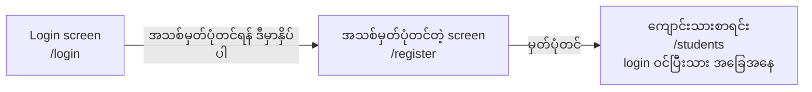
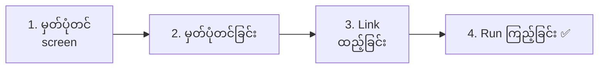
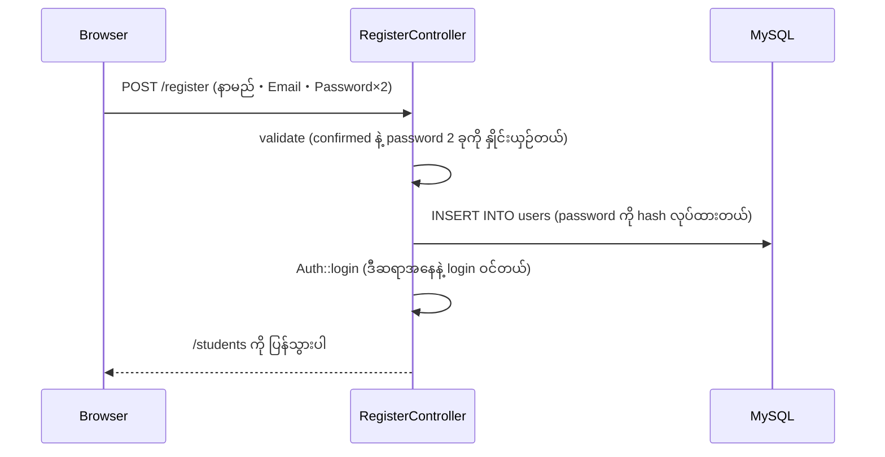

# ကျောင်းသားစီမံခန့်ခွဲမှု App ကို တည်ဆောက်ကြမယ် ⑤ — ဆရာ အသစ်မှတ်ပုံတင်ခြင်း

> 🇯🇵 မူရင်း (ဂျပန်ဘာသာဖြင့်): [20261210_資料_1.md](<../../../1年生_データ設計とアプリ開発/後期/20261210/20261210_資料_1.md>) <!-- original-ja-link -->

အခုအချိန်မှာ ဆရာတွေကို **Seeder နဲ့ပဲ မှတ်ပုံတင်လို့ရပါတယ်**။ ဆရာအသစ် ရောက်လာတိုင်း program ကို ပြင်ရေးနေရတာ အရမ်းခက်ပါတယ်။
ဒီနေ့မှာတော့ screen ကနေ **ဆရာရဲ့ account ကို ဖန်တီးလို့ရ** (အသစ်မှတ်ပုံတင်) အောင် လုပ်ပါမယ်။

## ဒီနေ့ရဲ့ ပန်းတိုင်
- အသစ်မှတ်ပုံတင်တဲ့ screen ကို ဖန်တီးပြီး ဆရာကို `users` table ထဲ သိမ်းနိုင်ရမယ်
- Password ရဲ့ "အတည်ပြု ထပ်ရိုက်ထည့်ခြင်း" ကို validation (`confirmed`) နဲ့ စစ်ဆေးနိုင်ရမယ်
- မှတ်ပုံတင်ပြီးတာနဲ့ login ဝင်ပြီးသား အခြေအနေ ဖြစ်အောင် လုပ်နိုင်ရမယ် (`Auth::login`)

> 12/3 ရဲ့ "Relation" အထိ ပြီးထားတဲ့ အခြေအနေကနေ စတင်ပါမယ်။

---

## 1. ဒီနေ့ ဖန်တီးမယ့်အရာ



```
新規登録

名前：             [ 鈴木先生            ]
メールアドレス：   [ suzuki@example.com  ]
パスワード：       [ ●●●●●●●●            ]
パスワード（確認）：[ ●●●●●●●●            ]

[登録]
```

### Login နဲ့ ကွာခြားချက်

11/26 ရဲ့ login နဲ့ ပုံစံက အတော်လေး တူပါတယ်။

| | Login (11/26) | အသစ်မှတ်ပုံတင်ခြင်း (ဒီနေ့) |
|---|---|---|
| URL | `/login` | `/register` |
| လုပ်တဲ့အရာ | `users` ထဲမှာ ရှိတဲ့ ဆရာ ဟုတ်မဟုတ် **စစ်ဆေးတယ်** | `users` ထဲကို ဆရာအသစ် **ထည့်တယ်** |
| ထည့်ရမယ့် field | Email လိပ်စာ・Password | နာမည်・Email လိပ်စာ・Password・**Password (အတည်ပြု)** |
| နောက်ဆုံးမှာ | `Auth::attempt()` နဲ့ login ဝင်တယ် | `Auth::login()` နဲ့ login ဝင်တယ် |

> **ဒုတိယနှစ်မှာတော့** ဒီအသစ်မှတ်ပုံတင်ခြင်းကိုလည်း API (`POST /api/register`) အဖြစ် ပြောင်းရေးပါမယ်။
> စစ်ဆေးတဲ့ စည်းမျဉ်း (validation) တွေကိုတော့ ဒုတိယနှစ်မှာလည်း ဒီအတိုင်းပဲ သုံးပါမယ်။

---

## 2. လက်တွေ့ ဖန်တီးကြည့်ကြမယ်



ပြင်ရမယ့် file တွေက အောက်ပါအတိုင်း ဖြစ်ပါတယ် (`src` ထဲမှာ)။

```
src/
├─ app/Http/Controllers/
│   └─ RegisterController.php ·········· 1・2. အသစ်မှတ်ပုံတင်ခြင်း (အသစ်ဖန်တီးမယ်)
├─ resources/views/
│   ├─ register.blade.php ·············· 1. အသစ်မှတ်ပုံတင်တဲ့ screen (အသစ်ဖန်တီးမယ်)
│   ├─ login.blade.php ················· 3. အသစ်မှတ်ပုံတင်ရန် link
│   └─ layouts/header.blade.php ········ 3. အသစ်မှတ်ပုံတင်ရန် link
└─ routes/web.php ······················ 1・2. Route
```

---

### 1. အသစ်မှတ်ပုံတင်တဲ့ screen ကို ဖန်တီးခြင်း

> အခု ဒီနေရာ: **🟢 1. မှတ်ပုံတင် screen** → 2. မှတ်ပုံတင်ခြင်း → 3. Link → 4. Run ကြည့်ခြင်း

#### ① Controller ကို ဖန်တီးမယ်

```powershell
docker compose exec laravel php artisan make:controller RegisterController
```

`app/Http/Controllers/RegisterController.php` ကို အောက်ပါအတိုင်း ရေးပါ။

```php
<?php

namespace App\Http\Controllers;

use App\Models\User;
use Illuminate\Http\Request;
use Illuminate\Support\Facades\Auth;

class RegisterController extends Controller
{
    // အသစ်မှတ်ပုံတင်တဲ့ screen ကို ပြမယ်
    public function showForm()
    {
        return view('register');
    }
}
```

#### ② View ကို ဖန်တီးမယ်

`resources/views/register.blade.php` ကို ဖန်တီးပါ။

```html
@include('layouts.header', ['title' => '新規登録'])

    <h1>新規登録</h1>

    <form method="POST" action="/register">
        @csrf

        <p>
            名前：
            <input type="text" name="name" value="{{ old('name') }}" required>
            @error('name') <span style="color: red;">{{ $message }}</span> @enderror
        </p>

        <p>
            メールアドレス：
            <input type="email" name="email" value="{{ old('email') }}" required>
            @error('email') <span style="color: red;">{{ $message }}</span> @enderror
        </p>

        <p>
            パスワード（8文字以上）：
            <input type="password" name="password" required>
            @error('password') <span style="color: red;">{{ $message }}</span> @enderror
        </p>

        <p>
            パスワード（確認）：
            <input type="password" name="password_confirmation" required>
        </p>

        <button type="submit">登録</button>
    </form>

    <a href="/login">ログインはこちら</a>

@include('layouts.footer')
```

| Code | အဓိပ္ပာယ် |
|--------|------|
| `name="password"` | Password |
| `name="password_confirmation"` | Password ကို **အတည်ပြုဖို့ ထပ်ရိုက်ထည့်တာ**။ နာမည်ကို `password` ရဲ့ နောက်မှာ `_confirmation` တွဲပေးရတာက **စည်းမျဉ်း** ပါ |

> **ဘာလို့ password ကို 2 ခါ ရိုက်ထည့်ရတာလဲ?**
> Password က `●●●` လို့ ပြတဲ့အတွက် ရိုက်မှားသွားရင်တောင် သတိမထားမိနိုင်ပါဘူး။
> 2 ခါ ရိုက်ထည့်ခိုင်းပြီး **တူမတူ** နှိုင်းယှဉ်ကြည့်ရင် ရိုက်မှားတာကို သိနိုင်ပါတယ်။

#### ③ Route ကို ရေးမယ်

`routes/web.php` ထဲမှာ ★ အပိုင်းကို ထပ်ရေးပါ။

```php
use App\Http\Controllers\RegisterController;  // ★ ထပ်ထည့် (အပေါ်ပိုင်းမှာ ရေးပါ)

Route::get('/register', [RegisterController::class, 'showForm']);  // ★ ထပ်ထည့်
```

✅ **စစ်ဆေးရန်**: http://localhost:8000/register ကို ဖွင့်ပြီး အသစ်မှတ်ပုံတင်တဲ့ screen ပေါ်လာရင် OK ပါ။

---

### 2. မှတ်ပုံတင်လို့ရအောင် လုပ်ခြင်း

> အခု ဒီနေရာ: 1. မှတ်ပုံတင် screen → **🟢 2. မှတ်ပုံတင်ခြင်း** → 3. Link → 4. Run ကြည့်ခြင်း

#### ① register method ကို ရေးမယ်

`RegisterController.php` ထဲမှာ ★ `register` ကို ထပ်ရေးပါ။

```php
    // ★ ဒီကနေ ထပ်ထည့်
    public function register(Request $request)
    {
        // ① ထည့်လိုက်တဲ့ data ကို စစ်ဆေးမယ်
        $request->validate([
            'name' => 'required|string|max:255',
            'email' => 'required|email|unique:users,email',
            'password' => 'required|min:8|confirmed',
        ], [
            'name.required' => '名前を入力してください。',
            'name.max' => '名前は255文字以内で入力してください。',
            'email.required' => 'メールアドレスを入力してください。',
            'email.email' => 'メールアドレスの形で入力してください。',
            'email.unique' => 'そのメールアドレスは、すでに登録されています。',
            'password.required' => 'パスワードを入力してください。',
            'password.min' => 'パスワードは8文字以上で入力してください。',
            'password.confirmed' => 'パスワード（確認）が一致しません。',
        ]);

        // ② ဆရာကို သိမ်းမယ်
        $user = new User();
        $user->name = $request->input('name');
        $user->email = $request->input('email');
        $user->password = $request->input('password');  // သိမ်းတဲ့အခါ အလိုအလျောက် hash လုပ်ပေးတယ်
        $user->save();

        // ③ ဒီအတိုင်း login ဝင်စေမယ်
        Auth::login($user);
        $request->session()->regenerate();

        // ④ ကျောင်းသားစာရင်းဆီ သွားမယ်
        return redirect('/students');
    }
    // ★ ဒီအထိ
```

အသစ်တွေ့ရတဲ့ အရာတွေပါ။

| Code | အဓိပ္ပာယ် |
|--------|------|
| `string` | စာသား ဖြစ်ရမယ် |
| `unique:users,email` | `users` table ရဲ့ `email` column ထဲမှာ တူညီတဲ့ တန်ဖိုး မရှိရဘူး (Email လိပ်စာ တစ်ခုတည်းနဲ့ 2 ခါ မှတ်ပုံတင်လို့ မရဘူး) |
| `min:8` | စာလုံး 8 လုံးနဲ့အထက် (`integer` မပါတဲ့အတွက် **စာလုံးအရေအတွက်** နဲ့ စစ်တယ်) |
| `confirmed` | `password` နဲ့ `password_confirmation` က **တူလား** |
| `Auth::login($user)` | Password ကို မစစ်ဘဲ **ဒီဆရာအနေနဲ့ login ဝင်စေတယ်** |

> **`Auth::attempt` နဲ့ `Auth::login` ရဲ့ ကွာခြားချက်**
>
> | | `Auth::attempt($credentials)` (11/26) | `Auth::login($user)` (ဒီနေ့) |
> |---|---|---|
> | Password ကို | စစ်တယ် | မစစ်ဘူး |
> | သုံးတဲ့ အခြေအနေ | Login screen (အသုံးပြုသူက အကောင့်ပိုင်ရှင် ဟုတ်မဟုတ် မသိသေး) | အသစ်မှတ်ပုံတင်ပြီးချိန် (အခုမှ မှတ်ပုံတင်လိုက်သူ ဖြစ်ကြောင်း သိပြီးသား) |
>
> မှတ်ပုံတင်ပြီးတာနဲ့ Login screen မှာ password ကို နောက်တစ်ခါ ပြန်ရိုက်ခိုင်းရတာ အလုပ်ရှုပ်တယ် မဟုတ်လား။
> အခုမှ မှတ်ပုံတင်လိုက်သူ ကိုယ်တိုင်ဖြစ်လို့ တစ်ခါတည်း login ဝင်စေပါတယ်။

> **Password ကို ဒီအတိုင်း ထည့်လိုက်လို့ ရလား?**
> 11/26 မှာ သင်ခဲ့သလိုပဲ `User` model ရဲ့ `'password' => 'hashed'` ကြောင့် **သိမ်းတဲ့အခါ အလိုအလျောက် hash လုပ်ပေး** ပါတယ်။
> ဒုတိယနှစ် သင်ခန်းစာမှာတော့ `Hash::make(...)` နဲ့ ကိုယ်တိုင် hash လုပ်ထားပေမဲ့ Laravel က "hash လုပ်ပြီးသား တန်ဖိုး" ကို ထပ်ပြီး hash မလုပ်တဲ့အတွက် ဘယ်လိုရေးရေး မှန်မှန်ကန်ကန် အလုပ်လုပ်ပါတယ်။

#### ② Route ကို ထပ်ရေးမယ်

```php
Route::get('/register', [RegisterController::class, 'showForm']);
Route::post('/register', [RegisterController::class, 'register']);  // ★ ထပ်ထည့်
```



---

### 3. အသစ်မှတ်ပုံတင်ရန် link ကို ထည့်ခြင်း

> အခု ဒီနေရာ: 1. မှတ်ပုံတင် screen → 2. မှတ်ပုံတင်ခြင်း → **🟢 3. Link** → 4. Run ကြည့်ခြင်း

#### ① Login screen မှာ

`resources/views/login.blade.php` ရဲ့ `</form>` အောက်မှာ ★ စာကြောင်း 1 ကြောင်းကို ထပ်ရေးပါ။

```html
        <button type="submit">ログイン</button>
    </form>

    <a href="/register">新規登録はこちら</a>  {{-- ★ ထပ်ထည့် --}}
```

#### ② Header မှာ

`resources/views/layouts/header.blade.php` ရဲ့ `@guest` ထဲမှာ ★ စာကြောင်း 1 ကြောင်းကို ထပ်ရေးပါ။

```html
        @guest
            <a href="/login">ログイン</a>
            <a href="/register">新規登録</a>  {{-- ★ ထပ်ထည့် --}}
        @endguest
```

Login မဝင်ထားတဲ့အချိန်မှာပဲ header မှာ「新規登録」(အသစ်မှတ်ပုံတင်) ပေါ်ပါမယ်။

---

### 4. Run ကြည့်ခြင်း ✅

> အခု ဒီနေရာ: 1. မှတ်ပုံတင် screen → 2. မှတ်ပုံတင်ခြင်း → 3. Link → **🟢 4. Run ကြည့်ခြင်း**

Logout လုပ်ပြီးမှ အောက်ပါ အစီအစဉ်အတိုင်း စမ်းကြည့်ပါ။

| | လုပ်ရမယ့်အရာ | ဒီလိုဖြစ်ရင် OK |
|---|---|---|
| ① | အသစ်မှတ်ပုံတင်ခြင်းမှာ နာမည်「鈴木先生」・Email လိပ်စာ `suzuki@example.com`・Password `password123` (2 ခါလုံး အတူတူ) နဲ့ မှတ်ပုံတင်မယ် | ကျောင်းသားစာရင်းဆီ ရောက်သွားပြီး header မှာ「鈴木先生 さん」လို့ ပေါ်တယ် |
| ② | ကျောင်းသားစာရင်းကို ကြည့်မယ် | **ကျောင်းသား 0 ယောက်** (ဆရာ Suzuki က ဘယ်သူ့ကိုမှ မှတ်ပုံမတင်ရသေးလို့ပါ။ 12/3 ရဲ့ relation ကြောင့်ပါ) |
| ③ | phpMyAdmin မှာ `users` table ကို ကြည့်မယ် | ဆရာ Suzuki ရှိနေပြီး `password` ကို hash (`$2y$12$...`) လုပ်ထားတယ် |
| ④ | Logout လုပ်ပြီး ဆရာ Suzuki ရဲ့ Email လိပ်စာနဲ့ password နဲ့ login ဝင်မယ် | Login ဝင်လို့ရတယ် |
| ⑤ | `suzuki@example.com` နဲ့ နောက်တစ်ခါ အသစ်မှတ်ပုံတင်မယ် | 「そのメールアドレスは、すでに登録されています。」(ဒီ Email လိပ်စာက မှတ်ပုံတင်ပြီးသား ဖြစ်ပါတယ်။) လို့ ပေါ်တယ် |
| ⑥ | Password နဲ့ အတည်ပြု field မှာ မတူတာတွေ ထည့်ပြီး မှတ်ပုံတင်မယ် | 「パスワード（確認）が一致しません。」(Password (အတည်ပြု) မကိုက်ညီပါ။) လို့ ပေါ်တယ် |
| ⑦ | Password ကို `abc` လို့ ထားပြီး မှတ်ပုံတင်မယ် | 「パスワードは8文字以上で入力してください。」(Password ကို စာလုံး 8 လုံးနဲ့အထက် ထည့်ပါ။) လို့ ပေါ်တယ် |

---

## 3. Route အနှစ်ချုပ်

Login・အသစ်မှတ်ပုံတင်ခြင်းနဲ့ ဆိုင်တဲ့ route တွေက အောက်ပါအတိုင်း ဖြစ်သွားပါပြီ။

```php
// Login・Logout
Route::get('/login', [LoginController::class, 'showForm'])->name('login');
Route::post('/login', [LoginController::class, 'login']);
Route::post('/logout', [LoginController::class, 'logout']);

// အသစ်မှတ်ပုံတင်ခြင်း
Route::get('/register', [RegisterController::class, 'showForm']);
Route::post('/register', [RegisterController::class, 'register']);
```

အသစ်မှတ်ပုံတင်တဲ့ route ကို `Route::middleware('auth')` ရဲ့ **အပြင်ဘက်** မှာ ရေးပါ။
Account မရှိသေးတဲ့ (login ဝင်လို့မရသေးတဲ့) သူတွေ သုံးမယ့် page ဖြစ်လို့ပါ။

---

## 4. အဆင်မပြေတဲ့အခါ

> **🔥 အလုပ်မလုပ်ရင် log ထုတ်ကြည့်ပါ!** → [【အရေးကြီး】Log ထုတ်နည်း](../20261022/【重要】ログの出し方.md)

| ဖြစ်နေတဲ့ ပြဿနာ | အကြောင်းရင်း ရှိတဲ့နေရာ | ဖြေရှင်းနည်း |
|------|----------|------|
| Password တူတူ ထည့်ထားပေမဲ့「一致しません」(မကိုက်ညီပါ) လို့ ပေါ်တယ် | View | အတည်ပြု field ရဲ့ နာမည်က `password_confirmation` ဖြစ်နေလား စစ်ပါ (စာလုံးပေါင်း တစ်လုံးမှားရင်တောင် နှိုင်းယှဉ်လို့ မရပါဘူး) |
| အသစ်မှတ်ပုံတင်တဲ့ screen ကို ဖွင့်ရင် Login screen ကို ရောက်သွားတယ် | Route | `/register` route က `Route::middleware('auth')` ရဲ့ `{ }` **အပြင်ဘက်** မှာ ရှိလား စစ်ပါ |
| မှတ်ပုံတင်ပြီးပေမဲ့ login ဝင်ပြီးသား အခြေအနေ မဖြစ်ဘူး | Controller | `Auth::login($user);` ကို ရေးထားလား စစ်ပါ |
| မှတ်ပုံတင်ထားတဲ့ ဆရာနဲ့ login ဝင်လို့ မရဘူး | Data | phpMyAdmin မှာ `password` ကို hash လုပ်ထားလား စစ်ပါ။ `User.php` ရဲ့ `'password' => 'hashed'` ကို ဖျက်မိထားလား စစ်ပါ |
| `Class "App\Http\Controllers\User" not found` | Controller | `RegisterController.php` ရဲ့ အပေါ်ပိုင်းမှာ `use App\Models\User;` ရှိလား စစ်ပါ |
| `Target class [RegisterController] does not exist.` | Route | `web.php` ရဲ့ အပေါ်ပိုင်းမှာ `use App\Http\Controllers\RegisterController;` ရှိလား စစ်ပါ |

---

## 5. အနှစ်ချုပ်

| ဒီနေ့ ရေးခဲ့တာ | တစ်ခွန်းတည်းနဲ့ ပြောရရင် |
|--------------|-----------|
| `name="password_confirmation"` | Password အတည်ပြု ထပ်ရိုက်ထည့်ခြင်း။ နာမည်က စည်းမျဉ်းအတိုင်း ပေးရတယ် |
| `confirmed` | `password` နဲ့ `password_confirmation` တူမတူ စစ်တယ် |
| `unique:users,email` | Email လိပ်စာ တူတဲ့ ဆရာကို 2 ယောက် မှတ်ပုံတင်လို့ မရဘူး |
| `min:8` | Password က စာလုံး 8 လုံးနဲ့အထက် |
| `new User()` → `save()` | ဆရာကို သိမ်းတယ် (password ကို အလိုအလျောက် hash လုပ်ပေးတယ်) |
| `Auth::login($user)` | Password ကို မစစ်ဘဲ အဲ့ဒီဆရာအနေနဲ့ login ဝင်စေတယ် |

**အသစ်မှတ်ပုံတင်ခြင်းဆိုတာ "user ကို ထည့်ပြီး တစ်ခါတည်း login ဝင်စေတာ" ဖြစ်ပါတယ်။ Login ဆိုတာက "အသုံးပြုသူဟာ အကောင့်ပိုင်ရှင် ဟုတ်မဟုတ် စစ်ပြီး login ဝင်စေတာ" ဖြစ်ပါတယ်။**

ဒါဆိုရင် ဆရာတွေက ကိုယ်တိုင် account ဖန်တီးပြီး ကိုယ့်ကျောင်းသားတွေကို စီမံခန့်ခွဲနိုင်တဲ့ App ဖြစ်သွားပါပြီ။

<!-- nav:start -->

---

| ⬅️ ယခင် | 🗺️ ခြုံငုံပုံ | နောက်တစ်ခု ➡️ |
|:--|:--:|--:|
| [12/03 ကျောင်းသားစီမံခန့်ခွဲမှု ④ Relation](../20261203/20261203_資料_1.md) | [သင်ခန်းစာများ၏ ခြုံငုံပုံ](../../README.md) | — |

<!-- nav:end -->
