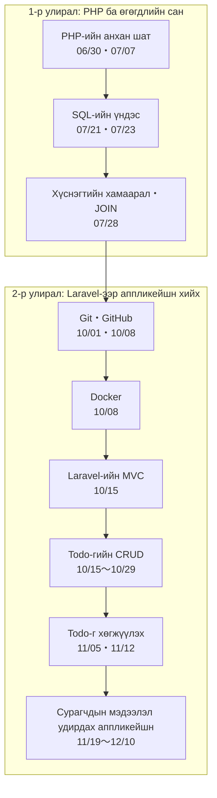

# 1-р курс｜Өгөгдлийн загварчлал ба аппликейшн хөгжүүлэлт — Материалын ерөнхий зураг

> 🇯🇵 Эх хувь (япон хэлээр): [README.md](<../1年生_データ設計とアプリ開発/README.md>) <!-- original-ja-link -->

Энэ хичээлийг **PHP-ээр ажилладаг хуудас хийх → өгөгдлийн санд өгөгдөл хадгалах → Laravel-ээр аппликейшн хийх** гэсэн дарааллаар үзнэ.

Аль ч материалын **хуудасны хамгийн доод хэсэгт байгаа холбоосоор** өмнөх, дараагийн материал эсвэл энэ хуудас руу шилжиж болно.
Төөрвөл энэ хуудас руугаа буцаж ирээрэй.

## Ерөнхий урсгал

Асуудал гарсан үед харах хуудас

| Ийм үед | Харах хуудас |
|:--|:--|
| Командаа мартсан | [Чухал командуудын жагсаалт](後期/重要コマンド一覧.md) |
| Laravel санасан шигээ ажиллахгүй байна | [【Чухал】Лог хэрхэн гаргах вэ](後期/20261022/【重要】ログの出し方.md) |
| 1-р улирлын PHP・MySQL-ийг хэрхэн ажиллуулахаа мартсан | [Todo удирдах аппыг ажиллуулах дараалал](前期/20260723/Todo管理アプリ起動する流れ.md) |

---

## 1-р улирал: PHP ба өгөгдлийн сан

| Огноо | Материал | Дасгал・Хариу | Нэмэлт |
|:--|:--|:--|:--|
| 06/30 | [PHP-ийн анхан шат](前期/20260630/20260630_資料.md) | [Дасгал](前期/20260630/20260630_演習.md)・[Хариу](前期/20260630/20260630_解答.md) | [PHP хөгжүүлэлтийн серверийг хэрхэн асаах](前期/PHP開発サーバーの立て方.md) |
| 07/07 | [PHP-ийн үндэс ба форм](前期/20260707/20260707_資料.md) | [Дасгал](前期/20260707/20260707_演習.md)・[Хариу](前期/20260707/20260707_解答.md) | |
| 07/14 | [Дасгалын бодлого](前期/20260714/20260714_資料_1.md) | | |
| 07/21 | [Яагаад DB хэрэгтэй вэ](前期/20260721/20260721_資料.md) [SQL-ийн үндэс ① (SELECT)](前期/20260721/20260721_資料_2.md) | [Дасгал](前期/20260721/20260721_演習.md)・[Хариу](前期/20260721/20260721_解答.md) | [Өгөгдлийн сангийн серверийг хэрхэн асаах (XAMPP)](前期/データベースサーバーの立て方/データベースサーバーの立て方.md) [Харилцаат өгөгдлийн сангийн анхан шат](前期/20260721/リレーショナルデータベース入門.md) |
| 07/23 | [SQL-ийн үндэс ② (INSERT・UPDATE・DELETE)](前期/20260723/20260723_資料.md) | [Дасгал](前期/20260723/20260723_演習.md)・[Хариу](前期/20260723/20260723_解答.md) | [Todo удирдах аппыг ажиллуулах дараалал](前期/20260723/Todo管理アプリ起動する流れ.md) [PDO MySQL холболтын алдааг засах арга](前期/20260723/PDO_MySQL接続エラー対処法.md) |
| 07/28 | [Хүснэгтийн харилцаа・JOIN](前期/20260728/20260728_資料.md) | [Дасгал](前期/20260728/20260728_演習.md)・[Хариу](前期/20260728/20260728_解答.md) | [JOIN-ийн анхан шат](前期/20260728/JOIN入門.md) |

## 2-р улирал: Laravel-ээр аппликейшн хийх

| Огноо | Материал | Нэмэлт |
|:--|:--|:--|
| 10/01 | [Өмнөх улирлын давталт](後期/20261001/20261001_復習.md) [Эх кодын удирдлагын анхан шат](後期/20261001/20261001_資料_1.md) | |
| 10/08 | [GitHub бүртгэл болон repository](後期/20261008/20261008_資料_1.md) [Дадлагын орчноо push хийх](後期/20261008/20261008_資料_2.md) [Docker-ийн анхан шат](後期/20261008/20261008_資料_3.md) | |
| 10/15 | [MVC-ийн бүтэц](後期/20261015/20261015_資料_1.md) [Todo жагсаалт](後期/20261015/20261015_資料_2.md) | |
| 10/22 | [Todo нэмэх (CREATE)](後期/20261022/20261022_資料_1.md) [Todo-гийн дэлгэрэнгүй (SHOW)](後期/20261022/20261022_資料_2.md) | [【Чухал】Лог хэрхэн гаргах вэ](後期/20261022/【重要】ログの出し方.md) |
| 10/29 | [Todo засах (UPDATE)](後期/20261029/20261029_資料_1.md) [Дууссан төлөвийг солих (PATCH)](後期/20261029/20261029_資料_2.md) [Todo устгах (DELETE)](後期/20261029/20261029_資料_3.md) | |
| 11/05 | [Seeder・Factory](後期/20261105/20261105_資料_1.md) [Баталгаажуулалт](後期/20261105/20261105_資料_2.md) | |
| 11/12 | [Нийтлэг хэсгийг эд анги болгох (@include)](後期/20261112/20261112_資料_1.md) [Ангилал нэмэх](後期/20261112/20261112_資料_2.md) | |
| 11/19 | [Сурагчийн бүртгэл ① Жагсаалт, дэлгэрэнгүй](後期/20261119/20261119_資料_1.md) [Сурагчийн бүртгэл ② Нэмэх, засах, устгах](後期/20261119/20261119_資料_2.md) | |
| 11/26 | [Сурагчийн бүртгэл ③ Нэвтрэлт](後期/20261126/20261126_資料_1.md) | |
| 12/03 | [Сурагчийн бүртгэл ④ Холбоос (relation)](後期/20261203/20261203_資料_1.md) | |
| 12/10 | [Сурагчийн бүртгэл ⑤ Багшийн шинэ бүртгэл](後期/20261210/20261210_資料_1.md) | |

Хэзээ ч ашиглаж болох хуудас: [Чухал командуудын жагсаалт](後期/重要コマンド一覧.md)
