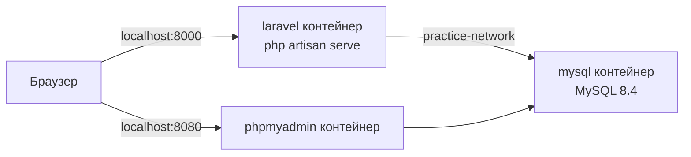
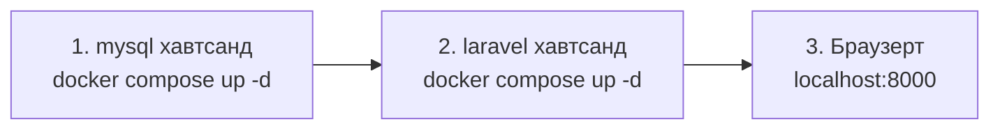

# Laravel × MySQL дасгалын орчин（Docker）

> 🇯🇵 Эх хувь (япон хэлээр): [README.md](<../../1年生_データ設計とアプリ開発/practice/README.md>) <!-- original-ja-link -->

Laravel болон MySQL-ийг **тусдаа контейнер** болгон ажиллуулна.
Хоёр контейнер `practice-network` гэдэг сүлжээгээр холбогдсон байна.



```
practice/
  mysql/
    compose.yaml    ← MySQL ба phpMyAdmin
  laravel/
    compose.yaml    ← Laravel
    Dockerfile
    entrypoint.sh
    src/            ← Анх ажиллуулахад Laravel автоматаар үүснэ
```

> Docker Desktop-ийг асааж, зүүн доод буланд **Engine running** гэж гарсныг шалгасны дараа эхэлнэ.
> Docker Desktop суулгах арга → [Docker Desktop суулгах](../後期/20261008/20261008_資料.md)

> **XAMPP-ийг зогсооно**
> XAMPP ашиглаж байгаа бол XAMPP Control Panel-ийг нээгээд, ажиллаж байгаа бүх зүйлийг（Apache・MySQL гэх мэт）**Stop** хийсний дараа эхэлнэ.
> XAMPP-ийн MySQL ажиллаж байвал ижил `3306` портыг ашигладаг тул MySQL контейнер асахгүй.

---

## 1. Хадгалах байршил

C диск дээр `git` нэртэй хавтас үүсгээд, төсөл бүрээ түүн дотор хийнэ.

```
C:\git\practice
```

Ширээний дэлгэц дээр хадгалсан ч болно.

> **Хаана хадгалснаа санаж байгаарай**
> Асаах, зогсоох болгондоо тэр хавтас руу `cd`-ээр шилжинэ. Хадгалсан байршлаа мартвал үйлдэл хийх боломжгүй болно.

> **OneDrive дотор хадгалахаас зайлсхий**
> `C:\Users\<хэрэглэгчийн нэр>\OneDrive\...` дотор хадгалвал синхрончлолтой давхцаж удаашрах, эсвэл алдаа гарах магадлалтай.
> Зарим компьютерт Desktop нь OneDrive дотор байдаг тул эргэлзвэл `C:\git`-д хадгална.

---

## 2. Асаах（дараалал чухал）

**Заавал mysql → laravel гэсэн дарааллаар** асаана.
Учир нь `practice-network` сүлжээ mysql талд үүсдэг.



PowerShell дээр ажиллуулна.（`C:\git\practice`-ээс өөр газар хадгалсан бол команд дахь замыг хадгалсан байршлаараа солино）

```powershell
cd C:\git\practice\mysql
docker compose up -d
```

```powershell
cd C:\git\practice\laravel
docker compose up -d
```

**Зөвхөн анх удаа** Laravel суулгахад хэдэн минут зарцуулна. Явцыг дараах командаар харж болно（харахаа болихдоо `Ctrl + C`）.

```powershell
docker compose logs -f
```

`Server running on [http://0.0.0.0:8000]` гэж гарвал бэлэн боллоо.

| Нээх URL | Харагдах зүйл |
|---------|--------------|
| http://localhost:8000 | Laravel-ийн нүүр хуудас ✅ |
| http://localhost:8080 | phpMyAdmin（`laravel` өгөгдлийн санд хүснэгтүүд үүссэн байна ✅） |

---

## 3. Зогсоох

Асаасан дарааллын **эсрэг дарааллаар**（laravel → mysql）зогсооно.

```powershell
cd C:\git\practice\laravel
docker compose down
```

```powershell
cd C:\git\practice\mysql
docker compose down
```

`down` хийсэн ч өгөгдлийн сангийн агуулга устахгүй（`mysql-data` volume-д хадгалагдсан хэвээр байна）.

---

## 4. Холболтын мэдээлэл

| Зүйл | Laravel-ээс | Компьютерээс（A5:SQL Mk-2 гэх мэт） |
|------|-------------|--------------------------|
| Хост | `mysql` | `127.0.0.1` |
| Порт | `3306` | `3306` |
| Өгөгдлийн сан | `laravel` | `laravel` |
| Хэрэглэгчийн нэр | `laravel` | `laravel` |
| Нууц үг | `password` | `password` |

Компьютер талын порт нь XAMPP-ийн MySQL-тэй адил `3306`. Тиймээс XAMPP-ийн MySQL-ийг зогсооно.
Laravel-ийн тохиргоо `laravel/src/.env` файлд бичигдсэн байна.

---

## 5. artisan команд ашиглах

`php artisan`-ийг laravel контейнер дотор ажиллуулна. laravel хавтсанд дараах байдлаар бичнэ.

```powershell
docker compose exec laravel php artisan migrate
docker compose exec laravel php artisan make:controller TodoController
```

---

## 6. Ажиллахгүй байвал

| Шинж тэмдэг | Шийдэл |
|------|------|
| `network practice-network declared as external, but could not be found` | mysql-ийг түрүүлж асаагаагүй → mysql хавтсанд `docker compose up -d` |
| Лог дээр `MySQL の起動を待っています...`（MySQL асахыг хүлээж байна...）гэж үргэлжилсээр байна | mysql контейнер ажиллаж байгаа эсэхийг Docker Desktop-ийн `Containers` хэсгээс шалгана |
| `port is already allocated`（порт ашиглагдаж байна） | XAMPP Control Panel дээр MySQL зэргийг Stop хийнэ. `php -S` гэх мэт ижил порт ашигладаг зүйлсийг ч зогсооно |
| Анхны суулгалт дундаа амжилтгүй болсон | laravel хавтсанд `docker compose down` → `src` хавтсыг устгах → дахин `docker compose up -d` |
| Өгөгдлийн санг эхнээс нь дахин эхлүүлмээр байна | mysql хавтсанд `docker compose down -v`（**Бүх өгөгдөл устна**） |
