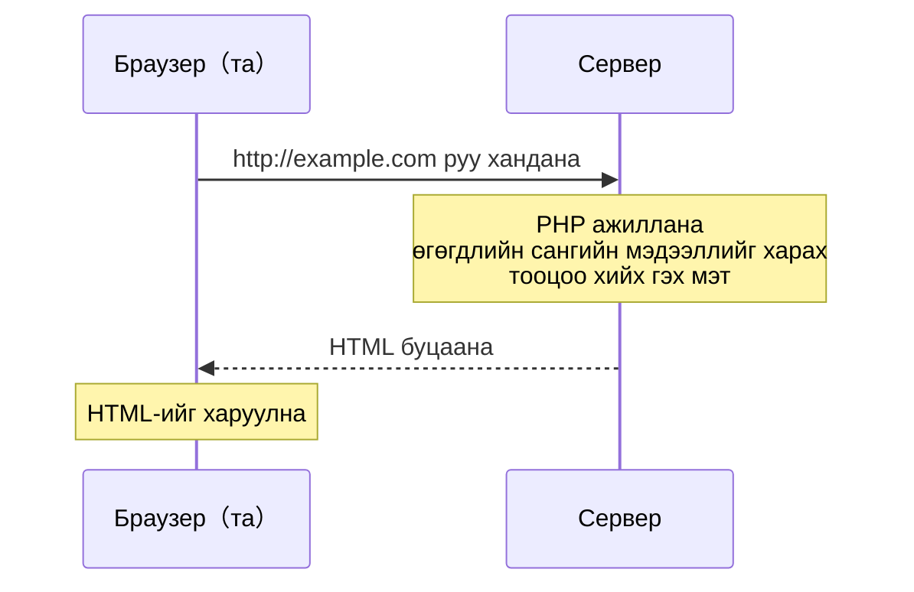

# 1-р курс｜Өгөгдлийн загварчлал ба аппликейшн хөгжүүлэлт — 2026/06/30

> 🇯🇵 Эх хувь (япон хэлээр): [20260630_資料.md](<../../../1年生_データ設計とアプリ開発/前期/20260630/20260630_資料.md>) <!-- original-ja-link -->

---

## Энэ хичээлийн үнэлгээний тухай

| Үзүүлэлт | Хувь |
| --- | --- |
| Ирц | 30% |
| Хичээл дээрх хандлага | 10% |
| Даалгавар | 60% |

> ⚠️ **Чухал: Ирц 60%-иас доош байвал даалгавар болон хандлагын үнэлгээнээс үл хамааран кредит авах боломжгүй.**\
> Хоцорсон эсвэл эрт явсныг хичээлийн багш тасалсанд тооцож магадгүй. Заавал цагтаа ирээрэй.

---

## Өнөөдрийн зорилго

- Сервер тал ба клиент талын ялгааг тайлбарлаж чаддаг болох
- PHP ажиллах орчныг бэлдэж чаддаг болох
- Анхны PHP файлаа ажиллуулж чаддаг болох

---

## 1. Клиент тал ба сервер талын ялгаа

```
Клиент тал（1-р улиралд үзсэн зүйл）
  Браузер дээр ажилладаг → HTML / CSS / JavaScript
  Хэрэглэгчийн төхөөрөмж дээр ажилладаг

Сервер тал（энэ улирлаас үзэх зүйл）
  Сервер дээр ажилладаг → PHP / Python / Ruby / Go гэх мэт
  Сервер дээр ажилласны дараа үр дүн нь браузерт илгээгддэг
```

**Яагаад сервер тал хэрэгтэй вэ?**

| Хийхийг хүссэн зүйл | Зөвхөн клиент | Сервер хэрэгтэй эсэх |
| --- | --- | --- |
| Текст харуулах | ✅ Болно | — |
| Өгөгдлийн сангаас унших | ❌ Болохгүй | ✅ Хэрэгтэй |
| Нууц үгийг аюулгүй хадгалах | ❌ Аюултай | ✅ Хэрэгтэй |
| Нэвтрэх функц | ❌ Болохгүй | ✅ Хэрэгтэй |

---

## 2. PHP гэж юу вэ

**PHP = сервер талын програмчлалын хэл. Веб аппликейшн хөгжүүлэхэд зориулагдсан.**

Браузер ба серверийн хоорондын харилцаа дараах байдлаар явагдана.



**JavaScript-тэй харьцуулж үзье:**

| Үзүүлэлт | JavaScript | PHP |
| --- | --- | --- |
| Ажиллах газар | Браузер | Сервер |
| Хувьсагч бичих арга | `let x = 5;` | `$x = 5;` |
| Тэмдэгт мөр залгах | `"Hello" + "World"` | `"Hello" . "World"` |
| Массив | `let arr = [1, 2, 3]` | `$arr = [1, 2, 3]` |
| Гаргах | `console.log()` | `echo` |

---

## 3. Орчин бэлдэх: PHP суулгах

### Mac бол（Homebrew ашиглана）

Homebrew суулгаагүй бол [brew.sh](https://brew.sh)-ийн зааврын дагуу эхлээд суулгаарай.

```bash
brew install php
```

### Windows бол

1. [windows.php.net/download](https://windows.php.net/download/) руу орно
2. 「VS16 x64 Non Thread Safe」-ийн ZIP файлыг татаж авна
3. `C:\php` руу задална
4. PATH орчны хувьсагчид `C:\php`-ийг нэмнэ

### Ажиллаж байгааг шалгах

```bash
php --version
# → PHP 8.x.x ... гэж гарвал болсон
```

---

## 4. Анхны PHP файл

### Ажлын хавтас үүсгэх（хаана ч болно）

```
Mac:     ~/study/
Windows: C:\Users\хэрэглэгчийн_нэр\study\
```

### `index.php` үүсгэх

```php
<?php
// PHP код <?php-ээр эхэлдэг
// JS-ийн console.log-той дүйцэх нь echo

echo "こんにちは PHP！";

// Хувьсагч $ тэмдгээр эхэлдэг（JavaScript-ээс ялгарах томоохон онцлог）
$namae = "田中太郎";
$nenrei = 20;

// Тэмдэгт мөр дотор хувьсагч оруулах（зөвхөн давхар хашилтад）
echo "名前: $namae";
echo "年齢: {$nenrei}歳";  // Хувьсагчийг {} дотор бичвэл найдвартай

// JS-ийн template literal-тай дүйцнэ
// JS: `名前: ${namae}`
// PHP: "名前: {$namae}"
?>
```

**Локал серверийг асааж браузераар шалгах:**

```bash
# study хавтас руу шилжсэний дараа ажиллуулна
cd ~/study
php -S localhost:8000
```

`http://localhost:8000/index.php` руу хандана

---

## 5. PHP-ийн үндсэн синтакс（JS-тэй харьцуулбал）

```php
<?php
// ========== Хувьсагч ==========
$name = "Alice";      // JS-ийн let-тэй дүйцнэ（$ заавал хэрэгтэй）
$age = 20;
$pi = 3.14;
$isStudent = true;

// ========== Гаргах ==========
echo "Hello";          // Мөр шилжүүлэхгүйгээр гаргана
echo "World\n";        // \n-ээр мөр шилжүүлнэ
echo $name . "\n";     // Цэгээр тэмдэгт мөр залгана（JS-ийн +-тэй дүйцнэ）

// PHP таг ба HTML-ийг хольж бичиж болно（PHP-ийн онцлог）
?>
<h1>こんにちは、<?= $name ?>さん！</h1>
<!-- <?= нь echo-гийн товчилсон хэлбэр -->
<?php

// ========== Нөхцөлт салаалалт（JS-тэй адилхан） ==========
if ($age >= 18) {
    echo "成人です\n";
} else {
    echo "未成年です\n";
}

// ========== Давталт ==========
for ($i = 1; $i <= 5; $i++) {   // $i нь JS-ийн i-тэй адил
    echo $i . "回目\n";
}

// ========== Массив ==========
$fruits = ["りんご", "みかん", "ぶどう"];
echo $fruits[0] . "\n";  // → りんご

// Массивын давталт
foreach ($fruits as $fruit) {  // JS-ийн forEach-тэй дүйцнэ
    echo $fruit . "\n";
}
?>
```

---

## Дүгнэлт

| Ойлголт | JavaScript | PHP |
| --- | --- | --- |
| Хувьсагч | `let x` | `$x` |
| Гаргах | `console.log()` | `echo` |
| Тэмдэгт мөр залгах | `"a" + "b"` | `"a" . "b"` |
| Массивын давталт | `forEach` | `foreach` |
| Ажиллах газар | Браузер | Сервер |

---

## Дараагийн хичээлийн тойм

PHP-ийн хувьсагч, төрөл, оператор, массив, ассоциатив массивыг нарийн үзнэ.\
「JavaScript-тэй ижил ойлголтууд өөр бичиглэлтэйгээр гарч ирнэ」гэдгийг анхааран суралцаарай.

<!-- nav:start -->

---

📎 Хамт уншаарай → [PHP хөгжүүлэлтийн серверийг хэрхэн асаах](../PHP開発サーバーの立て方.md)

| ⬅️ Өмнөх | 🗺️ Ерөнхий зураг | Дараагийнх ➡️ |
|:--|:--:|--:|
| — | [Материалын ерөнхий зураг](../../README.md) | [06/30 Дасгал](20260630_演習.md) |

<!-- nav:end -->
