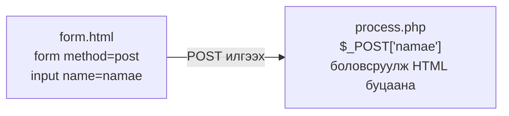
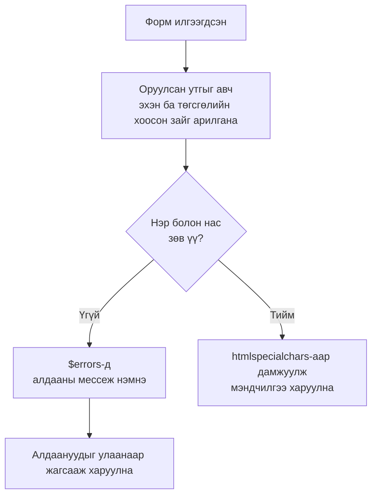

# 1-р курс｜Өгөгдлийн загварчлал ба аппликейшн хөгжүүлэлт — 2026/07/07

> 🇯🇵 Эх хувь (япон хэлээр): [20260707_資料.md](<../../../1年生_データ設計とアプリ開発/前期/20260707/20260707_資料.md>) <!-- original-ja-link -->

---

## Өнөөдрийн зорилго

- PHP-ийн хувьсагч, төрөл, массив, ассоциатив массивыг ашиглаж чаддаг болох
- Нөхцөлт салаалалт болон функц бичиж чаддаг болох
- HTML формын өгөгдлийг PHP-ээр хүлээн авч, аюулгүй боловсруулж чаддаг болох

---

## 1. Хувьсагч ба төрөл

```php
<?php
// Хувьсагч заавал $-ээр эхэлнэ
$namae    = "田中太郎";   // Тэмдэгт мөр（string）
$nenrei   = 20;           // Бүхэл тоо（int）
$身長     = 1.75;         // Бутархай тоо（float）
$isStudent = true;        // Логик утга（bool）

// gettype()-ээр төрлийг шалгана（JS-ийн typeof-той дүйцнэ）
echo gettype($namae);     // → string
echo gettype($nenrei);    // → integer

// Төрөл хөрвүүлэх
$str = "42";
$num = (int)$str;         // Тэмдэгт мөрийг бүхэл тоо болгоно
echo $num + 1;            // → 43
```

---

## 2. Тэмдэгт мөртэй ажиллах

```php
<?php
$namae = "田中太郎";

echo mb_strlen($namae);   // → 4（тэмдэгтийн тоо. mb_ функцууд япон хэлийг дэмждэг）

// Хувьсагчийг тэмдэгт мөрд оруулах
echo "名前: {$namae}さん";

// Түгээмэл ашиглагддаг тэмдэгт мөрийн функцууд
echo strtolower("HELLO");              // → hello
echo strtoupper("hello");              // → HELLO
echo trim("  hello  ");                // → hello（эхэн ба төгсгөлийн хоосон зайг арилгана）
echo str_replace("猫", "犬", "猫が好き"); // → 犬が好き
```

---

## 3. Массив

```php
<?php
$scores = [85, 72, 91, 68, 78];

echo $scores[0];          // → 85（0-ээс эхэлнэ）
echo count($scores);      // → 5（JS-ийн .length-тэй дүйцнэ）

$scores[] = 95;           // Төгсгөлд нэмнэ（JS-ийн push-тэй дүйцнэ）
sort($scores);            // Өсөх дарааллаар эрэмбэлнэ
rsort($scores);           // Буурах дарааллаар эрэмбэлнэ

// Түгээмэл ашиглагддаг массивын функцууд
$doubled  = array_map(fn($x) => $x * 2, $scores);       // JS-ийн map
$big      = array_filter($scores, fn($x) => $x >= 80);  // JS-ийн filter
$total    = array_sum($scores);                           // Нийлбэр
$average  = array_sum($scores) / count($scores);          // Дундаж
```

---

## 4. Ассоциатив массив（JS-ийн объекттой дүйцнэ）

```php
<?php
// Ассоциатив массив = түлхүүр ба утгын хос
$person = [
    "namae"  => "田中太郎",
    "nenrei" => 20,
    "email"  => "tanaka@example.com",
];

echo $person["namae"];   // → 田中太郎

$person["hobby"] = "プログラミング";  // Түлхүүр нэмнэ
$person["nenrei"] = 21;               // Утгыг өөрчилнө

// foreach-ээр түлхүүр ба утгыг гаргаж авна
foreach ($person as $key => $value) {
    echo "{$key}: {$value}\n";
}

// ========== Ассоциатив массивын массив（JS-ийн объектын массив） ==========
$students = [
    ["id" => 1, "name" => "田中太郎", "score" => 85],
    ["id" => 2, "name" => "鈴木花子", "score" => 72],
];

foreach ($students as $student) {
    echo "ID:{$student['id']} {$student['name']} {$student['score']}点\n";
}
```

---

## 5. Нөхцөлт салаалалт

```php
<?php
$score = 72;

// if/elseif/else（PHP-д elseif гэж бичнэ）
if ($score >= 90) {
    echo "S評価";
} elseif ($score >= 80) {
    echo "A評価";
} elseif ($score >= 70) {
    echo "B評価";
} else {
    echo "D評価";
}

// Гурвалсан оператор（JS-тэй адил）
$result = ($score >= 60) ? "合格" : "不合格";

// match илэрхийлэл（PHP 8.0 ба түүнээс хойших хувилбарт・switch-ийн сайжруулсан хувилбар）
$status = "active";
$label = match($status) {
    "active"   => "有効",
    "inactive" => "無効",
    default    => "不明",
};
echo $label;  // → 有効
```

---

## 6. Функц

```php
<?php
// Төрөл зарласан функц（аргумент ба буцаах утгад төрөл бичиж болно）
function calcTax(float $price, float $taxRate = 0.1): float {
    return $price * (1 + $taxRate);
}

echo calcTax(1000);       // → 1100（анхдагч утга 10%）
echo calcTax(1000, 0.08); // → 1080（8%）

// Олон утга буцаах（ассоциатив массиваар буцаана）
function calcStats(array $numbers): array {
    return [
        "total"   => array_sum($numbers),
        "average" => array_sum($numbers) / count($numbers),
        "max"     => max($numbers),
        "min"     => min($numbers),
    ];
}

$stats = calcStats([85, 72, 91, 68]);
echo "平均: " . $stats["average"];  // → 平均: 79

// Суман функц（arrow function, PHP 7.4 ба түүнээс хойших хувилбарт）
$double = fn($n) => $n * 2;
echo $double(5);  // → 10
```

---

## 7. Форм ба өгөгдөл хүлээн авах（$_POST）

Формд оруулсан утгууд PHP руу дараах байдлаар хүрнэ.



### form.html

```html
<form action="process.php" method="post">
  <input type="text"  name="namae"   placeholder="名前">
  <input type="number" name="age"    placeholder="年齢">
  <textarea name="message"></textarea>
  <button type="submit">送信する</button>
</form>
```

### process.php

```php
<?php
$namae   = $_POST["namae"]   ?? "";
$age     = $_POST["age"]     ?? "";
$message = $_POST["message"] ?? "";

// !! Чухал !! XSS-ээс хамгаалах: htmlspecialchars-аар HTML тагийг хүчингүй болгоно
$safeName    = htmlspecialchars($namae,   ENT_QUOTES, 'UTF-8');
$safeMessage = htmlspecialchars($message, ENT_QUOTES, 'UTF-8');

echo "<p>名前: {$safeName}</p>";
echo "<p>年齢: {$age}歳</p>";
echo "<p>メッセージ: {$safeMessage}</p>";
?>
```

---

## 8. XSS-ээс хамгаалах

```php
<?php
// ❌ Аюултай жишээ（htmlspecialchars-гүй）
$input = "<script>alert('ハッキング！')</script>";
echo $input;
// → Браузер <script>-ийг ажиллуулчихна!

// ✅ Аюулгүй жишээ
echo htmlspecialchars($input, ENT_QUOTES, 'UTF-8');
// → &lt;script&gt;... гэж энгийн тэмдэгт мөр болж харагдана
?>
```

> **Дүрэм:** Хэрэглэгчийн оруулсан утгыг заавал `htmlspecialchars()`-аар дамжуулсны дараа харуулна!

---

## 9. Валидаци（оруулсан утгыг шалгах）

Доорх код оруулсан утгыг дараах дарааллаар шалгаж байна.



```php
<?php
$errors = [];
$namae  = "";
$age    = "";

if ($_SERVER["REQUEST_METHOD"] === "POST") {
    $namae = trim($_POST["namae"] ?? "");
    $age   = trim($_POST["age"]   ?? "");

    if (empty($namae)) {
        $errors[] = "名前は必須です";
    } elseif (mb_strlen($namae) > 50) {
        $errors[] = "名前は50文字以内にしてください";
    }

    if (empty($age)) {
        $errors[] = "年齢は必須です";
    } elseif (!is_numeric($age) || $age < 0 || $age > 150) {
        $errors[] = "年齢は0〜150の数値を入力してください";
    }

    if (empty($errors)) {
        $safeName = htmlspecialchars($namae, ENT_QUOTES, 'UTF-8');
        echo "<p>こんにちは、{$safeName}さん（{$age}歳）！</p>";
    }
}

if (!empty($errors)) {
    echo "<ul style='color:red;'>";
    foreach ($errors as $error) {
        echo "<li>" . htmlspecialchars($error) . "</li>";
    }
    echo "</ul>";
}
?>
```

---

## Дүгнэлт

| Үйлдэл | JavaScript | PHP |
| --- | --- | --- |
| Хувьсагч | `let x = 1` | `$x = 1` |
| Массивын урт | `arr.length` | `count($arr)` |
| Төгсгөлд нэмэх | `arr.push(v)` | `$arr[] = v` |
| forEach | `arr.forEach(fn)` | `foreach ($arr as $v)` |
| Объект | `{key: value}` | `["key" => value]` |
| else if | `else if` | `elseif` |
| Суман функц | `(x) => x * 2` | `fn($x) => $x * 2` |
| Формын өгөгдөл хүлээн авах | `fetch` / `FormData` | `$_POST["name"]` |
| XSS-ээс хамгаалах | `textContent` ашиглана | `htmlspecialchars()` |

---

## Дараагийн хичээлийн тойм

「Яагаад өгөгдлийн сан хэрэгтэй вэ」гэдгийг туршлагаар дамжуулан судална.  
Зөвхөн PHP-ийн массиваар өгөгдөл удирдах гэхээр ямар хязгаарлалт гардгийг өөрөө мэдэрнэ.

<!-- nav:start -->

---

| ⬅️ Өмнөх | 🗺️ Ерөнхий зураг | Дараагийнх ➡️ |
|:--|:--:|--:|
| [06/30 Дасгал](../20260630/20260630_演習.md) | [Материалын ерөнхий зураг](../../README.md) | [07/07 Дасгал](20260707_演習.md) |

<!-- nav:end -->
