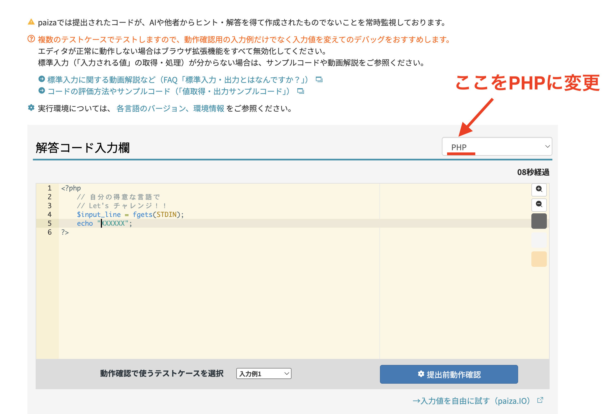

# Дасгалын бодлого（2026 оны 7-р сарын 14）

> 🇯🇵 Эх хувь (япон хэлээр): [20260714_資料_1.md](<../../../1年生_データ設計とアプリ開発/前期/20260714/20260714_資料_1.md>) <!-- original-ja-link -->

PHP-ийн серверийг асааж чаддаг болсон тул эхлээд өмнөх дасгал бодлогуудаа хийж үзээрэй.

## Бэлтгэл

- [PHP хөгжүүлэлтийн серверийг хэрхэн асаах](../PHP開発サーバーの立て方.md)

## Дасгал

1. [20260630_Дасгал](../20260630/20260630_演習.md)
2. [20260707_Дасгал](../20260707/20260707_演習.md)


Бодлого бүрийг нэг `index.php` дотор нэгтгэж бичиж болно. Эсвэл [PHP хөгжүүлэлтийн серверийг хэрхэн асаах](../PHP開発サーバーの立て方.md)-ийн「Бүлэг тус бүрийн хавтасны бүтцээр хандах」хэсгийн дагуу бодлого бүрийг тусдаа файлд хувааж болно（жишээ: `1-1.php` / `1-2.php`）.

### Хавтасны бүтцийн жишээ

```
study/
  index.php
  0630/
    1.php
    2.php
    3.php
    4.php
  0707/
    1-1.php
    1-2.php
    2-1.php
```

### Серверийг асаах команд

「cd」гэдэг нь хавтас руу шилжих гэсэн утгатай.

```bash
cd /Users/<хэрэглэгчийн нэр>/Desktop/study
php -S localhost:8000
```

### URL-аар хандах арга

Серверийг `study` хавтасны дотор шууд асаадаг（`php -S localhost:8000`）тул URL нь `study/`-ээс эхэлсэн харьцангуй замтай тохирно.

```
http://localhost:8000/0630/1.php
http://localhost:8000/0630/2.php
http://localhost:8000/0707/1-1.php
http://localhost:8000/0707/1-2.php
```

## AI ашиглах тухай

**Gemini зэрэг AI ашиглаж болно!** Гэхдээ дараах зүйлсийг анхаараарай.

- Програмчлалын хэлийг ойлгох
- Хайж олж болох зүйлсийг цээжлэх шаардлагагүй
- Ойлгохгүй бол「Кодод тайлбар коммент нэмж өгөөч」гэж AI-аас хүсээрэй


## Дасгалаа дуусгаад завтай байгаа хүмүүс Paiza-д бүртгүүлж, PHP-ээр ур чадварын шалгалтыг（skill check）өгч үзээрэй

https://paiza.jp/challenges

Илгээх хэл нь анхдагчаар өөр хэл дээр тохируулагдсан байдаг тул доорх зураг шиг PHP болгож өөрчлөөрэй.



**Анхааруулга: Paiza-гийн ур чадварын шалгалт нь AI эсвэл бусдаас сэжүүр・хариу авч бичсэн код мөн эсэхийг байнга хянадаг.** Өмнөх дасгалуудаас ялгаатай нь AI ашиглалгүй өөрийн хүчээр бодоорой.

<!-- nav:start -->

---

| ⬅️ Өмнөх | 🗺️ Ерөнхий зураг | Дараагийнх ➡️ |
|:--|:--:|--:|
| [07/07 Дасгал](../20260707/20260707_演習.md) | [Материалын ерөнхий зураг](../../README.md) | [07/21 Яагаад DB хэрэгтэй вэ](../20260721/20260721_資料.md) |

<!-- nav:end -->
