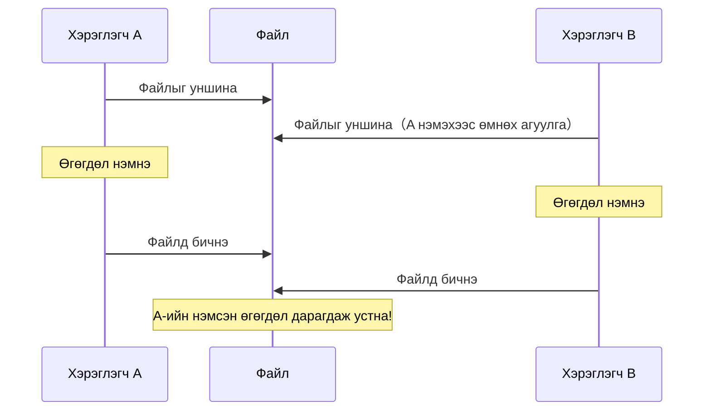
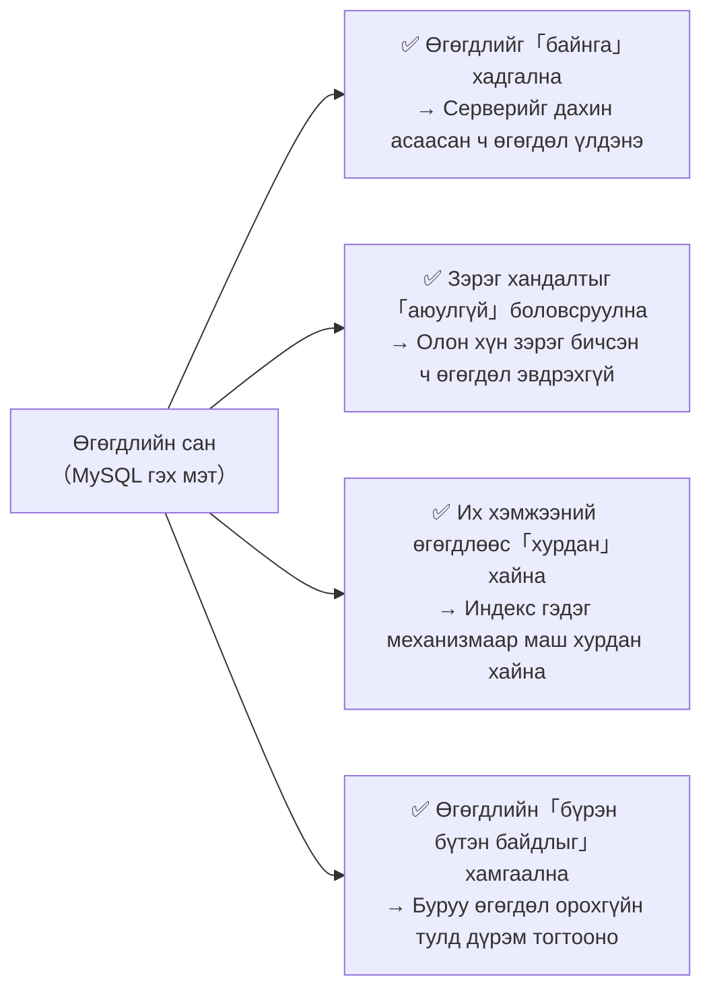
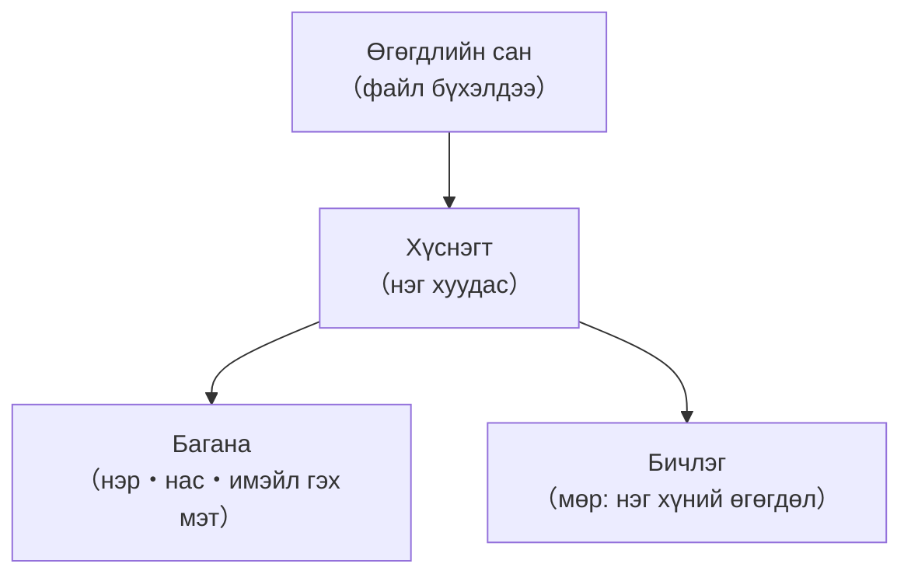
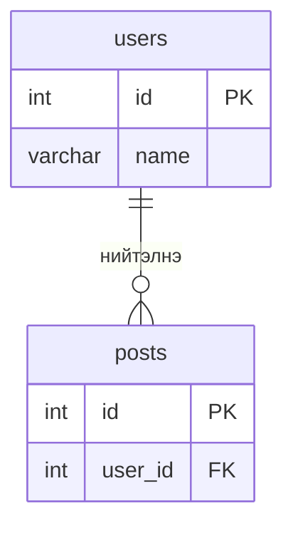

# Хичээл 06｜Яагаад DB хэрэгтэй вэ — Зөвхөн PHP-ийн массив хангалтгүй

> 🇯🇵 Эх хувь (япон хэлээр): [20260721_資料.md](<../../../1年生_データ設計とアプリ開発/前期/20260721/20260721_資料.md>) <!-- original-ja-link -->

## Өнөөдрийн зорилго
- Зөвхөн PHP-ийн массиваар өгөгдөл удирдах үед гарах асуудлуудыг тайлбарлаж чаддаг болох
- Өгөгдлийн сан юуг шийддэгийг ойлгох
- MySQL-ийн үндсэн ойлголтуудыг（хүснэгт・мөр・багана）тайлбарлаж чаддаг болох

---

## 1. Зөвхөн массиваар өгөгдөл удирдаж үзье

Эхлээд зөвхөн PHP-ийн массиваар「хэрэглэгч удирдах систем」хийж үзье.

```php
<?php
// Төлөвийг файлд хадгалах гэсэн оролдлого
// users.php
$users = [
    ["id" => 1, "name" => "田中太郎", "email" => "tanaka@example.com"],
    ["id" => 2, "name" => "鈴木花子", "email" => "suzuki@example.com"],
];

// Шинэ хэрэглэгч нэмэх функц
function addUser(array &$users, string $name, string $email): void {
    $newId = count($users) + 1;
    $users[] = ["id" => $newId, "name" => $name, "email" => $email];
}

addUser($users, "山田次郎", "yamada@example.com");

// Харуулах
foreach ($users as $user) {
    echo "{$user['id']}: {$user['name']}\n";
}
```

### Асуудал 1: Серверийг дахин асаахад өгөгдөл устна

```
PHP програм нь хүсэлт ирэх бүрд эхнээсээ ажилладаг
 → Үргэлж $users = []-ээс эхэлнэ
 → Өмнө нь нэмсэн өгөгдөл устчихна!
```

### Асуудал 2: Олон хүн зэрэг хандвал өгөгдөл эвдэрнэ

A ба B бараг зэрэг бичвэл дараах зүйл болно.



### Асуудал 3: Өгөгдөл ихсэхэд хайлт удаашрна

```php
// 1 сая хэрэглэгчээс тодорхой имэйл хаягийг хайх
foreach ($users as $user) {
    if ($user["email"] === "target@example.com") {
        return $user;  // Хамгийн муу тохиолдолд 1 сая удаа давтана...
    }
}
```

---

## 2. Өгөгдлийн сангийн шийддэг зүйлс



---

## 3. Өгөгдлийн сангийн үндсэн ойлголтууд

Өгөгдлийн санг **цахим хүснэгттэй（spreadsheet）төстэй бүтэцтэй** гэж төсөөлбөл ойлгоход хялбар.



```
Жишээ: users хүснэгт

 id │ name     │ email                │ created_at
────┼──────────┼──────────────────────┼─────────────────
  1 │ 田中太郎 │ tanaka@example.com   │ 2024-01-01 10:00
  2 │ 鈴木花子 │ suzuki@example.com   │ 2024-01-02 11:00
  3 │ 山田次郎 │ yamada@example.com   │ 2024-01-03 12:00
```

---

## 4. MySQL-ийн үндэс

**MySQL = Дэлхийд хамгийн өргөн хэрэглэгддэг нээлттэй эхийн харилцаат өгөгдлийн сан**

[Харилцаат өгөгдлийн сангийн тухай](./リレーショナルデータベース入門.md)

Laravel-д ч түгээмэл ашигладаг.

```
Харилцаат өгөгдлийн сан（RDB）гэдэг нь:
- Өгөгдлийг хүснэгтээр удирддаг
- Хүснэгтүүдийг「хамаарал（relation）」-аар холбож болно
- SQL（Structured Query Language）гэдэг хэлээр удирддаг

Жишээ:
  users хүснэгт（хэрэглэгчийн мэдээлэл）
  posts хүснэгт（нийтлэлийн мэдээлэл）
  → posts.user_id-аар нийтлэл аль хэрэглэгчид хамаарахыг бүртгэж болно
```

users ба posts-ийн хамаарлыг зургаар үзүүлбэл дараах байдалтай（нэг хэрэглэгч олон нийтлэлтэй байж болно）.



---

## 5. MySQL бэлдэх（Windows: XAMPP / Mac: DBngin）

Өөрийн үйлдлийн системд тохируулан аль нэгийг нь ашиглана.

### Windows бол: XAMPP

**XAMPP = Apache / MySQL（MariaDB）/ PHP / phpMyAdmin-ийг нэг дор суулгаж болдог үнэгүй хэрэгсэл**

#### Суулгах

[apachefriends.org](https://www.apachefriends.org/)-оос татаж аваад суулгана

#### MySQL серверийг асаах

1. XAMPP Control Panel-ийг нээнэ
2. 「MySQL」мөрөнд байгаа「Start」дээр дарж асаана

### Mac бол: DBngin

**DBngin = MySQL / PostgreSQL / Redis-ийг нэг товшилтоор асааж болдог үнэгүй хэрэгсэл**

#### Суулгах

[dbngin.com](https://dbngin.com/)-оос татаж аваад суулгана

#### MySQL сервер үүсгэх・асаах

1. DBngin-ийг нээнэ
2. 「+」товч →「MySQL」-ийг сонгоно
3. Хувилбараа сонгоод「Create」（аль ч хувилбар болно, эргэлзвэл хамгийн сүүлийн тогтвортой хувилбар）
4. Үүсгэсэн серверийн「Start」дээр дарж асаана

### Нийтлэг холболтын мэдээлэл

Аль ч хэрэгслээр анхдагч тохиргоогоор MySQL дараах тохиргоотойгоор асна.

```
Host:     127.0.0.1
Port:     3306
User:     root
Password: （хоосон байж болно）
```

※ 3306 портыг өөр MySQL ашиглаж байгаа бол хэрэгслийн тохиргоонд өөр портын дугаар руу сольж өгөөрэй（тэр тохиолдолд GUI хэрэгслийн холболтын тохиргоог ч тэр портын дугаарт тааруулна）.

---

## 6. GUI хэрэгслээр MySQL-тэй ажиллах（Windows: phpMyAdmin / Mac: TablePlus）

### Windows бол: phpMyAdmin

**phpMyAdmin = XAMPP-д стандартаар хамт ирдэг MySQL-ийн удирдлагын дэлгэц（браузераас ажиллуулна）**

XAMPP Control Panel дээр MySQL-ийг Start хийж асаасны дараа браузераас дараах хаяг руу хандана.

```
http://localhost/phpmyadmin/
```

Холболтын мэдээлэл оруулах шаардлагагүй（XAMPP асахад root хэрэглэгчээр автоматаар холбогдоно）.

### Mac бол: TablePlus

**TablePlus = MySQL-тэй GUI-аар ажиллах хэрэгсэл（SQL-ийг гараар бичиж дадлага хийж болно）**

#### Суулгах

[tableplus.com](https://tableplus.com/)-оос татаж авна

#### Холболтын тохиргоо（DBngin-ээр асаасан MySQL-д холбогдох бол）

```
Name:     local
Host:     127.0.0.1
Port:     3306
User:     root
Password: （хоосон байж болно）
Database: （дараа нь үүсгэнэ）
```

---

## 7. Анхны өгөгдлийн сангаа үүсгэх

Windows бол phpMyAdmin-ийн「SQL」таб, Mac бол TablePlus-ийн SQL таб дээр дараахыг ажиллуулна:

```sql
-- Өгөгдлийн сан үүсгэнэ
CREATE DATABASE school_db;

-- Үүсгэсэн өгөгдлийн санг ашиглана
USE school_db;

-- Хүснэгт үүсгэнэ
CREATE TABLE users (
    id    INT AUTO_INCREMENT PRIMARY KEY,  -- Автоматаар дугаар олгогдоно
    name  VARCHAR(100) NOT NULL,           -- Дээд тал нь 100 тэмдэгттэй тэмдэгт мөр（заавал）
    email VARCHAR(255) NOT NULL UNIQUE,    -- UNIQUE = давхардахыг хориглоно
    age   INT,                             -- Бүхэл тоо（заавал биш）
    created_at TIMESTAMP DEFAULT CURRENT_TIMESTAMP  -- Үүсгэсэн огноо, цаг
);

-- Өгөгдөл оруулж үзье
INSERT INTO users (name, email, age) VALUES ('田中太郎', 'tanaka@example.com', 20);
INSERT INTO users (name, email, age) VALUES ('鈴木花子', 'suzuki@example.com', 22);

-- Өгөгдлийг гаргаж авна
SELECT * FROM users;
```

---

## Нэмэлт: PHP-ээс SQL ажиллуулж буй жишээ

PHP-д **PDO（PHP Data Objects）** гэдэг DB-д холбогдох стандарт боломж байдаг.

```php
<?php
$pdo = new PDO(
    'mysql:host=127.0.0.1;port=3306;dbname=school_db;charset=utf8mb4',
    'root',
    '' // XAMPP/DBngin-ий анхдагч нууц үг хоосон
);

// Ажиллуулах SQL өгүүлбэр
$sql = "SELECT * FROM users";

$stmt = $pdo->query($sql);
$users = $stmt->fetchAll(PDO::FETCH_ASSOC);

foreach ($users as $user) {
    echo "{$user['id']}: {$user['name']}\n";
}
```

---

## Дүгнэлт

| Асуудал | Зөвхөн массив | Өгөгдлийн сан |
|------|---------|------------|
| Өгөгдлийг байнга хадгалах | ❌ Устна | ✅ Үлдэнэ |
| Зэрэг хандалт | ❌ Эвдэрнэ | ✅ Аюулгүй |
| Их хэмжээний өгөгдлөөс хайх | ❌ Удаан | ✅ Хурдан |
| Өгөгдлийн бүрэн бүтэн байдал | ❌ Шалгалтгүй | ✅ Дүрмээр хамгаалж болно |

---

## Дараагийн хичээлийн（Хичээл 07）тойм

SQL-ийн үндэс: `SELECT` / `WHERE` / `ORDER BY` ашиглан өгөгдөл гаргаж авах аргыг үзнэ.  
TablePlus дээр SQL-ийг өөрөө бичиж ажиллуулан туршина.

<!-- nav:start -->

---

📎 Хамт уншаарай → [Өгөгдлийн сангийн серверийг хэрхэн асаах (XAMPP)](../データベースサーバーの立て方/データベースサーバーの立て方.md)・[Харилцаат өгөгдлийн сангийн анхан шат](リレーショナルデータベース入門.md)

| ⬅️ Өмнөх | 🗺️ Ерөнхий зураг | Дараагийнх ➡️ |
|:--|:--:|--:|
| [07/14 Дасгалын бодлого](../20260714/20260714_資料_1.md) | [Материалын ерөнхий зураг](../../README.md) | [07/21 SQL-ийн үндэс ① (SELECT)](20260721_資料_2.md) |

<!-- nav:end -->
