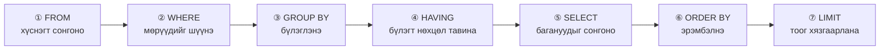

# Хичээл 07｜SQL-ийн үндэс ① — SELECT / WHERE / ORDER BY

> 🇯🇵 Эх хувь (япон хэлээр): [20260721_資料_2.md](<../../../1年生_データ設計とアプリ開発/前期/20260721/20260721_資料_2.md>) <!-- original-ja-link -->

## Өнөөдрийн зорилго
- SELECT-ээр өгөгдөл гаргаж авч чаддаг болох
- WHERE-ээр нөхцөл зааж шүүж чаддаг болох
- ORDER BY-гаар эрэмбэлж чаддаг болох
- LIMIT-ээр авах мөрийн тоог хязгаарлаж чаддаг болох

---

## Бэлтгэл: Дасгалын өгөгдөл оруулах

TablePlus-ийн SQL таб дээр ажиллуулаарай:

```sql
-- Өгөгдлийн сан ба хүснэгт үүсгэнэ
CREATE DATABASE IF NOT EXISTS school_db;
USE school_db;

-- Сурагчдын хүснэгт
CREATE TABLE IF NOT EXISTS students (
    id         INT AUTO_INCREMENT PRIMARY KEY,
    name       VARCHAR(100) NOT NULL,
    age        INT NOT NULL,
    class      VARCHAR(10) NOT NULL,
    score      INT NOT NULL,
    enrolled_at DATE NOT NULL
);

-- Туршилтын өгөгдөл оруулна
INSERT INTO students (name, age, class, score, enrolled_at) VALUES
('田中太郎', 18, 'A', 85, '2024-04-01'),
('鈴木花子', 19, 'A', 72, '2024-04-01'),
('山田次郎', 18, 'B', 91, '2024-04-01'),
('佐藤三郎', 20, 'B', 58, '2024-04-01'),
('伊藤美咲', 18, 'A', 78, '2024-04-01'),
('渡辺一郎', 19, 'C', 95, '2024-04-01'),
('加藤幸子', 18, 'C', 45, '2024-04-01'),
('吉田健太', 20, 'B', 88, '2024-04-01'),
('山本麻衣', 19, 'A', 67, '2024-04-01'),
('中村龍一', 18, 'C', 73, '2024-04-01');
```

---

## 1. SELECT — Өгөгдөл гаргаж авах

```sql
-- Бүх багана・бүх мөрийг авна（* = бүх багана）
SELECT * FROM students;

-- Зөвхөн тодорхой баганыг авна
SELECT name, score FROM students;

-- Баганад өөр нэр өгнө（AS）
SELECT name AS 名前, score AS 点数 FROM students;
```

---

## 2. WHERE — Нөхцөлөөр шүүх

```sql
-- score нь 80 ба түүнээс дээш оноотой сурагчид
SELECT * FROM students WHERE score >= 80;

-- class нь 'A' ангид хамаарах сурагчид
SELECT * FROM students WHERE class = 'A';

-- age нь 18 бөгөөд score нь 70 ба түүнээс дээш
SELECT * FROM students WHERE age = 18 AND score >= 70;

-- class нь 'A' эсвэл 'B'
SELECT * FROM students WHERE class = 'A' OR class = 'B';

-- class нь 'A' эсвэл 'B'（IN ашиглавал богино бичиж болно）
SELECT * FROM students WHERE class IN ('A', 'B');

-- score нь 60 ба түүнээс дээш, 90-ээс доош（BETWEEN）
SELECT * FROM students WHERE score BETWEEN 60 AND 89;

-- name-д "太" орсон（LIKE = хэсэгчлэн таарах）
SELECT * FROM students WHERE name LIKE '%太%';
-- % = хэдэн ч тэмдэгт байж болно（wildcard）

-- score нь NULL биш（IS NOT NULL）
SELECT * FROM students WHERE score IS NOT NULL;
```

---

## 3. ORDER BY — Эрэмбэлэх

```sql
-- score-оор өсөх дарааллаар（багаас нь）
SELECT * FROM students ORDER BY score ASC;   -- ASC = ascending（өсөх дараалал）

-- score-оор буурах дарааллаар（ихээс нь）
SELECT * FROM students ORDER BY score DESC;  -- DESC = descending（буурах дараалал）

-- class-аар өсөх дарааллаар, ижил class дотор score-оор буурах дарааллаар
SELECT * FROM students ORDER BY class ASC, score DESC;
```

---

## 4. LIMIT — Авах мөрийн тоог хязгаарлах

```sql
-- Эхний 5-ыг л авна
SELECT * FROM students ORDER BY score DESC LIMIT 5;

-- 6 дахь мөрөөс эхлэн 5 мөр авна（хуудаслалт / pagination-д ашиглана）
-- LIMIT мөрийн_тоо OFFSET эхлэх_байрлал
SELECT * FROM students ORDER BY id ASC LIMIT 5 OFFSET 5;
```

---

## 5. Нэгтгэх функцууд

```sql
-- Мөрийн тоог тоолно
SELECT COUNT(*) FROM students;
-- → 10

-- score-ийн нийлбэр・дундаж・хамгийн их・хамгийн бага
SELECT
    COUNT(*)    AS 人数,
    SUM(score)  AS 合計点,
    AVG(score)  AS 平均点,
    MAX(score)  AS 最高点,
    MIN(score)  AS 最低点
FROM students;

-- GROUP BY: ангийн дундаж оноо
SELECT class, AVG(score) AS 平均点, COUNT(*) AS 人数
FROM students
GROUP BY class
ORDER BY 平均点 DESC;
```

---

## 6. SELECT-ийн гүйцэтгэгдэх дараалал（чухал!）

SQL нь бичсэн дарааллаараа биш, дараах дарааллаар ажилладаг.



```sql
SELECT name, score       -- ⑤ Гаргах баганыг сонгоно
FROM students            -- ① Хүснэгт сонгоно
WHERE score >= 70        -- ② Нөхцөлөөр шүүнэ
GROUP BY class           -- ③ Бүлэглэнэ
HAVING AVG(score) >= 75  -- ④ Бүлэгт нөхцөл тавина（WHERE-ийн дараа）
ORDER BY score DESC      -- ⑥ Эрэмбэлнэ
LIMIT 5;                 -- ⑦ Тоог хязгаарлана
```

---

## Дүгнэлт

| SQL | Утга |
|-----|------|
| `SELECT * FROM хүснэгт` | Бүх өгөгдлийг авна |
| `WHERE нөхцөл` | Нөхцөлөөр шүүнэ |
| `AND` / `OR` | Олон нөхцөлийг хослуулна |
| `IN (утга1, утга2)` | Олон утгын аль нэгтэй таарна |
| `LIKE '%тэмдэгт%'` | Хэсэгчлэн таарах хайлт |
| `ORDER BY багана ASC/DESC` | Эрэмбэлнэ |
| `LIMIT тоо` | Авах мөрийн тоог хязгаарлана |
| `COUNT(*)` / `AVG()` / `SUM()` | Нэгтгэх функцууд |
| `GROUP BY багана` | Бүлэглэнэ |

---

## Дараагийн хичээлийн（Хичээл 08）тойм

INSERT / UPDATE / DELETE-ийг үзнэ.  
Өгөгдөл нэмэх・шинэчлэх・устгах боломжтой болно.

<!-- nav:start -->

---

| ⬅️ Өмнөх | 🗺️ Ерөнхий зураг | Дараагийнх ➡️ |
|:--|:--:|--:|
| [07/21 Яагаад DB хэрэгтэй вэ](20260721_資料.md) | [Материалын ерөнхий зураг](../../README.md) | [07/21 Дасгал](20260721_演習.md) |

<!-- nav:end -->
