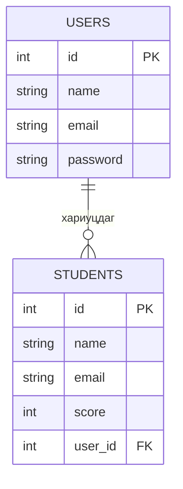

> 🇯🇵 Эх хувь (япон хэлээр): [リレーショナルデータベース入門.md](<../../../1年生_データ設計とアプリ開発/前期/20260721/リレーショナルデータベース入門.md>) <!-- original-ja-link -->

## Энэ нийтлэлээс юу мэдэх вэ

- Хүснэгт, мөр, багана
- Primary key (үндсэн түлхүүр)
- Foreign key (гадаад түлхүүр) ба хүснэгтүүдийн хоорондын холбоо
- Хүснэгтийг яагаад хуваадаг вэ

## Өгөгдлийн сан = цэгцтэй хүснэгтүүдийн цуглуулга

Цаасан дээр замбараагүй тэмдэглэхийн оронд өгөгдлийг хүснэгт хэлбэрээр цэгцлэн хадгалдаг систем нь «өгөгдлийн сан» юм. RDB (харилцаат өгөгдлийн сан) нь ийм хүснэгтүүдийг (table) хооронд нь холбож (=relation үүсгэж) ашиглаж чаддагаараа онцлог.

## Хүснэгт, мөр, багана

Энэ аппликейшнд үүрэг нь өөр 2 хүснэгт бий. Тус бүрийг жишээ болгон, хэсэг бүрийн нэрийг харцгаая.

### 🎓 students хүснэгт (сурагчдын өгөгдөл)

| id | name | email | score |
|----|------|-------|-------|
| 1  | 田中太郎 | tanaka@example.com | 80 |
| 2  | 佐藤花子 | sato@example.com | 95 |

- **Хүснэгт (table)**: энэ хүснэгт өөрөө (зориулалт бүрээр олон хүснэгт үүсгэдэг)
- **Багана (column)**: `id` `name` `email` `score` зэрэг босоо чиглэлд байрлах талбарууд
- **Мөр (record)**: 1 бичлэгийн өгөгдөл (энд 1 сурагчийн мэдээлэл)

### 🔑 users хүснэгт (багш, админы нэвтрэх мэдээлэл)

| id | name | email | password |
|----|------|-------|----------|
| 1  | 小山先生 | koyama@example.com | $2y$10$abcdefGhIjKlmn...(ハッシュ化済み) |
| 2  | 田中先生 | tanaka-t@example.com | $2y$10$OpQrStUvWxYz...(ハッシュ化済み) |

- **Хүснэгт (table)**: `users` (нэвтрэх бүртгэлийн мэдээлэл. students-ээс өөр үүрэгтэй)
- **Багана (column)**: `id` `name` `email` `password`
- **Мөр (record)**: 1 бичлэгийн өгөгдөл (энд 1 багш эсвэл админы нэвтрэх мэдээлэл)

> 💡 `password`-ийг оруулсан тэмдэгт мөрөөр нь (энгийн текстээр) хадгалахгүй, харин хэшлэх буюу буцаах боломжгүй хувиргалт хийсний дараа хадгалдаг. Ингэснээр өгөгдлийн сангийн агуулга алдагдсан ч анхны нууц үгийг мэдэх боломжгүй болно.

## Primary key: өгөгдлийг давхцалгүй ялгах ID

Зөвхөн `name` (нэр)-ээр хайвал ижил овог нэртэй хүмүүс байхад нэг хүнийг тодорхойлж чадахгүй. Тиймээс бусад мөрийнхтэй хэзээ ч давхцахгүй дугаар (**primary key**) ашигладаг. Дээрх хүснэгтийн `id` нь үүний жишээ бөгөөд «id = 1-тэй өгөгдлийг өгөөч» гэвэл 田中太郎-ийн ганцхан бичлэгийг сонгож авна. Primary key = регистрийн дугаар эсвэл гишүүний дугаар шиг зүйл гэж төсөөлвөл ойлгоход амар.

## Foreign key: хүснэгтүүдийн хоорондын холбоо

Олон хүснэгтийг ID-аар холбож чаддаг нь RDB-ийн гол мөн чанар (=«relational» гэдэг нэрний гарал үүсэл) юм.

Энэ аппликейшнд нэвтрэхэд зориулсан `users` хүснэгт (багш, админы бүртгэл),
сурагчдын өгөгдлийн `students` хүснэгт гэсэн 2 хүснэгт бий. Одоогоор энэ 2
ID-аар холбогдоогүй, бие даасан хүснэгтүүд юм.

Хэрэв «аль багш (user) аль сурагчийг (student) бүртгэсэн / хариуцаж байгаа вэ» гэдгийг
бүртгэх шаардлага гарвал `students` хүснэгтэд `user_id` гэсэн багана нэмж холбоно.

`STUDENTS.user_id` (foreign key)-аар `USERS.id` (primary key)-г заалгавал,
1 багш (user) олон сурагчийг (student) хариуцаж болох холбоог (нэгээс олон, one-to-many) илэрхийлж болно.

## Хүснэгтийг яагаад хуваадаг вэ

Хүснэгтийг хуваалгүй нэг хүснэгтэд нэгтгэвэл, нэг хариуцагч багшийн нэр болон и-мэйл хаяг тухайн багшийн хариуцсан сурагчдын тоогоор давхардана.

| student_id | student_name | staff_name | staff_email |
|-----------|-------|-------------|---------------|
| 101 | 田中花子 | 小山先生 | koyama@example.com |
| 103 | 田中次郎 | 小山先生 | koyama@example.com |

Ингэвэл 小山 багш и-мэйл хаягаа өөрчлөх үед холбогдох бүх мөрийг хайж засах шаардлагатай болж, зарим мөрийг засахаа орхигдуулах магадлалтай. users хүснэгт, students хүснэгт гэж хувааж ID-аар холбовол 小山 багшийн мэдээлэл ганцхан газар байх тул засварыг ч нэг газар хийхэд л хангалттай. Ийм «давхардлаас зайлсхийж хүснэгтийг хуваах» аргыг **нормчлол (normalization)** гэнэ.

## Дүгнэлт

- Өгөгдлийн сан гэдэг нь өгөгдлийг цэгцлэн хадгалах систем
- RDB нь өгөгдлийг «хүснэгт» хэлбэрээр удирддаг бөгөөд хүснэгт нь «багана (зүйл)» болон «мөр (1 бичлэгийн өгөгдөл)»-өөс бүрддэг
- Primary key нь бичлэг бүрийг давхцалгүй ялгах тэмдэг (ID)
- Foreign key нь өөр хүснэгтийн primary key-г зааж, хүснэгтүүдийг хооронд нь холбох арга
- Хүснэгтийг хувааж холбосноор ижил мэдээлэл давхардахаас сэргийлж, өгөгдлийг цэгцлэхэд амар болно

Цаашид «SQL», «индекс», «транзакц» зэрэг ойлголтууд гарч ирнэ, гэхдээ эхлээд энэ үндсийг төсөөлж чадвал болно.

<!-- nav:start -->

---

| ⬅️ Буцах | 🗺️ Ерөнхий зураг | Дараагийнх ➡️ |
|:--|:--:|--:|
| [07/21 Яагаад DB хэрэгтэй вэ](20260721_資料.md) | [Материалын ерөнхий зураг](../../README.md) | [07/21 SQL-ийн үндэс ① (SELECT)](20260721_資料_2.md) |

<!-- nav:end -->
