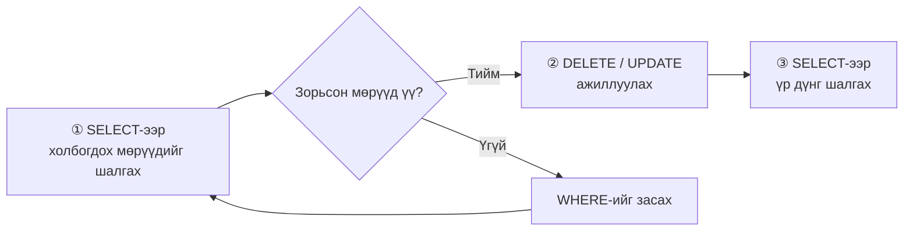
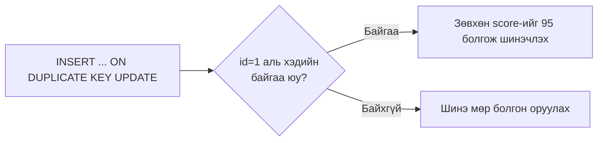

# Хичээл 08｜SQL-ийн үндэс ② — INSERT / UPDATE / DELETE

> 🇯🇵 Эх хувь (япон хэлээр): [20260723_資料.md](<../../../1年生_データ設計とアプリ開発/前期/20260723/20260723_資料.md>) <!-- original-ja-link -->

## Өнөөдрийн зорилго
- INSERT-ээр өгөгдөл нэмж чаддаг болох
- UPDATE-ээр өгөгдөл шинэчилж чаддаг болох
- DELETE-ээр өгөгдөл устгаж чаддаг болох
- WHERE-ийн ач холбогдлыг (мартвал бүх бичлэг өөрчлөгдөнө) ойлгох

---

## 1. INSERT — өгөгдөл нэмэх

```sql
-- Бүх баганад утга оруулах үед (баганын нэрийг орхиж болно)
INSERT INTO students VALUES (NULL, '新入生A', 18, 'A', 80, '2024-04-01');
-- ↑ id нь AUTO_INCREMENT тул NULL байхад болно

-- Зөвхөн тодорхой баганыг зааж оруулах (зөвлөмж болгож буй арга)
INSERT INTO students (name, age, class, score, enrolled_at)
VALUES ('新入生B', 19, 'B', 75, '2024-04-01');

-- Олон мөрийг нэг дор оруулах
INSERT INTO students (name, age, class, score, enrolled_at)
VALUES
    ('新入生C', 18, 'C', 88, '2024-04-01'),
    ('新入生D', 20, 'A', 62, '2024-04-01'),
    ('新入生E', 19, 'B', 71, '2024-04-01');
```

---

## 2. UPDATE — өгөгдөл шинэчлэх

```sql
-- !! Маш чухал !!
-- WHERE-ийг бичихээ мартвал бүх мөр шинэчлэгдчихнэ!
-- Заавал WHERE-ийг шалгаад дараа нь ажиллуулаарай!

-- id нь 1-тэй тэнцүү сурагчийн score-ийг 90 болгож шинэчлэх
UPDATE students SET score = 90 WHERE id = 1;

-- Олон баганыг зэрэг шинэчлэх (таслалаар зааглана)
UPDATE students SET score = 95, class = 'S' WHERE id = 1;

-- WHERE-гүй (аюултай! бүх мөр шинэчлэгдэнэ)
-- UPDATE students SET score = 0;  ← Үүнийг хийвэл бүгд 0 оноотой болно!

-- Одоогийн утгыг ашиглан шинэчлэх (жишээ: бүгдэд +5 оноо)
UPDATE students SET score = score + 5;  -- Зориуд хийж байгаа бол зүгээр
```

---

## 3. DELETE — өгөгдөл устгах

```sql
-- !! Маш чухал !!
-- WHERE-ийг бичихээ мартвал бүх мөр устчихна!
-- DELETE-ийг буцаах боломжгүй!

-- id нь 5-тай тэнцүү сурагчийг устгах
DELETE FROM students WHERE id = 5;

-- score нь 50-аас бага бүх сурагчийг устгах
DELETE FROM students WHERE score < 50;

-- WHERE-гүй (хэзээ ч хийж болохгүй)
-- DELETE FROM students;  ← Хүснэгт хоосон болно!
```

> **Ажил дээр заавал мөрдөх дүрэм:**  
> 1. UPDATE/DELETE хийхээс өмнө өөрчлөх эсвэл устгах бичлэгүүдийг SELECT-ээр шалгана  
> 2. Ажиллуулахаас өмнө нөөц хуулбар (backup) авна  
> 3. WHERE-ийг заавал шалгана

---

## 4. UPDATE/DELETE-ийг аюулгүй хийх арга

Шууд ажиллуулалгүй, дараах дарааллаар явна.



```sql
-- Алхам 1: эхлээд SELECT-ээр холбогдох бичлэгүүдийг шалгах
SELECT * FROM students WHERE score < 50;
-- → Устгагдах мөрүүдийг нүдээрээ шалгана

-- Алхам 2: асуудалгүй бол DELETE-ийг ажиллуулах
DELETE FROM students WHERE score < 50;

-- Шалгах
SELECT * FROM students;
```

---

## 5. Түгээмэл хэрэглэгддэг хэв маяг: UPSERT

```sql
-- INSERT OR UPDATE (байгаа өгөгдөл бол шинэчилнэ, байхгүй бол оруулна)
-- MySQL-д INSERT ... ON DUPLICATE KEY UPDATE-ийг ашиглана
INSERT INTO students (id, name, score)
VALUES (1, '田中太郎', 95)
ON DUPLICATE KEY UPDATE score = 95;
-- id=1 аль хэдийн байвал → зөвхөн score нь 95 болж шинэчлэгдэнэ
-- id=1 байхгүй бол → шинээр оруулна
```

Зургаар үзүүлбэл дараах байдлаар салаалдаг.



---

## 6. CRUD-ийн дүгнэлт

| Үйлдэл | SQL | Утга |
|------|-----|------|
| **C**reate (үүсгэх) | `INSERT INTO ... VALUES ...` | Өгөгдөл нэмэх |
| **R**ead (унших) | `SELECT ... FROM ...` | Өгөгдөл авах |
| **U**pdate (шинэчлэх) | `UPDATE ... SET ... WHERE ...` | Өгөгдөл шинэчлэх |
| **D**elete (устгах) | `DELETE FROM ... WHERE ...` | Өгөгдөл устгах |

> **CRUD = Create / Read / Update / Delete** нь веб аппликейшний үндсэн үйлдлүүд юм.  
> Laravel-ийн дасгал дээр ч яг ижил ойлголт гарч ирнэ.

---

## Дараагийн хичээл (Хичээл 09)-ийн танилцуулга

Хүснэгтүүдийн хоорондын харилцаа болон JOIN-ийг үзнэ.  
«Хэрэглэгчийн хүснэгт ба захиалгын хүснэгтийг нэгтгэж, хэн юу захиалсныг» нэг SQL өгүүлбэрээр гаргаж авч чаддаг болно.

<!-- nav:start -->

---

| ⬅️ Өмнөх | 🗺️ Ерөнхий зураг | Дараагийнх ➡️ |
|:--|:--:|--:|
| [07/21 Дасгал](../20260721/20260721_演習.md) | [Материалын ерөнхий зураг](../../README.md) | [07/23 Дасгал](20260723_演習.md) |

<!-- nav:end -->
