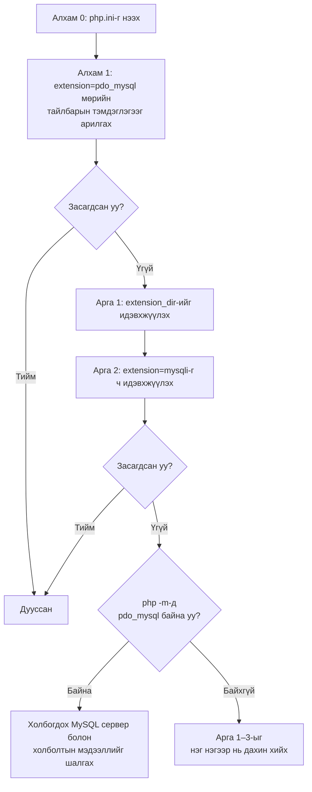

# PDO MySQL өргөтгөл идэвхжихгүй байх үеийн шийдэл

> 🇯🇵 Эх хувь (япон хэлээр): [PDO_MySQL接続エラー対処法.md](<../../../1年生_データ設計とアプリ開発/前期/20260723/PDO_MySQL接続エラー対処法.md>) <!-- original-ja-link -->

## Хамаарах алдаа

Дараах шиг алдаа гарч байгаа үеийн шийдэл юм.

```
Fatal error: Uncaught PDOException: could not find driver in C:\Users\nishida\Desktop\apple\5.php:2
Stack trace:
#0 C:\Users\nishida\Desktop\apple\5.php(2): PDO->__construct('mysql:host=127....', 'root', Object(SensitiveParameterValue))
#1 {main}
  thrown in C:\Users\nishida\Desktop\apple\5.php on line 2
```

### Энэ алдааны утга

PHP-ээс MySQL (өгөгдлийн сан)-д холбогдохдоо `PDO` гэдэг механизмыг ашигладаг ч, MySQL-тэй бодитоор харилцахын тулд «драйвер» гэдэг тусдаа бүрэлдэхүүн хэрэгтэй.

`could not find driver` нь «драйвер олдсонгүй» гэсэн утгатай алдаа юм. Өөрөөр хэлбэл, **PHP `pdo_mysql` өргөтгөлийг (драйверыг) ачаалж чадаагүй** учраас энэ алдаа гарч байна.

Шалтгаан нь ихэнхдээ php.ini (PHP-ийн тохиргооны файл)-ийн тохиргоонд байдаг. Дараах алхмуудыг дээрээс нь дарааллаар нь туршаарай. Нэг алхам туршсан болгондоо заавал «серверийг дахин эхлүүлэх» ([Арга 3](#арга-3-серверийг-найдвартай-дахин-эхлүүлэх))-ийг хийсний дараа браузераар шалгаарай. Зөвхөн тохиргоог өөрчлөхөд PHP-д тусахгүй.

Ерөнхий дараалал нь дараах байдалтай.



※ Аль ч алхамд өөрчлөөд хадгалсны дараа заавал Арга 3 (серверийг дахин эхлүүлэх)-ыг хийгээд шалгана.

---

## Алхам 0: php.ini-г нээх

Цаашид php.ini гэдэг файлыг олон удаа засна. Эхлээд хэрхэн нээхийг шалгацгаая.

1. Explorer (хавтас) эсвэл VS Code-оос `C:\php\php.ini`-г нээнэ.
   - Олдохгүй бол терминалд `php --ini` гэж оруулбал ашиглаж байгаа php.ini файлын байршил харагдана.
2. Цаашид энэ php.ini-ийн агуулгыг засварлана.

---

## Алхам 1: extension=pdo_mysql мөрийн тайлбарын тэмдэглэгээг арилгах

php.ini дотор олон функц (өргөтгөл)-ийг идэвхжүүлэх, идэвхгүй болгох тохиргоо бий. Мөрийн эхэнд `;` (цэгтэй таслал) байвал тухайн мөрийг тайлбар болгож, идэвхгүй болгосон гэсэн үг.

1. php.ini-г нээсэн байдалтай `Ctrl + F` (хайлт) дарж, `extension=pdo_mysql` гэж оруулан хайна.
2. Дараах шиг эхэндээ `;` тэмдэгтэй мөр олдох ёстой.

   ```ini
   ;extension=pdo_mysql
   ```

3. Мөрийн эхэн дэх `;`-ийг л устгана.

   ```ini
   extension=pdo_mysql
   ```

4. `Ctrl + S`-ээр хадгална.
5. [Арга 3](#арга-3-серверийг-найдвартай-дахин-эхлүүлэх)-ын алхмаар серверийг дахин эхлүүлж, браузераар ажиллаж байгаа эсэхийг шалгана.

Ихэнхдээ үүгээр засагддаг, гэхдээ засагдахгүй бол дараагийн хэсэг рүү шилжээрэй.

---

## Энэ хүртэл шийдэгдээгүй бол

`;extension=pdo_mysql` мөрийн тайлбарын тэмдэглэгээг арилгасан ч асуудал шийдэгдэхгүй бол өргөтгөлийн файл (DLL файл) байрлах хавтасны байршлыг PHP таньж чадахгүй байх магадлал өндөр.

Дараах аргуудыг дарааллаар нь шалгаж үзээрэй.

## Арга 1: extension_dir-ийн тохиргоог идэвхжүүлэх (★Хамгийн түгээмэл шалтгаан)

`extension=pdo_mysql` нь зөвхөн «pdo_mysql функцийг ашиглана» гэсэн заавар юм. Харин тухайн функцийг хэрэгжүүлэх файл (DLL файл) хаана байгааг PHP-д заадаг тохиргоо нь `extension_dir` юм. Үүнийг зөв тохируулаагүй бол заавар нь байгаа ч файл нь олдохгүй.

1. `C:\php\php.ini`-г нээнэ.
2. Гар дээрээс `Ctrl + F` дарж, `extension_dir`-ээр хайна.
3. Дараах шиг мөрийг хайна (эхэндээ `;` тэмдэгтэй байх ёстой).

   ```ini
   ;extension_dir = "ext"
   ```

4. Эхэн дэх `;` (цэгтэй таслал)-ийг устгаж идэвхжүүлнэ.

   ```ini
   extension_dir = "ext"
   ```

5. `Ctrl + S`-ээр хадгалаад, [Арга 3](#арга-3-серверийг-найдвартай-дахин-эхлүүлэх)-аар серверийг дахин эхлүүлж шалгана.

   ※Үүгээр ч шийдэгдэхгүй бол `"ext"` гэсэн харьцангуй замын оронд бүтэн зам (абсолют зам)-аар зааж үзээрэй.

   ```ini
   extension_dir = "C:\php\ext"
   ```

   Энэ нь `C:\php` хавтас доторх `ext` хавтсыг ашиглахыг PHP-д тодорхой зааж өгч байгаа хэрэг юм. Өөрчилсний дараа дахин хадгалж, серверийг дахин эхлүүлээрэй.

## Арга 2: extension=mysqli-г ч хамт идэвхжүүлж үзэх

`mysqli` нь мөн MySQL-д холбогдоход зориулсан өөр нэг өргөтгөл юм. Орчноос хамаарч `pdo_mysql` хэвийн ажиллахын тулд `mysqli` ч хамт идэвхтэй байх шаардлагатай тохиолдол бий. Найдвартай байлгахын тулд хамт идэвхжүүлчихье.

1. php.ini дотор `extension=mysqli`-г хайна.
2. Эхэнд нь `;` байвал устгана.

   ```ini
   extension=mysqli
   ```

3. `Ctrl + S`-ээр хадгалаад, серверийг дахин эхлүүлж шалгана.

## Арга 3: Серверийг «найдвартай» дахин эхлүүлэх

php.ini-г өөрчилсөн ч яг одоо ажиллаж байгаа PHP серверт автоматаар тусахгүй. Учир нь тохиргооны файл «серверийг эхлүүлэх үед» ганцхан удаа ачаалагддаг. Тиймээс тохиргоог өөрчилсний дараа заавал серверийг нэг удаа бүрэн зогсоож, дахин эхлүүлэх шаардлагатай.

1. VS Code-ийн доод хэсэгт байрлах терминалыг (хар дэлгэц) нээнэ.
2. Терминал дээр дараад `Ctrl + C`-г хэд хэдэн удаа дарж серверийг бүрэн зогсооно. Терминалд `^C` гэж харагдаж, команд оруулах мөр дахин гарвал сервер зогссон байна.
3. Серверийг эхлүүлэх командыг дахин оруулна.

   ```bash
   php -S localhost:8000
   ```

4. Браузер дээр тухайн хуудсыг (жишээ: `http://localhost:8000/5.php`) дахин ачаалж (refresh) шалгана.

---

## Тэгсэн ч шийдэгдэхгүй бол шалгах арга

«Үнэндээ одоо pdo_mysql ачаалагдсан байгаа юу» гэдгийг шууд шалгах арга бий.

1. Терминалд дараах командыг ажиллуулна.

   ```bash
   php -m
   ```

   Энэ нь «одоо PHP-д ачаалагдсан өргөтгөлүүдийн жагсаалт»-ыг харуулах команд юм.

2. Гарч ирсэн жагсаалтаас `pdo_mysql` гэсэн үг байгаа эсэхийг хайгаарай.
   - **Байвал** → Өргөтгөл өөрөө ачаалагдсан байна. Алдаа үргэлжилсээр байвал холбогдох MySQL сервер ажиллаж байгаа эсэх, холболтын мэдээлэл (хостын нэр, хэрэглэгчийн нэр, нууц үг гэх мэт) зөв эсэхийг шалгаарай.
   - **Байхгүй бол** → Өргөтгөл хараахан ачаалагдаагүй байна. Дээрх Арга 1–3-ыг нэг нэгээр нь найдвартай (хадгалах ба серверийг дахин эхлүүлэхийг хамт) дахин хийж үзээрэй.

<!-- nav:start -->

---

| ⬅️ Буцах | 🗺️ Ерөнхий зураг | Дараагийнх ➡️ |
|:--|:--:|--:|
| [Todo удирдах аппыг ажиллуулах дараалал](Todo管理アプリ起動する流れ.md) | [Материалын ерөнхий зураг](../../README.md) | [07/28 Хүснэгтийн харилцаа・JOIN](../20260728/20260728_資料.md) |

<!-- nav:end -->
