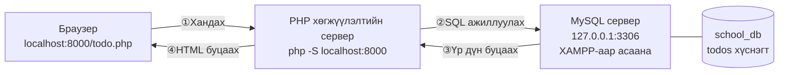
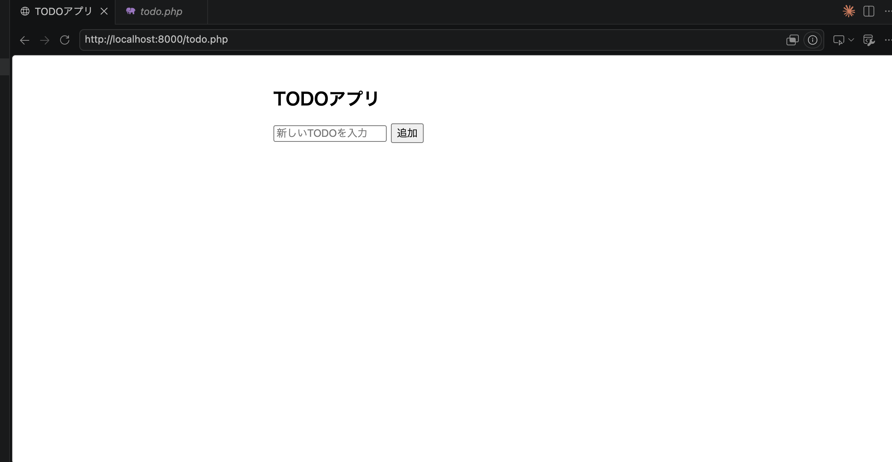
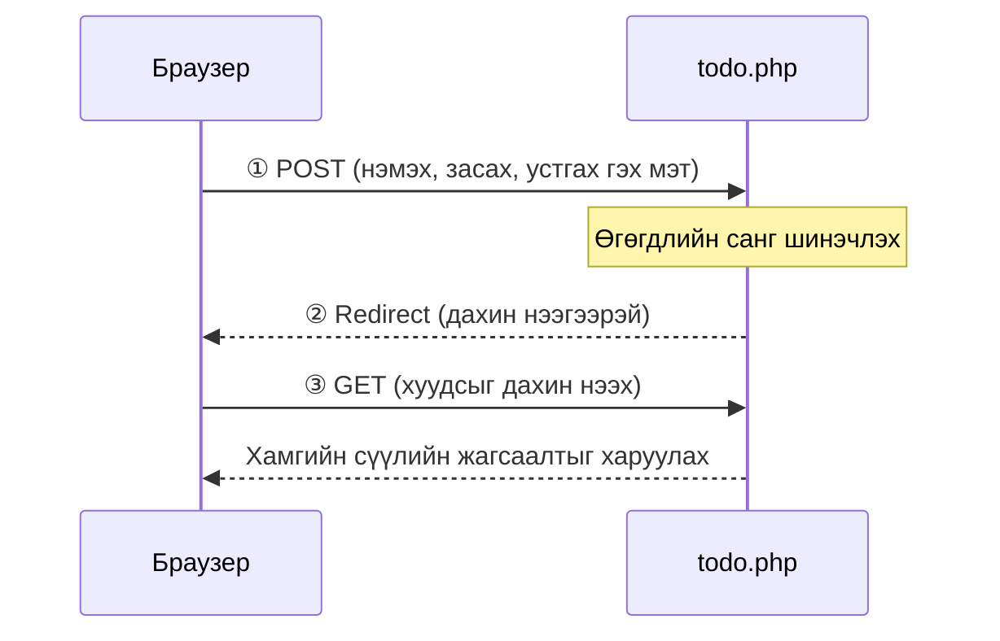

# Todo удирдах аппыг ажиллуулах дараалал

> 🇯🇵 Эх хувь (япон хэлээр): [Todo管理アプリ起動する流れ.md](<../../../1年生_データ設計とアプリ開発/前期/20260723/Todo管理アプリ起動する流れ.md>) <!-- original-ja-link -->

`todo.php` нь PHP＋PDO-оор MySQL-д холбогдож, TODO нэмэх, засах, дууссан эсэхийг өөрчлөх, устгах боломжтой апп юм. Үүнийг ажиллуулахын тулд «өгөгдлийн сангийн сервер» болон «PHP хөгжүүлэлтийн сервер» гэсэн **2**-ыг асаасан байх шаардлагатай.

## Ерөнхий зураг (ажиллаж байгаа үеийн төсөөлөл)



- **PHP хөгжүүлэлтийн сервер**: `todo.php` (програмын үндсэн хэсэг)-г ажиллуулах үүрэгтэй. Браузерын хандалтыг хүлээн авч PHP-г ажиллуулна.
- **MySQL сервер (XAMPP)**: өгөгдлийг (`school_db`-ийн `todos` хүснэгтэд) хадгалах үүрэгтэй. PHP-ээс хүссэн SQL-ийг ажиллуулж, өгөгдлийг буцаана.
- Энэ 2 нь **тус тусдаа процесс** тул хоёуланг нь асаалттай байлгах шаардлагатай (аль нэг нь зогссон байхад л алдаа гарна).

## Урьдчилсан нөхцөл

- XAMPP суулгасан байх
- PHP суулгасан байх (`php -v`-ээр шалгана)
- Доорх командуудын `<хэрэглэгчийн нэр>`-ийг өөрийн компьютерийн хэрэглэгчийн нэрээр солих

---

## 0. todo.php-г өөрийн study хавтсанд бэлтгэх

Тараасан `todo.php`-г өөрийн компьютерийн `study` хавтас доор (жишээ: `study/20260723/`) хуулж тавина.

- Файлыг шууд чирж буулгах (drag & drop)-аар хуулах, эсвэл
- Агуулгыг нь хуулаад, өөрийн орчинд шинээр үүсгэсэн `todo.php` руу буулгах

Аль ч аргыг сонгосон, `php -S` командыг ажиллуулах `study` хавтас дотор `todo.php` файлыг байрлуулаарай.

---

## 1. XAMPP-аар MySQL-г асаах

XAMPP Control Panel-г нээж, `MySQL`-ийн `Actions` нь `Stop` гэж харагдаж байгаа (＝ажиллаж байгаа) эсэхийг шалгана. `Start` гэж харагдаж байвал дарж асаагаарай.

(Дэлгэрэнгүй алхмыг [Өгөгдлийн сангийн серверийг хэрхэн асаах](../データベースサーバーの立て方/データベースサーバーの立て方.md)-аас үзнэ үү)

`todo.php` нь дараах холболтын мэдээллээр MySQL-д холбогдох тул энэ тохиргоотой таарч байх ёстой.

```php
$pdo = new PDO(
    'mysql:host=127.0.0.1;port=3306;dbname=school_db;charset=utf8mb4',
    'root',
    '' // XAMPP/DBngin-ийн анхдагч тохиргоонд нууц үг хоосон байдаг
);
```

- Хост: `127.0.0.1` (өөрийн компьютер)
- Порт: `3306` (MySQL-ийн стандарт порт)
- Өгөгдлийн сангийн нэр: `school_db`
- Хэрэглэгчийн нэр: `root`　Нууц үг: хоосон

`school_db` өгөгдлийн санг урьдчилан phpMyAdmin зэрэг хэрэгслээр үүсгэх шаардлагатай (`todos` хүснэгтийг `todo.php` ажиллах үедээ автоматаар үүсгэдэг тул хүснэгтийг гараар үүсгэх шаардлагагүй).

---

## 2. PHP хөгжүүлэлтийн серверийг асаах

Terminal-ийг нээж, `todo.php` байрлаж буй `study` хавтас руу шилжсэний дараа PHP-ийн хөгжүүлэлтийн серверийг асаана.

```bash
cd /Users/<хэрэглэгчийн нэр>/Desktop/study
php -S localhost:8000
```

(Дэлгэрэнгүй алхмыг [PHP хөгжүүлэлтийн серверийг хэрхэн асаах](../PHP開発サーバーの立て方.md)-аас үзнэ үү)

---

## 3. Браузераар хандах

Серверийг асаалттай байлгасаар, браузерт `todo.php`-г байрлуулсан газарт харгалзах URL руу хандана.

```
http://localhost:8000/20260723/todo.php
```

Дээрх URL-ийг хуулж, браузерын хаягийн мөрөнд буулгаад хандаарай.

※ `study/20260723/` дотор байрлуулсан үеийн жишээ юм. Бодит URL-ийг «`php -S` асаасан хавтас (`study/`)-аас эхэлсэн харьцангуй зам»-д тохируулаарай.

TODO аппын дэлгэц гарч ирвэл амжилттай асжээ.

---

## 4. Ажиллагааг шалгах

### Энэ дэлгэц нээгдвэл болно!




- Оруулах талбарт текст бичээд «追加» (Нэмэх) → жагсаалтад нэмэгдэж байна уу
- Чагтлах нүдийг сонгоход → текст дундуураа зураастай болж, дууссанд тооцогдож байна уу
- «編集» (Засах) → агуулгыг өөрчлөөд «保存» (Хадгалах) товчоор хадгалж чадаж байна уу
- «削除» (Устгах) → баталгаажуулах цонхны дараа устгагдаж байна уу

Бүгд тусгагдсан байдалтай `index.php` (＝`todo.php`) руу буцаж ирж байвал хэвийн ажиллаж байна (PRG хэв маягийн ачаар үйлдэл хийсний дараа хуудас автоматаар дахин ачаалагддаг).

PRG (Post → Redirect → Get) хэв маягийн дараалал нь дараах байдалтай.



---

## Серверийг зогсоох

`php -S` ажиллуулсан terminal дээр `Ctrl + C` дарахад PHP хөгжүүлэлтийн сервер зогсоно. MySQL-г XAMPP Control Panel-ийн `Stop` товчоор зогсоож болно.

---

## Хэвийн ажиллахгүй бол

`could not find driver` зэрэг PDO-той холбоотой алдаа гарвал [PDO MySQL холболтын алдааг засах арга](./PDO_MySQL接続エラー対処法.md)-аас үзнэ үү.

<!-- nav:start -->

---

📎 Мөн уншаарай → [PDO MySQL холболтын алдааг засах арга](PDO_MySQL接続エラー対処法.md)

| ⬅️ Өмнөх | 🗺️ Ерөнхий зураг | Дараагийнх ➡️ |
|:--|:--:|--:|
| [07/23 Дасгал](20260723_演習.md) | [Материалын ерөнхий зураг](../../README.md) | [07/28 Хүснэгтийн харилцаа・JOIN](../20260728/20260728_資料.md) |

<!-- nav:end -->
