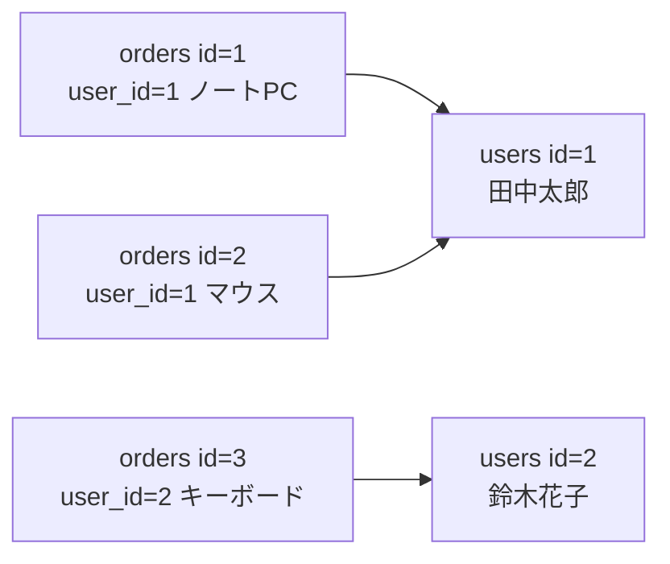
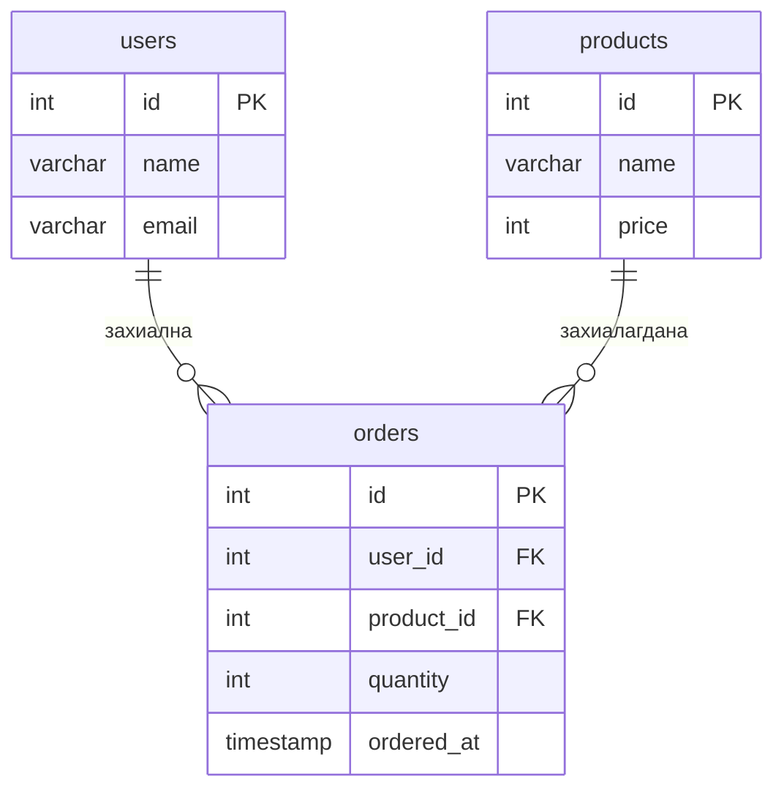
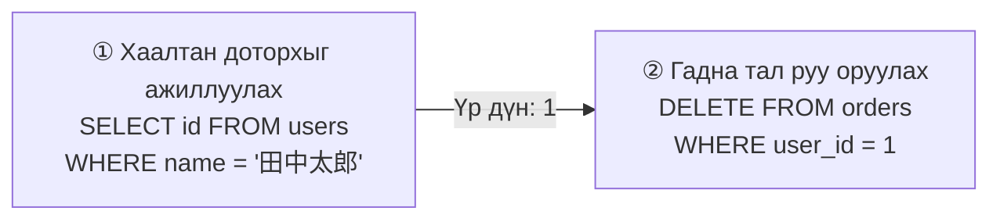

# Хичээл 09｜Хүснэгтийн харилцаа・JOIN — олон хүснэгтийн өгөгдлийг хослуулах

> 🇯🇵 Эх хувь (япон хэлээр): [20260728_資料.md](<../../../1年生_データ設計とアプリ開発/前期/20260728/20260728_資料.md>) <!-- original-ja-link -->

## Өнөөдрийн зорилго
- Хүснэгтийг яагаад хуваадгийг (нормчлол) тайлбарлаж чаддаг болох
- Гадаад түлхүүрийн ойлголтыг эзэмших
- INNER JOIN / LEFT JOIN-оор хүснэгтүүдийг нэгтгэж чаддаг болох

---

[Харилцаат өгөгдлийн сангийн тухай](../20260721/リレーショナルデータベース入門.md)

## 1. Хүснэгтийг яагаад хуваадаг вэ

Муу жишээ: бүгдийг 1 хүснэгтэд шахаж хийх

```
orders хүснэгт (муу жишээ)
id │ user_name │ user_email         │ product_name │ price
───┼───────────┼────────────────────┼──────────────┼───────
 1 │ 田中太郎  │ tanaka@example.com │ ノートPC     │ 98000
 2 │ 田中太郎  │ tanaka@example.com │ マウス       │  3200
 3 │ 鈴木花子  │ suzuki@example.com │ キーボード   │  8500
```

**Асуудал:**
- 田中太郎-ийн мэдээлэл 2 мөрөнд давхардаж байна (и-мэйл өөрчлөгдвөл бүх мөрийг шинэчлэх шаардлагатай)
- Өгөгдөл хоорондоо зөрчилдөхөд амархан

**Шийдэл: хүснэгтийг хувааж, гадаад түлхүүрээр холбох (нормчлол)**

---

## 2. Гадаад түлхүүр (Foreign Key)

**users хүснэгт**

| id | name | email |
|----|------|-------|
| 1 | 田中太郎 | tanaka@... |
| 2 | 鈴木花子 | suzuki@... |

**orders хүснэгт**

| id | user_id | product | price |
|----|---------|---------|-------|
| 1 | 1 | ノートPC | 98000 |
| 2 | 1 | マウス | 3200 |
| 3 | 2 | キーボード | 8500 |

`orders.user_id` нь `users.id`-г лавлаж байна. Үүнийг «гадаад түлхүүр (Foreign Key)» гэнэ.



---

## 3. Хүснэгт үүсгэх ба гадаад түлхүүр тохируулах

```sql
USE school_db;

-- users хүснэгт
CREATE TABLE users (
    id    INT AUTO_INCREMENT PRIMARY KEY,
    name  VARCHAR(100) NOT NULL,
    email VARCHAR(255) NOT NULL UNIQUE
);

-- products хүснэгт
CREATE TABLE products (
    id    INT AUTO_INCREMENT PRIMARY KEY,
    name  VARCHAR(100) NOT NULL,
    price INT NOT NULL
);

-- orders хүснэгт (гадаад түлхүүрээр холбоно)
CREATE TABLE orders (
    id         INT AUTO_INCREMENT PRIMARY KEY,
    user_id    INT NOT NULL,
    product_id INT NOT NULL,
    quantity   INT NOT NULL DEFAULT 1,
    ordered_at TIMESTAMP DEFAULT CURRENT_TIMESTAMP,
    
    -- Гадаад түлхүүрийн хязгаарлалт (лавлагааны бүрэн бүтэн байдлыг хадгална)
    FOREIGN KEY (user_id)    REFERENCES users(id),
    FOREIGN KEY (product_id) REFERENCES products(id)
);

-- Туршилтын өгөгдөл
INSERT INTO users (name, email) VALUES
    ('田中太郎', 'tanaka@example.com'),
    ('鈴木花子', 'suzuki@example.com'),
    ('山田次郎', 'yamada@example.com');

INSERT INTO products (name, price) VALUES
    ('ノートPC', 98000),
    ('マウス', 3200),
    ('キーボード', 8500);

INSERT INTO orders (user_id, product_id, quantity) VALUES
    (1, 1, 1),  -- 田中 1 ширхэг зөөврийн компьютер захиалсан
    (1, 2, 2),  -- 田中 2 ширхэг хулгана захиалсан
    (2, 3, 1),  -- 鈴木 1 ширхэг гар захиалсан
    (3, 1, 1),  -- 山田 1 ширхэг зөөврийн компьютер захиалсан
    (2, 1, 1);  -- 鈴木 1 ширхэг зөөврийн компьютер захиалсан
```

3 хүснэгтийн харилцааг зургаар үзүүлбэл дараах байдалтай. orders нь users болон products хоёуланг нь гадаад түлхүүрээр лавлаж байна.



---

[INNER JOIN ба LEFT JOIN-ийн ялгааны тухай](./JOIN入門.md)

## 4. INNER JOIN — хоёуланд нь байгаа өгөгдлийг л нэгтгэнэ

```sql
-- orders дээр users-ийн мэдээллийг нэгтгэх
SELECT
    orders.id,
    users.name    AS ユーザー名,
    users.email,
    orders.quantity
FROM orders
INNER JOIN users ON orders.user_id = users.id;

-- 3 хүснэгтийг нэгтгэх (orders + users + products)
SELECT
    orders.id,
    users.name      AS ユーザー名,
    products.name   AS 商品名,
    products.price  AS 単価,
    orders.quantity AS 数量,
    products.price * orders.quantity AS 合計金額
FROM orders
INNER JOIN users    ON orders.user_id    = users.id
INNER JOIN products ON orders.product_id = products.id
ORDER BY orders.id;
```

---

## 5. LEFT JOIN — зүүн хүснэгтийн бүх мөрийг оруулна

```sql
-- Хараахан захиалга өгөөгүй хэрэглэгчдийг ч оруулж харуулах үед
SELECT
    users.name,
    COUNT(orders.id) AS 注文数
FROM users
LEFT JOIN orders ON users.id = orders.user_id
GROUP BY users.id, users.name;

-- Захиалгагүй хэрэглэгчид ч харагдана
-- INNER JOIN бол зөвхөн захиалгатай хэрэглэгчид гарна
```

### 5-1. Нэмэлт хэрэглээ: хараахан захиалга өгөөгүй хэрэглэгчдийг л хайх

LEFT JOIN-оор нэгтгэх үед баруун талд (orders) таарах мөр байхгүй бол тэр баганууд `NULL` болдог. Энэ шинжийг ашиглавал «таараагүй мөрүүдийг л» шүүж чадна.

```sql
SELECT users.name, users.email
FROM users
LEFT JOIN orders ON users.id = orders.user_id
WHERE orders.id IS NULL;
```

**Бодох арга:**
1. `LEFT JOIN`-оор users хүснэгтийн бүх хэрэглэгчийг үлдээнэ (захиалгагүй хэрэглэгчийн orders хүснэгтийн баганууд `NULL` болно)
2. `WHERE orders.id IS NULL`-ээр «orders-тэй таараагүй мөрүүд»-ийг л шүүнэ
   → Өөрөөр хэлбэл «нэг ч удаа захиалга өгөөгүй хүмүүс» л үлдэнэ

`INNER JOIN`-д энэ хэв маягийг ашиглаж болохгүй (таараагүй мөрүүд үр дүнд огт гарч ирдэггүй учраас). «LEFT JOIN + `IS NULL`»-ийг хамт хэрэглэдэг түгээмэл хэв маяг гэж санаж авбал хэрэгтэй.

---

## 6. Нэгтгэн тооцоолох үйлдэлтэй хослуулах

```sql
-- Хэрэглэгч бүрийн худалдан авалтын нийт дүн
SELECT
    users.name AS ユーザー名,
    COUNT(orders.id) AS 注文件数,
    SUM(products.price * orders.quantity) AS 合計金額
FROM users
INNER JOIN orders    ON users.id          = orders.user_id
INNER JOIN products  ON orders.product_id = products.id
GROUP BY users.id, users.name
ORDER BY 合計金額 DESC;
```

---

## 7. HAVING — нэгтгэн тооцоолсны «дараа» шүүнэ

`WHERE` нь нэгтгэн тооцоолохоос **өмнөх** мөрүүдийг шүүдэг бол `HAVING` нь `GROUP BY`-ээр нэгтгэн тооцоолсны **дараах** үр дүнг шүүдэг.

```sql
-- Нийт дүн нь 100000 иен ба түүнээс дээш хэрэглэгчдийг л харуулах
SELECT
    users.name AS ユーザー名,
    SUM(products.price * orders.quantity) AS 合計金額
FROM users
INNER JOIN orders   ON users.id          = orders.user_id
INNER JOIN products ON orders.product_id = products.id
GROUP BY users.id, users.name
HAVING SUM(products.price * orders.quantity) >= 100000;
```

**WHERE ба HAVING-ийн ялгаа:**

| | Хэзээ шүүх | Юуг ашиглаж болох |
|---|---|---|
| `WHERE` | `GROUP BY`-ээр нэгтгэн тооцоолохоос **өмнө** | Мөр бүрийн түүхий баганууд (`orders.quantity` гэх мэт) |
| `HAVING` | `GROUP BY`-ээр нэгтгэн тооцоолсны **дараа** | `SUM()` `COUNT()` зэрэг нэгтгэн тооцооны үр дүн |

`SELECT ... FROM ... WHERE ... GROUP BY ... HAVING ... ORDER BY` гэсэн дарааллаар бичдэг ч бодитоор `WHERE`→`GROUP BY`→`HAVING`→`ORDER BY` гэсэн дарааллаар боловсруулагддаг. «`HAVING SUM(...) >= 100000` бол болно, `WHERE SUM(...) >= 100000` бол болохгүй (нэгтгэн тооцоолохоос өмнө тул SUM хараахан байхгүй)» гэж санаж аваарай.

---

## 8. Дэд асуулга — SELECT дотор SELECT бичих

`INSERT` эсвэл `DELETE` хийх үед хамаарах `id`-г мэдэхгүй байх тохиолдол бий. Тийм үед `SELECT`-ийн үр дүнг шууд нөхцөл болгон ашигладаг **дэд асуулга** хэрэгтэй.

```sql
-- Жишээ: «田中太郎»-ийн id-г нөхцөлд ашиглах гэсэн ч id нь хэд вэ гэдгийг мэдэхгүй

-- ① Муу жишээ биш ч 2 алхамд хуваагдана
SELECT id FROM users WHERE name = '田中太郎';  -- Үр дүн: 1
DELETE FROM orders WHERE user_id = 1;          -- Шалгасан 1-ийг гараар оруулна

-- ② Дэд асуулга ашиглавал 1 командаар бичиж болно
DELETE FROM orders
WHERE user_id = (SELECT id FROM users WHERE name = '田中太郎');
```

`( )` доторх `SELECT` эхэлж ажиллаад 1 утга (энд `id`) болж, гадна талын `WHERE user_id = энд` хэсэгт орж ирнэ гэж төсөөлөөрэй. «Хаалтан доторхыг эхэлж уншина» гэж бодвол ойлгоход амар.



```sql
-- INSERT-д ч мөн адил ашиглаж болох жишээ
INSERT INTO orders (user_id, product_id, quantity)
VALUES (
    (SELECT id FROM users WHERE name = '田中太郎'),
    (SELECT id FROM products WHERE name = 'USBハブ'),
    3
);
```

---

## Дүгнэлт

| Ойлголт | Тайлбар |
|------|------|
| Гадаад түлхүүр | Өөр хүснэгтийн үндсэн түлхүүрийг лавлах багана |
| INNER JOIN | Хоёр хүснэгтэд хоёуланд нь байгаа өгөгдлийг л нэгтгэнэ |
| LEFT JOIN | Зүүн хүснэгтийн бүх мөр＋баруун хүснэгтийн таарсан хэсгийг нэгтгэнэ |
| `ON хүснэгтA.col = хүснэгтB.col` | Нэгтгэх нөхцөл |
| LEFT JOIN + `WHERE ... IS NULL` | Баруун хүснэгттэй таараагүй мөрүүдийг л хайх түгээмэл хэв маяг |
| `WHERE` | Нэгтгэн тооцоолохоос өмнөх мөрүүдийг шүүнэ |
| `HAVING` | `GROUP BY`-ээр нэгтгэн тооцоолсны дараах үр дүнг шүүнэ |
| Дэд асуулга `(SELECT ...)` | `SELECT`-ийн үр дүнг өөр SQL командын нөхцөл эсвэл утга болгон ашиглана |

---

## Дараагийн хичээл (Хичээл 10)-ын танилцуулга

SQL дасгалын хүрээнд захиалгын удирдлагын өгөгдлийн сантай өөрсдөө ажиллана.  
SELECT / INSERT / UPDATE / DELETE / JOIN-ийг хослуулсан практик бодлогууд бодно.

<!-- nav:start -->

---

📎 Мөн уншаарай → [JOIN-ийн анхан шат](JOIN入門.md)

| ⬅️ Өмнөх | 🗺️ Ерөнхий зураг | Дараагийнх ➡️ |
|:--|:--:|--:|
| [Todo удирдах аппыг ажиллуулах дараалал](../20260723/Todo管理アプリ起動する流れ.md) | [Материалын ерөнхий зураг](../../README.md) | [07/28 SQL дасгал](20260728_演習.md) |

<!-- nav:end -->
