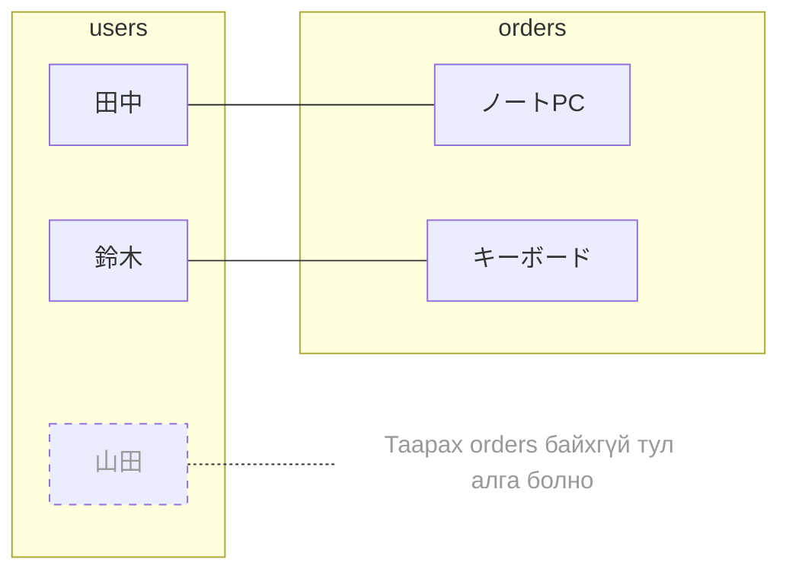
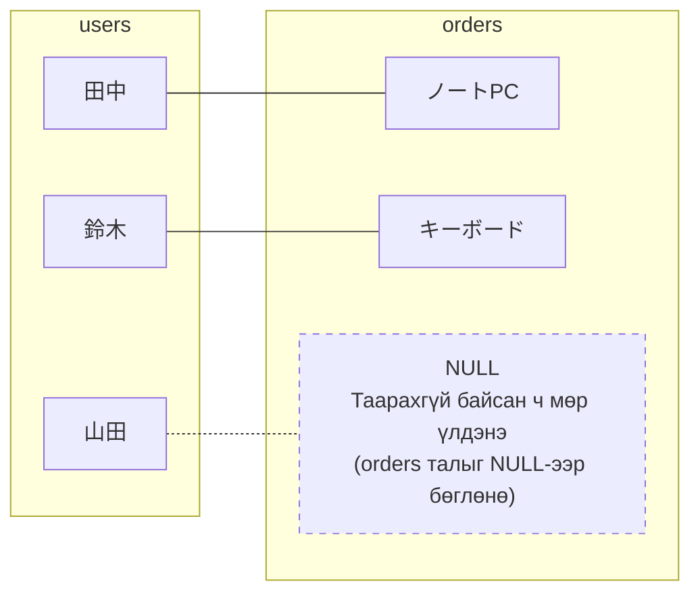

> 🇯🇵 Эх хувь (япон хэлээр): [JOIN入門.md](<../../../1年生_データ設計とアプリ開発/前期/20260728/JOIN入門.md>) <!-- original-ja-link -->

## Энэ нийтлэлээс юу мэдэх вэ

- INNER JOIN нь «хоёр хүснэгтэд хоёуланд нь байгаа өгөгдлийг л» нэгтгэдэг
- LEFT JOIN нь «зүүн хүснэгтийн бүх мөр＋баруун хүснэгтийн таарсан хэсгийг» нэгтгэдэг
- Ижил 2 хүснэгт, ижил нэгтгэх нөхцөлтэй байсан ч JOIN-ийн төрлөөс хамаарч үр дүнгийн мөрийн тоо өөрчлөгддөг

## Ашиглах 2 хүснэгт

`users` (хэрэглэгч) болон `orders` (захиалга)-аар тайлбарлая. Гол санаа нь **山田次郎 хараахан нэг ч удаа захиалга өгөөгүй** гэдэгт оршино.

### 🧑 users хүснэгт

| id | name |
|----|------|
| 1  | 田中太郎 |
| 2  | 鈴木花子 |
| 3  | 山田次郎 |

### 🛒 orders хүснэгт

| id | user_id | product |
|----|---------|---------|
| 1  | 1       | ノートPC |
| 2  | 2       | キーボード |

`orders.user_id` нь `users.id`-г зааж байна (гадаад түлхүүр). 山田次郎 (id=3)-г заасан мөр `orders`-д нэг ч байхгүй.

## INNER JOIN: хоёуланд нь байгаа өгөгдлийг л нэгтгэнэ

```sql
SELECT users.name, orders.product
FROM users
INNER JOIN orders ON users.id = orders.user_id;
```

**Үр дүн:**

| name | product |
|------|---------|
| 田中太郎 | ノートPC |
| 鈴木花子 | キーボード |

INNER JOIN-ийн дүрслэл (холбогдсон хосууд л үр дүнд гарна)



山田次郎-д `orders`-оос таарах мөр нэг ч байхгүй тул **үр дүнгээс алга болно**. «Хоёр хүснэгтэд хоёуланд нь байгаа өгөгдлийг л нэгтгэнэ» гэдэг нь ийм утгатай.

## LEFT JOIN: зүүн хүснэгтийн бүх мөр＋баруун хүснэгтийн таарсан хэсгийг нэгтгэнэ

```sql
SELECT users.name, orders.product
FROM users
LEFT JOIN orders ON users.id = orders.user_id;
```

**Үр дүн:**

| name | product |
|------|---------|
| 田中太郎 | ノートPC |
| 鈴木花子 | キーボード |
| 山田次郎 | NULL    |

LEFT JOIN-ийн дүрслэл (зүүн хүснэгт дэх бүх хүн үлдэнэ)



`FROM users LEFT JOIN orders`-ийн **FROM талд (зүүн талд) бичсэн users нь суурь** болно. 山田次郎 захиалгагүй байсан ч мөр болж үлдэх бөгөөд `orders` талын баганууд `NULL` (харгалзах зүйлгүй)-ээр бөглөгдөнө.

## Ялгах арга

- **`FROM A LEFT JOIN B`** → **A нь зүүн тал**, A-ийн бүх мөр заавал үлдэнэ
- Таараагүй мөр гарвал баруун талын (B) баганууд автоматаар `NULL` болно
- `INNER JOIN`-д ийм «бүгдийг үлдээх» үйлдэл байхгүй, зөвхөн таарсан мөрүүд үлдэнэ

## Алийг нь ашиглах вэ

| Хийхийг хүсэж буй зүйл | Ашиглах JOIN |
|---|---|
| Захиалгатай хүмүүсийн өгөгдлийг л харахыг хүсвэл | `INNER JOIN` |
| Нэг ч захиалга өгөөгүй хүмүүсийг оролцуулан бүгдийг жагсаахыг хүсвэл (жишээ: захиалга өгөөгүй, мэдээллийн и-мэйл илгээх хүмүүсийг олох) | `LEFT JOIN` |
| Хэрэглэгч бүрийн захиалгын тоог тоолохыг хүсвэл (0 захиалгатай хүнийг ч 0 гэж гаргахыг хүсвэл) | `LEFT JOIN` + `COUNT` |

3 дахь жишээ нь `20260728_資料.md`-ийн «5. LEFT JOIN» хэсэгт үзсэн, нэг ч захиалга өгөөгүй хэрэглэгчдийг мөн харуулдаг SQL юм. `INNER JOIN`-оор ижил зүйлийг хийвэл 山田次郎 шиг захиалга өгөөгүй хэрэглэгчид үр дүнд огт гарч ирэхгүй.

## Дүгнэлт

- `INNER JOIN` нь «хоёр хүснэгтэд хоёуланд нь байгаа өгөгдлийг л» нэгтгэнэ → таараагүй мөрүүд алга болно
- `LEFT JOIN` нь «`FROM`-ийн зүүн хүснэгтийн бүх мөр＋баруун хүснэгтийн таарсан хэсгийг» нэгтгэнэ → таараагүй ч зүүн хүснэгтийн мөрүүд үлдэж, баруун тал нь `NULL` болно
- «Бүх хүн / бүх бичлэгийг алгасалгүй харахыг хүсвэл» LEFT JOIN, «хоёуланд нь байгаа өгөгдөл л хангалттай бол» INNER JOIN гэж санаарай

<!-- nav:start -->

---

| ⬅️ Буцах | 🗺️ Ерөнхий зураг | Дараагийнх ➡️ |
|:--|:--:|--:|
| [07/28 Хүснэгтийн харилцаа・JOIN](20260728_資料.md) | [Материалын ерөнхий зураг](../../README.md) | [07/28 SQL дасгал](20260728_演習.md) |

<!-- nav:end -->
