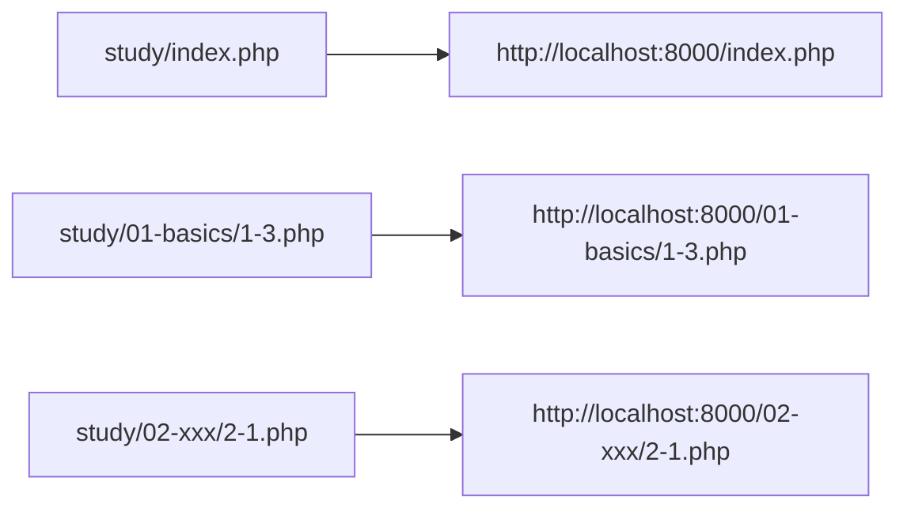

# PHP хөгжүүлэлтийн серверийг хэрхэн асаах

> 🇯🇵 Эх хувь (япон хэлээр): [PHP開発サーバーの立て方.md](<../../1年生_データ設計とアプリ開発/前期/PHP開発サーバーの立て方.md>) <!-- original-ja-link -->

PHP файлыг браузераар шууд нээвэл ажиллахгүй (эх код нь тэр чигээрээ харагдах / татагдана).
PHP нь серверийн талд тайлбарлагддаг хэл тул заавал `php -S` зэрэг серверээр дамжуулж хандана.

## Урьдчилсан нөхцөл

- PHP суулгасан байх (`php -v`-ээр шалгана)
- Энд `php`-д суулгагдсан хөгжүүлэлтийн серверийг ашиглана (production-д тохиромжгүй)
- Доорх командуудын `<хэрэглэгчийн нэр>`-ийг өөрийн компьютерийн хэрэглэгчийн нэрээр солих (жишээ: `taro`, `hanako` гэх мэт. Mac бол `whoami` командаар шалгаж болно)

## Арга 1: study хавтаснаас серверийг ажиллуулах

```bash
cd /Users/<хэрэглэгчийн нэр>/Desktop/study
php -S localhost:8000
```

`cd` (change directory) нь терминалын одоогийн хавтсыг (current directory) солих команд юм.
`cd /Users/<хэрэглэгчийн нэр>/Desktop/study` командаар `study` хавтас руу шилжсэний дараа `php -S`-ийг ажиллуулснаар
`study` нь серверийг ажиллуулсан хавтас буюу вэбийн үндсэн хавтас болно.

`php -S`-ийг ажиллуулсан хавтас нь вэбийн үндсэн хавтас (`/`) болно.
`study/`-ийн шууд доор `contact.php` байгаа тул URL нь шууд:

```
http://localhost:8000/contact.php
http://localhost:8000/1-3.php
http://localhost:8000/index.php
```

## Бүлэг тус бүрийн хавтасны бүтцээр хандах

Дасгал олширвол бүлэг бүрээр дэд хавтас үүсгэж цэгцэлнэ (жишээ: `01-basics/`).

```
study/
  index.php
  contact.php
  01-basics/
    1-1.php
    1-2.php
    1-3.php
  02-xxx/
    2-1.php
```

Серверийг өмнөхийн адил **study хавтаснаас** ажиллуулна (ажиллуулах хавтсыг өөрчлөхгүй).

```bash
cd /Users/<хэрэглэгчийн нэр>/Desktop/study
php -S localhost:8000
```

Серверийг ажиллуулсан хавтас нь вэбийн үндсэн хавтас болдог тул дэд хавтсанд байрлуулсан файлд хандахдаа
**URL-д тэр хавтасны нэрийг оруулах** шаардлагатай:

```
http://localhost:8000/index.php
http://localhost:8000/01-basics/1-3.php
http://localhost:8000/02-xxx/2-1.php
```

Өөрөөр хэлбэл «файлыг байрлуулсан зам»＝«URL-ийн зам» (`study/`-ээс эхэлсэн харьцангуй зам) гэж шууд харгалзана.



## Серверийг зогсоох

Серверийг ажиллуулсан терминал дээр `Ctrl + C` дарна.

## Портын дугаарын тухай

`8000`-ын оронд сул байгаа дурын портын дугаарыг зааж болно (жишээ: `php -S localhost:8080`).

<!-- nav:start -->

---

| ⬅️ Буцах | 🗺️ Ерөнхий зураг | Дараагийнх ➡️ |
|:--|:--:|--:|
| [06/30 PHP-ийн анхан шат](20260630/20260630_資料.md) | [Материалын ерөнхий зураг](../README.md) | [06/30 Дасгал](20260630/20260630_演習.md) |

<!-- nav:end -->
