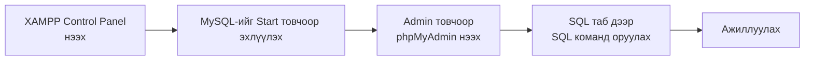
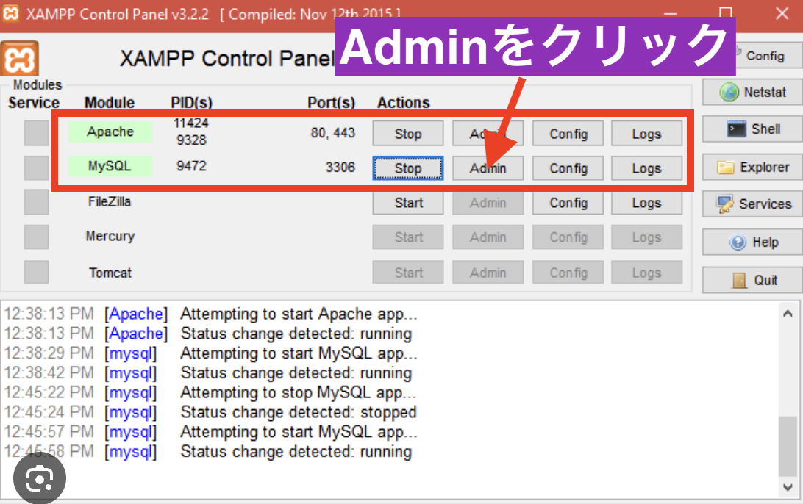
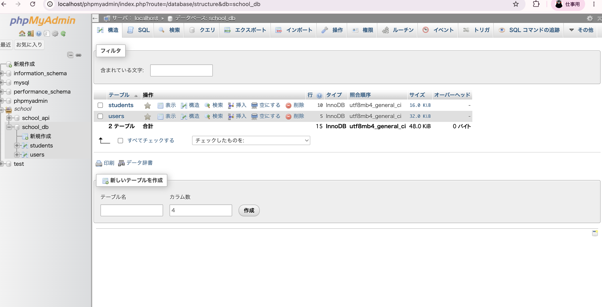
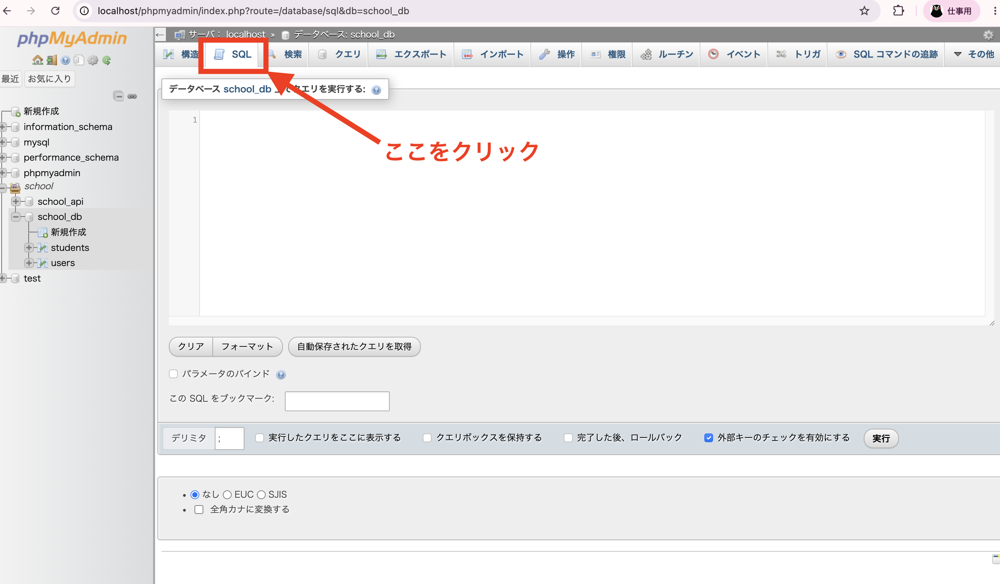

# Өгөгдлийн сангийн серверийг хэрхэн асаах (XAMPP)

> 🇯🇵 Эх хувь (япон хэлээр): [データベースサーバーの立て方.md](<../../../1年生_データ設計とアプリ開発/前期/データベースサーバーの立て方/データベースサーバーの立て方.md>) <!-- original-ja-link -->

## Энэ нийтлэлээс юу мэдэх вэ

- XAMPP-аар юуг асааж байгаа вэ
- phpMyAdmin (өгөгдлийн сангийн удирдлагын дэлгэц)-ийг хэрхэн нээх
- phpMyAdmin дээр SQL команд ажиллуулах арга

Ерөнхий дараалал нь дараах байдалтай.

## 1. XAMPP гэж юу вэ

XAMPP (замп) нь вэб аппликейшн ажиллуулахад шаардлагатай дараах 2 зүйлийг компьютерт хялбархан суулгах боломж олгодог програм юм.

- **Apache**: вэб хуудсыг харуулах вэб сервер
- **MySQL**: өгөгдлийг хадгалах өгөгдлийн сангийн сервер

Аппликейшн хөгжүүлэхэд «өгөгдөл хадгалах газар (өгөгдлийн сан)» хэрэгтэй тул эхлээд MySQL-ийг ажиллуулах шаардлагатай.

## 2. XAMPP-ийг ажиллуулж, ажиллаж байгаа эсэхийг шалгах

XAMPP-ийн програм (XAMPP Control Panel)-ыг нээнэ.

`Apache` болон `MySQL` мөрийн `Actions`-д `Stop` гэж харагдаж байвал аль хэдийн асаалттай байна. Хэрэв `Start` гэж харагдаж байвал асаагүй байгаа тул тэр товчийг дарж асаагаарай.

## 3. phpMyAdmin (удирдлагын дэлгэц)-ийг нээх

MySQL мөрөнд байгаа `Admin` товчийг дарна.

Тэгэхэд браузерт **phpMyAdmin** гэдэг дэлгэц нээгдэнэ. phpMyAdmin нь MySQL-д хадгалагдсан өгөгдлийг дэлгэц дээр харах, засах боломжтой удирдлагын хэрэгсэл юм. Энд аль хэдийн үүсгэсэн өгөгдлийн сан (жишээ: `school_db`) доторх хүснэгтүүдийн (`students`, `users` гэх мэт) жагсаалтыг харж болно.

## 4. SQL команд ажиллуулах

Хүснэгт үүсгэх, өгөгдөл бүртгэх, өөрчлөх үйлдлийг SQL командаар шууд хийх бол дэлгэцийн дээд хэсэгт байгаа `SQL` табыг дарна.

Табыг нээхэд SQL команд оруулах талбар гарч ирнэ. Тэнд SQL командаа оруулаад «実行» (Ажиллуулах) товчийг дарвал тухайн команд өгөгдлийн санд хэрэгжинэ.

## Дүгнэлт

- XAMPP нь Apache (вэб сервер) болон MySQL (өгөгдлийн сан)-ийг хамтад нь ажиллуулах хэрэгсэл
- MySQL-ийн `Admin`-аас phpMyAdmin гэдэг өгөгдлийн сангийн удирдлагын дэлгэцийг нээж болно
- phpMyAdmin-ийн `SQL` табаас SQL командыг шууд ажиллуулж болно

<!-- nav:start -->

---

| ⬅️ Буцах | 🗺️ Ерөнхий зураг | Дараагийнх ➡️ |
|:--|:--:|--:|
| [07/21 Яагаад DB хэрэгтэй вэ](../20260721/20260721_資料.md) | [Материалын ерөнхий зураг](../../README.md) | [07/21 SQL-ийн үндэс ① (SELECT)](../20260721/20260721_資料_2.md) |

<!-- nav:end -->
