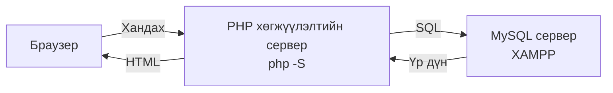
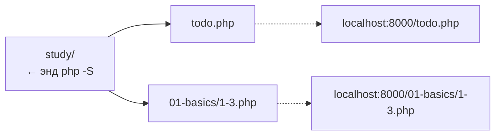
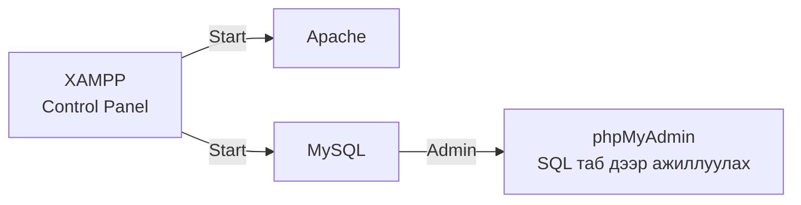
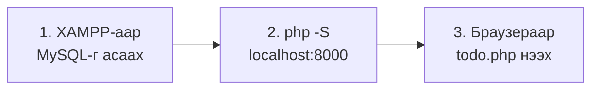

# Өмнөх улирлын давталт

> 🇯🇵 Эх хувь (япон хэлээр): [20261001_復習.md](<../../../1年生_データ設計とアプリ開発/後期/20261001/20261001_復習.md>) <!-- original-ja-link -->

Дараагийн улирал эхлэхээс өмнө өмнөх улиралд хийсэн «аппыг ажиллуулах бэлтгэл»-ээ санацгаая.
Веб аппыг ажиллуулахад **2 сервер** хэрэгтэй байсан.



- **PHP хөгжүүлэлтийн сервер**: PHP програмыг ажиллуулах үүрэгтэй
- **MySQL сервер**: өгөгдлийг хадгалах үүрэгтэй

**Аль нэг нь зогссон байхад л апп ажиллахгүй.**

---

## 1. PHP хөгжүүлэлтийн сервер

PHP нь серверийн талд ажилладаг хэл тул `.php` файлыг браузераар шууд нээвэл ажиллахгүй.
Тиймээс PHP-д суулгагдсан хөгжүүлэлтийн серверийг асаасан.

Windows дээр **PowerShell** (Start цэснээс «PowerShell» гэж хайна) ашиглан ажиллуулна.

```powershell
cd C:\Users\<хэрэглэгчийн нэр>\Desktop\study
php -S localhost:8000
```

> **`php` олдсонгүй гэж гарвал**
> XAMPP-д байгаа PHP-г байршлыг нь зааж асаана.
>
> ```powershell
> C:\xampp\php\php.exe -S localhost:8000
> ```

`php -S`-ийг ажиллуулсан хавтас нь URL-ийн `/` (root) болно.
Хавтас доторх файлд хандахдаа URL-д тэр хавтасны нэрийг нэмж бичнэ.



Зогсоохдоо асаасан PowerShell дээр `Ctrl + C` дарна.

Дэлгэрэнгүйг → [PHP хөгжүүлэлтийн серверийг хэрхэн асаах](../../前期/PHP開発サーバーの立て方.md)

---

## 2. XAMPP (MySQL)

Өгөгдөл хадгалах газар болгож XAMPP-аар MySQL-г асаасан.
XAMPP Control Panel-ийн `Start` товчийг дараад, `Stop` болж өөрчлөгдвөл ажиллаж байна.



MySQL мөрийн `Admin` товчийг дарахад өгөгдлийн сангийн удирдлагын дэлгэц (phpMyAdmin) нээгдэнэ.
`SQL` табаас SQL командыг шууд ажиллуулж болдог байсан.

Дэлгэрэнгүйг → [Өгөгдлийн сангийн серверийг хэрхэн асаах (XAMPP)](../../前期/データベースサーバーの立て方/データベースサーバーの立て方.md)

---

## 3. Аппыг ажиллуулах дараалал

PHP-ээс PDO-оор MySQL-д холбогдож, Todo удирдах апп (`todo.php`)-ыг ажиллуулсан.
Дараах дарааллаар асаана.



Дэлгэрэнгүйг → [Todo удирдах аппыг ажиллуулах дараалал](../../前期/20260723/Todo管理アプリ起動する流れ.md)

<!-- nav:start -->

---

| ⬅️ Өмнөх | 🗺️ Ерөнхий зураг | Дараагийнх ➡️ |
|:--|:--:|--:|
| [07/28 SQL дасгал](../../前期/20260728/20260728_演習.md) | [Материалын ерөнхий зураг](../../README.md) | [10/01 Эх кодын удирдлагын анхан шат](20261001_資料_1.md) |

<!-- nav:end -->
