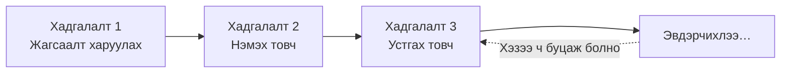
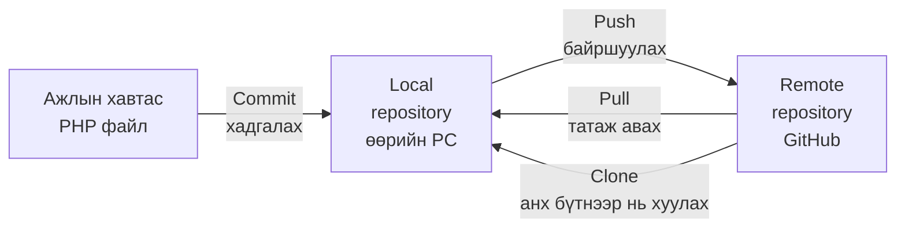
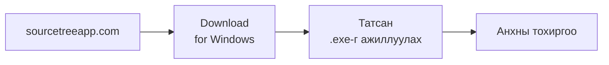
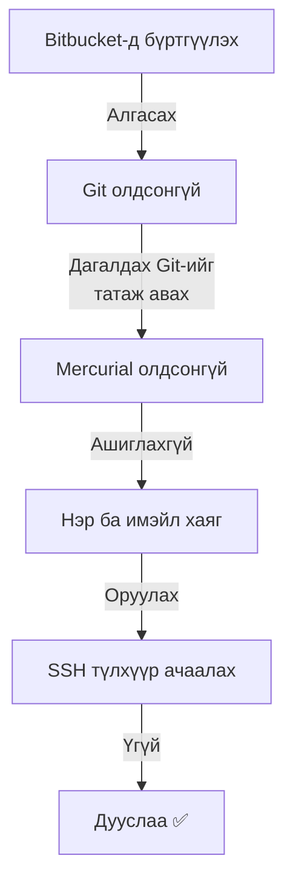
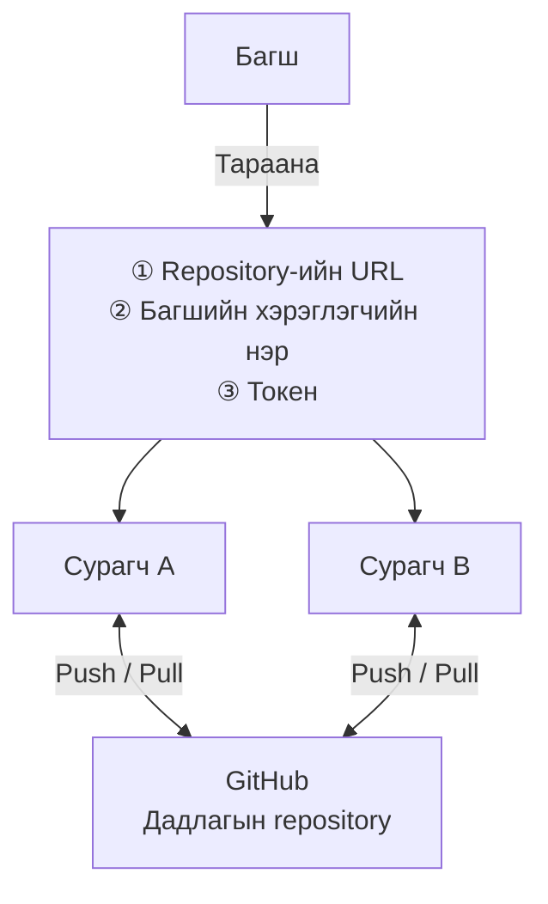
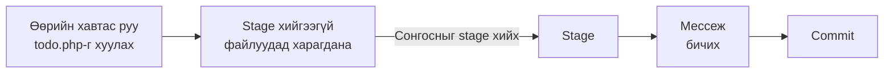
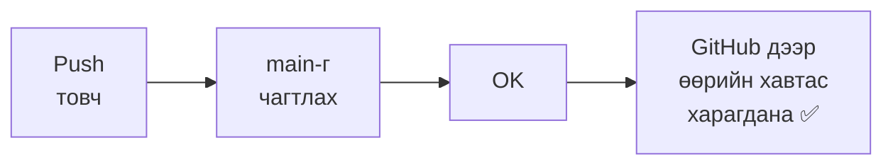
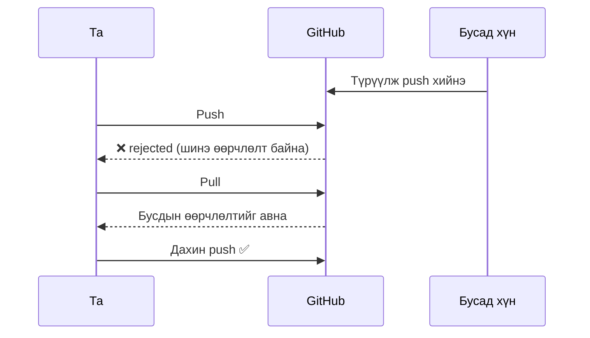
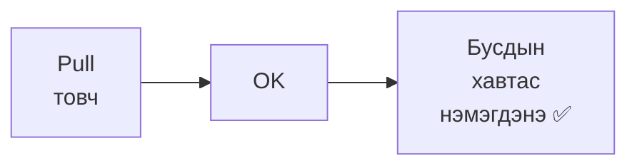
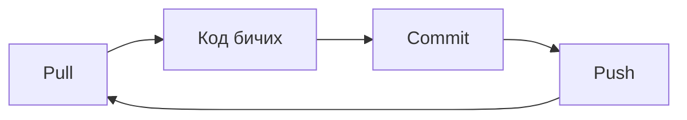

# Эх кодын удирдлагын анхан шат — SourceTree болон GitHub-аар кодоо удирдах

> 🇯🇵 Эх хувь (япон хэлээр): [20261001_資料_1.md](<../../../1年生_データ設計とアプリ開発/後期/20261001/20261001_資料_1.md>) <!-- original-ja-link -->

## Өнөөдрийн зорилго
- Эх кодын удирдлага яагаад хэрэгтэйг ойлгох
- SourceTree дээр commit, push, pull хийж чаддаг болох

[Өмнөх улирлын давталт](./20261001_復習.md)

---

## 1. Эх кодын удирдлага яагаад хэрэгтэй вэ?

Танд ийм зүйл тохиолдож байсан уу?

```
study/
  todo.php
  todo_コピー.php
  todo_動いてたやつ.php
  todo_最新2.php   ← аль нь үнэхээр хамгийн сүүлийн хувилбар вэ?
```

Файлаа хуулж хадгалдаг аргаар бол аль нь хамгийн сүүлийн хувилбар, хаана юу зассанаа мэдэхээ больдог.
Компьютер эвдэрвэл бүгд устчихна.

Git ашиглавал тоглоом шиг **хадгалалтын цэг** үлдээж болно.
Эвдэлчихсэн ч гэсэн, хэвийн ажиллаж байсан үе рүүгээ хэзээ ч буцаж болно.



---

## 2. Git, GitHub, SourceTree

Нэр нь төстэй ч, тус бүр өөр үүрэгтэй.

| Нэр | Юу вэ? | Зүйрлэвэл |
|------|-----------|-----------|
| **Git** | Түүхийг бүртгэдэг систем | Хадгалах функц |
| **GitHub** | Түүхийг интернэтэд байршуулдаг үйлчилгээ | Үүлэн дэх хадгалалтын сан |
| **SourceTree** | Git-ийг дэлгэц дээрээс удирддаг програм | Хадгалалтын цонх |

Git-ийг ер нь PowerShell зэрэгт команд бичиж ашигладаг ч, өнөөдөр SourceTree ашиглан **хулганаар** хийнэ.

---

## 3. Нэр томьёог зургаар цээжилье

Git-д файл «ажлын хавтас → өөрийн PC → GitHub» хооронд шилжиж явдаг.
Сумны нэр нь шууд үйлдлийн нэр болно.



- **Repository**: түүхийг удирддаг «хайрцаг». Өөрийн PC дээр байгааг нь **local**, GitHub дээр байгааг нь **remote** гэж нэрлэдэг
- **Commit**: өөрчлөлтийг хадгалалтын цэг болгон бүртгэх
- **Push**: өөрийн PC дээрх хадгалалтыг GitHub руу байршуулах
- **Pull**: GitHub дээрх хамгийн сүүлийн төлөвийг өөрийн PC рүү татаж авах
- **Clone**: GitHub дээрх repository-г анх удаа бүтнээр нь хуулж авах

---

## 4. SourceTree суулгах

Албан ёсны сайтаас суулгагчийг татаж аваад ажиллуулна.



Суулгах явцад хэд хэдэн асуулт гарна.



| Асуух зүйл | Сонгох зүйл |
|------------|---------|
| Bitbucket (Atlassian)-д бүртгүүлэх | `スキップ` (Алгасах; өнөөдөр ашиглахгүй) |
| Git олдсонгүй | **埋め込み版のGitをダウンロード** (Дагалдах Git-ийг татаж авах; SourceTree-д зориулсан Git суугдана) |
| Mercurial олдсонгүй | `Mercurialを使いたくない` (Mercurial ашиглахыг хүсэхгүй; өнөөдөр ашиглахгүй) |
| Нэр ба имэйл хаяг | Оруулна. Энэ нэр **commit-ийн зохиогч** болж бүртгэгдэнэ |
| SSH түлхүүр ачаалах эсэх | `いいえ` (Үгүй; өнөөдөр токен ашиглах тул хэрэггүй) |

> Дэлгэц дээрх бичвэр хувилбараас хамаарч бага зэрэг өөр байж болно. Эргэлзвэл багшаасаа асуугаарай.

> **Өөрийгөө таних боломжтой нэр оруулаарай**
> Өнөөдөр бүгд нэг repository ашиглах тул `yamada-taro` гэх мэтээр **хэний commit болох нь мэдэгдэх нэр** өгөөрэй.

---

## 5. Өнөөдрийн ажиллах зарчим

Өнөөдөр багшийн GitHub дээр бэлдсэн **дадлагын repository**-г ангийнхан бүгдээрээ ашиглана.
Өөрийн GitHub бүртгэлийг хараахан ашиглахгүй, багшийн өгөх 3 мэдээллээр холбогдоно.



**Токен** гэдэг нь GitHub-д «энэ хүн үйлдэл хийж болно» гэж мэдэгдэх, нууц үгийн оронд ашигладаг нууц код юм (`github_pat_`-аар эхэлсэн урт тэмдэгт мөр).
Өнөөдрийн токеныг зөвхөн дадлагын repository дээр ажиллах боломжтойгоор хязгаарласан.

> ⚠️ **Токеноо бусдад бүү харуул, SNS болон чатад бүү тавь**

---

## 6. Clone хийх

Багшийн repository-г өөрийн PC рүү хуулна.


SourceTree-ийн дээд хэсэгт байгаа `Clone`-г дараад, дараах байдлаар оруулна.

| Талбар | Оруулах зүйл |
|------|------------|
| Эх зам / URL | Багшаас авсан repository-ийн URL |
| Хадгалах зам | `C:\Users\<хэрэглэгчийн нэр>\Desktop\<repository-ийн нэр>` |

Явцын дунд хэрэглэгчийн нэр, нууц үг асуувал **нууц үгийн талбарт токеноо буулгаж тавина**.

✅ Desktop дээр `<repository-ийн нэр>` хавтас үүсэж, дотор нь `README.md` байвал амжилттай.

Оруулсан токен Windows-ийн «Credential Manager»-т хадгалагдах тул дараагийн удаа дахин асуухгүй.

> **Desktop дээр хавтас харагдахгүй бол**
> OneDrive ашигладаг PC дээр Desktop-ийн байршил `C:\Users\<хэрэглэгчийн нэр>\OneDrive\デスクトップ` байх тохиолдол бий.
> Хадгалах газрын `...` товчноос Explorer-оор Desktop-оо сонговол найдвартай.

---

## 7. Commit хийх

Өмнөх улиралд хийсэн PHP файлаа clone хийсэн хавтас руу хийгээд commit хийнэ.
Бүгд нэг repository ашиглах тул **өөрийн нэртэй хавтас** үүсгээд, түүн дотроо хийнэ.
Ингэвэл бусдын файлтай давхцахгүй.

```
<repository-ийн нэр>/
  README.md
  yamada-taro/     ← өөрийн хавтас
    todo.php
  suzuki-hanako/   ← бусад хүн
    todo.php
```

Explorer-оор файлаа хуулсны дараа SourceTree-ийн зүүн талын `ファイルステータス` (Файлын төлөв)-ийг нээнэ.
«ステージしていないファイル» (Stage хийгээгүй файлууд)-д гарсан файлыг «ステージ» (Stage) руу шилжүүлээд, мессеж бичиж commit хийнэ.



**Stage** гэдэг нь «энэ удаагийн хадгалалтад оруулах файлууд»-ыг сонгох газар юм.

Commit мессежид дараа нь харахад ойлгомжтой байхаар **юу хийснээ** бичээрэй.

| ❌ Муу мессеж | ⭕ Сайн мессеж |
|----------|----------|
| Засвар | Todo-ийн устгах товч ажиллахгүй байсан алдааг зассан |
| Шинэчлэл | Todo жагсаалтад дуусах хугацааны багана нэмсэн |

---

## 8. Push хийх

Зөвхөн commit хийсэн бол зөвхөн өөрийн PC дотор л бүртгэгдсэн байна.
Push хийж GitHub руу байршуулна.



Багшийн дэлгэцэнд харуулж буй GitHub хуудсан дээр өөрийн хавтас гарч ирвэл амжилттай.

### Алдаа (rejected) гарвал

Өөр хүн түрүүлж push хийсэн бол GitHub дээрх төлөв илүү шинэ болсон байна.
Энэ чигээрээ push хийвэл GitHub татгалзана (rejected).
**Эхлээд pull хийж хамгийн сүүлийн өөрчлөлтийг авсны дараа** дахин push хийгээрэй.



---

## 9. Pull хийх

Бусдын push хийсэн өөрчлөлтийг өөрийн PC рүү татаж авна.



Explorer-оор Desktop дээрх `<repository-ийн нэр>` хавтсыг нээгээд, бусдын хавтас нэмэгдсэн байвал амжилттай.
Ингэж GitHub-ээр дамжуулан **бүх хүний өөрчлөлтийг хуваалцаж болдог** нь GitHub-ийн давуу тал юм.

---

## 10. Ажлын урсгал

Git ашигласан хөгжүүлэлтэд дараах урсгалыг давтана.



- **Ажил эхлэхээсээ өмнө pull**: бусдын өөрчлөлтийг эхэлж авах
- **Ойр ойрхон commit хийх**: «Энд хүртэл ажиллаж байна» гэж бодвол хадгална
- **Ажлын төгсгөлд push**: GitHub-д хадгалж хуваалцана

> Өнөөдрийн repository болон токен **зөвхөн дадлагад зориулсан** (хичээлийн дараа ашиглах боломжгүй болно).
> Өөрийн repository үүсгэх → [GitHub бүртгэл болон repository үүсгэх арга](../20261008/20261008_資料_1.md)

<!-- nav:start -->

---

| ⬅️ Өмнөх | 🗺️ Ерөнхий зураг | Дараагийнх ➡️ |
|:--|:--:|--:|
| [10/01 Өмнөх улирлын давталт](20261001_復習.md) | [Материалын ерөнхий зураг](../../README.md) | [10/08 GitHub бүртгэл болон repository](../20261008/20261008_資料_1.md) |

<!-- nav:end -->
