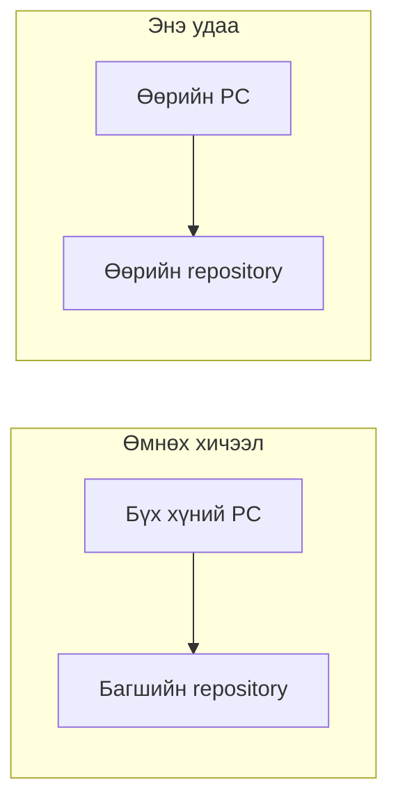
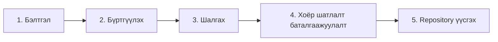
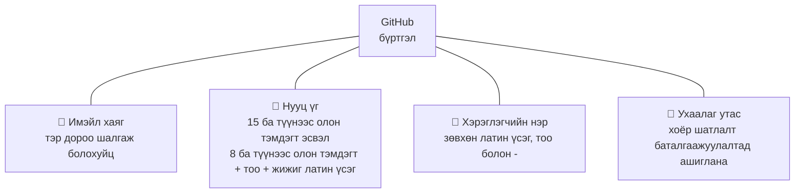
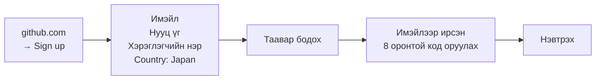
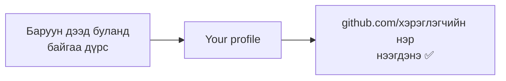
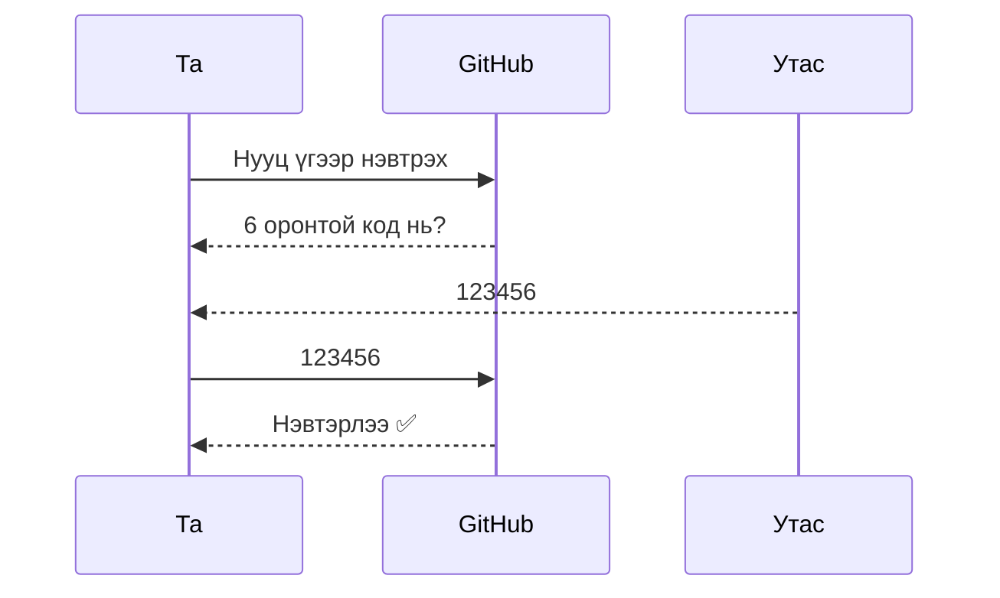
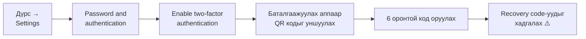
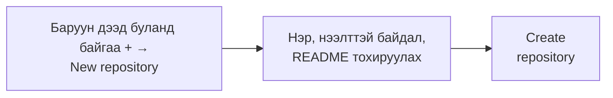
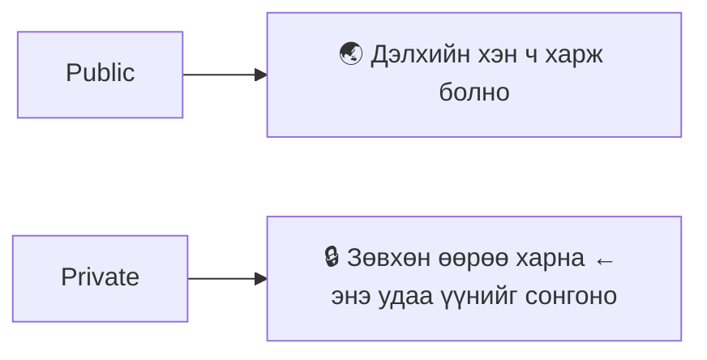

> 🇯🇵 Эх хувь (япон хэлээр): [20261008_資料_1.md](<../../../1年生_データ設計とアプリ開発/後期/20261008/20261008_資料_1.md>) <!-- original-ja-link -->

# GitHub бүртгэл болон repository үүсгэх арга

## Өнөөдрийн зорилго
- GitHub бүртгэл үүсгэж чаддаг болох
- Өөрийн repository үүсгэж чаддаг болох

[Эх кодын удирдлагын анхан шат руу буцах](../20261001/20261001_資料_1.md)

---

## Өмнөх хичээлийн давталт

Өмнөх хичээлээр бид бүгдээрээ **багшийн GitHub бүртгэл дээрх repository** руу push хийсэн.

Энэ удаа **өөрийн GitHub бүртгэл үүсгэж, өөрийн repository** бэлдэнэ.
Ингэснээр өөрийн кодоо өөрийн гэсэн газарт удирдах боломжтой болно.

---

## Ерөнхий урсгал

Өнөөдөр дараах 5 алхмаар GitHub дээр зөвхөн өөртөө зориулсан код хадгалах газар бэлдэнэ.

---

## 1. Бэлдэх зүйлс

Бүртгүүлж эхлэхээсээ өмнө дараах 4 зүйлийг бэлдээрэй.

- **Имэйл хаяг**: баталгаажуулах код ирэх тул хичээлийн үеэр тэр дороо шалгаж болох хаяг ашиглана
- **Ухаалаг утас**: дараа нь тохируулах хоёр шатлалт баталгаажуулалтад ашиглана

### Хэрэглэгчийн нэрийг хэрхэн сонгох вэ

Хэрэглэгчийн нэр `https://github.com/<хэрэглэгчийн нэр>` гэх мэтээр **URL-д орж, бусдад харагдах нэр** юм.
Ирээдүйд портфолио болгон бусдад үзүүлж магадгүй тул хошигносон, зохимжгүй нэрээс зайлсхийгээрэй.
Жинхэнэ нэрээ ил гаргахыг хүсэхгүй бол жинхэнэ нэр байх албагүй.

| ❌ Зайлсхийх | ⭕ Сайн |
|-------------|----------|
| `unko-man`, `aaaa1234` | `taro-yamada`, `tyamada-dev` |

---

## 2. Бүртгүүлэх

https://github.com -г нээж, баруун дээд буланд байгаа `Sign up`-аас бүртгүүлнэ.

- Хэрэглэгчийн нэрийг аль хэдийн хэн нэгэн ашигласан бол улаанаар харагдах тул өөр нэр сонгоно
- **Таавар** нь «хүн мөн эсэхийг шалгах» зорилготой. Дэлгэцийн зааврын дагуу хариулна
- Бүртгүүлсэн имэйл рүү ирсэн **8 оронтой код**-ыг оруулбал бүртгэл дуусна

Явцын дунд асуулт эсвэл багц сонгох цонх гарвал дараах байдлаар үргэлжлүүлнэ.

| Цонх | Сонгох зүйл |
|------|---------|
| Ашиглах зорилгын асуулт | `Skip personalization` (алгасах) |
| Багц | **Free (үнэгүй)** |

> **Имэйл ирэхгүй бол**
> Спам хавтсаа шалгах → хэдэн минут хүлээгээд `Resend the code`-оор дахин илгээх → тэгсэн ч ирэхгүй бол хаягаа буруу бичсэн эсэхийг шалгах

---

## 3. Шалгах

Бүртгэл үүссэн эсэхийг өөрийн профайл хуудсыг нээж шалгана.

**Өөрийн хэрэглэгчийн нэрийг тэмдэглэж аваарай.** Дараа нь ашиглана.

---

## 4. Хоёр шатлалт баталгаажуулалт

**Хоёр шатлалт баталгаажуулалт (2FA)** гэдэг нь нууц үгээс гадна **утсан дээр гарах 6 оронтой код**-оор нэвтрэлтийг баталгаажуулдаг систем юм.
Нууц үг тань задарсан ч, утас тань байхгүй бол хэн ч нэвтэрч чадахгүй.

GitHub хоёр шатлалт баталгаажуулалт тохируулахыг шаарддаг тул нэвтэрснээс хойш хэсэг хугацааны дараа тохируулах заавар гарч ирнэ.

### Тохируулах алхам

Утсандаа баталгаажуулах апп (Google Authenticator гэх мэт) суулгаад эхэлнэ.

> ⚠️ **Recovery code-уудыг заавал хадгалаарай!**
> Утсаа гээсэн үед нэвтрэх сүүлчийн арга нь энэ юм.
> Гээчихвэл бүртгэлдээ нэвтэрч чадахгүй болох тохиолдол бий.

---

## 5. Repository үүсгэх

Бүртгэл үүссэний дараа өөрийн кодоо хадгалах **repository** (түүхийг удирддаг хайрцаг) үүсгэнэ.

Дараах байдлаар тохируулна.

| Талбар | Тохиргоо |
|------|------------|
| Repository name | `php-study` |
| Нээлттэй байдал | **`Private`** |
| Add README | **Асаах** |

**Нээлттэй байдал** гэдэг нь энэ repository-г хэн харж болохыг тохируулах зүйл юм.
Дадлагын кодыг `Private` болгож тохируулаарай.

**README** нь repository-ийн тайлбарыг бичдэг файл юм.
Эхнээсээ нэг файл байвал дараа нь clone хийхэд агуулга нь орж ирсэн эсэхийг шалгаж болно.

### Шалгах ✅

Дараах 3 зүйл бүрдсэн бол бэлэн боллоо.

- URL нь `github.com/<хэрэглэгчийн нэр>/php-study` болсон байна
- `README.md` харагдаж байна
- Repository-ийн нэрний хажууд `Private` гэж харагдаж байна

---

Дараа нь үүсгэсэн `php-study` руугаа дадлагын орчноо push хийнэ → [Дадлагын орчноо өөрийн repository руу push хийх](./20261008_資料_2.md)

<!-- nav:start -->

---

| ⬅️ Өмнөх | 🗺️ Ерөнхий зураг | Дараагийнх ➡️ |
|:--|:--:|--:|
| [10/01 Эх кодын удирдлагын анхан шат](../20261001/20261001_資料_1.md) | [Материалын ерөнхий зураг](../../README.md) | [10/08 Дадлагын орчноо push хийх](20261008_資料_2.md) |

<!-- nav:end -->
