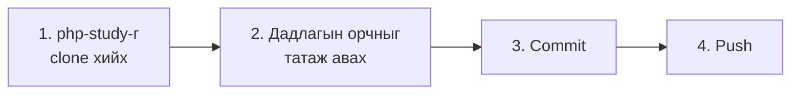
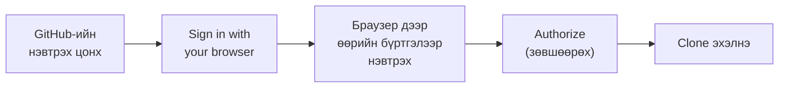
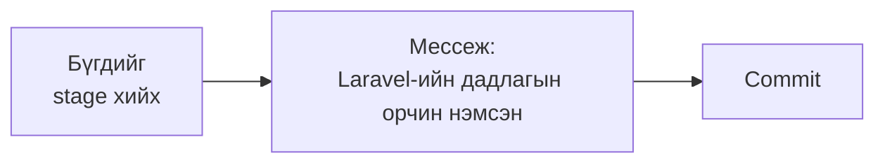

# Дадлагын орчноо өөрийн repository руу push хийх

> 🇯🇵 Эх хувь (япон хэлээр): [20261008_資料_2.md](<../../../1年生_データ設計とアプリ開発/後期/20261008/20261008_資料_2.md>) <!-- original-ja-link -->

## Өнөөдрийн зорилго
- Өөрийн GitHub бүртгэлээр нэвтэрч clone, push хийж чаддаг болох
- Дадлагын орчноо өөрийн repository руу push хийж чаддаг болох

[GitHub бүртгэл болон repository үүсгэх арга руу буцах](./20261008_資料_1.md)

---

## Ерөнхий урсгал

[Материал 1](./20261008_資料_1.md)-д үүсгэсэн `php-study` руу багшийн бэлдсэн **дадлагын орчныг** хийж push хийнэ.



---

## 1. php-study-г clone хийх

Өмнөх удаагийнх шиг SourceTree-ийн `Clone`-оор өөрийн PC рүү хуулна.
Өмнө нь токентой URL-аар clone хийсэн бол энэ удаа **өөрийн GitHub бүртгэлээр нэвтэрч** холбогдоно.

| Талбар | Оруулах зүйл |
|------|------------|
| Эх зам / URL | `https://github.com/<өөрийн хэрэглэгчийн нэр>/php-study.git` |
| Хадгалах зам | `C:\Users\<хэрэглэгчийн нэр>\Desktop\php-study` |

`クローン` (Clone)-г дарахад GitHub-ийн нэвтрэх цонх гарч ирнэ.
`Sign in with your browser` (браузераар нэвтрэх)-г сонгоод, **өөрийн бүртгэлээр** нэвтэрнэ.



- Браузер дээр нэвтрэхийг шаардвал Материал 1-д үүсгэсэн бүртгэлээрээ нэвтэрнэ (хоёр шатлалт баталгаажуулалтын 6 оронтой кодыг ч оруулна)
- `Authorize` (зөвшөөрөх)-г дарвал SourceTree руу буцаж clone эхэлнэ
- Нэвтрэх мэдээлэл Windows-д хадгалагдах тул дараагийн удаа асуухгүй

✅ Desktop дээр `php-study` хавтас үүсэж, дотор нь `README.md` байвал амжилттай.

---

## 2. Дадлагын орчныг татаж авах

Багшийн repository-г ZIP-ээр татаж аваад, доторх `practice` хавтасны **агуулгыг** гаргаж авна.


**Багшийн repository:** https://github.com/hakobunet/iica-koyama

Задалсан хавтас дотор дараах байршилд `practice` байна.

```
iica-koyama-main/
  docs/
    1年生_データ設計とアプリ開発/
      practice/   ← үүний агуулгыг хуулна
```

`practice` хавтсыг нээгээд **агуулгыг бүгдийг нь** `php-study`-ийн **шууд доор** хуулна (`practice` хавтсыг өөрийг нь үүсгэхгүй).

```
php-study/
  README.md          ← practice-ийн README.md-ээр сольж болно
  .gitattributes
  mysql/
    compose.yaml
  laravel/
    .gitignore
    compose.yaml
    Dockerfile
    entrypoint.sh
```

> **`README.md` ижил нэртэй давхцвал**
> «Файлыг солих»-ыг сонгож болно. Дадлагын орчныг хэрхэн ажиллуулах тухай бичсэн README болно.

> **Доторх файлуудыг нэг нэгээр нь бүү сонго**
> `.gitattributes`, `.gitignore` гэх мэт нэр нь `.`-аар эхэлдэг файлууд чухал тохиргооны файлууд юм.
> Анзаарахад хэцүү байж болох тул `practice` хавтсыг нээгээд `Ctrl + A` (бүгдийг сонгох)-аар нэг дор хуулаарай.

---

## 3. Commit хийх

SourceTree-ийн `ファイルステータス` (Файлын төлөв)-ийг нээвэл `mysql`, `laravel` доторх файлууд «ステージしていないファイル» (Stage хийгээгүй файлууд)-д харагдана.



---

## 4. Push хийх

`プッシュ` (Push) товч → `main`-г чагтлах → `OK`-оор GitHub руу байршуулна.

### Шалгах ✅

Браузер дээр `github.com/<хэрэглэгчийн нэр>/php-study`-г нээгээд дараах байдалтай байвал бэлэн боллоо.

- `mysql` болон `laravel` хавтас хамгийн дээд түвшинд (шууд доор) харагдаж байна

> **Clone эсвэл push хийхэд `403` эсвэл `Repository not found` гарвал**
> URL дахь `<өөрийн хэрэглэгчийн нэр>` зөв эсэх, браузер дээр **өөрийн бүртгэлээр** нэвтэрсэн эсэхээ шалгаарай.

Дадлагын орчныг хэрхэн ажиллуулахыг `php-study` хавтасны `README.md`-д бичсэн байгаа.
Хавтасны байршил `C:\Users\<хэрэглэгчийн нэр>\Desktop\php-study` болох тул README дахь `Desktop\practice`-г `Desktop\php-study` гэж ойлгоорой.

<!-- nav:start -->

---

| ⬅️ Өмнөх | 🗺️ Ерөнхий зураг | Дараагийнх ➡️ |
|:--|:--:|--:|
| [10/08 GitHub бүртгэл болон repository](20261008_資料_1.md) | [Материалын ерөнхий зураг](../../README.md) | [10/08 Docker-ийн анхан шат](20261008_資料_3.md) |

<!-- nav:end -->
