# Docker-ийн анхан шат — Docker Desktop суулгах

> 🇯🇵 Эх хувь (япон хэлээр): [20261008_資料_3.md](<../../../1年生_データ設計とアプリ開発/後期/20261008/20261008_資料_3.md>) <!-- original-ja-link -->

## Өнөөдрийн зорилго
- Docker юу хийж өгдөг болохыг ойлгох
- Docker Desktop суулгаад `hello-world`-г ажиллуулж чаддаг болох
- Дадлагын орчныг ажиллуулж, браузер дээр Laravel-ийн нүүр хуудсыг харуулж чаддаг болох

---

## Эхлээд: Container гэж юу вэ?

**Container** гэдэг нь PC дотор үүсгэсэн **жижиг тусгай өрөө** шиг зүйл юм.
Өрөөн дотор нь програмыг ажиллуулахад хэрэгтэй зүйлс (PHP, MySQL гэх мэт) л байдаг.

Өмнөх улиралд XAMPP-ийг PC дээрээ шууд суулгаж байсан.
Container ашиглавал PC-дээ өөрт нь суулгалгүйгээр зөвхөн өрөөн дотроо ажиллуулж болно.

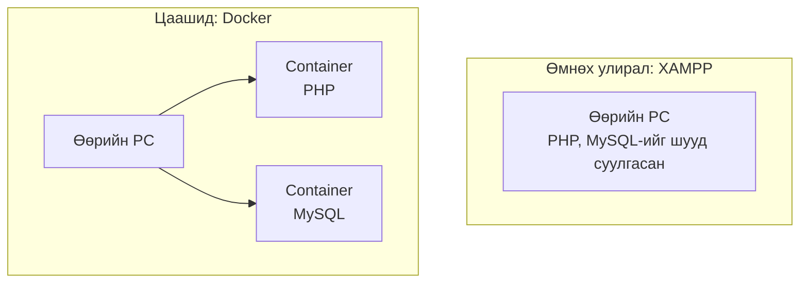

Container дараах онцлогтой.

| Онцлог | Юу гэсэн үг вэ? |
|------|--------------|
| **Өрөө бүр тусдаа** | Container-ууд бие биедээ нөлөөлөхгүй. PHP-ийн хуучин болон шинэ хувилбарыг зэрэг ажиллуулж болно |
| **PC-г бохирдуулахгүй** | PC-дээ өөрт нь юу ч суулгахгүй |
| **Хурдан үүсгэж, хурдан устгана** | Хэдхэн секундэд асна. Хэрэггүй болбол устгаад дахин үүсгэхэд л болно |
| **Хэний PC дээр ч ижил агуулгатай** | Нэг зураг төслөөс үүсгэвэл бүх хүний PC дээр ижил орчин болно |

Ийм container-ыг үүсгэж, ажиллуулдаг програм нь **Docker** юм.

---

## 1. Docker-ийг яагаад ашигладаг вэ?

Өмнөх улиралд програмаа ажиллуулахын тулд XAMPP суулгаж, PHP болон MySQL-ийг бэлдсэн.
Гэхдээ ийм зүйл байнга тохиолддог.

```
A: «Миний PC дээр ажиллаад байдаг шүү дээ…»
B: «PHP-ийн хувилбар өөр юм шиг байна»
C: «XAMPP-ийн тохиргоог оролдсон чинь ажиллахаа больчихлоо»
```

**Docker** ашиглавал програм ажиллуулах орчныг (PHP, MySQL гэх мэт) **container** (тусгай өрөө)-т хийж, ямар ч PC дээр адилхан ажиллуулж болно.

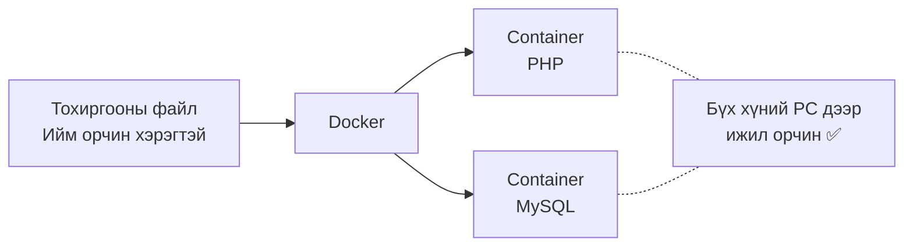

- Орчноо эвдэлчихсэн ч container-ыг дахин үүсгэвэл шууд хэвэндээ орно
- Тохиргооны файлаа хуваалцвал багийн бүх гишүүн ижил орчин бэлдэж чадна

---

## 2. Docker, image, container

Эхэнд гарах үгсийг хоол хийхтэй зүйрлэж цээжилье.

| Нэр | Юу вэ? | Жишээлбэл |
|------|-----------|-----------|
| **Image** | Орчны зураг төсөл | Жор |
| **Container** | Image-ээс үүсгэсэн, бодитоор ажилладаг орчин | Жороор хийсэн хоол |
| **Docker Desktop** | Windows дээр Docker ашиглах програм | Гал тогоо |
| **Docker Hub** | Image-үүдийг нийтэлсэн сайт | Жорын ном |

Нэг image (жор)-ээс container (хоол)-ыг хэдийг ч хамаагүй үүсгэж болно.

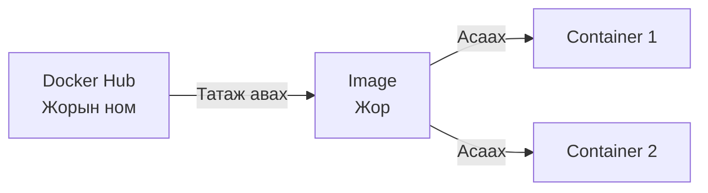

> **Container-ыг устгаад болох уу?**
> Container-ыг image (жор)-ээс хэзээ ч дахин үүсгэж болох тул эвдэрвэл устгаад дахин үүсгэхэд л болно.
> Гэхдээ **container дотор үүсгэсэн өгөгдөл container-ыг устгахад хамт устна.** Өгөгдлийг хадгалж үлдээх аргыг дараагийн хичээлүүдээр үзнэ.

---

## 3. Суулгах дараалал

Өнөөдөр дараах дарааллаар явна.

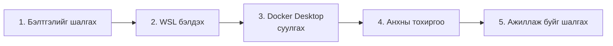

---

## 4. Бэлтгэлийг шалгах

Docker Desktop суулгахаасаа өмнө PC тань дараах нөхцөлийг хангаж байгаа эсэхийг шалгана.

| Шалгах зүйл | Нөхцөл |
|------------|------|
| Windows-ийн хувилбар | Windows 10 (22H2) эсвэл Windows 11 |
| Виртуалчлал | **Идэвхтэй** байх |
| Бүртгэл | **Администраторын эрхтэй** хэрэглэгч |

### Виртуалчлал идэвхтэй эсэхийг шалгах

Docker нь PC дотор өөр нэг жижиг PC ажиллуулдаг **виртуалчлал** гэдэг функцийг ашигладаг.

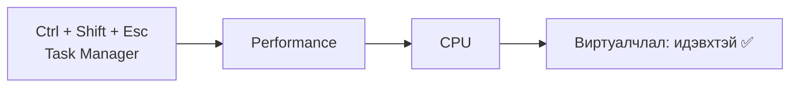

Баруун доод талын жагсаалтад **«仮想化：有効»** (Виртуалчлал: идэвхтэй) гэж харагдаж байвал болно.

> **«無効» (идэвхгүй) байвал**
> BIOS (PC асах үеийн тохиргооны цонх)-оос идэвхжүүлэх шаардлагатай. PC үйлдвэрлэгчээс хамаарч үйлдэл өөр байдаг тул багшаа дуудаарай.

---

## 5. WSL бэлдэх

**WSL** (Windows Subsystem for Linux) нь Windows дотор Linux ажиллуулдаг систем юм.
Docker Desktop энэ WSL дээр ажилладаг.

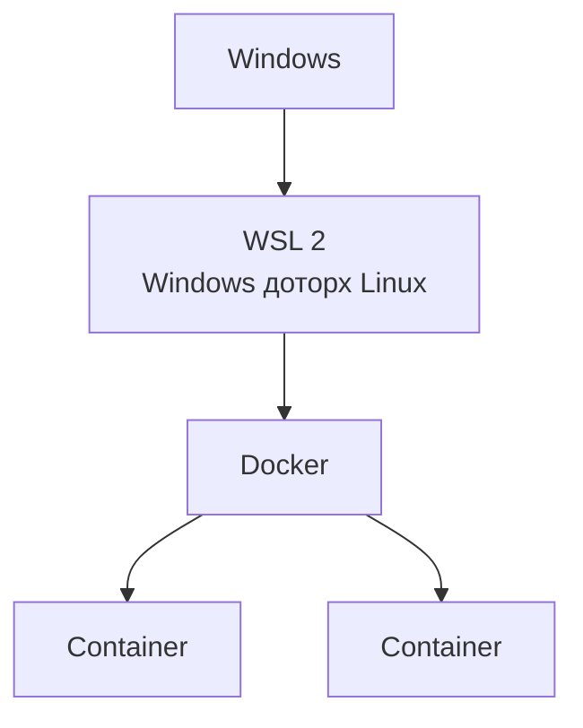

Start цэснээс «PowerShell» гэж хайгаад, **баруун товч → «Run as administrator» (администратороор ажиллуулах)**-аар нээнэ.

```powershell
wsl --install
```

Аль хэдийн суусан бол хамгийн сүүлийн хувилбар болгож шинэчилнэ.

```powershell
wsl --update
```

Дууссаны дараа **PC-гээ дахин асаана**.

✅ Дахин асаасны дараа PowerShell дээр дараахыг ажиллуулаад `既定のバージョン: 2` (Default Version: 2) гэж гарвал болно.

```powershell
wsl --status
```

> **`wsl --install` хийхэд Ubuntu-ийн хэрэглэгчийн нэр асуувал**
> Энэ бол Ubuntu (Linux-ийн нэг төрөл)-ийн анхны тохиргоо юм. Жижиг латин үсгээр хэрэглэгчийн нэр, мөн нууц үгээ сонгоод оруулна.
> Нууц үг оруулахад дэлгэц дээр юу ч харагдахгүй ч, зөв оруулагдаж байгаа.

---

## 6. Docker Desktop суулгах

Албан ёсны сайтаас суулгагчийг татаж аваад ажиллуулна.

**Татах хуудас:** https://www.docker.com/products/docker-desktop/

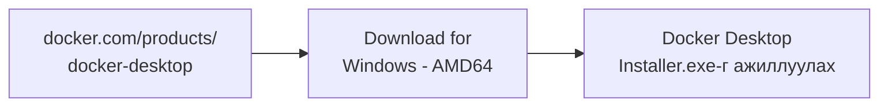

> **ARM64 болон AMD64-ийн ялгаа**
> Энэ нь PC-ийн CPU-ийн төрөл юм. Ихэнх Windows PC **AMD64** (x86_64) байдаг.
> Snapdragon гэх мэт утасны төрлийн CPU-тай PC дээр л ARM64-ийг сонгоно.

Суулгах явцад тохиргоо асууна.

| Асуух зүйл | Сонгох зүйл |
|------------|---------|
| Use WSL 2 instead of Hyper-V | **Асаах** (WSL дээр ажиллуулна) |
| Add shortcut to desktop | Асаах (Desktop дээр дүрс үүснэ) |

`OK`-г дарвал суулгалт эхэлнэ.
`Close and restart` (эсвэл `Close`) гарвал **PC-гээ дахин асаана**.

---

## 7. Анхны тохиргоо

Дахин асаасны дараа Desktop дээрх **Docker Desktop**-ийн дүрс дээр давхар дарж асаана.

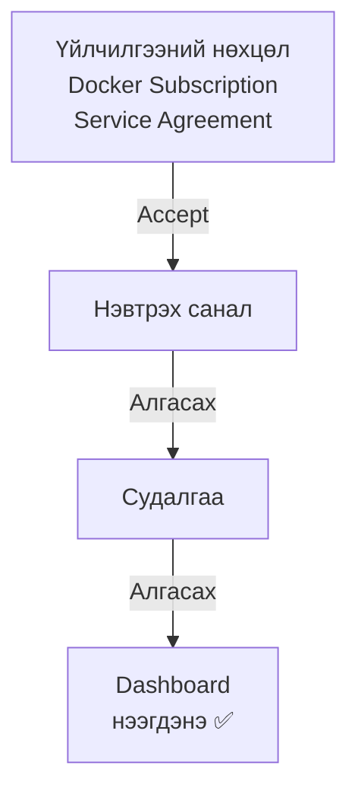

| Цонх | Сонгох зүйл |
|------|---------|
| Үйлчилгээний нөхцөл (Subscription Service Agreement) | `Accept` |
| Нэвтрэх (Sign in / Sign up) | `Skip` (өнөөдөр бүртгэлгүйгээр ашиглана) |
| Судалгаа (Welcome Survey) | `Skip` |

> Суралцах зорилгоор болон хувь хүн ашиглахад үнэгүй.

> Дэлгэц дээрх бичвэр хувилбараас хамаарч бага зэрэг өөр байж болно. Эргэлзвэл багшаасаа асуугаарай.

### Асаж байгаа эсэхийг шалгах

Цонхны зүүн доод хэсэгт **Engine running** (ногоон) гэж харагдаж байвал Docker ажиллаж байна.
Дэлгэцийн баруун доод хэсгийн taskbar (`^` дотор)-т байгаа **халимны дүрс** 🐳-ээр ч шалгаж болно.

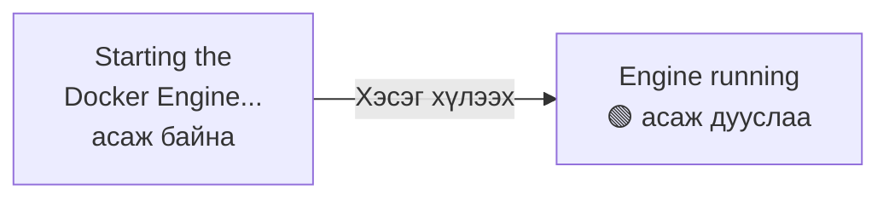

**Docker Desktop асаагүй бол Docker-ийг ашиглах боломжгүй.**
PC-гээ дахин асаасан бол эхлээд Docker Desktop-оо асаагаарай.

---

## 8. Ажиллаж буйг шалгах

PowerShell (администратор биш байж болно)-ийг нээгээд Docker-ийн хувилбарыг шалгана.

```powershell
docker --version
```

```
Docker version 28.x.x, build xxxxxxx
```

гэх мэтээр харагдвал болно (тоо нь хүн бүрт өөр байна).

Дараа нь дадлагын **hello-world** image-ийг ажиллуулж үзье.

```powershell
docker run hello-world
```

Энэ ганц командаар Docker дараах зүйлсийг хийж байна.

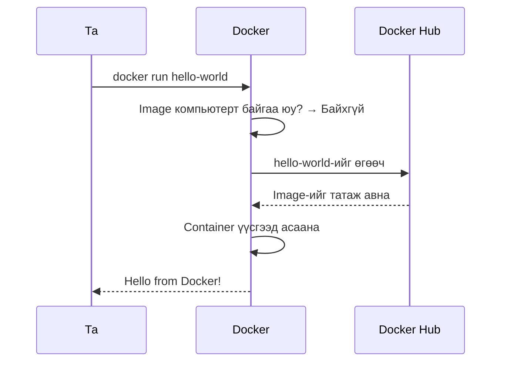

✅ Дараах мессеж харагдвал суулгалт амжилттай.

```
Hello from Docker!
This message shows that your installation appears to be working correctly.
```

Дахин `docker run hello-world`-г ажиллуулбал энэ удаа татаж авалгүйгээр шууд ажиллана.
Учир нь image (жор) компьютерт аль хэдийн байгаа.

Docker Desktop-ийн зүүн талын `Containers`-г нээвэл саяхан ажиллуулсан container харагдаж байна.

---

## 9. Дадлагын орчныг ажиллуулах

[Материал 2](./20261008_資料_2.md)-т push хийсэн дадлагын орчноо Docker-оор ажиллуулж үзье.
**Заавал mysql → laravel гэсэн дарааллаар** асаана.

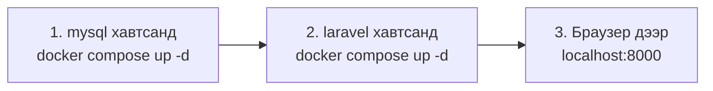

Асаахад 2 container дараах байдлаар холбогдож ажиллана.
laravel container нь mysql container-ыг ашигладаг тул mysql-ийг эхэлж асаана.

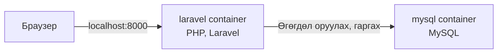

```powershell
cd C:\Users\<хэрэглэгчийн нэр>\Desktop\php-study\mysql
docker compose up -d
```

```powershell
cd C:\Users\<хэрэглэгчийн нэр>\Desktop\php-study\laravel
docker compose up -d
```

**Зөвхөн анх удаа** Laravel суулгахад хэдэн минут зарцуулна.
`docker compose logs -f`-ээр явцыг харж болно (`Ctrl + C`-ээр харахаа зогсооно).
`Server running on [http://0.0.0.0:8000]` гэж гарвал бэлэн боллоо.

✅ Браузер дээр http://localhost:8000 -г нээгээд дараах дэлгэц гарвал болно.


---

## 10. Болохгүй байвал

| Шинж тэмдэг | Шийдэл |
|------|------|
| `docker` олдсонгүй гэж гарна | Docker Desktop асаж байгаа эсэхийг шалгах → PowerShell-ийг дахин нээх |
| `Engine stopped` хэвээрээ ажиллахгүй | Docker Desktop-ийг хаагаад дахин асаах → болохгүй бол PC-г дахин асаах |
| WSL хуучирсан гэж гарна (WSL update failed гэх мэт) | Администраторын PowerShell дээр `wsl --update` → PC-г дахин асаах |
| Виртуалчлал идэвхгүй гэж гарна (Virtualization support not detected) | [4. Бэлтгэлийг шалгах](#4-бэлтгэлийг-шалгах)-г харах → багшаа дуудах |
| `error during connect` гарна | Docker Engine асаж байгаа хэвээр байна. Зүүн доод хэсэг `Engine running` болтол хүлээх |

---

## 11. Дүгнэлт

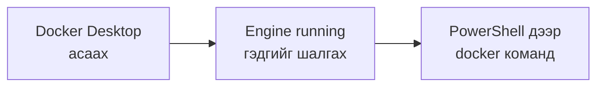

- **Image** бол зураг төсөл, **container** бол түүнээс үүсгэсэн бодитоор ажилладаг орчин
- Docker ашиглахаасаа өмнө **Docker Desktop-оо асаасан** байх
- `docker run <image-ийн нэр>`-ээр image татаж авахаас эхлээд container асаах хүртэл нэг дор хийж болно

Дараагийн хичээлээр Docker ашиглан PHP болон MySQL-ийн орчин үүсгэнэ.

<!-- nav:start -->

---

| ⬅️ Өмнөх | 🗺️ Ерөнхий зураг | Дараагийнх ➡️ |
|:--|:--:|--:|
| [10/08 Дадлагын орчноо push хийх](20261008_資料_2.md) | [Материалын ерөнхий зураг](../../README.md) | [10/15 MVC-ийн бүтэц](../20261015/20261015_資料_1.md) |

<!-- nav:end -->
