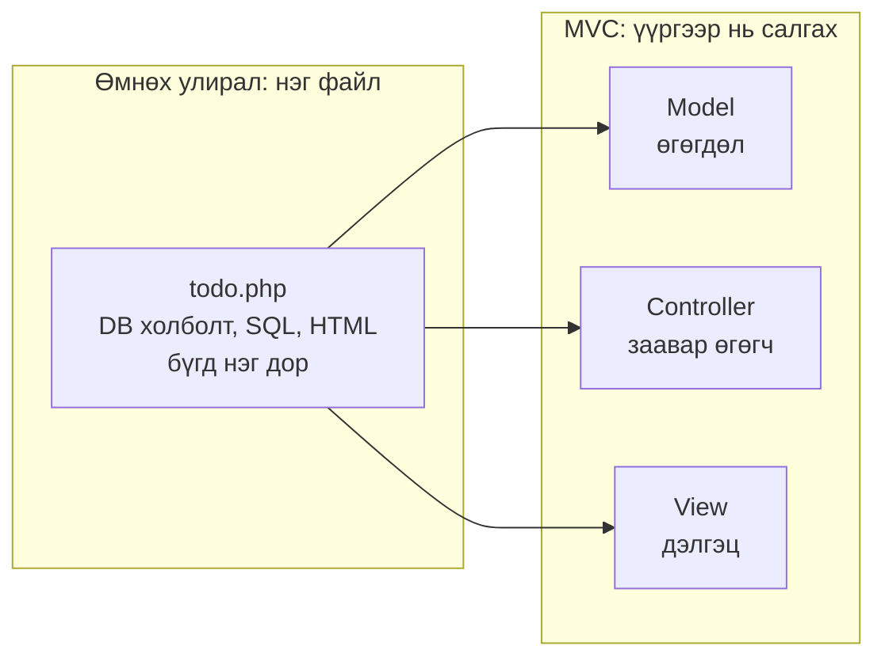
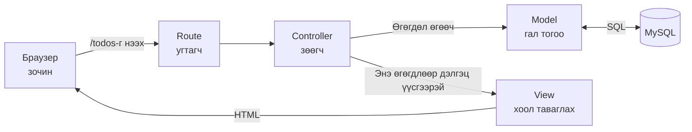
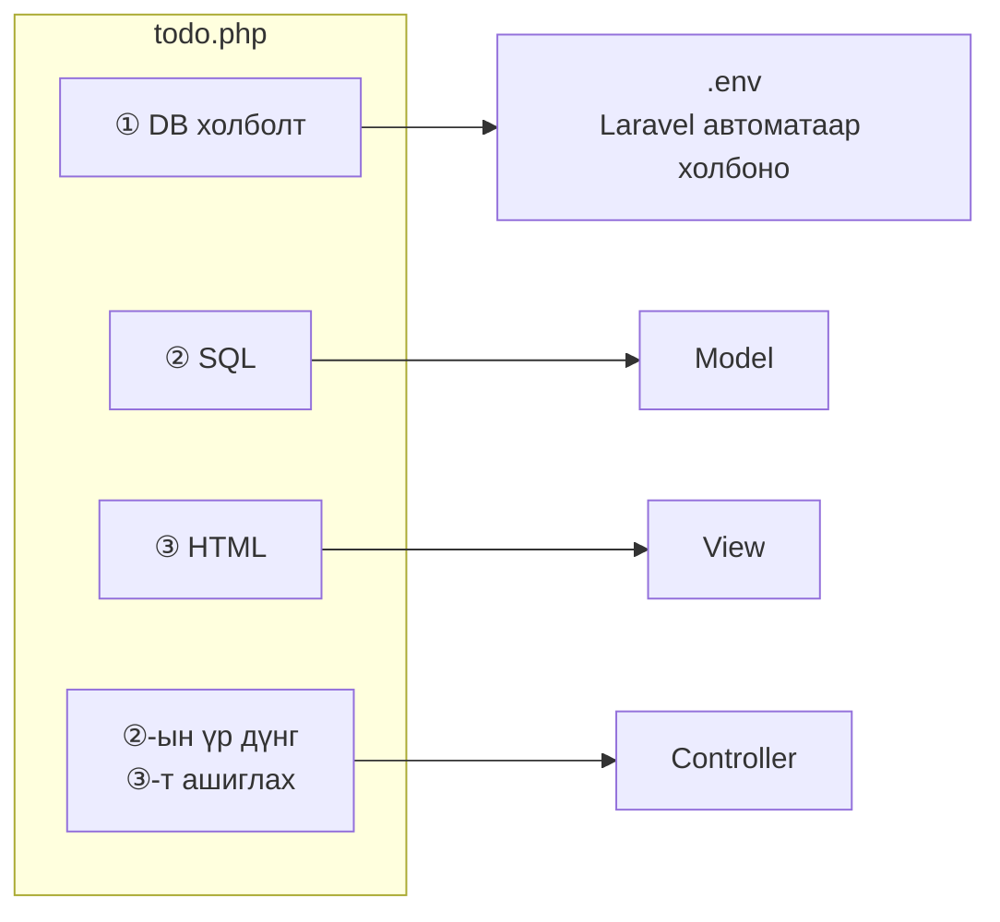
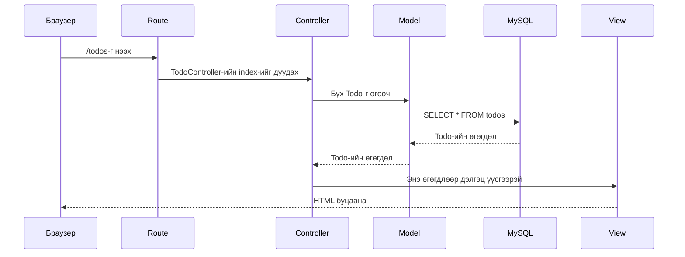
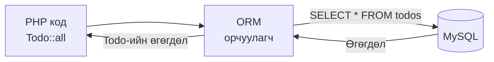
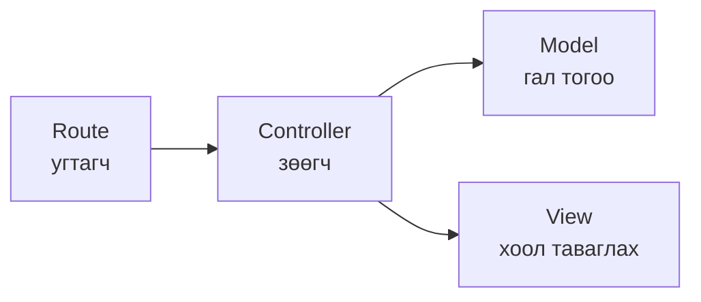

# Laravel-ийн анхан шат — MVC-ийн бүтэц

> 🇯🇵 Эх хувь (япон хэлээр): [20261015_資料_1.md](<../../../1年生_データ設計とアプリ開発/後期/20261015/20261015_資料_1.md>) <!-- original-ja-link -->

## Өнөөдрийн зорилго
- MVC (Model, View, Controller)-ийн үүргийг ойлгох
- Laravel-д хүсэлт «Route → Controller → Model → View» гэж дамждагийг ойлгох
- ORM ашиглавал SQL бичихгүйгээр өгөгдөл оруулж, гаргаж болдгийг ойлгох

---

## 1. Өмнөх улирлын todo.php-г эргэн харах

Өмнөх улиралд хийсэн `todo.php` файлд бүх кодыг **нэг дор** бичсэн байсан.
Жагсаалт харуулдаг хэсгийг нь л салгаж авбал ийм байна.

```php
<?php
// ① Өгөгдлийн сантай холбогдох
$pdo = new PDO('mysql:host=127.0.0.1;dbname=school_db;charset=utf8mb4', 'root', '');

// ② SQL-ээр Todo-г авчрах
$stmt = $pdo->query("SELECT * FROM todos ORDER BY created_at DESC");
$todos = $stmt->fetchAll(PDO::FETCH_ASSOC);
?>
<!-- ③ HTML-ээр дэлгэц үүсгэх -->
<ul>
<?php foreach ($todos as $todo): ?>
    <li><?= htmlspecialchars($todo['title']) ?></li>
<?php endforeach; ?>
</ul>
```

Жижиг програмыг ингэж бичээд ажиллуулж болно.
Гэхдээ програм томрох тусам ийм зүйл тохиолддог.

```
A: «Зөвхөн дэлгэцийн харагдах байдлыг засмаар байхад SQL холилдчихсон, уншихад хэцүү…»
B: «Нэг ижил SELECT-ийг олон файл руу хуулчихсан»
C: «Хаана нь засах ёстойгоо мэдэхгүй байна»
```

Тиймээс **үүргээр нь файлуудыг салгах** үзэл санаа нь **MVC** юм.



---

## 2. MVC гэж юу вэ

MVC нь програмын ажлыг 3 үүрэгт хуваах арга юм. Үүнийг ресторантай зүйрлэж ойлгоё.

| Нэр | Үүрэг | Ресторанаар бол |
|------|------|------------------|
| **M**odel (Model) | Өгөгдлийн сангийн өгөгдлийг оруулж, гаргана | Гал тогоо (орц материалаа гаргаж ирнэ) |
| **V**iew (View) | Дэлгэц (HTML) үүсгэнэ | Хоолыг таваглах (тавган дээр хоол хийж, зочинд хүргэнэ) |
| **C**ontroller (Controller) | Захиалга хүлээн авч, Model болон View-д заавар өгнө | Зөөгч (гал тогоо болон хоол таваглах хэсгийг холбоно) |

Laravel-д үүн дээр **Route** (аль URL-ыг аль Controller хариуцах) нэмэгдэнэ.
Route бол рестораны **үүдэнд угтаж хөтөлдөг ажилтан** юм.



Гол санаа нь **Controller голд нь байж, бүгдэд заавар өгдөг** явдал юм.
View өөрөө Model руу өгөгдөл авахаар явдаггүй. Өгөгдлийг Controller-оос дамжуулж авдаг.

### Өмнөх улирлын todo.php аль хэсэг рүү очих вэ?

Дээрх `todo.php` файлын ①〜③ хэсгүүд MVC-д дараах байдлаар хуваагдана.



| todo.php-ийн хэсэг | Хаашаа очих | Байршил |
|---------------|-------|---------|
| ① Өгөгдлийн сантай холбогдох | Laravel автоматаар хийж өгнө | `.env` (тохиргооны файл) |
| ② SQL-ээр Todo-г авчрах | **Model** | `app/Models/Todo.php` |
| ③ HTML-ээр дэлгэц үүсгэх | **View** | `resources/views/todos/index.blade.php` |
| ②-ын үр дүнг ③-т дамжуулах | **Controller** | `app/Http/Controllers/TodoController.php` |
| Аль URL-аар энэ үйлдлийг ажиллуулах | **Route** | `routes/web.php` |

---

## 3. Хүсэлтийн урсгал

Браузер дээр `http://localhost:8000/todos`-г нээхэд Laravel дотор дараах дарааллаар боловсруулалт явагдана.



Ресторанаар бол ийм урсгал юм.

1. Зочин ресторанд ирнэ (браузер дээр `/todos`-г нээх)
2. Угтагч зочныг хариуцах зөөгчид нь хүргэж өгнө (Route → Controller)
3. Зөөгч гал тогооноос орц материал захиална (Controller → Model)
4. Гал тогоо агуулахаас орц материал гаргаж ирнэ (Model → MySQL)
5. Зөөгч орц материалыг хоол таваглах ажилтанд дамжуулна (Controller → View)
6. Хоолыг зочинд гаргаж өгнө (HTML браузер руу буцна)

---

## 4. ORM-ийн бүтэц

### ORM гэж юу вэ

Өмнөх улиралд `SELECT * FROM todos` гэх мэтээр **SQL өгүүлбэрийг өөрсдөө бичиж** байсан.
Laravel-д Model ашиглаад `Todo::all()` гэж бичихэд л өгөгдлөө авчирч болно.

Энэ нь **ORM** (Object-Relational Mapping) гэдэг системийн ачаар юм.
ORM нь **PHP кодыг SQL рүү автоматаар хөрвүүлж**, MySQL руу илгээж өгдөг.
Laravel-ийн ORM-ийг **Eloquent** (Элоквент) гэдэг.



Ресторанаар бол гал тогоо (Model)-нд **орчуулагч (ORM)** байж, зөөгчийн «Бүх Todo-г өгөөч» гэсэн захиалгыг агуулах (MySQL)-ын ойлгох хэл (SQL) рүү хөрвүүлж өгдөг гэж төсөөлөөрэй.

### Өмнөх улирлын SQL-тэй харьцуулах

| Хийхийг хүссэн зүйл | Өмнөх улирал (SQL бичих) | Laravel (Eloquent) |
|------------|-----------------|-------------------|
| Бүгдийг авчрах | `SELECT * FROM todos` | `Todo::all()` |
| id нь 1-тэй тэнцүү өгөгдлийг авчрах | `SELECT * FROM todos WHERE id = 1` | `Todo::find(1)` |
| Зөвхөн дуусаагүйг авчрах | `SELECT * FROM todos WHERE is_done = 0` | `Todo::where('is_done', 0)->get()` |

Өнөөдөр «SQL бичихгүйгээр ингэж бичиж болдог юм байна» гэдгийг ойлгоход л хангалттай.

### SQL сурсан маань дэмий болох уу?

**Үгүй.** ORM ард талдаа SQL үүсгээд MySQL руу илгээж байдаг.
Сайн ажиллахгүй байх үед эсвэл нарийн төвөгтэй өгөгдөл авах үед өмнөх улиралд сурсан SQL-ийн мэдлэг хэрэг болно.

---

## 5. Дүгнэлт



| Үүрэг | Товчхондоо |
|------|-----------|
| **Route** | Аль URL-ыг аль Controller хариуцахыг шийднэ |
| **Controller** | Model-оос өгөгдөл аваад View-д дамжуулна |
| **Model** | Өгөгдлийн сангийн өгөгдлийг оруулж, гаргана (ORM нь SQL рүү хөрвүүлж өгнө) |
| **View** | Дэлгэц (HTML) үүсгэнэ |

Үүргээр нь файлууд салсан байдаг тул «дэлгэцийг засах бол View», «өгөгдөл авах аргыг засах бол Model» гэх мэтээр **хаана засахаа шууд мэддэг** болно.

Дараа нь бодитоор MVC-д хувааж Todo-ийн жагсаалтын хуудас хийнэ → [Todo жагсаалт хийж үзье](./20261015_資料_2.md)

<!-- nav:start -->

---

| ⬅️ Өмнөх | 🗺️ Ерөнхий зураг | Дараагийнх ➡️ |
|:--|:--:|--:|
| [10/08 Docker-ийн анхан шат](../20261008/20261008_資料_3.md) | [Материалын ерөнхий зураг](../../README.md) | [10/15 Todo жагсаалт](20261015_資料_2.md) |

<!-- nav:end -->
