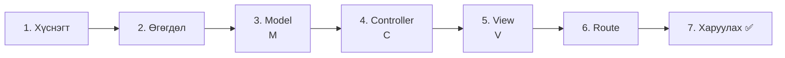
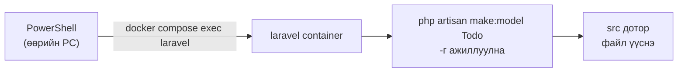
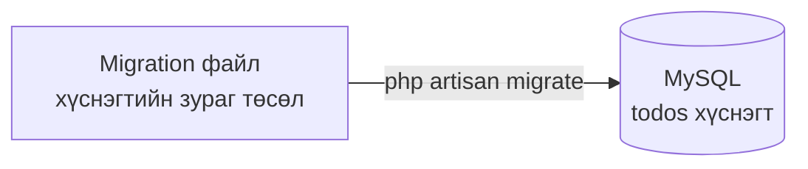
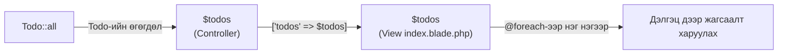
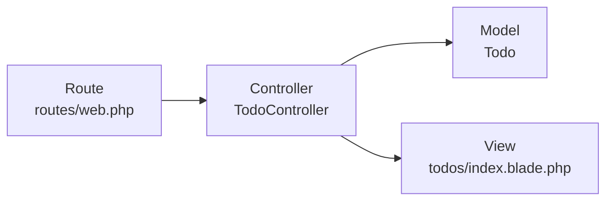

# Laravel-ийн анхан шат — Todo жагсаалт хийж үзье

> 🇯🇵 Эх хувь (япон хэлээр): [20261015_資料_2.md](<../../../1年生_データ設計とアプリ開発/後期/20261015/20261015_資料_2.md>) <!-- original-ja-link -->

[MVC-ийн бүтэц](./20261015_資料_1.md)-ээр сурсан зүйлээ ашиглаад Todo-ийн жагсаалтын хуудас хийнэ.

## Өнөөдрийн зорилго
- Todo-ийн жагсаалтын хуудсыг MVC-д хувааж хийж чаддаг болох
- Migration, Model, Controller, View, Route-ийг тус бүр хаана бичихийг ойлгох

> Дадлагын орчны (`php-study`) mysql болон laravel-ийг асаасны дараа эхэлнэ.
> Асаах аргыг `php-study` хавтасны `README.md`-ээс хараарай.

Өмнөх улирлын ижил `todos` хүснэгтийг ашиглан Todo-ийн жагсаалтын хуудас хийнэ.
Файлууд `php-study\laravel\src` дотор үүснэ.

---

## 1. Хийх дараалал

**Ажиллах дараалал** (Route → Controller → Model → View)-ын эсрэгээр **өгөгдлийн талаас** эхэлж хийнэ.
Учир нь орц материал (хүснэгт болон өгөгдөл) байхгүй бол хоол (дэлгэц) хийж чадахгүй.



---

## 2. Командыг хэрхэн унших вэ

Өнөөдөр дараах шиг командуудыг хэд хэдэн удаа ашиглана.
Командыг PowerShell дээр **laravel хавтас** руу шилжсэний дараа ажиллуулна.

```powershell
cd C:\Users\<хэрэглэгчийн нэр>\Desktop\php-study\laravel
```

```powershell
docker compose exec laravel php artisan make:model Todo
```

Урт харагдаж байгаа ч 2 хэсэгт хуваагддаг.

| Хэсэг | Утга |
|------|------|
| `docker compose exec laravel` | «laravel container дотор дараах командыг ажиллуул» |
| `php artisan make:model Todo` | «Todo нэртэй Model үүсгэ» |

Өөрийн PC-ийн PowerShell-ээс container руу команд илгээж ажиллуулж байна гэж төсөөлөөрэй.
Container дотор үүссэн файлууд өөрийн PC-ийн `src` хавтсанд гарч ирнэ.



**artisan** (артизан) нь Laravel-д дагалддаг **туслах команд** юм.
`make:〇〇`-оор файлын загварыг автоматаар үүсгэж өгдөг.

---

## 3. Хийж үзье

Өнөөдөр үүсгэх, засах файлууд дараах 5 (`src` дотор).

```
src/
├─ routes/
│   └─ web.php ······························ 6. Route (нэмж бичнэ)
├─ app/
│   ├─ Http/Controllers/
│   │   └─ TodoController.php ··············· 4. Controller
│   └─ Models/
│       └─ Todo.php ························· 3. Model
├─ resources/views/
│   └─ todos/
│       └─ index.blade.php ·················· 5. View
└─ database/migrations/
    └─ 2026_10_15_xxxxxx_create_todos_table.php ··· 1. Хүснэгт
```

### 1. Хүснэгт үүсгэх (migration)

> Одоо энд: **🟢 1. Хүснэгт** → 2. Өгөгдөл → 3. Model → 4. Controller → 5. View → 6. Route → 7. Харуулах

**Migration** гэдэг нь хүснэгтийн зураг төслийг PHP-ээр бичсэн файл юм.
Өмнөх улиралд SQL-ийн `CREATE TABLE`-ээр хүснэгт үүсгэж байсан бол Laravel-д энэ файлаас үүсгэнэ.

Дараах командаар migration файл үүсгэнэ.

```powershell
docker compose exec laravel php artisan make:migration create_todos_table
```

Нэрийг нь `create_〇〇_table` гэж өгвөл Laravel хүснэгтийн нэр `todos`-ийг уншиж аваад загварыг үүсгэж өгнө.

`database/migrations/`-д `2026_10_15_123456_create_todos_table.php` гэх мэт **огноотой файл** үүснэ.
Нээгээд `up()`-ийн дотор талыг дараах байдлаар бичнэ.

```php
public function up(): void
{
    Schema::create('todos', function (Blueprint $table) {
        $table->id();
        $table->string('title');
        $table->boolean('is_done')->default(false);
        $table->timestamps();
    });
}
```

Өмнөх улирлын `CREATE TABLE`-тэй харьцуулж үзье. Ижил зүйлийг PHP-ээр бичиж байна.

| Өмнөх улирлын SQL | Migration |
|----------|----------------|
| `id INT AUTO_INCREMENT PRIMARY KEY` | `$table->id();` (нарийн хэлбэл INT-ээс том тоо хадгалж чаддаг `BIGINT UNSIGNED` болно) |
| `title VARCHAR(255) NOT NULL` | `$table->string('title');` |
| `is_done TINYINT(1) NOT NULL DEFAULT 0` | `$table->boolean('is_done')->default(false);` |
| `created_at TIMESTAMP ...` | `$table->timestamps();` (`created_at` болон `updated_at` гэсэн 2 багана үүснэ. Утгыг нь Laravel автоматаар оруулна) |

Хадгалсны дараа migration-ийг ажиллуулж хүснэгт үүсгэнэ.

Түүнээс өмнө **`todos` хүснэгт хараахан байхгүй гэдгийг** шалгаж үзье.
Файл бичсэн төдийгөөр хүснэгт үүсчихгүй.

👀 **Ажиллуулахаас өмнө харах**: phpMyAdmin (http://localhost:8080)-ий зүүн талын жагсаалтаас `laravel` өгөгдлийн санг нээнэ.
Хүснэгтийн жагсаалтад `todos` **хараахан байхгүй** гэдгийг шалгаарай.



```powershell
docker compose exec laravel php artisan migrate
```

✅ **Шалгах**: phpMyAdmin (http://localhost:8080)-ий `laravel` өгөгдлийн санд `todos` хүснэгт үүссэн байвал болно.

---

### 2. Өгөгдөл оруулах

> Одоо энд: 1. Хүснэгт → **🟢 2. Өгөгдөл** → 3. Model → 4. Controller → 5. View → 6. Route → 7. Харуулах

phpMyAdmin дээр `todos` хүснэгтийг нээгээд `挿入` (Insert)-ээс 2〜3 Todo оруулж өгнө.
`id`, `created_at`, `updated_at`-ийг хоосон үлдээж болно.

| title | is_done |
|-------|---------|
| 牛乳を買う | 0 |
| レポートを出す | 1 |

✅ **Шалгах**: `表示` (Browse) таб дээр оруулсан өгөгдөл харагдаж байвал болно.

---

### 3. Model үүсгэх (M)

> Одоо энд: 1. Хүснэгт → 2. Өгөгдөл → **🟢 3. Model** → 4. Controller → 5. View → 6. Route → 7. Харуулах

Хүснэгт үүссэн тул тэр хүснэгтийн өгөгдлийг оруулж, гаргадаг **Model** (гал тогоо)-ийг үүсгэнэ.

```powershell
docker compose exec laravel php artisan make:model Todo
```

`app/Models/Todo.php` үүснэ. Нээгээд үзвэл бараг юу ч бичээгүй байна.

```php
class Todo extends Model
{
    //
}
```

**Ингээд бэлэн боллоо. Юу ч нэмж бичих шаардлагагүй.**
Laravel нь Model-ийн нэр `Todo`-оос **хүснэгтийн нэр `todos`**-ийг автоматаар тодорхойлдог тул үүгээр л өгөгдөл оруулж, гаргаж болно.

| Model-ийн нэр (ганц тоо, том үсгээр эхэлнэ) | Хүснэгтийн нэр (олон тоо, жижиг үсэг) |
|------------------|------------------|
| `Todo` | `todos` |
| `User` | `users` |

Model ашиглавал **SQL өгүүлбэрийг өөрөө бичихгүйгээр** өгөгдөл оруулж, гаргаж болно.
Энэ нь **ORM** гэдэг системийн ачаар юм → [ORM-ийн бүтэц](./20261015_資料_1.md#4-orm-ийн-бүтэц)

> **`-m` нэмбэл нэг дор үүсгэж болно**
> `php artisan make:model Todo -m` гэвэл Model болон migration-ийг нэг удаад үүсгэж болно.
> Өнөөдөр үүргийг нь салгаж ойлгохын тулд тус тусад нь үүсгэлээ.

---

### 4. Controller үүсгэх (C)

> Одоо энд: 1. Хүснэгт → 2. Өгөгдөл → 3. Model → **🟢 4. Controller** → 5. View → 6. Route → 7. Харуулах

Model (гал тогоо) болон View (хоолыг таваглах)-ийг холбодог **Controller** (зөөгч)-ийг үүсгэнэ.

```powershell
docker compose exec laravel php artisan make:controller TodoController
```

`app/Http/Controllers/TodoController.php` үүсэх тул агуулгыг нь дараах байдлаар сольж бичнэ.

```php
<?php

namespace App\Http\Controllers;

use App\Models\Todo;  // ← Todo Model-ийг ашиглахын тулд бичих 1 мөр

class TodoController extends Controller
{
    public function index()
    {
        // ① Model-оос «Бүх Todo-г өгөөч» гэж хүснэ
        $todos = Todo::all();

        // ② View-ээс «Энэ өгөгдлөөр дэлгэц үүсгээрэй» гэж хүснэ
        return view('todos.index', ['todos' => $todos]);
    }
}
```

| Код | Утга |
|--------|------|
| `Todo::all()` | `SELECT * FROM todos`-тэй адилхан. SQL бичих шаардлагагүй |
| `view('todos.index', ...)` | `resources/views/todos/index.blade.php`-г ашиглан дэлгэц үүсгэнэ (`.` нь хавтас заагч тэмдэг) |
| `['todos' => $todos]` | View дотор `$todos` гэсэн нэрээр ашиглах боломжтой болгоно |

Өгөгдөл дараах байдлаар Controller-оос View руу дамжина.



Өмнөх улирлын `todo.php`-тэй харьцуулбал ②-ын 2 мөр `Todo::all()` гэсэн 1 мөр болсон байна.

```php
// Өмнөх улирал
$stmt = $pdo->query("SELECT * FROM todos");
$todos = $stmt->fetchAll(PDO::FETCH_ASSOC);

// Laravel
$todos = Todo::all();
```

---

### 5. View үүсгэх (V)

> Одоо энд: 1. Хүснэгт → 2. Өгөгдөл → 3. Model → 4. Controller → **🟢 5. View** → 6. Route → 7. Харуулах

Дэлгэц үүсгэдэг **View** (хоолыг таваглах)-ийг үүсгэнэ. View-ийг командаар биш, өөрөө файл үүсгэж хийнэ.

1. `resources/views` дотор `todos` хавтас үүсгэнэ
2. `todos` хавтас дотор `index.blade.php` гэсэн файл үүсгэнэ

```
resources/views/
  └─ todos/
       └─ index.blade.php   ← энд бичнэ
```

```html
<!DOCTYPE html>
<html lang="ja">
<head>
    <meta charset="UTF-8">
    <title>TODOアプリ</title>
</head>
<body>
    <h1>TODOアプリ</h1>

    <ul>
        @foreach ($todos as $todo)
            <li>
                <input type="checkbox" @checked($todo->is_done)>
                {{ $todo->title }}
            </li>
        @endforeach
    </ul>
</body>
</html>
```

**Blade** (блэйд) нь Laravel-ийн HTML бичих арга юм. Өмнөх улирлын PHP-ээс богино бичиж болно.

| Blade | Өмнөх улирлын PHP-ээр бичвэл |
|-------|-----------------|
| `{{ $todo->title }}` | `<?= htmlspecialchars($todo['title']) ?>` |
| `@foreach (...)` 〜 `@endforeach` | `<?php foreach (...): ?>` 〜 `<?php endforeach; ?>` |
| `@checked($todo->is_done)` | `<?= $todo['is_done'] ? 'checked' : '' ?>` |

- `{{ }}` нь автоматаар `htmlspecialchars` хийж өгдөг тул аюулгүй
- Өмнөх улиралд `$todo['title']` байсан бол Model-ийн өгөгдлийг **`$todo->title`** (сум)-аар гаргаж авна
- `@checked(...)` нь `( )` доторх утга нь дууссан төлөвийг илэрхийлэх `1` үед л checkbox-д `checked` нэмнэ
- Checkbox-ийг дарж болох ч өнөөдөр хараахан **өгөгдлийн санд хадгалагдахгүй** (хуудсыг дахин ачаалбал хуучин байдалдаа орно). Дарахад хадгалагддаг болгохыг 10/29-нд үзнэ

---

### 6. Route бичих

> Одоо энд: 1. Хүснэгт → 2. Өгөгдөл → 3. Model → 4. Controller → 5. View → **🟢 6. Route** → 7. Харуулах

Эцэст нь «`/todos`-г нээхэд аль Controller-ийг ажиллуулах»-ыг **Route** (хөтөч)-д зааж өгнө.

`routes/web.php`-г нээгээд ★-тай 2 мөрийг нэмж бичнэ.

```php
<?php

use Illuminate\Support\Facades\Route;
use App\Http\Controllers\TodoController;  // ★ Нэмэх (дээд хэсэгт бичнэ)

Route::get('/', function () {
    return view('welcome');
});

Route::get('/todos', [TodoController::class, 'index']);  // ★ Нэмэх (хамгийн доор бичнэ)
```

`Route::get('/todos', [TodoController::class, 'index']);` нь дараах утгатай.

```
Route::get( '/todos' ,  [TodoController::class, 'index'] );
             ~~~~~~~     ~~~~~~~~~~~~~~~~~~~~~  ~~~~~~~
             Энэ URL-ыг  TodoController-ийн     index-ээр хариуцуулна
             нээвэл
```

---

### 7. Харуулах ✅

> Одоо энд: 1. Хүснэгт → 2. Өгөгдөл → 3. Model → 4. Controller → 5. View → 6. Route → **🟢 7. Харуулах**

Браузер дээр http://localhost:8000/todos -г нээнэ.
phpMyAdmin дээр оруулсан Todo-нууд жагсаалтаар харагдвал амжилттай.

```
TODOアプリ

☐ 牛乳を買う
☑ レポートを出す
```

Дууссан Todo (`is_done` нь `1`)-д чагт тавигдсан байна.

✅ **Шалгах**: phpMyAdmin дээр 1 Todo нэмээд браузерээ дахин ачаалж үзээрэй. Нэмсэн Todo гарч ирвэл өгөгдлийн сангаас зөв авч чадаж байна гэсэн үг.

---

## 4. Болохгүй байвал

Алдааны дэлгэцийн хамгийн дээд хэсэгт гарсан англи бичвэрийг уншвал хаана асуудал байгааг мэдэж болно.

| Шинж тэмдэг | Шалтгааны байршил | Шийдэл |
|------|----------|------|
| `404 Not Found` | Route | `routes/web.php`-д route бичсэн эсэх, URL нь `/todos` болсон эсэхийг шалгах |
| `Target class [TodoController] does not exist` | Route | `web.php`-ийн дээд хэсэгт `use App\Http\Controllers\TodoController;` байгаа эсэхийг шалгах |
| `Class "App\Http\Controllers\Todo" not found` | Controller | `TodoController.php`-ийн дээд хэсэгт `use App\Models\Todo;` байгаа эсэхийг шалгах |
| `View [todos.index] not found` | View | Файлын байршил `resources/views/todos/index.blade.php` болсон эсэхийг шалгах (`.blade.php` хүртэл хэрэгтэй) |
| `Table 'laravel.todos' doesn't exist` | Хүснэгт | `php artisan migrate`-г ажиллуулсан эсэхийг шалгах |
| Жагсаалтад юу ч гарахгүй | Өгөгдөл | phpMyAdmin дээр `todos` хүснэгтэд өгөгдөл орсон эсэхийг шалгах |

---

## 5. Дүгнэлт



| Үүрэг | Өнөөдөр бичсэн зүйл | Товчхондоо |
|------|--------------|-----------|
| **Route** | `Route::get('/todos', ...)` | Аль URL-ыг аль Controller хариуцахыг шийднэ |
| **Controller** | `TodoController`-ийн `index()` | Model-оос өгөгдөл аваад View-д дамжуулна |
| **Model** | `Todo` (`Todo::all()`) | Өгөгдлийн сангийн өгөгдлийг оруулж, гаргана |
| **View** | `todos/index.blade.php` | Дэлгэц үүсгэнэ (Blade-ээр бичнэ) |

Үүргээр нь файлууд салсан байдаг тул **хаана засахаа шууд мэддэг** болно.

<!-- nav:start -->

---

| ⬅️ Өмнөх | 🗺️ Ерөнхий зураг | Дараагийнх ➡️ |
|:--|:--:|--:|
| [10/15 MVC-ийн бүтэц](20261015_資料_1.md) | [Материалын ерөнхий зураг](../../README.md) | [10/22 Todo нэмэх (CREATE)](../20261022/20261022_資料_1.md) |

<!-- nav:end -->
