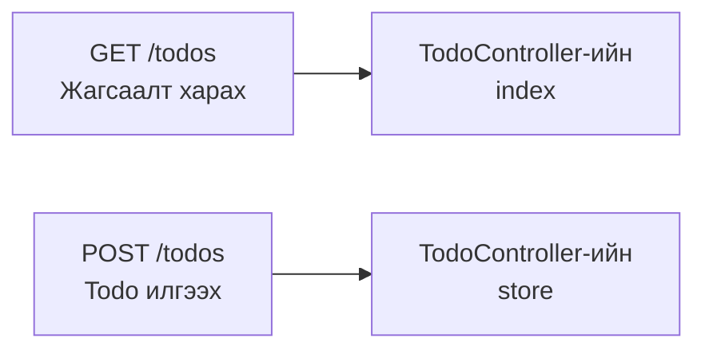
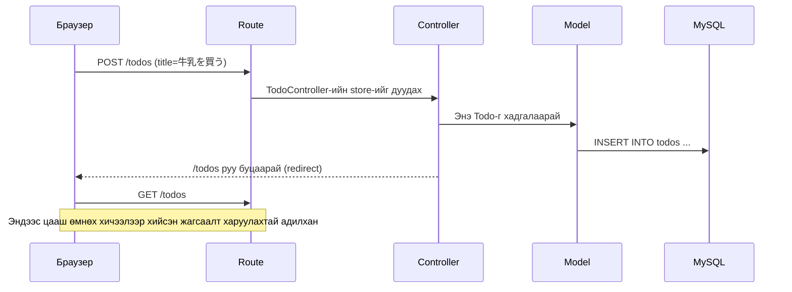
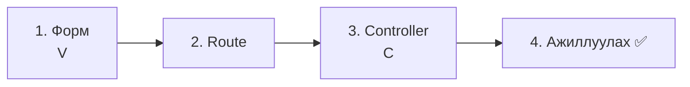
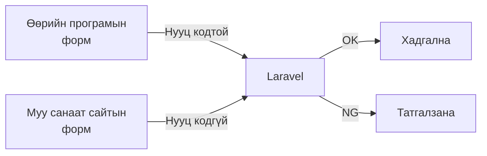
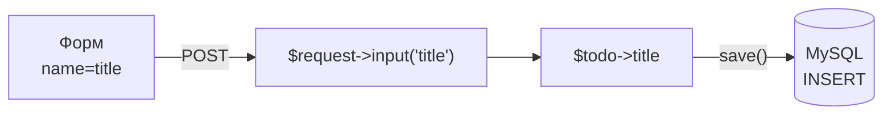
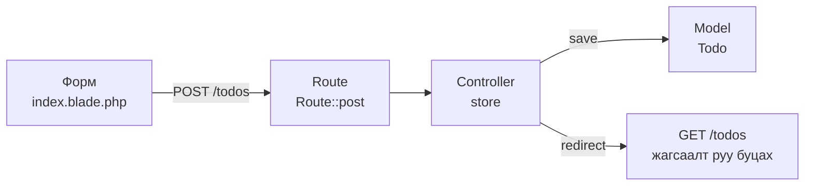

# Laravel-ийн анхан шат — Todo нэмье (CREATE)

> 🇯🇵 Эх хувь (япон хэлээр): [20261022_資料_1.md](<../../../1年生_データ設計とアプリ開発/後期/20261022/20261022_資料_1.md>) <!-- original-ja-link -->

[Өмнөх хичээлээр](../20261015/20261015_資料_2.md) хийсэн Todo жагсаалтад **формоос Todo нэмэх функц** нэмнэ.

## Өнөөдрийн зорилго
- GET болон POST-ийн ялгааг ойлгох
- Формоос илгээсэн өгөгдлийг Controller-оор хүлээн авч өгөгдлийн санд хадгалж чаддаг болох
- Хадгалсны дараа жагсаалтын хуудас руу буцааж чиглүүлж (redirect хийж) чаддаг болох

> Дадлагын орчны (`php-study`) mysql болон laravel-ийг асаасны дараа эхэлнэ.
> Өмнөх хичээлээр хийсэн `/todos` жагсаалтын хуудас харагдаж байгаа төлөвөөс эхэлнэ.

---

## 1. GET болон POST

Браузераас сервер рүү илгээх хүсэлт (request) хэд хэдэн төрөлтэй. Өнөөдөр дараах 2-ыг ашиглана.

| Төрөл | Ашиглах үе | Жишээлбэл |
|------|---------|-----------|
| **GET** | Хуудсыг **харах** үед (URL нээх, холбоос дарах) | Цэсийг харуулж өгөхийг хүсэх |
| **POST** | Өгөгдөл **илгээх** үед (формын илгээх товч) | Захиалгын хуудас өгөх |

Өмнөх хичээлээр хийсэн нь «Todo харах» хуудас байсан тул **GET** байсан.
Өнөөдөр хийх нь «Todo илгээж хадгалах» функц тул **POST** ашиглана.

Laravel-д **ижил URL-д GET болон POST-оор хандсан үед өөр өөр үйлдэл** гүйцэтгүүлэх боломжтой.



> **Өмнөх улирлын todo.php-д бол?**
> Өмнөх улиралд нэг файл дотор `<input type="hidden" name="action" value="create">` ашиглан «аль үйлдэл болох»-ыг ялгаж байсан.
> Laravel-д **URL болон GET/POST-ийн хослолоор** аль method ажиллахыг шийддэг.

---

## 2. Өнөөдрийн урсгал

Формын илгээх товчийг дарахад дараах дарааллаар боловсруулалт явагдана.



Гол санаа нь хамгийн сүүлийн **redirect** юм.
Хадгалж дууссаны дараа Controller дэлгэц үүсгэлгүйгээр «жагсаалтын хуудсыг (`/todos`) дахин нээгээрэй» гэж браузерт хариу буцаана.
Браузер жагсаалтыг дахин нээх тул нэмсэн Todo жагсаалтад гарч ирнэ.

> **Өмнөх улирлын todo.php-д ч хийж байсан**
> Өмнөх улиралд `header('Location: index.php');`-ээр ижил зүйлийг хийж байсан (PRG загвар).
> Энэ нь дахин ачаалсан ч ижил Todo давхар бүртгэгдэхээс сэргийлэх зорилготой.

---

## 3. Хийж үзье

Энэ удаа хүснэгт ч, Model ч бэлэн байгаа тул **ажиллах дараалал**-аар (View → Route → Controller) хийнэ.



Засах файлууд дараах 3 (`src` дотор). Model `Todo.php`-г өнөөдөр өөрчлөхгүй.

```
src/
├─ resources/views/todos/
│   └─ index.blade.php ················ 1. Форм нэмж бичнэ
├─ routes/
│   └─ web.php ························ 2. POST-ийн route нэмж бичнэ
└─ app/Http/Controllers/
    └─ TodoController.php ············· 3. store method нэмж бичнэ
```

---

### 1. Форм үүсгэх (V)

> Одоо энд: **🟢 1. Форм** → 2. Route → 3. Controller → 4. Ажиллуулах

`resources/views/todos/index.blade.php`-г нээгээд `<h1>`-ийн яг доор ★-тай формыг нэмж бичнэ.

```html
<!DOCTYPE html>
<html lang="ja">
<head>
    <meta charset="UTF-8">
    <title>TODOアプリ</title>
</head>
<body>
    <h1>TODOアプリ</h1>

    {{-- ★ Эндээс нэмнэ --}}
    <form method="POST" action="/todos">
        @csrf
        <input type="text" name="title" placeholder="新しいTODOを入力" required>
        <button type="submit">追加</button>
    </form>
    {{-- ★ Энд хүртэл --}}

    <ul>
        @foreach ($todos as $todo)
            <li>
                <input type="checkbox" @checked($todo->is_done)>
                {{ $todo->title }}
            </li>
        @endforeach
    </ul>
</body>
</html>
```

| Код | Утга |
|--------|------|
| `method="POST"` | POST-оор илгээнэ |
| `action="/todos"` | `/todos` руу илгээнэ |
| `name="title"` | `title` гэсэн нэрээр илгээнэ. Controller-т энэ нэрийг ашиглаж хүлээн авна |
| `required` | Хоосон байвал илгээх боломжгүй болгоно |
| `@csrf` | Доор тайлбарлах «нууц код»-ыг оруулна |
| `{{-- --}}` | Blade-ийн тайлбар (comment). Дэлгэц дээр харагдахгүй |

#### `@csrf` гэж юу вэ?

`@csrf` нь форм руу **нууц код (CSRF token)**-ыг нууцаар оруулдаг бичиглэл юм.
Браузер дээр «View page source»-ийг харвал дараах шиг 1 мөр болж өөрчлөгдсөнийг харж болно.

```html
<input type="hidden" name="_token" value="санамсаргүй тэмдэгт мөр">
```

Laravel POST хүсэлт ирэхэд нууц кодыг шалгадаг.
Ингэснээр **муу санаат сайт таны програм руу дур мэдэн форм илгээх халдлага (CSRF)**-аас хамгаалж чадна.



**POST формд заавал `@csrf` бичнэ** гэдгийг цээжилье.

> **`@csrf`-ийг мартсан ч ажиллачих тохиолдол бий**
> Laravel 13 нууц кодоос гадна «ижил сайтаас илгээсэн эсэх»-ийг ч браузераас шалгадаг.
> Тиймээс дадлагын орчинд (`localhost`) `@csrf`-ийг мартсан ч ажиллачих тохиолдол бий.
> Гэхдээ нийтэд нээх серверийн орчноос хамаарч зөвхөн нууц кодоор шийддэг тул **ажиллаж байсан ч заавал бичнэ**.

---

### 2. Route бичих

> Одоо энд: 1. Форм → **🟢 2. Route** → 3. Controller → 4. Ажиллуулах

`routes/web.php`-г нээгээд ★-тай 1 мөрийг нэмж бичнэ.

```php
<?php

use Illuminate\Support\Facades\Route;
use App\Http\Controllers\TodoController;

Route::get('/', function () {
    return view('welcome');
});

Route::get('/todos', [TodoController::class, 'index']);
Route::post('/todos', [TodoController::class, 'store']);  // ★ Нэмэх
```

```
Route::post( '/todos' ,  [TodoController::class, 'store'] );
~~~~~~~~~~~   ~~~~~~~     ~~~~~~~~~~~~~~~~~~~~~  ~~~~~~~
POST-оор      Энэ URL     TodoController-ийн     store-оор боловсруулаарай
              руу илгээвэл
```

`get` болон `post`-оос хамаарч ижил `/todos` байсан ч хариуцах method өөр болно.

| Route | Хариуцагч | Хийх зүйл |
|--------|------|---------|
| `Route::get('/todos', ...)` | `index` | Жагсаалт харуулна (өмнөх хичээл) |
| `Route::post('/todos', ...)` | `store` | Todo хадгална (өнөөдөр) |

`store` (стор) нь «хадгалах» гэсэн утгатай. Laravel-д хадгалдаг method-д `store` гэсэн нэрийг түгээмэл ашигладаг.

---

### 3. Controller бичих (C)

> Одоо энд: 1. Форм → 2. Route → **🟢 3. Controller** → 4. Ажиллуулах

`app/Http/Controllers/TodoController.php`-г нээгээд ★-тай хэсгийг нэмж бичнэ.

```php
<?php

namespace App\Http\Controllers;

use App\Models\Todo;
use Illuminate\Http\Request;  // ★ Нэмэх (формын өгөгдлийг хүлээн авахын тулд)

class TodoController extends Controller
{
    public function index()
    {
        $todos = Todo::all();

        return view('todos.index', ['todos' => $todos]);
    }

    // ★ Эндээс нэмнэ
    public function store(Request $request)
    {
        // ① Нэг шинэ Todo бэлдэнэ
        $todo = new Todo();

        // ② Формд оруулсан гарчгийг хийнэ
        $todo->title = $request->input('title');

        // ③ Өгөгдлийн санд хадгална
        $todo->save();

        // ④ Жагсаалтын хуудас руу буцна
        return redirect('/todos');
    }
    // ★ Энд хүртэл
}
```

| Код | Утга |
|--------|------|
| `Request $request` | Формоос илгээсэн өгөгдөл орсон хайрцаг. Laravel автоматаар дамжуулж өгнө |
| `$request->input('title')` | Формын `name="title"`-ийн утгыг гаргаж авна. Өмнөх улирлын `$_POST['title']`-тэй адилхан |
| `new Todo()` | Нэг шинэ Todo бэлдэнэ (хараахан хадгалагдаагүй) |
| `$todo->save()` | Өгөгдлийн санд хадгална. `INSERT INTO todos ...`-тэй адилхан |
| `redirect('/todos')` | «`/todos`-г дахин нээгээрэй» гэж браузерт хариу буцаана |

Өмнөх улирлын `todo.php`-тэй харьцуулж үзье.

```php
// Өмнөх улирал
$title = trim($_POST['title'] ?? '');
$stmt = $pdo->prepare("INSERT INTO todos (title) VALUES (:title)");
$stmt->execute(['title' => $title]);
header('Location: index.php');
exit;

// Laravel
$todo = new Todo();
$todo->title = $request->input('title');
$todo->save();
return redirect('/todos');
```

SQL бичихгүйгээр Model-ийн `save()`-аар `INSERT` өгүүлбэр үүсгүүлж болно (ORM).
Prepared statement-ийг ч Laravel дотроо хийж өгдөг тул аюулгүй.
Мөн өмнөх улиралд ашиглаж байсан `trim()`-ийн үйлдлийг (эхэн болон төгсгөлийн хоосон зайг арилгах) Laravel автоматаар хийж өгдөг.



---

### 4. Ажиллуулах ✅

> Одоо энд: 1. Форм → 2. Route → 3. Controller → **🟢 4. Ажиллуулах**

1. Браузер дээр http://localhost:8000/todos -г нээнэ
2. Оруулах талбарт «宿題をする» (гэрийн даалгавар хийх) гэж бичээд `追加` (Нэмэх)-г дарна
3. Жагсаалтын хамгийн доор «宿題をする» гарч ирвэл амжилттай

```
TODOアプリ

[ 新しいTODOを入力 ] [追加]

☐ 牛乳を買う
☑ レポートを出す
☐ 宿題をする        ← нэмэгдлээ!
```

✅ **Шалгах 1**: phpMyAdmin (http://localhost:8080) дээр `todos` хүснэгтийг нээж үзээрэй.
Нэмсэн Todo-ийн `created_at` болон `updated_at`-д огноо, цаг орсон байх ёстой. `save()` хийх үед Laravel автоматаар оруулж өгсөн.
Цаг нь 9 цагаар хоцорсон харагдаж байгаа нь Laravel UTC (дэлхийн стандарт цаг)-аар бүртгэдэгтэй холбоотой.
(Өмнөх хичээлээр phpMyAdmin дээр гараар оруулсан Todo-нууд хоосон (NULL) хэвээр байна)

✅ **Шалгах 2**: Нэмсний дараа браузерын хуудсыг дахин ачаалж (F5) үзээрэй.
Redirect хийж байгаа тул ижил Todo давхар нэмэгдэхгүй.

---

## 4. Болохгүй байвал

> **🔥 Ажиллахгүй бол log гарга!**
> Алдааны шалтгааныг мэдэхгүй бол log гаргаж «хаана хүртэл ажилласан»-ыг шалгаарай → [【Чухал】Лог хэрхэн гаргах вэ](./【重要】ログの出し方.md)

| Шинж тэмдэг | Шалтгааны байршил | Шийдэл |
|------|----------|------|
| `The POST method is not supported for route todos.` | Route | `routes/web.php`-д `Route::post('/todos', ...)` бичсэн эсэхийг шалгах |
| `Call to undefined method App\Http\Controllers\TodoController::store()` | Controller | `TodoController.php`-д `store` method бичсэн эсэх, нэрийн бичиглэлийг шалгах |
| `Class "App\Http\Controllers\Request" does not exist` | Controller | `TodoController.php`-ийн дээд хэсэгт `use Illuminate\Http\Request;` байгаа эсэхийг шалгах |
| `Column 'title' cannot be null` | Форм | `<input>`-ийн `name="title"`-ийн бичиглэлийг шалгах (Controller-ийн `input('title')`-тэй ижил нэр байх ёстой) |
| `419 Page Expired` | Форм | Форм дотор `@csrf` байгаа эсэхийг шалгах (дадлагын орчинд `@csrf` байхгүй ч гарахгүй тохиолдол бий) |
| Нэмсэн ч жагсаалтад гарахгүй | Controller | `$todo->save();` бичсэн эсэхийг шалгах. phpMyAdmin дээр өгөгдөл орсон эсэхийг ч шалгах |

---

## 5. Дүгнэлт



| Өнөөдөр бичсэн зүйл | Товчхондоо |
|--------------|-----------|
| `<form method="POST">` болон `@csrf` | Todo илгээх форм. POST формд заавал `@csrf` |
| `Route::post('/todos', ...)` | POST-оор илгээвэл `store` хариуцна |
| `$request->input('title')` | Формоос илгээсэн утгыг хүлээн авна |
| `new Todo()` → `save()` | Шинэ Todo үүсгээд хадгална (INSERT) |
| `redirect('/todos')` | Хадгалсны дараа жагсаалт руу буцна |

---

## 6. Цааш нь хийж үзье (цаг үлдсэн хүмүүст)

Шинээр нэмсэн Todo **хамгийн дээр** гарч ирдэг болгож үзье.
`index` method дахь `Todo::all()`-г дараах байдлаар сольж бичнэ.

```php
$todos = Todo::orderBy('id', 'desc')->get();
```

`ORDER BY id DESC` (id-ийн ихээс бага руу = шинээс хуучин руу)-тэй ижил утгатай.

> **`Todo::create()` гэсэн бичиглэл ч бий**
> Интернэтээс хайвал `new Todo()` → `save()`-ийн оронд дараах бичиглэл ч түгээмэл гардаг.
> ```php
> Todo::create(['title' => $request->input('title')]);
> ```
> 1 мөрөөр бичиж болдог тул хэрэгтэй ч, үүнийг ашиглахын тулд Model-д «аль баганад утга оруулж болох»-ыг бичих тохиргоо (`Fillable`) хэрэгтэй.
> Бичихгүй бол `Add [title] to fillable property ...` гэсэн алдаа гарна.
> Өнөөдөр бүтцийг нь ойлгоход хялбар `new Todo()` → `save()`-ийг ашиглалаа.

<!-- nav:start -->

---

📎 Мөн уншаарай → [【Чухал】Лог хэрхэн гаргах вэ](【重要】ログの出し方.md)

| ⬅️ Өмнөх | 🗺️ Ерөнхий зураг | Дараагийнх ➡️ |
|:--|:--:|--:|
| [10/15 Todo жагсаалт](../20261015/20261015_資料_2.md) | [Материалын ерөнхий зураг](../../README.md) | [10/22 Todo-гийн дэлгэрэнгүй (SHOW)](20261022_資料_2.md) |

<!-- nav:end -->
