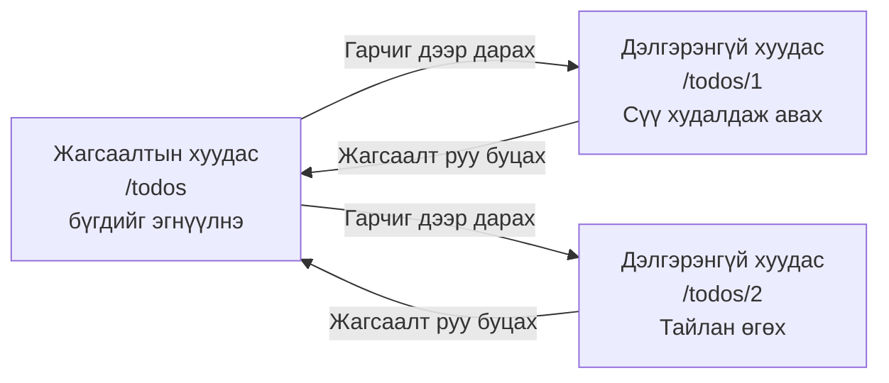
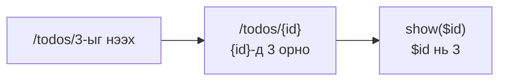
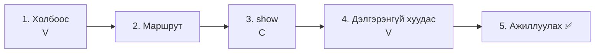
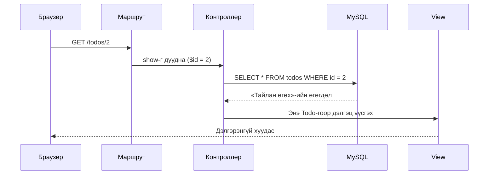
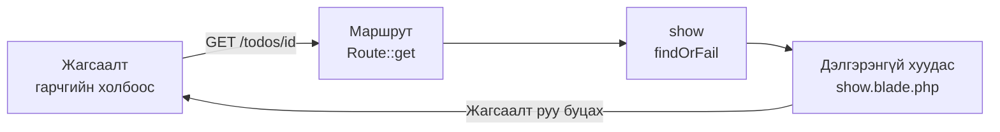

# Laravel-ийн анхан шат — Todo-гийн дэлгэрэнгүй хуудас хийцгээе (SHOW)

> 🇯🇵 Эх хувь (япон хэлээр): [20261022_資料_2.md](<../../../1年生_データ設計とアプリ開発/後期/20261022/20261022_資料_2.md>) <!-- original-ja-link -->

[1-р материал](./20261022_資料_1.md)-аар бид Todo нэмэх боломжтой болсон. Дараа нь **нэг Todo-г дэлгэрэнгүй харах хуудас (дэлгэрэнгүй хуудас)** хийнэ.

## Өнөөдрийн зорилго
- URL дотор `id` оруулж, аль Todo-г харахаа шийдэж чаддаг болох (маршрутын параметр)
- `id` ашиглан зөвхөн нэг Todo авч чаддаг болох
- Нэг Todo-гийн мэдээллийг дэлгэрэнгүй хуудсанд харуулж чаддаг болох

> 1-р материалын «Todo нэмэх» хэсэг ажиллаж байгаа төлөвөөс эхэлнэ.

---

## 1. Жагсаалтын хуудас ба дэлгэрэнгүй хуудас

Жагсаалтын хуудас бол «бүх Todo-г эгнүүлэн харуулдаг» хуудас байсан.
Дэлгэрэнгүй хуудас бол «**зөвхөн нэг Todo-г** дэлгэрэнгүй харуулдаг» хуудас юм.



| | URL | Хариуцагч | Юу харуулах |
|---|---|---|---|
| Жагсаалтын хуудас | `/todos` | `index` | Бүх Todo |
| Дэлгэрэнгүй хуудас | `/todos/1`, `/todos/2` … | `show` | **URL дахь тоотой ижил `id`-тай** нэг Todo |

URL-ын төгсгөлийн тоо бол **харахыг хүссэн Todo-гийн `id`** юм.
`/todos/1` бол `id` нь 1 байгаа Todo-гийн, `/todos/2` бол `id` нь 2 байгаа Todo-гийн дэлгэрэнгүй хуудас болно.

> **Онлайн дэлгүүрт ч мөн адил**
> Онлайн худалдааны сайтад ч бүтээгдэхүүний жагсаалтаас нэгийг нь дарахад зөвхөн тэр бүтээгдэхүүний дэлгэрэнгүй хуудас нээгддэг.
> URL-ыг нь харвал `/items/12345` гэх мэтээр **дугаар орсон** байх нь элбэг.

---

## 2. Шинээр гарч ирэх зүйлс

### Маршрутын параметр `{id}`

`/todos/1`, `/todos/2`, `/todos/3`… гэж Todo-гийн тоогоор маршрут бичих нь их ажилтай.
Тиймээс маршрутад `{id}` гэж бичвэл **URL-ын тухайн хэсэгт ямар ч утга ирж болно**, мөн тэр утгыг контроллер дээр хүлээн авч чадна.

```php
Route::get('/todos/{id}', [TodoController::class, 'show']);
```



### `findOrFail()`-аар зөвхөн нэгийг авах

Жагсаалтад `Todo::all()`-аар **бүгдийг** авсан.
Дэлгэрэнгүй хуудсанд `id` ашиглаад **зөвхөн нэгийг** авна.

| Бичих арга | Юу авах | SQL-ээр бол |
|--------|--------------|------------|
| `Todo::all()` | Бүгдийг | `SELECT * FROM todos` |
| `Todo::findOrFail($id)` | `id` нь таарсан нэгийг | `SELECT * FROM todos WHERE id = ?` |

---

## 3. Хийж үзье



Өөрчлөх файл дараах 4 байна (`src` дотор).

```
src/
├─ resources/views/todos/
│   ├─ index.blade.php ················ 1. Гарчгийг холбоос болгох
│   └─ show.blade.php ················· 4. Дэлгэрэнгүй хуудас (шинээр үүсгэнэ)
├─ routes/
│   └─ web.php ························ 2. Маршрут нэмж бичих
└─ app/Http/Controllers/
    └─ TodoController.php ············· 3. show методыг нэмж бичих
```

---

### 1. Жагсаалтын гарчгийг холбоос болгох (V)

> Одоо энд: **🟢 1. Холбоос** → 2. Маршрут → 3. show → 4. Дэлгэрэнгүй хуудас → 5. Ажиллуулах

`resources/views/todos/index.blade.php`-г нээгээд, `{{ $todo->title }}`-ийг ★ тэмдэглэсэн жишээний дагуу холбоосоор хүрээлнэ.

```html
    <ul>
        @foreach ($todos as $todo)
            <li>
                <input type="checkbox" @checked($todo->is_done)>
                <a href="/todos/{{ $todo->id }}">{{ $todo->title }}</a>  {{-- ★ холбоос болгох --}}
            </li>
        @endforeach
    </ul>
```

`{{ $todo->id }}`-д тухайн Todo-гийн `id` орно.
Браузераар жагсаалтыг нээгээд гарчиг дээр хулганаа аваачвал, зүүн доод буланд `…/todos/1`, `…/todos/2` гэх мэтээр мөр бүрт өөр URL харагдана.

(Энэ үед гарчиг дээр дарвал `404 Not Found` гарна. Учир нь маршрут хараахан байхгүй.)

---

### 2. Маршрут бичих

> Одоо энд: 1. Холбоос → **🟢 2. Маршрут** → 3. show → 4. Дэлгэрэнгүй хуудас → 5. Ажиллуулах

`routes/web.php`-д ★ бүхий 1 мөрийг нэмж бичнэ.

```php
Route::get('/todos', [TodoController::class, 'index']);
Route::post('/todos', [TodoController::class, 'store']);
Route::get('/todos/{id}', [TodoController::class, 'show']);  // ★ нэмсэн
```

```
Route::get( '/todos/{id}' ,  [TodoController::class, 'show'] );
~~~~~~~~~~   ~~~~~~~~~~~     ~~~~~~~~~~~~~~~~~~~~~  ~~~~~~
GET-ээр      энэ URL-ыг      TodoController-ийн     show метод хариуцна
             нээвэл
             ({id} нь юу ч байж болно)
```

Ингээд маршрут 3 боллоо.

| Маршрут | Хариуцагч | Юу хийх |
|--------|------|---------|
| `GET /todos` | `index` | Жагсаалт харуулах |
| `POST /todos` | `store` | Шинээр нэмэх |
| `GET /todos/{id}` | `show` | Нэг Todo-г дэлгэрэнгүй харуулах |

`show` (шоу) гэдэг нь «харуулах» гэсэн утгатай. Laravel-д нэг өгөгдлийг харуулдаг методод `show` гэсэн нэрийг ихэвчлэн хэрэглэдэг.

---

### 3. show методыг бичих (C)

> Одоо энд: 1. Холбоос → 2. Маршрут → **🟢 3. show** → 4. Дэлгэрэнгүй хуудас → 5. Ажиллуулах

`app/Http/Controllers/TodoController.php`-д ★ бүхий `show` методыг нэмж бичнэ.

```php
    // (index ба store-г орхисон)

    // ★ эндээс нэмнэ
    public function show($id)
    {
        // ① id-аар харахыг хүссэн нэг Todo-г авна
        $todo = Todo::findOrFail($id);

        // ② дэлгэрэнгүй хуудсыг харуулна
        return view('todos.show', ['todo' => $todo]);
    }
    // ★ энд хүртэл
```

| Код | Утга |
|--------|------|
| `show($id)` | URL-ын `{id}` хэсэг `$id`-д орно |
| `Todo::findOrFail($id)` | `id` нь таарсан нэг Todo-г авна |
| `view('todos.show', ...)` | `resources/views/todos/show.blade.php`-г ашиглан дэлгэц үүсгэнэ |
| `['todo' => $todo]` | View дотор `$todo` гэсэн нэрээр ашиглах боломжтой болгоно |

`index`-тэй харьцуулж үзье. Хэлбэр нь бараг ижил.

| | `index` (жагсаалт) | `show` (дэлгэрэнгүй) |
|---|---|---|
| Авах зүйл | `Todo::all()` (бүгдийг) | `Todo::findOrFail($id)` (нэгийг) |
| Хувьсагч | `$todos` (олон тоо) | `$todo` (ганц тоо) |
| View | `todos.index` | `todos.show` |

> **`findOrFail`-ийн «OrFail» гэж юу вэ?**
> «Олдохгүй бол алдаа (Fail) болгоно» гэсэн утгатай.
> `/todos/999` шиг байхгүй Todo-г нээх гэвэл автоматаар `404 Not Found` хуудсыг харуулна.
> Үүнтэй төстэй `Todo::find($id)` нь олдохгүй бол `null` (хоосон) болж, дараа нь view дээр алдаа гарна.

---

### 4. Дэлгэрэнгүй хуудас хийх (V)

> Одоо энд: 1. Холбоос → 2. Маршрут → 3. show → **🟢 4. Дэлгэрэнгүй хуудас** → 5. Ажиллуулах

`resources/views/todos` дотор `show.blade.php` гэсэн файлыг шинээр үүсгэнэ.

```
resources/views/todos/
  ├─ index.blade.php
  └─ show.blade.php   ← шинээр үүсгэнэ
```

```html
<!DOCTYPE html>
<html lang="ja">
<head>
    <meta charset="UTF-8">
    <title>TODOの詳細</title>
</head>
<body>
    <h1>{{ $todo->title }}</h1>

    <p>番号：{{ $todo->id }}</p>

    <p>
        状態：
        @if ($todo->is_done)
            完了 ✅
        @else
            未完了
        @endif
    </p>

    <a href="/todos">一覧にもどる</a>
</body>
</html>
```

| Код | Утга |
|--------|------|
| `{{ $todo->title }}` | Todo-гийн гарчиг |
| `{{ $todo->id }}` | Todo-гийн дугаар (`id`) |
| `@if` ~ `@else` ~ `@endif` | Дууссан бол «完了 ✅» (дууссан), үгүй бол «未完了» (дуусаагүй) гэж харуулна |

Жагсаалтын view дээр `@foreach`-аар нэг нэгээр нь гаргаж байсан, харин дэлгэрэнгүй хуудасны `$todo` нь **анхнаасаа ганцхан** тул `@foreach` хэрэггүй.

---

### 5. Ажиллуулах ✅

> Одоо энд: 1. Холбоос → 2. Маршрут → 3. show → 4. Дэлгэрэнгүй хуудас → **🟢 5. Ажиллуулах**

1. http://localhost:8000/todos хаягийг нээнэ
2. «レポートを出す» (Тайлан өгөх) дээр дарна
3. Дараах шиг дэлгэрэнгүй хуудас гарвал амжилттай

```
レポートを出す

番号：2

状態：完了 ✅

一覧にもどる
```



✅ **Шалгах 1**: Бусад Todo дээр ч дарж, тус бүрийн гарчиг ба төлөв гарч байгаа эсэхийг шалгаарай.

✅ **Шалгах 2**: Браузерын URL-ыг шууд http://localhost:8000/todos/999 болгон өөрчлөөд нээж үзээрэй.
`id` нь 999 байгаа Todo байхгүй тул `404 Not Found` хуудас гарна. Энэ нь `findOrFail` ажиллаж байгаагийн шинж юм.

---

## 4. Бүтэхгүй байвал

> **🔥 Ажиллахгүй бол лог гарга!**
> Алдааны шалтгаан ойлгогдохгүй үед `show` дотор `Log::info()` ашиглаж `$id`-ийн утгыг шалгаарай → [【Чухал】Лог хэрхэн гаргах вэ](./【重要】ログの出し方.md)

| Шинж тэмдэг | Шалтгааны байршил | Шийдэл |
|------|----------|------|
| Гарчиг дээр дарахад `404 Not Found` | Маршрут | `routes/web.php`-д `Route::get('/todos/{id}', ...)` бичсэн эсэхийг шалгах |
| `Call to undefined method App\Http\Controllers\TodoController::show()` | Контроллер | `TodoController.php`-д `show` метод бичсэн эсэх, нэрийн үсгийг шалгах |
| `View [todos.show] not found.` | View | `resources/views/todos/show.blade.php` үүсгэсэн эсэх, файлын нэрийг шалгах |
| `Undefined variable $todo` | Контроллер | `view('todos.show', ['todo' => $todo])` доторх `'todo'`-гийн үсгийг шалгах (`'todos'` болчихоогүй эсэх) |
| Аль Todo дээр дарсан ч ижил Todo гарна | View | Жагсаалтын холбоос `href="/todos/{{ $todo->id }}"` болсон эсэхийг шалгах |

---

## 5. Дүгнэлт



| Өнөөдөр бичсэн зүйл | Нэг үгээр |
|--------------|-----------|
| `href="/todos/{{ $todo->id }}"` | Todo бүрт `id` агуулсан холбоос үүсгэнэ |
| `Route::get('/todos/{id}', ...)` | URL доторх `id`-г контроллер дээр `$id` болгон хүлээн авна |
| `Todo::findOrFail($id)` | `id`-аар нэг Todo-г авна. Олдохгүй бол 404 гарна |
| `show.blade.php` | Нэг Todo-г дэлгэрэнгүй харуулах хуудас |

Энд сурсан **`{id}` ба `findOrFail()`**-ийг дараа нь хийх «засах», «устгах» хэсэгт ч ашиглана.

---

## 6. Цааш нь хийж үзье (цаг үлдсэн хүмүүст)

Дэлгэрэнгүй хуудсанд **үүсгэсэн огноо, цагийг** (`created_at`) ч харуулж үзээрэй.

<details>
<summary>Сэжүүр</summary>

`show.blade.php`-д дараах 1 мөрийг нэмж бичнэ.

```html
<p>作った日時：{{ $todo->created_at }}</p>
```

- 1-р материалын формоор нэмсэн Todo-д огноо, цаг харагдана (UTC учраас Японы цагаас 9 цагаар хоцорсон байна)
- Өмнөх удаа phpMyAdmin дээр гараар оруулсан Todo-гийн `created_at` хоосон (NULL) тул юу ч харагдахгүй

</details>

<!-- nav:start -->

---

| ⬅️ Өмнөх | 🗺️ Ерөнхий зураг | Дараагийнх ➡️ |
|:--|:--:|--:|
| [10/22 Todo нэмэх (CREATE)](20261022_資料_1.md) | [Материалын ерөнхий зураг](../../README.md) | [10/29 Todo засах (UPDATE)](../20261029/20261029_資料_1.md) |

<!-- nav:end -->
