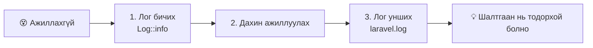
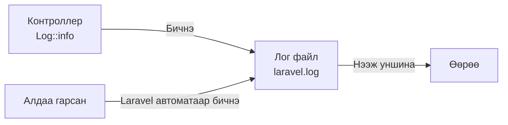
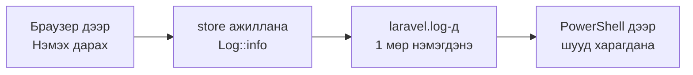
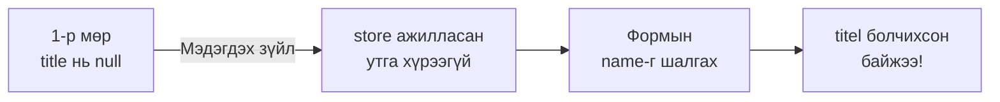
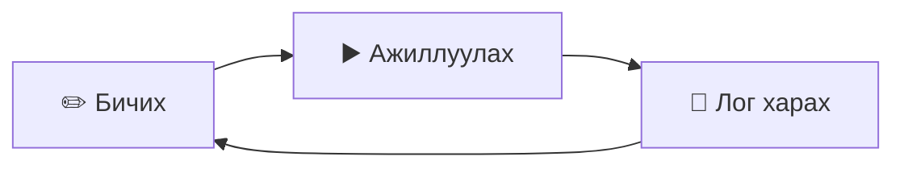

# 【Чухал】Ажиллахгүй бол лог гарга!

> 🇯🇵 Эх хувь (япон хэлээр): [【重要】ログの出し方.md](<../../../1年生_データ設計とアプリ開発/後期/20261022/【重要】ログの出し方.md>) <!-- original-ja-link -->

[«Todo нэмье (CREATE)» руу буцах](./20261022_資料_1.md)

> ## 🔥 Ажиллахгүй бол лог гарга!
> Програм зөв ажиллахгүй үед **кодыг таамгаар өөрчлөөд байвал бараг засагдахгүй.**
> Эхлээд **лог гаргаж, дотор нь юу болж байгааг хар**. Энэ бол шалтгааныг олох хамгийн дөт зам.
> Энэ хуудсыг цаашдын хичээл болон чөлөөт бүтээл дээр ч байнга ашиглана. Асуудал тулгарвал энэ хуудсыг хэдэн ч удаа эргэж хараарай.
>
> ## 👀 Лог харах дадалтай болъё!
> Зөвхөн ажиллахгүй үед биш, **өдөр тутамдаа лог хардаг** болъё.
> Ингэснээр ажилласан гэж бодсон ч үнэндээ алдаатай байгааг эрт анзаарна.



## Энэ хуудасны зорилго
- Лог юунд хэрэгтэйг ойлгох
- `Log::info()`-гоор өөрөө лог бичиж гаргаж чаддаг болох
- Лог файлыг нээж, агуулгыг нь уншиж чаддаг болох
- Өдөр тутамдаа лог хардаг дадалтай болох

---

## 1. Лог гэж юу вэ

Формын `追加` (Нэмэх) товчийг дарсан ч зөв хадгалагдахгүй байх тохиолдол бий.
Гэхдээ контроллер дотор юу болж байгааг дэлгэцээс харж чадахгүй.

- Формын утга контроллерт зөв хүрч байна уу?
- `store` метод ер нь ажиллаж байна уу?

Үүнийг мэдэхийн тулд **лог** ашиглана.
Лог бол апп «хэзээ, юу хийснээ» бичиж үлдээдэг **өдрийн тэмдэглэл** шиг зүйл.



Лог файл `src` дотор дараах байршилд байна.

```
src/
└─ storage/
    └─ logs/
        └─ laravel.log   ← энд бичигдэнэ
```

> **Алдаа ч автоматаар бичигдэнэ**
> Та өөрөө юу ч хийхгүй байсан ч програмын алдаа гарвал Laravel түүнийг `laravel.log`-д бичиж өгдөг.
> Алдааны дэлгэцийг хаачихсан ч дараа нь логоос шалгаж болно.
>
> Гэхдээ `404 Not Found` (хуудас олдсонгүй), `405` (`The POST method is not supported ...`), `419 Page Expired` гэх мэт
> **«URL эсвэл илгээх арга буруу» төрлийн алдаа лог руу бичигдэхгүй**. Ийм үед маршрут болон формоо шалгаарай.

---

## 2. Лог бичиж гаргаж үзье

Өмнөх удаагийн `store` методод лог бичих мөр нэмж үзье.
`app/Http/Controllers/TodoController.php`-г нээгээд ★ хэсгийг нэмж бичнэ.

```php
<?php

namespace App\Http\Controllers;

use App\Models\Todo;
use Illuminate\Http\Request;
use Illuminate\Support\Facades\Log;  // ★ нэмсэн (лог ашиглахын тулд)

class TodoController extends Controller
{
    // (index-г орхисон)

    public function store(Request $request)
    {
        // ★ формоос ирсэн утгыг лог руу бичнэ
        Log::info('Todoを追加します', ['title' => $request->input('title')]);

        $todo = new Todo();
        $todo->title = $request->input('title');
        $todo->save();

        // ★ хадгалж чадсанаа лог руу бичнэ
        Log::info('Todoを保存しました', ['id' => $todo->id]);

        return redirect('/todos');
    }
}
```

| Код | Утга |
|--------|------|
| `use Illuminate\Support\Facades\Log;` | Лог ашиглахад хэрэгтэй 1 мөр |
| `Log::info('мессеж')` | Лог руу «мэдээлэл» болгон бичнэ |
| `['title' => ...]` | Мессежтэй хамт утгыг нь ч бичиж гаргана (байхгүй байж болно) |
| `$todo->id` | `save()` хийсний дараа автоматаар өгөгдсөн `id`-г мэдэж болно |

---

## 3. Логоо харж үзье

Браузераар http://localhost:8000/todos хаягийг нээгээд «宿題をする» (Гэрийн даалгавар хийх) гэж оруулаад `追加` (Нэмэх) дээр дарна.
Дараа нь логоо харж үзье. Харах 2 арга бий.

### Харах арга 1: Засварлагчаар нээх

`src/storage/logs/laravel.log`-г VS Code зэрэг засварлагчаар нээнэ.
Хамгийн доош гүйлгэвэл дараах шиг мөрүүд нэмэгдсэн байна.

```
[2026-10-22 01:15:30] local.INFO: Todoを追加します {"title":"宿題をする"}
[2026-10-22 01:15:30] local.INFO: Todoを保存しました {"id":3}
```

| Хэсэг | Утга |
|------|------|
| `[2026-10-22 01:15:30]` | Бичигдсэн огноо, цаг |
| `local` | Ажиллуулж буй орчин (дадлагын орчин нь `local`) |
| `INFO` | Логийн төрөл (мэдээлэл) |
| `Todoを追加します` | Өөрийн бичсэн мессеж («Todo нэмнэ») |
| `{"title":"宿題をする"}` | Хамт бичиж гаргасан утга |

> **Цаг 9 цагаар зөрөөд байна уу?**
> Laravel цагийг **UTC (Дэлхийн зохицуулсан цаг)**-аар бүртгэдэг. Японы цаг нь UTC дээр 9 цаг нэмсэн цаг юм.
> Дээрх жишээний `01:15:30` нь Японы цагаар `10:15:30` болно.

### Харах арга 2: PowerShell дээр бодит цагаар харах

laravel хавтас дотор дараах командыг ажиллуулна.

```powershell
docker compose exec laravel tail -f storage/logs/laravel.log
```

Лог бичигдэх бүрт тэр даруйд нь харагдана.
Браузер дээр `追加` (Нэмэх) дарахад шинэ мөр нэмэгдэж байгааг харж болно.
Харахаа болих үедээ `Ctrl + C` дарна.

> `tail: cannot open ... No such file or directory` гэж гарвал лог файл хараахан үүсээгүй байна.
> Лог файл нь анхны 1 мөр бичигдэх үед үүсдэг. Браузер дээр нэг удаа `追加` (Нэмэх) дараад дахин ажиллуулаарай.



> **`php artisan pail` ашиглах боломжгүй**
> Интернэтээс хайвал лог харах команд болгон `php artisan pail` гарч ирдэг.
> Дадлагын орчинд pail ажиллахад хэрэгтэй PHP-ийн боломж (pcntl) суугаагүй тул ашиглах боломжгүй.
> Оронд нь `tail -f` ашиглана.

---

## 4. Логийн төрлүүд

Лог нь чухлын зэргээрээ хэд хэдэн төрөлтэй. Ихэвчлэн хэрэглэдэг нь дараах 4.

| Бичих арга | Төрөл | Хэрэглэх үе |
|--------|------|---------|
| `Log::debug('...')` | Дебаг | Хөгжүүлэлтийн явцад утгаа шалгамаар байх үед |
| `Log::info('...')` | Мэдээлэл | «Todo хадгалсан» гэх мэт энгийн үйл явдал |
| `Log::warning('...')` | Анхааруулга | Алдаа биш ч анхаарах хэрэгтэй зүйл |
| `Log::error('...')` | Алдаа | Амжилтгүй болсон үед |

Лог файлд `local.DEBUG`, `local.INFO`, `local.WARNING`, `local.ERROR` гэх мэтээр төрөл нь бичигдэнэ.
Алдаа хайхдаа файл дотроос `ERROR` гэж хайвал олоход амар болно.

---

## 5. Ажиллахгүй үед логоор шалтгааныг хайх

### Лог гаргахгүй бол…

```
«Магадгүй энэ хэсэг буруу юм болов уу…» → өөрчилнө → ажиллахгүй хэвээр
«Тэгвэл энэ юм болов уу…»              → өөрчилнө → ажиллахгүй хэвээр
«Анх ямар байсан билээ…»              → буцааж чадахгүй 😱
```

Таамгаар өөрчлөөд байвал цаг их зарцуулаад зогсохгүй, **ажиллаж байсан хэсгээ хүртэл эвдэх** тохиолдол бий.

| | Таамгаар засах | Лог гаргах |
|---|---|---|
| Юу хийх | Санаанд орсон газраа өөрчилнө | Өөрчлөхөөсөө өмнө эхлээд логоор дотрыг нь харна |
| Юу мэдэх | Юу ч мэдэхгүй | Хаана хүртэл ажилласан, утга нь юу байсан |
| Үр дүн | Засагдах эсэх нь азаас шалтгаална | Шалтгааны байршлыг нарийсгаж чадна |

### Лог ашиглан алдааны шалтгааныг олох

Лог нь «хаана хүртэл ажилласныг» шалгахад хэрэгтэй.

Жишээ нь, формын `name`-г `name="titel"` (үсгийн алдаатай) гэж бичсэн гэж бодъё.
`追加` (Нэмэх) дарахад алдаа гарлаа. Логийг харвал ингэж бичигдсэн байна.

```
[2026-10-22 01:20:05] local.INFO: Todoを追加します {"title":null}
[2026-10-22 01:20:05] local.ERROR: SQLSTATE[23000]: Integrity constraint violation: 1048 Column 'title' cannot be null ...
```



1-р мөрөөс **`store` хүртэл ажиллаж байгаа ч `title`-ийн утга хүрч ирээгүй** гэдэг нь тодорхой болно.
Тиймээс утгыг илгээж буй тал (формын `name`) сэжигтэй гэж үзэж болно.

Ийнхүү **сэжигтэй газрын өмнө, хойно лог бичиж, хаана хүртэл зөв ажиллаж байгааг шалгах** нь шалтгаан хайх гол арга юм.

> **Багш эсвэл найзаасаа асуухдаа ч логоо үзүүлээрэй**
> Зөвхөн «Ажиллахгүй байна» гэвэл асуулт сонссон хүн ч шалтгааныг мэдэхгүй.
> «`store`-ийн эхэнд гаргасан лог дээр `title` нь `null` байсан» гэх мэтээр **логтойгоо хамт асуувал** хурдан шийдэгдэнэ.

---

## 6. Лог ба `dd()`-ийн ялгаа

Утга шалгах арга гэвэл `dd()` ч бий.

```php
dd($request->input('title'));
```

`dd()` бичвэл **тэр газарт боловсруулалт зогсож**, утга нь браузерт харагдана.

| | `Log::info()` | `dd()` |
|---|---|---|
| Хаана гарах вэ? | Лог файлд | Браузерын дэлгэцэнд |
| Боловсруулалт? | Зогсохгүй, эцэс хүртэл ажиллана | Тэр газарт зогсоно |
| Тохиромжтой үе | Бүх урсгалыг дагамаар байх үед, дараа нь эргэж харах үед | Нэг утгыг тэр дор нь хурдан харах үед |
| Дараа нь устгах уу? | Үлдээж болно | **Заавал устгана** (устгахгүй бол үргэлж тэнд зогсоно) |

---

## 7. Лог харах дадалтай болъё!

Лог бол зөвхөн ажиллахгүй үед хардаг зүйл биш. **Өдөр тутамдаа харах дадал** суулгавал алдаагаа эрт анзаарна.

### Хөгжүүлэлтийн явцад логийг нээлттэй байлгах

Програм бичиж байх хугацаандаа PowerShell дээр `tail -f`-г ажиллуулсан хэвээр үлдээнэ.
3 цонхыг зэрэгцүүлж, **бичих → ажиллуулах → лог харах**-ыг давтахыг зөвлөж байна.

```
┌──────────────┬──────────────┐
│              │              │
│  Засварлагч  │  Браузер     │
│  (бичих)     │  (ажиллуулах)│
│              │              │
├──────────────┴──────────────┤
│  PowerShell (лог харах)     │
│  tail -f storage/logs/...   │
└─────────────────────────────┘
```



### «Ажилласан» үед ч лог харах

Дэлгэц дээр ажиллаж байгаа мэт харагдаж байсан ч **дотор нь өөр утга орсон** байх тохиолдол бий.
Жишээ нь, оруулсан гарчиг яг хэвээрээ хүрч байна уу, 1 удаа `追加` (Нэмэх) дарахад 2 бичлэг хадгалагдчихаагүй юу гэх мэт.
Логоор «бодсон утга маань мөн үү» гэдгийг хүртэл шалгасны дараа л «ажилласан» гэж хэлж болно.

### Алдааны дэлгэц гарвал эхлээд лог

Алдааны дэлгэц гарвал сандралгүйгээр `laravel.log`-ийн **хамгийн доод хэсгийг** харна.
`ERROR` гэж бичсэн мөрөнд юу болсон нь бичигдсэн байдаг.
(`404`, `405`, `419` нь лог руу бичигддэггүй тул дэлгэц дээрх мессежийг уншаад маршрут болон формоо шалгана)

### Лог харах дадлын шалгах жагсаалт

- [ ] Хөгжүүлэлт эхлэхдээ `tail -f`-ээр логийг нээсэн
- [ ] Товч дарах, хуудас нээх бүрдээ логийг харсан
- [ ] «Ажилласан» үед ч бодсон утга мөн эсэхийг логоор шалгасан
- [ ] Алдаа гарвал эхлээд `laravel.log`-ийн хамгийн доод хэсгийг харсан
- [ ] Асуулт асуухдаа логоо хамт үзүүлсэн

---

## 8. Дүгнэлт

> ## 🔥 Ажиллахгүй бол лог гарга!
> ## 👀 Лог харах дадалтай болъё!

- Лог бол апп «хэзээ, юу хийснээ» бичдэг өдрийн тэмдэглэл
- `use Illuminate\Support\Facades\Log;` гэж бичээд `Log::info('мессеж', [утга])`-оор бичиж гаргана
- Лог нь `src/storage/logs/laravel.log`-д бичигдэнэ. Алдаа ч автоматаар бичигдэнэ
- `docker compose exec laravel tail -f storage/logs/laravel.log`-оор бодит цагаар харж болно
- Цаг нь UTC (Японы цагаас 9 цагаар хоцорсон)
- Бүтэхгүй байвал сэжигтэй газрын өмнө, хойно лог бичиж «хаана хүртэл ажилласныг» шалгана
- Хөгжүүлэлтийн явцад `tail -f`-г нээлттэй байлгаж, **бичих → ажиллуулах → лог харах**-ыг давтана

<!-- nav:start -->

---

| ⬅️ Буцах | 🗺️ Ерөнхий зураг | Дараагийнх ➡️ |
|:--|:--:|--:|
| [10/22 Todo нэмэх (CREATE)](20261022_資料_1.md) | [Материалын ерөнхий зураг](../../README.md) | [10/22 Todo-гийн дэлгэрэнгүй (SHOW)](20261022_資料_2.md) |

<!-- nav:end -->
