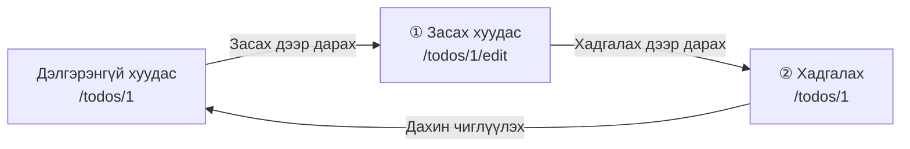
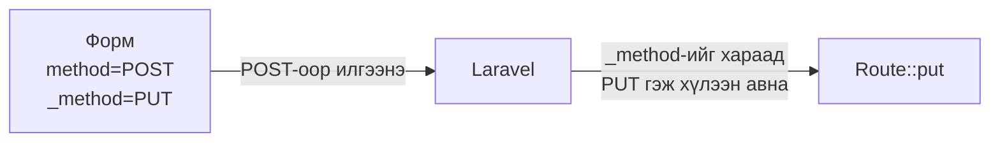
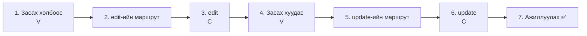
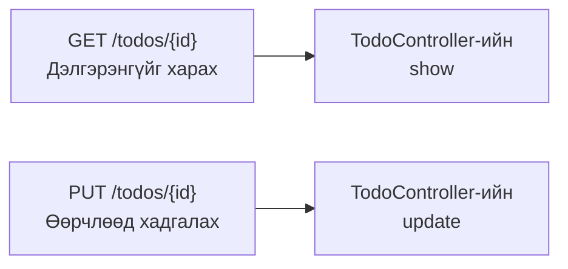
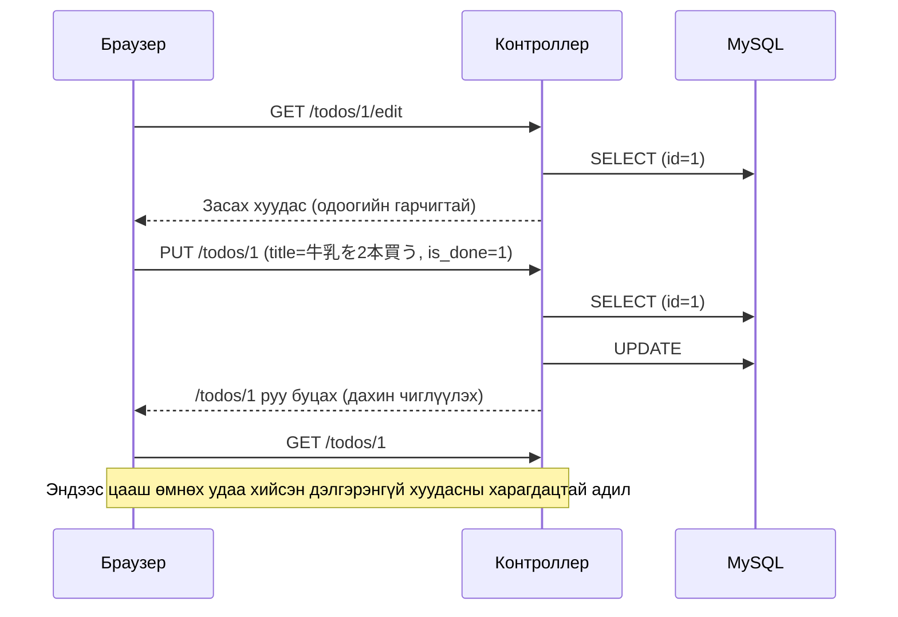
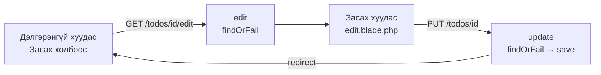

# Laravel-ийн анхан шат — Todo-г засъя (UPDATE)

> 🇯🇵 Эх хувь (япон хэлээр): [20261029_資料_1.md](<../../../1年生_データ設計とアプリ開発/後期/20261029/20261029_資料_1.md>) <!-- original-ja-link -->

[Өмнөх удаа](../20261022/20261022_資料_2.md) хийсэн дэлгэрэнгүй хуудсанд «Засах» товч нэмж, **бүртгэсэн Todo-гийн гарчиг болон төлөвийг (дууссан / дуусаагүй) өөрчлөх (засах) функц** хийнэ.

## Өнөөдрийн зорилго
- Засах хуудас хийж, одоогийн гарчиг ба төлөвийг харуулж чаддаг болох
- PUT ба `@method('PUT')` ашиглан өөрчилсөн агуулгаа илгээж чаддаг болох
- Өөрчилсөн гарчиг ба төлөвийг өгөгдлийн санд хадгалж (UPDATE) чаддаг болох
- Чагтлах нүдний утгыг хэрхэн хүлээн авахыг ойлгох

> Дадлагын орчны (`php-study`) mysql болон laravel-ийг асаасны дараа эхэлнэ.
> Өмнөх удаагийн «дэлгэрэнгүй хуудас (`/todos/1` гэх мэт)» харагдаж байгаа төлөвөөс эхэлнэ.

---

## 1. Засах үйлдэл «2 хуудаснаас» бүрддэг

Нэмэх үйлдэл «формыг илгээх» 1 удаагаар дуусдаг байсан.
Засах үйлдэл нь **① засах хуудсыг нээх** → **② өөрчлөөд илгээх** гэсэн 2 удаад хуваагдана.



| | URL | Төрөл | Хариуцагч | Юу хийх |
|---|---|---|---|---|
| ① | `/todos/1/edit` | GET | `edit` | Засах хуудсыг харуулна (одоогийн гарчгийг оруулах талбарт урьдчилан оруулна) |
| ② | `/todos/1` | PUT | `update` | Өөрчилсөн гарчгийг хадгална |

Аль алинд нь URL доторх `1` бол **засахыг хүссэн Todo-гийн `id`** юм.
Өмнөх удаагийн дэлгэрэнгүй хуудастай адил **маршрутын параметр `{id}`** болон **`findOrFail()`**-г ашиглана.

> **Эхний улирлын todo.php-д яаж байсан бэ?**
> Эхний улиралд `index.php?edit=3` гэх мэтээр `?edit=`-ээр аль Todo-г засахаа тодорхойлдог байсан.
> Laravel-д `/todos/3/edit` гэх мэтээр **URL дотор `id`-г оруулна**.

---

## 2. Шинээр гарч ирэх зүйл: PUT ба `@method('PUT')`

«Аль хэдийн байгаа өгөгдлийг өөрчлөх» үед **PUT** гэсэн төрлийг ашиглах нь Laravel-ийн дүрэм.

| Төрөл | Хэрэглэх үе | Одоогоор хийсэн зүйлс |
|------|---------|-------------------|
| GET | Харах | Жагсаалт (`/todos`), дэлгэрэнгүй (`/todos/1`) |
| POST | Шинээр нэмэх | Нэмэх (`/todos`) |
| **PUT** | Өөрчлөх | **Өнөөдрийн засах хэсэг** |

Гэхдээ HTML форм **зөвхөн GET ба POST-ыг л илгээж чадна**.
Тиймээс формыг POST-оор илгээж, `@method('PUT')`-ээр «үнэндээ PUT» гэдгийг Laravel-д мэдэгдэнэ.

```html
<form method="POST" action="/todos/1">
    @csrf
    @method('PUT')
    ...
</form>
```

`@method('PUT')` нь `<input type="hidden" name="_method" value="PUT">` гэсэн 1 мөр болж хувирна.
Laravel энэ `_method`-ийг хараад «PUT ирлээ» гэж үзнэ.



---

## 3. Хийж үзье



Өөрчлөх файл дараах 4 байна (`src` дотор).

```
src/
├─ resources/views/todos/
│   ├─ show.blade.php ················· 1. Засах холбоос нэмж бичих
│   └─ edit.blade.php ················· 4. Засах хуудас (шинээр үүсгэнэ)
├─ routes/
│   └─ web.php ························ 2, 5. Маршрут нэмж бичих
└─ app/Http/Controllers/
    └─ TodoController.php ············· 3, 6. edit ба update-г нэмж бичих
```

---

### 1. Дэлгэрэнгүй хуудсанд «Засах» холбоос нэмэх (V)

> Одоо энд: **🟢 1. Засах холбоос** → 2. edit-ийн маршрут → 3. edit → 4. Засах хуудас → 5. update-ийн маршрут → 6. update → 7. Ажиллуулах

Өмнөх удаа хийсэн `resources/views/todos/show.blade.php`-г нээгээд ★ бүхий 1 мөрийг нэмж бичнэ.

```html
<body>
    <h1>{{ $todo->title }}</h1>

    <p>番号：{{ $todo->id }}</p>

    <p>
        状態：
        @if ($todo->is_done)
            完了 ✅
        @else
            未完了
        @endif
    </p>

    <a href="/todos/{{ $todo->id }}/edit">編集</a>  {{-- ★ нэмсэн --}}
    <a href="/todos">一覧にもどる</a>
</body>
```

`/todos/{{ $todo->id }}/edit` нь `id` нь 1 байгаа Todo бол `/todos/1/edit` болно.

(Энэ үед «編集» (Засах) дээр дарвал `404 Not Found` гарна. Учир нь маршрут хараахан байхгүй.)

---

### 2. Засах хуудасны маршрутыг бичих

> Одоо энд: 1. Засах холбоос → **🟢 2. edit-ийн маршрут** → 3. edit → 4. Засах хуудас → 5. update-ийн маршрут → 6. update → 7. Ажиллуулах

`routes/web.php`-д ★ бүхий 1 мөрийг нэмж бичнэ.

```php
Route::get('/todos', [TodoController::class, 'index']);
Route::post('/todos', [TodoController::class, 'store']);
Route::get('/todos/{id}', [TodoController::class, 'show']);
Route::get('/todos/{id}/edit', [TodoController::class, 'edit']);  // ★ нэмсэн
```

```
Route::get( '/todos/{id}/edit' ,  [TodoController::class, 'edit'] );
~~~~~~~~~~   ~~~~~~~~~~~~~~~~     ~~~~~~~~~~~~~~~~~~~~~  ~~~~~~
GET-ээр      энэ URL-ыг нээвэл    TodoController-ийн     edit метод хариуцна
```

`edit` (эдит) гэдэг нь «засах» гэсэн утгатай. Laravel-д засах хуудсыг харуулдаг методод `edit` гэсэн нэрийг ихэвчлэн хэрэглэдэг.

---

### 3. edit методыг бичих (C)

> Одоо энд: 1. Засах холбоос → 2. edit-ийн маршрут → **🟢 3. edit** → 4. Засах хуудас → 5. update-ийн маршрут → 6. update → 7. Ажиллуулах

`app/Http/Controllers/TodoController.php`-д ★ бүхий `edit` методыг нэмж бичнэ.

```php
    // (index, store, show-г орхисон)

    // ★ эндээс нэмнэ
    public function edit($id)
    {
        // ① id-аар засахыг хүссэн нэг Todo-г авна
        $todo = Todo::findOrFail($id);

        // ② засах хуудсыг харуулна
        return view('todos.edit', ['todo' => $todo]);
    }
    // ★ энд хүртэл
```

Өмнөх удаагийн `show`-тэй харьцуулж үзье. **Ялгаатай нь зөвхөн ашиглах view** юм.

| | `show` (дэлгэрэнгүй) | `edit` (засах) |
|---|---|---|
| Авах зүйл | `Todo::findOrFail($id)` | `Todo::findOrFail($id)` |
| View | `todos.show` | **`todos.edit`** |

---

### 4. Засах хуудас хийх (V)

> Одоо энд: 1. Засах холбоос → 2. edit-ийн маршрут → 3. edit → **🟢 4. Засах хуудас** → 5. update-ийн маршрут → 6. update → 7. Ажиллуулах

`resources/views/todos` дотор `edit.blade.php` гэсэн файлыг шинээр үүсгэнэ.

```
resources/views/todos/
  ├─ index.blade.php
  ├─ show.blade.php
  └─ edit.blade.php   ← шинээр үүсгэнэ
```

```html
<!DOCTYPE html>
<html lang="ja">
<head>
    <meta charset="UTF-8">
    <title>TODOの編集</title>
</head>
<body>
    <h1>TODOの編集</h1>

    <form method="POST" action="/todos/{{ $todo->id }}">
        @csrf
        @method('PUT')
        <input type="text" name="title" value="{{ $todo->title }}" required>
        <label>
            <input type="checkbox" name="is_done" value="1" @checked($todo->is_done)>
            完了
        </label>
        <button type="submit">保存</button>
    </form>

    <a href="/todos/{{ $todo->id }}">もどる</a>
</body>
</html>
```

| Код | Утга |
|--------|------|
| `action="/todos/{{ $todo->id }}"` | `/todos/1` гэх мэт, засаж буй Todo-гийн `id`-тай URL руу илгээнэ |
| `@csrf` | Нууц үг (өмнөх удаагийн нэмэх формтой адил) |
| `@method('PUT')` | «Үнэндээ PUT» гэдгийг Laravel-д мэдэгдэнэ |
| `value="{{ $todo->title }}"` | Оруулах талбарт **одоогийн гарчгийг анхнаас нь оруулж өгнө** |
| `name="is_done" value="1"` | **Чагт тэмдэг тавьсан үед л** `is_done=1` илгээгдэнэ |
| `@checked($todo->is_done)` | Дууссан Todo бол анхнаас нь чагт тэмдэг тавьж өгнө (10/15-ны жагсаалттай адил) |
| `<label>` ~ `</label>` | «完了» (Дууссан) гэсэн бичвэр дээр дарахад ч чагтлах нүдний төлөв өөрчлөгдөхөөр болгоно |

#### Чагтлах нүдний ажиллах чухал зарчим

Чагтлах нүд **чагталсан үед л** утгаа илгээдэг.
Чагт тэмдгийг арилгасан үед `is_done` өөрөө **илгээгдэхгүй**.

| Чагтлах нүд | Илгээгдэх зүйл |
|----------------|------------|
| ☑ Тавьсан | `title=…` ба `is_done=1` |
| ☐ Тавиагүй | Зөвхөн `title=…` (`is_done` огт илгээгдэхгүй) |

Тиймээс контроллер дээр «`is_done` **илгээгдэж ирсэн эсэхээр**» дууссан / дуусаагүйг шийднэ (6-р алхамд бичнэ).

Нэмэх формоос ялгаатай нь дараах 4.

| | Нэмэх форм | Засах форм |
|---|---|---|
| Илгээх хаяг | `/todos` | `/todos/{{ $todo->id }}` |
| `@method('PUT')` | Байхгүй | **Байгаа** |
| Оруулах талбар | Хоосон | **Одоогийн гарчиг орсон байна** (`value`) |
| Төлөв | Байхгүй (нэмсэн Todo нь дуусаагүй) | **Дууссан эсэхийг заах чагтлах нүд** (одоогийн төлөвийг харуулна) |

✅ **Шалгах**: Дэлгэрэнгүй хуудсан дээр «編集» (Засах) дарахад, оруулах талбарт одоогийн гарчиг, чагтлах нүд нь одоогийн төлөвийг харуулсан засах хуудас гарвал болно.
(«保存» (Хадгалах)-ыг одоохондоо битгий дараарай. Дарвал алдаа гарна.)

---

### 5. Хадгалах маршрутыг бичих

> Одоо энд: 1. Засах холбоос → 2. edit-ийн маршрут → 3. edit → 4. Засах хуудас → **🟢 5. update-ийн маршрут** → 6. update → 7. Ажиллуулах

`routes/web.php`-д ★ бүхий 1 мөрийг нэмж бичнэ.

```php
Route::get('/todos', [TodoController::class, 'index']);
Route::post('/todos', [TodoController::class, 'store']);
Route::get('/todos/{id}', [TodoController::class, 'show']);
Route::get('/todos/{id}/edit', [TodoController::class, 'edit']);
Route::put('/todos/{id}', [TodoController::class, 'update']);  // ★ нэмсэн
```

Ингээд маршрут 5 боллоо.

| Маршрут | Хариуцагч | Юу хийх |
|--------|------|---------|
| `GET /todos` | `index` | Жагсаалт харуулах |
| `POST /todos` | `store` | Шинээр нэмэх |
| `GET /todos/{id}` | `show` | Нэг Todo-г дэлгэрэнгүй харуулах |
| `GET /todos/{id}/edit` | `edit` | Засах хуудсыг харуулах |
| `PUT /todos/{id}` | `update` | Өөрчлөөд хадгалах |

`/todos/{id}`-г **GET бол `show`, PUT бол `update`** хариуцна.
`/todos`-ийн үеийн «GET бол `index`, POST бол `store`»-той ижил зарчим.



---

### 6. update методыг бичих (C)

> Одоо энд: 1. Засах холбоос → 2. edit-ийн маршрут → 3. edit → 4. Засах хуудас → 5. update-ийн маршрут → **🟢 6. update** → 7. Ажиллуулах

`TodoController.php`-д ★ бүхий `update` методыг нэмж бичнэ.

```php
    // ★ эндээс нэмнэ
    public function update(Request $request, $id)
    {
        // ① id-аар өөрчлөхийг хүссэн нэг Todo-г авна
        $todo = Todo::findOrFail($id);

        // ② оруулсан гарчиг ба төлөвөөр өөрчилнө
        $todo->title = $request->input('title');
        $todo->is_done = $request->has('is_done');

        // ③ өгөгдлийн санд хадгална
        $todo->save();

        // ④ дэлгэрэнгүй хуудас руу буцна
        return redirect('/todos/' . $todo->id);
    }
    // ★ энд хүртэл
```

| Код | Утга |
|--------|------|
| `update(Request $request, $id)` | Формын утга (`$request`) болон URL-ын `{id}` (`$id`) хоёуланг нь хүлээн авна |
| `$request->has('is_done')` | `is_done` илгээгдэж ирвэл `true` (дууссан), байхгүй бол `false` (дуусаагүй). Эхний улирлын `isset($_POST['is_done'])`-тэй адил |
| `'/todos/' . $todo->id` | Тэмдэгтүүдийг холбож `/todos/1` шиг URL болгоно (`.` нь эхний улиралд үзсэн тэмдэгт мөр холбох оператор) |

Өмнөх удаа хийсэн нэмэх `store`-той бараг ижил хэлбэртэй. Ялгаатай нь **① ба ④**.

| | `store` (нэмэх) | `update` (засах) |
|---|---|---|
| ① | `new Todo()` (шинээр үүсгэнэ) | `Todo::findOrFail($id)` (байгааг нь авна) |
| ② | `$todo->title = ...` | `$todo->title = ...` ба `$todo->is_done = ...` |
| ③ | `save()` → `INSERT` | `save()` → **`UPDATE`** |
| ④ | Жагсаалт (`/todos`) руу буцна | Дэлгэрэнгүй хуудас (`/todos/1` гэх мэт) руу буцна |

Ижил `save()` байсан ч **шинээр үүсгэсэн Todo бол `INSERT`, авсан Todo бол `UPDATE`**-г Laravel автоматаар ялгаж хэрэглэдэг.

Эхний улирлын `todo.php`-тэй харьцуулж үзье.

```php
// Эхний улирал
$id = (int)($_POST['id'] ?? 0);
$title = trim($_POST['title'] ?? '');
$stmt = $pdo->prepare("UPDATE todos SET title = :title WHERE id = :id");
$stmt->execute(['title' => $title, 'id' => $id]);
header('Location: index.php');
exit;

// Laravel
$todo = Todo::findOrFail($id);
$todo->title = $request->input('title');
$todo->is_done = $request->has('is_done');
$todo->save();
return redirect('/todos/' . $todo->id);
```

Эхний улирлын засах хэсэг зөвхөн гарчгийг өөрчилдөг байсан бол Laravel хувилбарт **төлөвийг ч хамт** өөрчилнө.

---

### 7. Ажиллуулах ✅

> Одоо энд: 1. Засах холбоос → 2. edit-ийн маршрут → 3. edit → 4. Засах хуудас → 5. update-ийн маршрут → 6. update → **🟢 7. Ажиллуулах**

1. http://localhost:8000/todos хаягийг нээнэ
2. «牛乳を買う» (Сүү худалдаж авах) дээр дарж, дэлгэрэнгүй хуудсыг нээнэ
3. «編集» (Засах) дарна
4. Оруулах талбарыг «牛乳を2本買う» (2 шил сүү худалдаж авах) болгон өөрчилж, «完了» (Дууссан)-д чагт тэмдэг тавиад `保存` (Хадгалах) дарна
5. Дэлгэрэнгүй хуудас руу буцаж, гарчиг нь «牛乳を2本買う», төлөв нь «完了 ✅» (Дууссан ✅) болж өөрчлөгдсөн бол амжилттай
6. Засах хуудсыг дахин нээж, чагт тэмдгийг арилгаад `保存` (Хадгалах) дарвал «未完了» (Дуусаагүй) болж буцдагийг ч шалгаарай



✅ **Шалгах 1**: Жагсаалтын хуудас руу буцаж, жагсаалт дахь гарчиг болон чагтлах нүдний төлөв мөн өөрчлөгдсөн эсэхийг шалгаарай.

✅ **Шалгах 2**: phpMyAdmin дээр `todos` хүснэгтийг нээж үзээрэй.
Өөрчилсөн Todo-гийн `updated_at` нь хадгалсан цаг болж өөрчлөгдсөн байна (UTC учраас Японы цагаас 9 цагаар хоцорсон байна).
`save()` хийх үед Laravel «шинэчилсэн цагийг» автоматаар оруулж өгсөн. `created_at` нь хэвээрээ.

> **Гарчиг ч, төлөв ч өөрчлөхгүйгээр «Хадгалах» дарвал?**
> Юу ч өөрчлөгдөөгүй үед Laravel `UPDATE` хийхгүй. Тиймээс `updated_at` ч өөрчлөгдөхгүй.

---

## 4. Бүтэхгүй байвал

> **🔥 Ажиллахгүй бол лог гарга!**
> Алдааны шалтгаан ойлгогдохгүй үед `update` дотор `Log::info()` ашиглаж `$id`, `title`, `is_done`-ийн утгыг шалгаарай → [【Чухал】Лог хэрхэн гаргах вэ](../20261022/【重要】ログの出し方.md)

| Шинж тэмдэг | Шалтгааны байршил | Шийдэл |
|------|----------|------|
| «編集» (Засах) дарахад `404 Not Found` | Маршрут | `routes/web.php`-д `Route::get('/todos/{id}/edit', ...)` бичсэн эсэхийг шалгах |
| `Call to undefined method App\Http\Controllers\TodoController::edit()` | Контроллер | `TodoController.php`-д `edit` метод бичсэн эсэх, нэрийн үсгийг шалгах (`update` ч мөн адил) |
| `View [todos.edit] not found.` | View | `resources/views/todos/edit.blade.php` үүсгэсэн эсэх, файлын нэрийг шалгах |
| Засах хуудасны оруулах талбар хоосон | View | `<input>`-д `value="{{ $todo->title }}"` байгаа эсэхийг шалгах |
| «保存» (Хадгалах) дарахад `The POST method is not supported for route todos/1.` | View | Засах хуудасны формд `@method('PUT')` байгаа эсэхийг шалгах |
| «保存» (Хадгалах) дарахад `The PUT method is not supported for route todos/1.` | Маршрут | `routes/web.php`-д `Route::put('/todos/{id}', ...)` бичсэн эсэхийг шалгах |
| Хадгалсан ч гарчиг өөрчлөгдөхгүй | Контроллер | `update` дотор `$todo->save();` байгаа эсэхийг шалгах |
| Чагт тэмдэг тавьж хадгалсан ч дуусаагүй хэвээр | View, контроллер | `name="is_done"` ба `$request->has('is_done')`-ийн үсэг ижил эсэхийг шалгах |
| Чагт тэмдгийг арилгаж хадгалсан ч дууссан хэвээр | Контроллер | `update` дотор `$todo->is_done = $request->has('is_done');` байгаа эсэхийг шалгах |
| Өөр Todo өөрчлөгдчихсөн | View | Засах хуудасны `action="/todos/{{ $todo->id }}"`-г шалгах |

> `404`, `The ... method is not supported` алдаанууд лог руу бичигдэхгүй. Дэлгэц дээрх мессежийг уншаад маршрут болон формоо шалгаарай.

---

## 5. Дүгнэлт



| Өнөөдөр бичсэн зүйл | Нэг үгээр |
|--------------|-----------|
| `Route::get('/todos/{id}/edit', ...)` ба `edit` | Засах хуудсыг харуулна. `show`-той бараг ижил |
| `value="{{ $todo->title }}"` | Оруулах талбарт одоогийн гарчгийг оруулж өгнө |
| `<input type="checkbox" name="is_done" ...>` | Төлөвийг засах чагтлах нүд. Чагталсан үед л илгээгдэнэ |
| `$request->has('is_done')` | `is_done` илгээгдэж ирсэн эсэхээр дууссан / дуусаагүйг шийднэ |
| `@method('PUT')` | Формыг POST-оор илгээж, «үнэндээ PUT» гэж мэдэгдэнэ |
| `Route::put('/todos/{id}', ...)` ба `update` | Өөрчлөөд хадгална |
| Авсан Todo-г `save()` | `UPDATE` болно (шинээр үүсгэсэн Todo бол `INSERT`) |

---

## 6. Цааш нь хийж үзье (цаг үлдсэн хүмүүст)

Засах хуудасны гарчгийг «TODOの編集» (TODO засах) биш, «『牛乳を買う』の編集» («Сүү худалдаж авах»-ыг засах) шиг **засаж буй Todo-гийн гарчигтай** болгож үзээрэй.

<details>
<summary>Сэжүүр</summary>

`edit.blade.php`-ийн `<h1>` дотор `{{ $todo->title }}`-г ашиглана.

```html
<h1>『{{ $todo->title }}』の編集</h1>
```

</details>

---

Дараа нь жагсаалтын чагтлах нүдээр дууссан болон дуусаагүй төлөвийг солих функц хийнэ → [Дууссан / дуусаагүйг сольё (PATCH)](./20261029_資料_2.md)

<!-- nav:start -->

---

| ⬅️ Өмнөх | 🗺️ Ерөнхий зураг | Дараагийнх ➡️ |
|:--|:--:|--:|
| [10/22 Todo-гийн дэлгэрэнгүй (SHOW)](../20261022/20261022_資料_2.md) | [Материалын ерөнхий зураг](../../README.md) | [10/29 Дууссан төлөвийг солих (PATCH)](20261029_資料_2.md) |

<!-- nav:end -->
