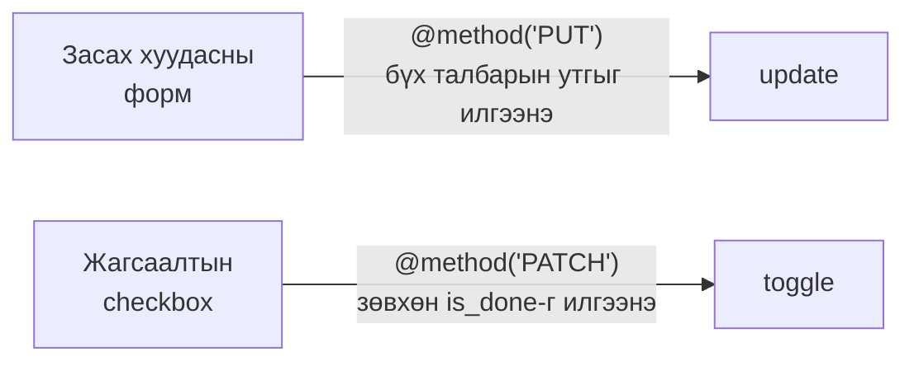
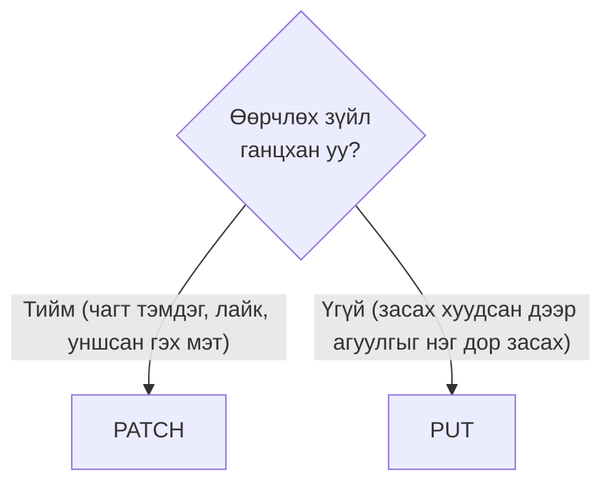
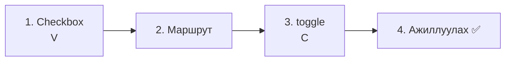
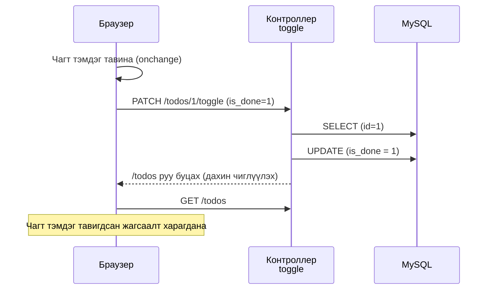
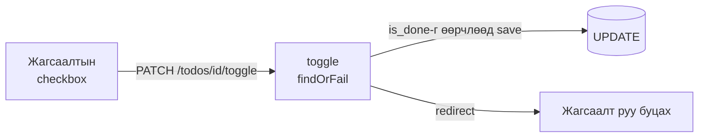

# Laravel-ийн анхан шат — Дууссан / дуусаагүйг сольё (PATCH)

> 🇯🇵 Эх хувь (япон хэлээр): [20261029_資料_2.md](<../../../1年生_データ設計とアプリ開発/後期/20261029/20261029_資料_2.md>) <!-- original-ja-link -->

[1-р материал](./20261029_資料_1.md)-аар бид Todo-гийн гарчгийг засах боломжтой болсон. Дараа нь жагсаалтын checkbox-оор **дууссан / дуусаагүйг солих функц** хийнэ.

## Өнөөдрийн зорилго
- PUT ба PATCH-ийн ялгааг ойлгох
- PATCH ба `@method('PATCH')` ашиглан зөвхөн нэг хэсгийг өөрчлөх хүсэлт илгээж чаддаг болох
- Checkbox-оор дууссан / дуусаагүйг сольж чаддаг болох

> 1-р материалын «Todo засах» хэсэг ажиллаж байгаа төлөвөөс эхэлнэ.

---

## 1. Дууссан / дуусаагүйг солих гэж юу вэ

1-р материалд засах хуудаснаас төлөвийг (`is_done`) өөрчилж чаддаг болсон.
Гэхдээ жагсаалтын checkbox-ыг дарсан ч **өгөгдлийн санд хадгалагдахгүй** (хуудсыг дахин ачаалбал анхныхаа байдал руу буцна).
Энд жагсаалтын checkbox-ыг **дармагц «дууссан ⇄ дуусаагүй» шууд солигддог** болгоно.
Засах хуудсыг тэр болгон нээлгүйгээр жагсаалтаасаа шууд сольж чаддаг болно.

```
TODO апп

☐ 牛乳を買う         ← чагт тэмдэг тавибал «дууссан» болно
☑ レポートを出す     ← чагт тэмдгийг арилгавал «дуусаагүй» болж буцна
```

Цаанаа бол 1-р материалд хийсэн `update`-тэй ижил **UPDATE** үйлдэл хийнэ. Зөвхөн `title`-ийн оронд `is_done`-г өөрчилдгөөрөө ялгаатай.

| URL | Төрөл | Хариуцагч | Юу хийх |
|-----|------|------|---------|
| `/todos/1/toggle` | **PATCH** | `toggle` | `is_done`-г өөрчилнө |

`toggle` (тоггл) гэдэг нь «асаалттай, унтраалттай төлөвийн хооронд шилжүүлэх» гэсэн утгатай.

---

## 2. Шинээр гарч ирэх зүйл: PATCH

Өөрчлөх үеийн төрөлд **PUT**-ээс гадна **PATCH** (патч) бий.
Хоёулаа «өөрчлөх» боловч **хэр зэрэг өөрчлөх** нь ялгаатай.

| Төрөл | Утга | Жишээгээр бол |
|------|------|-----------|
| PUT | Өгөгдлийг **бүтнээр нь** өөрчилнө | Баримт бичгийг шинээр бичээд **бүхэлд нь сольж тавина** |
| **PATCH** | Өгөгдлийн **зөвхөн нэг хэсгийг** өөрчилнө | Баримт бичгийн **ганцхан газарт** засварын тууз наана |

`patch` гэдэг нь англиар «нөхөөс (хувцасны цоорхой дээр нэг хэсэг даавуу тавьж засах)» гэсэн утгатай.

### Хаягийн картаар харьцуулж үзье

Жишээ нь, ийм «хаягийн карт» байна гэж бодъё.

```
Нэр: Ямада Ханако
Хаяг: Токио хот, 〇〇 дүүрэг…
Утас: 090-xxxx-xxxx
```

Нүүсний улмаас **зөвхөн хаяг** өөрчлөгдлөө.

```
【PUT】Шинэ карт бичээд бүхэлд нь сольж тавина

  ┌──────────────────────┐
  │ Нэр: Ямада Ханако    │ ← өөрчлөгдөөгүй ч бичнэ
  │ Хаяг: Осака…(шинэ)   │ ← өөрчлөгдсөн хэсэг
  │ Утас: 090-xxxx-xxxx  │ ← өөрчлөгдөөгүй ч бичнэ
  └──────────────────────┘

【PATCH】Одоогийн картын зөвхөн хаягийн хэсэгт засварын тууз наана

  ┌──────────────────────┐
  │ Хаяг: Осака…(шинэ)   │ ← зөвхөн өөрчлөгдсөн хэсэг
  └──────────────────────┘
```

| | PUT | PATCH |
|---|---|---|
| Илгээх зүйл | **Нэр, хаяг, утас бүгдийг** (өөрчлөгдөөгүй нэр, утсыг ч бичнэ) | **Зөвхөн хаягийг** |
| Бичээгүй зүйл? | «Хоосон болгоно» гэсэн утгатай | «Хэвээр нь үлдээнэ» гэсэн утгатай |

PUT нь «Энэ бол шинэ карт» гэж **бүгдийг** нь өгдөг тул бичихээ мартсан зүйл хоосон болчихно.
PATCH нь «Зөвхөн энийг зас» гэж өгдөг тул бичээгүй зүйлс хэвээрээ үлдэнэ.

### Todo апп дээр бол

Todo апп дээр хэрэглэвэл ийм болно.

| | Засах (`update`) | Дууссан / дуусаагүйг солих (`toggle`) |
|---|---|---|
| Ямар үйлдэл вэ? | Засах хуудсан дээр **Todo-гийн агуулгыг дахин бичиж** хадгална | Жагсаалт дээр **зөвхөн чагт тэмдгийг** солино |
| Илгээх зүйл | Засах хуудасны **бүх талбарын утга** (`title` ба `is_done`) | **Зөвхөн `is_done`-г** |
| Төрөл | **PUT** | **PATCH** |
| Бичих арга | `@method('PUT')` / `Route::put(...)` | `@method('PATCH')` / `Route::patch(...)` |



> **Засах хуудсан дээр ч төлөвийг өөрчилж болдог байхад яагаад toggle хийх вэ?**
> Засах хуудас бол «гарчиг ба төлөвийг **нэг дор** дахин бичих дэлгэц» (PUT).
> Жагсаалтын checkbox бол «**зөвхөн** төлөвийг тэр дор нь хурдан өөрчлөх» зориулалттай (PATCH).
> Хоёулаа `is_done`-г өөрчилдөг ч **илгээх зүйл (бүгдийг үү, нэг хэсгийг үү) ялгаатай** тул тусдаа боловсруулалт, тусдаа төрөл болгоно.
> «Дэлгэц дээрх зүйлсийг нэг дор дахин илгээх» нь PUT, «зөвхөн нэг зүйлийг онож өөрчлөх» нь PATCH.

### Эргэлзвэл



Өдөр тутмын аппуудад жишээ нь ингэж ялгаж хэрэглэдэг.

| Үйлдэл | Төрөл | Шалтгаан |
|------|------|------|
| Профайл засах хуудсан дээр «Хадгалах» | PUT | Нэр, өөрийн танилцуулга зэргийг нэг дор дахин илгээнэ |
| Пост дээр «лайк» дарах | PATCH | Зөвхөн «лайк» гэсэн нэг зүйлийг өөрчилнө |
| Мессежийг «уншсан» болгох | PATCH | Зөвхөн «уншсан эсэх» гэсэн нэг зүйлийг өөрчилнө |
| Todo-д чагт тэмдэг тавих | PATCH | Зөвхөн `is_done` гэсэн нэг зүйлийг өөрчилнө |

### PUT ч, PATCH ч аль нь ч ажиллах уу?

Laravel дээр аль алиныг нь ашигласан ч `save()`-ээр адилхан хадгалж болно. **Програмын ажиллагаа өөрчлөгдөхгүй**.
(Хаягийн картын жишээ бол «PUT ба PATCH-ийн **утга**» юм. Laravel-д PUT-ээр илгээгээгүй зүйл автоматаар хоосон болдоггүй.)
Тэгсэн ч ялгаж хэрэглэдэг нь маршрутыг хараад л **«ямар боловсруулалт хийдгийг» ойлгохуйц** болгохын тулд юм.

```php
Route::put('/todos/{id}', ...);           // «Todo-г бүтнээр нь дахин бичих юм байна»
Route::patch('/todos/{id}/toggle', ...);  // «Todo-гийн нэг хэсгийг өөрчлөх юм байна»
```

> Бодит хөгжүүлэлтэд засах хуудсанд ч PATCH ашигладаг баг бий. Чухал нь **багийн дотор дүрмээ нэгтгэх** явдал.
> Энэ хичээлд «засах хуудас бол PUT, ганц зүйл өөрчлөх үед PATCH» гэж нэгтгэнэ.

HTML форм PATCH-ыг ч илгээж чадахгүй тул PUT-тэй адил `@method('PATCH')` ашиглана.

> **Эхний улирлын todo.php-д ч хийж байсан**
> Эхний улиралд `action=toggle` илгээж, `isset($_POST['is_done']) ? 1 : 0`-ээр дууссан / дуусаагүйг шийддэг байсан.
> Laravel-д ч ижил санаагаар хийнэ.

---

## 3. Хийж үзье



Өөрчлөх файл дараах 3 байна (`src` дотор).

```
src/
├─ resources/views/todos/
│   └─ index.blade.php ················ 1. Checkbox-ыг формоор хүрээлэх
├─ routes/
│   └─ web.php ························ 2. Маршрут нэмж бичих
└─ app/Http/Controllers/
    └─ TodoController.php ············· 3. toggle методыг нэмж бичих
```

---

### 1. Жагсаалтын checkbox-оор хадгалж болдог болгох (V)

> Одоо энд: **🟢 1. Checkbox** → 2. Маршрут → 3. toggle → 4. Ажиллуулах

`resources/views/todos/index.blade.php`-ийн `<li>` доторхыг дараах байдлаар өөрчилнө.
Одоо байгаа checkbox-ыг **формоор хүрээлж**, `name`, `value`, `onchange`-г нэмнэ.

```html
    <ul>
        @foreach ($todos as $todo)
            <li>
                {{-- ★ эндээс өөрчилнө --}}
                <form method="POST" action="/todos/{{ $todo->id }}/toggle" style="display: inline;">
                    @csrf
                    @method('PATCH')
                    <input type="checkbox" name="is_done" value="1" onchange="this.form.submit()" @checked($todo->is_done)>
                </form>
                {{-- ★ энд хүртэл --}}
                <a href="/todos/{{ $todo->id }}">{{ $todo->title }}</a>
            </li>
        @endforeach
    </ul>
```

| | 10/15-аас (дарсан ч хадгалагдахгүй) | Өнөөдрөөс (дарвал хадгалагдана) |
|---|---|---|
| Форм | Байхгүй | `<form ...>`-оор хүрээлнэ |
| `name="is_done" value="1"` | Байхгүй | Байгаа |
| `onchange` | Байхгүй | Байгаа |
| `@checked(...)` | Байгаа | Байгаа (хэвээр) |

| Код | Утга |
|--------|------|
| `action="/todos/{{ $todo->id }}/toggle"` | `/todos/1/toggle` гэх мэт, тухайн Todo-гийн `id`-тай URL руу илгээнэ |
| `@method('PATCH')` | «Үнэндээ PATCH» гэдгийг Laravel-д мэдэгдэнэ (зөвхөн нэг хэсгийг өөрчлөх тул) |
| `name="is_done" value="1"` | **Чагт тэмдэг тавьсан үед л** `is_done=1` илгээгдэнэ |
| `onchange="this.form.submit()"` | Чагт тэмдгийг өөрчилсөн даруйд формыг илгээнэ (илгээх товч хэрэггүй) |
| `@checked($todo->is_done)` | Дууссан Todo бол анхнаас нь чагт тэмдэг тавьж өгнө (10/15-тай адил) |
| `style="display: inline;"` | Формын дараа шинэ мөр үүсгэлгүй, гарчигтай нь нэг мөрөнд байрлуулна |

> **Checkbox-ын чухал зарчим (1-р материалын давталт)**
> Checkbox нь **чагт тэмдэг тавьсан үед л** `is_done=1`-г илгээдэг. Чагт тэмдгийг арилгасан үед `is_done` өөрөө илгээгдэхгүй.
> Тиймээс контроллер дээр 1-р материалын `update`-тэй адил «`is_done` **илгээгдэж ирсэн эсэхээр**» дууссан / дуусаагүйг шийднэ.

---

### 2. Маршрут бичих

> Одоо энд: 1. Checkbox → **🟢 2. Маршрут** → 3. toggle → 4. Ажиллуулах

`routes/web.php`-д ★ бүхий 1 мөрийг нэмж бичнэ.

```php
Route::get('/todos', [TodoController::class, 'index']);
Route::post('/todos', [TodoController::class, 'store']);
Route::get('/todos/{id}', [TodoController::class, 'show']);
Route::get('/todos/{id}/edit', [TodoController::class, 'edit']);
Route::put('/todos/{id}', [TodoController::class, 'update']);
Route::patch('/todos/{id}/toggle', [TodoController::class, 'toggle']);  // ★ нэмсэн
```

`/todos/{id}` (гарчиг засах) ба `/todos/{id}/toggle` (дууссан / дуусаагүйг солих) нь URL өөр тул тусдаа хариуцагчтай болно.

---

### 3. toggle методыг бичих (C)

> Одоо энд: 1. Checkbox → 2. Маршрут → **🟢 3. toggle** → 4. Ажиллуулах

`TodoController.php`-д ★ бүхий `toggle` методыг нэмж бичнэ.

```php
    // ★ эндээс нэмнэ
    public function toggle(Request $request, $id)
    {
        // ① Төлөвийг нь өөрчлөх Todo-г id-аар нь олж авна
        $todo = Todo::findOrFail($id);

        // ② is_done илгээгдэж ирвэл дууссан (true), байхгүй бол дуусаагүй (false)
        $todo->is_done = $request->has('is_done');

        // ③ өгөгдлийн санд хадгална
        $todo->save();

        // ④ жагсаалтын хуудас руу буцна
        return redirect('/todos');
    }
    // ★ энд хүртэл
```

| Код | Утга |
|--------|------|
| `$request->has('is_done')` | `is_done` илгээгдэж ирвэл `true`, байхгүй бол `false`. Эхний улирлын `isset($_POST['is_done'])`-тэй адил |

`update`-тэй харьцуулж үзье.

| | `update` (засах хуудас) | `toggle` (жагсаалтын checkbox) |
|---|---|---|
| ① | `Todo::findOrFail($id)` | `Todo::findOrFail($id)` |
| ② | `title` ба `is_done`-г өөрчилнө | **Зөвхөн `is_done`-г** өөрчилнө |
| ③ | `save()` → `UPDATE` | `save()` → `UPDATE` |
| ④ | Дэлгэрэнгүй хуудас руу буцна | Жагсаалтын хуудас руу буцна |

Эхний улирлын `todo.php`-тэй харьцуулж үзье.

```php
// Эхний улирал
$id = (int)($_POST['id'] ?? 0);
$isDone = isset($_POST['is_done']) ? 1 : 0;
$stmt = $pdo->prepare("UPDATE todos SET is_done = :is_done WHERE id = :id");
$stmt->execute(['is_done' => $isDone, 'id' => $id]);
header('Location: index.php');
exit;

// Laravel
$todo = Todo::findOrFail($id);
$todo->is_done = $request->has('is_done');
$todo->save();
return redirect('/todos');
```

---

### 4. Ажиллуулах ✅

> Одоо энд: 1. Checkbox → 2. Маршрут → 3. toggle → **🟢 4. Ажиллуулах**

1. http://localhost:8000/todos хаягийг нээнэ
2. «牛乳を買う» (Сүү худалдаж авах)-ын checkbox-д чагт тэмдэг тавина
3. Хуудас дахин ачаалагдаад чагт тэмдэг хэвээрээ байвал амжилттай
4. Дахин чагт тэмдгийг арилгаад, арилсан хэвээрээ байх эсэхийг ч шалгаарай



✅ **Шалгах 1**: Чагт тэмдэг тавьсан Todo-гийн дэлгэрэнгүй хуудсыг нээж, «完了 ✅» (Дууссан) болсон эсэхийг шалгаарай.

✅ **Шалгах 2**: phpMyAdmin дээр `todos` хүснэгтийг нээж, `is_done` нь `1` (дууссан), `0` (дуусаагүй) болж өөрчлөгдсөн эсэхийг шалгаарай.

---

## 4. Бүтэхгүй байвал

> **🔥 Ажиллахгүй бол лог гарга!**
> Алдааны шалтгаан ойлгогдохгүй үед `toggle` дотор `Log::info()` ашиглаж `is_done` илгээгдэж ирж байгаа эсэхийг шалгаарай → [【Чухал】Лог хэрхэн гаргах вэ](../20261022/【重要】ログの出し方.md)

| Шинж тэмдэг | Шалтгааны байршил | Шийдэл |
|------|----------|------|
| Чагт тэмдэг тавьсан ч юу ч болохгүй | View | `<input>`-д `onchange="this.form.submit()"` байгаа эсэхийг шалгах |
| Чагт тэмдэг тавихад `404 Not Found` | Маршрут | `routes/web.php`-д `Route::patch('/todos/{id}/toggle', ...)` бичсэн эсэхийг шалгах |
| Чагт тэмдэг тавихад `The POST method is not supported for route todos/1/toggle.` | View | Checkbox-ын формд `@method('PATCH')` байгаа эсэхийг шалгах |
| Чагт тэмдэг тавихад `The PATCH method is not supported for route todos/1/toggle.` | Маршрут | `routes/web.php` нь `Route::put(...)` болчихоогүй эсэхийг шалгах (`Route::patch(...)` болгох) |
| Чагт тавьсан ч буцаад арилчихна | View, контроллер | `name="is_done"` ба `$request->has('is_done')`-ийн бичлэг таарч байгаа эсэхийг шалгах |
| Дууссан Todo боловч чагт тэмдэг тавигдаагүй | View | `<input>`-д `@checked($todo->is_done)` байгаа эсэхийг шалгах |

---

## 5. Дүгнэлт



| Өнөөдөр бичсэн зүйл | Нэг үгээр |
|--------------|-----------|
| PATCH ба `@method('PATCH')` | Зөвхөн нэг хэсгийг өөрчлөх үед ашиглана (бүтнээр нь бол PUT) |
| `onchange="this.form.submit()"` | Чагт тэмдгийг өөрчилсөн даруйд формыг илгээнэ |
| `name="is_done" value="1"` | Чагт тэмдэг тавьсан үед л `is_done=1` илгээгдэнэ |
| `Route::patch('/todos/{id}/toggle', ...)` | PATCH-аар илгээгдвэл `toggle` хариуцна |
| `$request->has('is_done')` | `is_done` илгээгдэж ирсэн эсэхээр дууссан / дуусаагүйг шийднэ |

---

Дараа нь Todo устгах функц хийнэ → [Todo-г устгая (DELETE)](./20261029_資料_3.md)

<!-- nav:start -->

---

| ⬅️ Өмнөх | 🗺️ Ерөнхий зураг | Дараагийнх ➡️ |
|:--|:--:|--:|
| [10/29 Todo засах (UPDATE)](20261029_資料_1.md) | [Материалын ерөнхий зураг](../../README.md) | [10/29 Todo устгах (DELETE)](20261029_資料_3.md) |

<!-- nav:end -->
