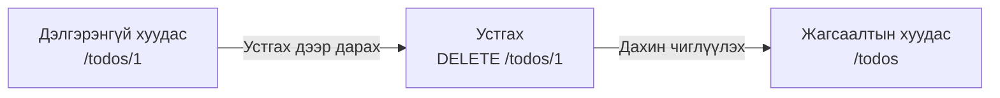
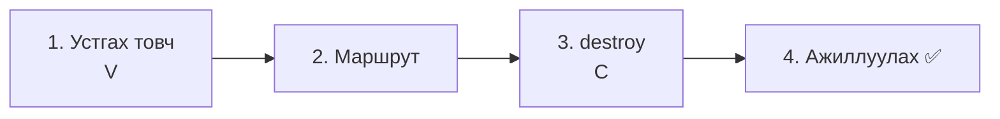
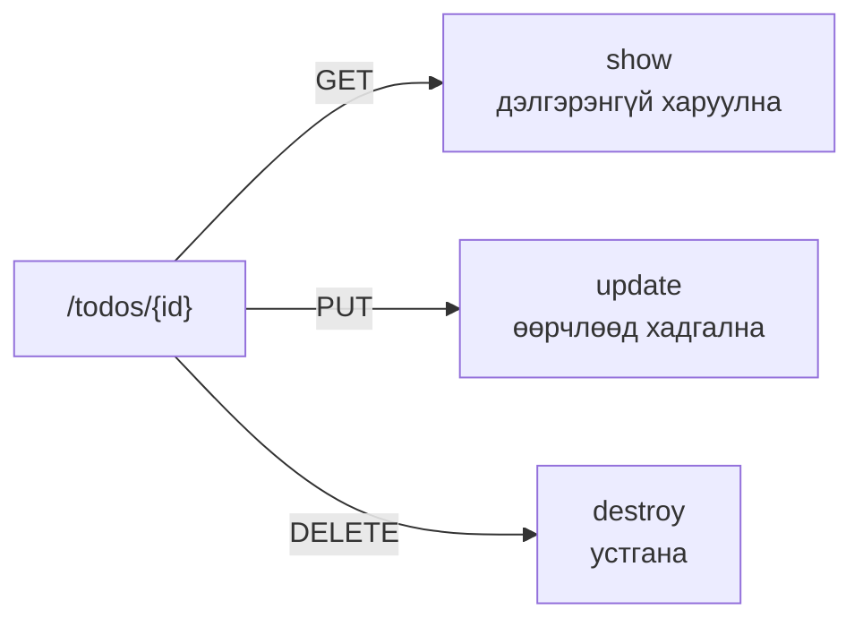
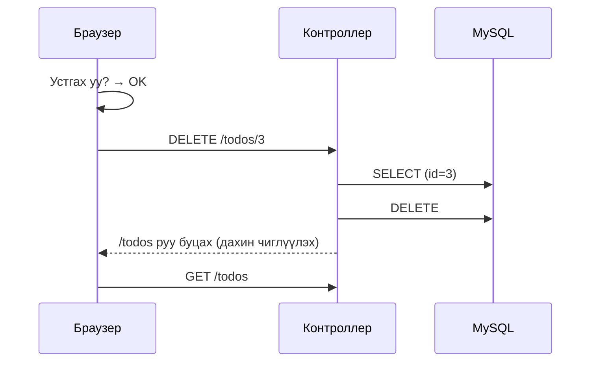
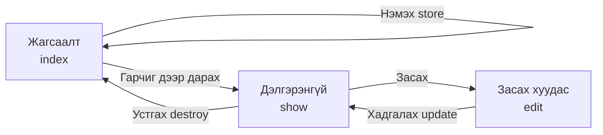

# Laravel-ийн анхан шат — Todo-г устгая (DELETE)

> 🇯🇵 Эх хувь (япон хэлээр): [20261029_資料_3.md](<../../../1年生_データ設計とアプリ開発/後期/20261029/20261029_資料_3.md>) <!-- original-ja-link -->

[1-р материал](./20261029_資料_1.md), [2-р материал](./20261029_資料_2.md)-аар бид Todo-г засах боломжтой болсон. Дараа нь **Todo-г арилгах (устгах) функц** хийнэ.

## Өнөөдрийн зорилго
- DELETE ба `@method('DELETE')` ашиглан устгах хүсэлт илгээж чаддаг болох
- `delete()`-ээр Todo-г өгөгдлийн сангаас устгаж чаддаг болох
- Нэмэх, харуулах, засах, устгах (CRUD) үйлдлүүдийг бүхэлд нь ойлгох

> 2-р материалын «дууссан / дуусаагүйг солих» хэсэг ажиллаж байгаа төлөвөөс эхэлнэ.

---

## 1. Устгах зарчим

Засахаас ялгаатай нь устгах үйлдэл **хуудас нээлгүйгээр, ганц товчоор дуусна**.



| URL | Төрөл | Хариуцагч | Юу хийх |
|-----|------|------|---------|
| `/todos/1` | **DELETE** | `destroy` | Todo-г устгана |

### DELETE ба `@method('DELETE')`

«Өгөгдөл арилгах» үед **DELETE** гэсэн төрлийг ашиглах нь Laravel-ийн дүрэм.
PUT-тэй адил HTML форм DELETE-ийг илгээж чадахгүй тул `@method('DELETE')` ашиглана.

| Төрөл | Хэрэглэх үе | Бичих арга |
|------|---------|--------|
| PUT | Өөрчлөх | Формд `@method('PUT')` |
| PATCH | Зөвхөн нэг хэсгийг өөрчлөх | Формд `@method('PATCH')` |
| **DELETE** | Арилгах | Формд `@method('DELETE')` |

> **Яагаад холбоос (`<a>`) биш, формын товч гэж?**
> Холбоос нь GET-ээр нээгддэг. GET бол «зөвхөн харах» дүрэмтэй тул өгөгдөл арилгах боловсруулалтад ашигладаггүй.
> Хэрэв холбоосоор устгаж болдог байсан бол URL-ыг нээгээд л Todo устчихна.
> Өгөгдөл өөрчлөх (нэмэх, засах, устгах) үед **формын товчоор илгээнэ** гэж санаарай.

---

## 2. Хийж үзье



Өөрчлөх файл дараах 3 байна (`src` дотор).

```
src/
├─ resources/views/todos/
│   └─ show.blade.php ················· 1. Устгах товч нэмж бичих
├─ routes/
│   └─ web.php ························ 2. Маршрут нэмж бичих
└─ app/Http/Controllers/
    └─ TodoController.php ············· 3. destroy методыг нэмж бичих
```

---

### 1. Дэлгэрэнгүй хуудсанд «Устгах» товч нэмэх (V)

> Одоо энд: **🟢 1. Устгах товч** → 2. Маршрут → 3. destroy → 4. Ажиллуулах

`resources/views/todos/show.blade.php`-д ★ бүхий формыг нэмж бичнэ.

```html
    <a href="/todos/{{ $todo->id }}/edit">編集</a>

    {{-- ★ эндээс нэмнэ --}}
    <form method="POST" action="/todos/{{ $todo->id }}" onsubmit="return confirm('削除しますか？');">
        @csrf
        @method('DELETE')
        <button type="submit">削除</button>
    </form>
    {{-- ★ энд хүртэл --}}

    <a href="/todos">一覧にもどる</a>
```

| Код | Утга |
|--------|------|
| `action="/todos/{{ $todo->id }}"` | `/todos/1` гэх мэт, арилгахыг хүссэн Todo-гийн `id`-тай URL руу илгээнэ |
| `@method('DELETE')` | «Үнэндээ DELETE» гэдгийг Laravel-д мэдэгдэнэ |
| `onsubmit="return confirm('削除しますか？');"` | Илгээхээс өмнө баталгаажуулах цонх («削除しますか？» = «Устгах уу?») гаргана. «Cancel» дарвал илгээхгүй |

Оруулах талбар байхгүй. Учир нь **аль Todo-г арилгахыг URL-ын `id`-аар л мэдэж болно**.

> **Эхний улирлын todo.php-д ч хийж байсан**
> `confirm()`-оор баталгаажуулсны дараа устгах нь эхний улирлын `todo.php`-тэй адил.
> Устгасан өгөгдлийг буцааж сэргээх боломжгүй тул баталгаажуулах цонх гаргах нь зүйтэй.

---

### 2. Маршрут бичих

> Одоо энд: 1. Устгах товч → **🟢 2. Маршрут** → 3. destroy → 4. Ажиллуулах

`routes/web.php`-д ★ бүхий 1 мөрийг нэмж бичнэ.

```php
Route::get('/todos', [TodoController::class, 'index']);
Route::post('/todos', [TodoController::class, 'store']);
Route::get('/todos/{id}', [TodoController::class, 'show']);
Route::get('/todos/{id}/edit', [TodoController::class, 'edit']);
Route::put('/todos/{id}', [TodoController::class, 'update']);
Route::patch('/todos/{id}/toggle', [TodoController::class, 'toggle']);
Route::delete('/todos/{id}', [TodoController::class, 'destroy']);  // ★ нэмсэн
```

`destroy` (дестрой) гэдэг нь «эвдэх, арилгах» гэсэн утгатай. Laravel-д устгах методод `destroy` гэсэн нэрийг ихэвчлэн хэрэглэдэг.

Ингэснээр `/todos/{id}`-г **GET бол `show`, PUT бол `update`, DELETE бол `destroy`** хариуцна.

Ижил URL байсан ч илгээх арга (төрөл)-аас хамаарч хариуцагч нь өөр болно.



---

### 3. destroy методыг бичих (C)

> Одоо энд: 1. Устгах товч → 2. Маршрут → **🟢 3. destroy** → 4. Ажиллуулах

`TodoController.php`-д ★ бүхий `destroy` методыг нэмж бичнэ.

```php
    // ★ эндээс нэмнэ
    public function destroy($id)
    {
        // ① Устгахыг хүссэн нэг Todo-г id-аар нь олж авна
        $todo = Todo::findOrFail($id);

        // ② өгөгдлийн сангаас устгана
        $todo->delete();

        // ③ жагсаалтын хуудас руу буцна
        return redirect('/todos');
    }
    // ★ энд хүртэл
```

| Код | Утга |
|--------|------|
| `$todo->delete()` | Өгөгдлийн сангаас устгана. `DELETE FROM todos WHERE id = ?`-тэй адил |
| `redirect('/todos')` | Жагсаалтын хуудас руу буцна (устгасан Todo-гийн дэлгэрэнгүй хуудас байхгүй болсон тул) |

Эхний улирлын `todo.php`-тэй харьцуулж үзье.

```php
// Эхний улирал
$id = (int)($_POST['id'] ?? 0);
$stmt = $pdo->prepare("DELETE FROM todos WHERE id = :id");
$stmt->execute(['id' => $id]);
header('Location: index.php');
exit;

// Laravel
$todo = Todo::findOrFail($id);
$todo->delete();
return redirect('/todos');
```

---

### 4. Ажиллуулах ✅

> Одоо энд: 1. Устгах товч → 2. Маршрут → 3. destroy → **🟢 4. Ажиллуулах**

1. http://localhost:8000/todos хаягийг нээнэ
2. Устгаж болох Todo (жишээ нь «宿題をする» (Гэрийн даалгавар хийх)) дээр дарж, дэлгэрэнгүй хуудсыг нээнэ
3. «削除» (Устгах) дарна
4. «削除しますか？» (Устгах уу?) гэж гарвал `OK` дарна
5. Жагсаалтын хуудас руу буцаж, тэр Todo алга болсон бол амжилттай



✅ **Шалгах 1**: phpMyAdmin дээр `todos` хүснэгтийг нээж, устгасан Todo-гийн мөр алга болсон эсэхийг шалгаарай.

✅ **Шалгах 2**: Устгасан Todo-гийн дэлгэрэнгүй хуудасны URL-ыг (жишээ нь http://localhost:8000/todos/3 ) шууд нээж үзээрэй.
Байхгүй болсон тул `404 Not Found` гарна. `findOrFail` ажиллаж байна.

✅ **Шалгах 3**: «削除» (Устгах) дараад баталгаажуулах цонхон дээр `キャンセル` (Cancel) дарвал юу ч устахгүй гэдгийг ч шалгаарай.

---

## 3. Бүтэхгүй байвал

> **🔥 Ажиллахгүй бол лог гарга!**
> Алдааны шалтгаан ойлгогдохгүй үед `destroy` дотор `Log::info()` ашиглаж `$id`-ийн утгыг шалгаарай → [【Чухал】Лог хэрхэн гаргах вэ](../20261022/【重要】ログの出し方.md)

| Шинж тэмдэг | Шалтгааны байршил | Шийдэл |
|------|----------|------|
| «削除» (Устгах) дарахад `The POST method is not supported for route todos/1.` | Харагдац | Устгах формд `@method('DELETE')` байгаа эсэхийг шалгах |
| «削除» (Устгах) дарахад `The DELETE method is not supported for route todos/1.` | Маршрут | `routes/web.php`-д `Route::delete('/todos/{id}', ...)` бичсэн эсэхийг шалгах |
| `Call to undefined method App\Http\Controllers\TodoController::destroy()` | Контроллер | `TodoController.php`-д `destroy` метод бичсэн эсэх, нэрийн үсгийг шалгах |
| Устгасан ч жагсаалтад үлдсэн | Контроллер | `destroy` дотор `$todo->delete();` байгаа эсэхийг шалгах |
| Баталгаажуулах цонх гарахгүй | Харагдац | `<form>`-д `onsubmit="return confirm('削除しますか？');"` байгаа эсэхийг шалгах |

---

## 4. CRUD бүрэн боллоо!

Ингээд Todo-г **нэмэх, харуулах, засах, устгах** бүгдийг хийж чаддаг боллоо.
Энэ 4-ийг нийтэд нь **CRUD** (крад) гэж нэрлэдэг. Ихэнх веб апп энэ CRUD-ын хослолоос бүрддэг.

| | Утга | SQL | Энэ удаагийн Todo апп | Хийсэн хичээл |
|---|---|---|---|---|
| **C**reate | Нэмэх | `INSERT` | `store` | 10/22 |
| **R**ead | Харуулах | `SELECT` | `index`, `show` | 10/15, 10/22 |
| **U**pdate | Засах | `UPDATE` | `edit`, `update`, `toggle` | Өнөөдөр |
| **D**elete | Устгах | `DELETE` | `destroy` | Өнөөдөр |

Маршрут нийтдээ 7 боллоо.

| Маршрут | Хариуцагч | Юу хийх |
|--------|------|---------|
| `GET /todos` | `index` | Жагсаалт харуулах |
| `POST /todos` | `store` | Шинээр нэмэх |
| `GET /todos/{id}` | `show` | Нэг Todo-г дэлгэрэнгүй харуулах |
| `GET /todos/{id}/edit` | `edit` | Засах хуудсыг харуулах |
| `PUT /todos/{id}` | `update` | Өөрчлөөд хадгалах |
| `PATCH /todos/{id}/toggle` | `toggle` | Дууссан / дуусаагүйг солих |
| `DELETE /todos/{id}` | `destroy` | Устгах |



<!-- nav:start -->

---

| ⬅️ Өмнөх | 🗺️ Ерөнхий зураг | Дараагийнх ➡️ |
|:--|:--:|--:|
| [10/29 Дууссан төлөвийг солих (PATCH)](20261029_資料_2.md) | [Материалын ерөнхий зураг](../../README.md) | [11/05 Seeder・Factory](../20261105/20261105_資料_1.md) |

<!-- nav:end -->
