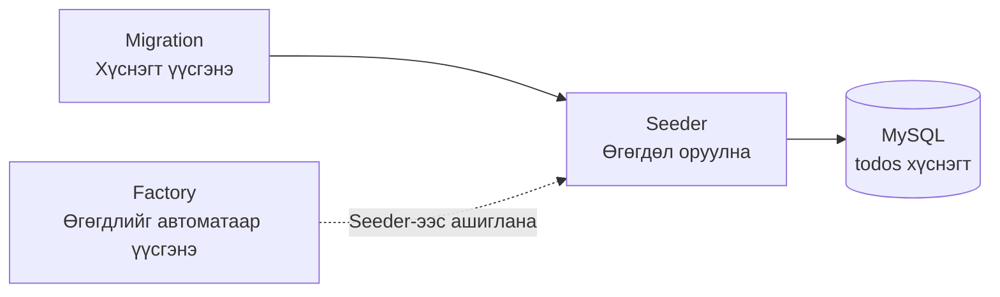
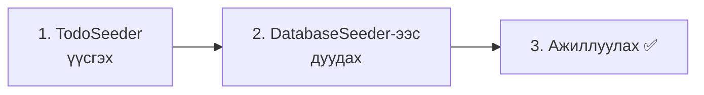
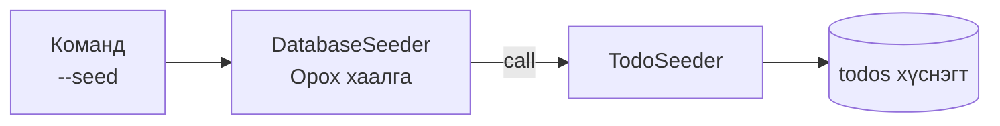
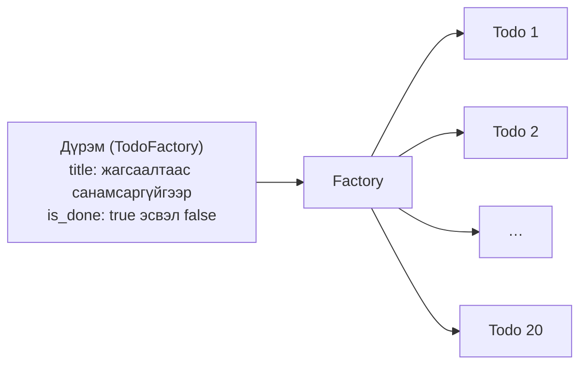
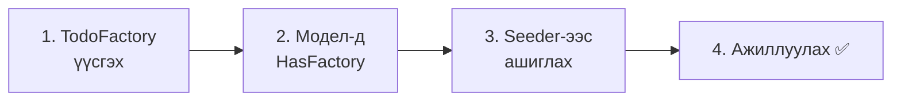
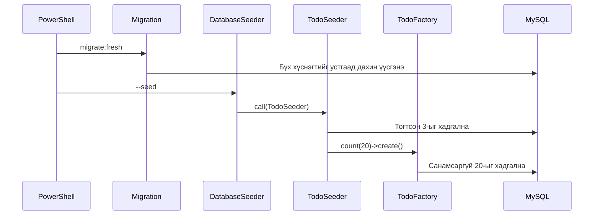
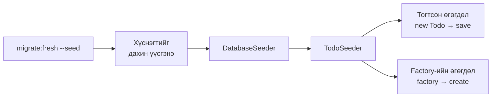

# Laravel-ийн анхан шат — Туршилтын өгөгдөл оруулъя (Seeder・Factory)

> 🇯🇵 Эх хувь (япон хэлээр): [20261105_資料_1.md](<../../../1年生_データ設計とアプリ開発/後期/20261105/20261105_資料_1.md>) <!-- original-ja-link -->

Өнөөг хүртэл Todo-ийн өгөгдлийг phpMyAdmin-д нэг нэгээр нь гараар оруулдаг, эсвэл формоор нэмдэг байлаа.
Өнөөдөр **ганцхан командаар туршилтын өгөгдөл оруулах арга**-ыг сурна.

## Өнөөдрийн зорилго
- Seeder (сийдер)-ээр тогтсон туршилтын өгөгдөл оруулж чаддаг болох
- Factory (фактори)-оор маш олон туршилтын өгөгдлийг автоматаар үүсгэж чаддаг болох
- `migrate:fresh --seed`-ээр өгөгдлийн санг хүссэн үедээ анхны төлөвт нь буцааж чаддаг болох

> Дадлагын орчны (`php-study`) mysql болон laravel-ийг асаагаад эхэлнэ.
> Командуудыг PowerShell-ээр **laravel хавтас** руу шилжсэний дараа ажиллуулна.

---

## 1. Яагаад туршилтын өгөгдөл оруулах механизм хэрэгтэй вэ?

Өмнө нь ийм зүйл тохиолдож байсан уу?

```
A：「Устгах дадлага хийтэл Todo маань алга болчихлоо. Дахиад гараар оруулах уу…？」
B：「Жагсаалтын хуудасны харагдах байдлыг шалгамаар байна, гэтэл Todo ердөө 3 ширхэг л байна」
C：「Найзынхаа компьютертэй харьцуулахад доторх өгөгдөл нь өөр байна」
```

Туршилтын өгөгдлийг **программаар оруулдаг** болговол ийм болно.

| | phpMyAdmin-д гараар оруулах | Программаар оруулах |
|---|---|---|
| Оруулах ажил | Нэг нэгээр нь бичнэ | Ганцхан команд |
| Устаж алга болбол | Дахиад гараар оруулна | Ганцхан командаар буцаад сэргэнэ |
| 100 ширхэг хэрэгтэй бол | Их хүнд | Зөвхөн тоог нь өөрчилнө |
| Бүгдийн компьютер дээр | Өөр өөр | Ижил өгөгдөлтэй болно |

Laravel-д үүнийг **Seeder** болон **Factory**-оор хийдэг.

---

## 2. Seeder ба Factory

**Seeder** (сийдер) гэдэг нь «үр (seed) тарьдаг зүйл» гэсэн утгатай.
Хоосон хүснэгтэд анхны өгөгдөл гэдэг «үр»-ийг тарьдаг.

| Нэр | Үүрэг | Жишээлбэл |
|------|------|-----------|
| **Migration** | Хүснэгт үүсгэнэ (10/15-нд үзсэн) | Тариалангийн талбай бэлдэх |
| **Seeder** | Хүснэгтэд өгөгдөл оруулна | Үр тарих |
| **Factory** | Өгөгдлийг автоматаар олноор нь үүсгэнэ | Үрийг олноор нь хийдэг машин |



Өнөөдөр дараах 2 алхмын дарааллаар хийнэ.

1. **Seeder**-ээр тогтсон 3 Todo оруулна
2. **Factory**-оор 20 Todo автоматаар үүсгээд оруулна

Файлууд `src` дотор энд байрлана.

```
src/
└─ database/
    ├─ migrations/ ··········· Хүснэгтийн зураг төсөл (10/15-нд хийсэн)
    ├─ seeders/
    │   ├─ DatabaseSeeder.php ··· Анхнаасаа байдаг. Эндээс бүх Seeder-ийг ажиллуулна
    │   └─ TodoSeeder.php ······· Өнөөдөр хийнэ
    └─ factories/
        └─ TodoFactory.php ······ Өнөөдөр хийнэ
```

---

## 3. Seeder-ээр тогтсон өгөгдөл оруулъя



### 1. TodoSeeder үүсгэх

> Одоо энд байна：**🟢 1. TodoSeeder** → 2. DatabaseSeeder → 3. Ажиллуулах

Дараах командаар Seeder-ийн файлыг үүсгэнэ.

```powershell
docker compose exec laravel php artisan make:seeder TodoSeeder
```

`database/seeders/TodoSeeder.php` үүсэх тул доторх агуулгыг нь дараах байдлаар өөрчилж бичнэ.

```php
<?php

namespace Database\Seeders;

use App\Models\Todo;  // ← Todo модел-ийг ашиглахын тулд бичих 1 мөр
use Illuminate\Database\Seeder;

class TodoSeeder extends Seeder
{
    public function run(): void
    {
        // Оруулах өгөгдлөө массиваар бэлдэнэ
        $todos = [
            ['title' => '牛乳を買う',     'is_done' => false],
            ['title' => 'レポートを出す', 'is_done' => true],
            ['title' => '宿題をする',     'is_done' => false],
        ];

        // Нэг нэгээр нь Todo үүсгээд хадгална
        foreach ($todos as $data) {
            $todo = new Todo();
            $todo->title = $data['title'];
            $todo->is_done = $data['is_done'];
            $todo->save();
        }
    }
}
```

| Код | Утга |
|--------|------|
| `run()` | Seeder-ийг ажиллуулах үед гүйцэтгэгддэг метод |
| `$todos = [ ... ]` | Оруулах өгөгдлийн массив (эхний улиралд үзсэн ассоциатив массив) |
| `foreach` | Массиваас нэг нэгээр нь гаргаж аваад давтана |
| `new Todo()` 〜 `save()` | 10/22-нд үзсэн `store`-той ижил аргаар нэг Todo-г хадгална |

`store`-д формоос авсан утгыг оруулдаг байсан бол Seeder-д **массивын утгыг** оруулж байна. Ялгаа нь зөвхөн энэ.

---

### 2. DatabaseSeeder-ээс дуудах

> Одоо энд байна：1. TodoSeeder → **🟢 2. DatabaseSeeder** → 3. Ажиллуулах

`database/seeders/DatabaseSeeder.php` бол **Seeder-ийн орох хаалга**.
Seeder ажиллуулах командыг бичихэд хамгийн түрүүнд энэ файл ажилладаг.

Нээж үзэхэд анхнаасаа «туршилтын нэг хэрэглэгч үүсгэх» код бичигдсэн байдаг.
Одоохондоо хэрэглэгч ашиглахгүй тул доторх агуулгыг нь дараах байдлаар өөрчилж бичнэ.

```php
<?php

namespace Database\Seeders;

use Illuminate\Database\Seeder;

class DatabaseSeeder extends Seeder
{
    public function run(): void
    {
        // TodoSeeder-ийг ажиллуулна
        $this->call(TodoSeeder::class);
    }
}
```

`$this->call(TodoSeeder::class)` гэдэг нь «`TodoSeeder`-ийг ажиллуулаарай» гэсэн утгатай.
Seeder нэмэгдэх бүрт энд `$this->call(...)`-г нэмж бичнэ.



---

### 3. Ажиллуулах ✅

> Одоо энд байна：1. TodoSeeder → 2. DatabaseSeeder → **🟢 3. Ажиллуулах**

Дараах командыг ажиллуулна.

```powershell
docker compose exec laravel php artisan migrate:fresh --seed
```

| Хэсэг | Утга |
|------|------|
| `migrate:fresh` | **Бүх хүснэгтийг устгаад**, migration-аар дахин үүсгэнэ |
| `--seed` | Дахин үүсгэсний дараа Seeder-ээр өгөгдөл оруулна |

> ⚠️ **`migrate:fresh` нь бүх өгөгдлийг устгана**
> phpMyAdmin эсвэл формоор оруулсан Todo ч бүгд устна.
> Дадлагын өгөгдлийн сан учраас асуудалгүй, гэхдээ **production өгөгдлийн санд хэзээ ч ашиглахгүй**.

✅ **Шалгах 1**：http://localhost:8000/todos -ийг нээгээд 3 Todo харагдаж байвал болно.

✅ **Шалгах 2**：phpMyAdmin-д `todos` хүснэгтийг нээж үзээрэй.
`save()`-ээр оруулсан тул `created_at` болон `updated_at`-д ч огноо цаг орсон байна (гараар оруулж байхад хоосон байсан).

✅ **Шалгах 3**：Хэдэн Todo устгаад, дахиад `migrate:fresh --seed`-ийг ажиллуулж үзээрэй.
**Анхны 3 ширхэг рүүгээ буцна.** Ингэснээр хүссэн үедээ дадлагаа дахин эхлүүлж болно.

---

## 4. Factory-оор олон өгөгдөл үүсгэе

3 ширхэгийг гараар бичиж болох ч 20, 100 ширхэг болбол хэцүү.
**Factory**-г ашиглавал «ийм маягийн өгөгдөл үүсгэ» гэсэн дүрмийг ганцхан удаа бичихэд л хэдэн ч ширхэгийг автоматаар үүсгэж чадна.





### 1. TodoFactory үүсгэх

> Одоо энд байна：**🟢 1. TodoFactory** → 2. HasFactory → 3. Seeder-ээс ашиглах → 4. Ажиллуулах

```powershell
docker compose exec laravel php artisan make:factory TodoFactory
```

`database/factories/TodoFactory.php` үүсэх тул `definition()`-ий доторхыг дараах байдлаар өөрчилж бичнэ.

```php
    public function definition(): array
    {
        return [
            'title' => fake()->randomElement([
                '牛乳を買う',
                'レポートを出す',
                '宿題をする',
                '部屋のそうじ',
                '本を返す',
                'ゴミを出す',
            ]),
            'is_done' => fake()->boolean(),
        ];
    }
```

| Код | Утга |
|--------|------|
| `definition()` | «1 Todo-г ямар утгатайгаар үүсгэх» дүрмийг бичих газар |
| `fake()` | Туршилтын өгөгдөлд зориулсан санамсаргүй утга үүсгэдэг хэрэгсэл (Faker) |
| `fake()->randomElement([...])` | Массив дотроос санамсаргүйгээр нэгийг сонгоно |
| `fake()->boolean()` | `true` эсвэл `false`-ийг санамсаргүйгээр сонгоно |

`id`, `created_at`, `updated_at` нь өмнөх шигээ автоматаар орох тул бичихгүй.

---

### 2. Модел-д HasFactory бичих

> Одоо энд байна：1. TodoFactory → **🟢 2. HasFactory** → 3. Seeder-ээс ашиглах → 4. Ажиллуулах

Factory-г ашиглахын тулд модел-д «Factory-г ашиглах боломжтой болгох» нэг мөр хэрэгтэй.
`app/Models/Todo.php`-г нээгээд ★ тэмдэгтэй 2 мөрийг нэмж бичнэ.

```php
<?php

namespace App\Models;

use Illuminate\Database\Eloquent\Factories\HasFactory;  // ★ Нэмэх
use Illuminate\Database\Eloquent\Model;

class Todo extends Model
{
    use HasFactory;  // ★ Нэмэх
}
```

Ингэснээр `Todo::factory()` гэж бичихэд `TodoFactory`-г ашиглах боломжтой болно.
(Laravel нь `Todo` гэсэн модел-ийн нэрээс `TodoFactory`-г автоматаар хайж олдог)

---

### 3. Seeder-ээс Factory ашиглах

> Одоо энд байна：1. TodoFactory → 2. HasFactory → **🟢 3. Seeder-ээс ашиглах** → 4. Ажиллуулах

`database/seeders/TodoSeeder.php`-ийн `run()`-ий төгсгөлд ★ тэмдэгтэй 1 мөрийг нэмж бичнэ.

```php
    public function run(): void
    {
        $todos = [
            ['title' => '牛乳を買う',     'is_done' => false],
            ['title' => 'レポートを出す', 'is_done' => true],
            ['title' => '宿題をする',     'is_done' => false],
        ];

        foreach ($todos as $data) {
            $todo = new Todo();
            $todo->title = $data['title'];
            $todo->is_done = $data['is_done'];
            $todo->save();
        }

        // ★ Factory-оор 20 Todo үүсгээд хадгална
        Todo::factory()->count(20)->create();
    }
```

```
Todo::factory() -> count(20) -> create();
~~~~~~~~~~~~~~~    ~~~~~~~~~    ~~~~~~~~
TodoFactory-оор    20 ширхэг    үүсгээд хадгална
```

---

### 4. Ажиллуулах ✅

> Одоо энд байна：1. TodoFactory → 2. HasFactory → 3. Seeder-ээс ашиглах → **🟢 4. Ажиллуулах**

```powershell
docker compose exec laravel php artisan migrate:fresh --seed
```

✅ **Шалгах 1**：http://localhost:8000/todos -ийг нээгээд **23** Todo (тогтсон 3 ＋ Factory-ийн 20) харагдаж байвал болно.

✅ **Шалгах 2**：Дахиад `migrate:fresh --seed`-ийг ажиллуулж үзээрэй.
Эхний 3 нь ижил, харин Factory-оор үүсгэсэн 20 нь **ажиллуулах бүрт гарчиг болон дууссан・дуусаагүй төлөв нь өөрчлөгдөнө**. Учир нь санамсаргүйгээр үүсгэж байгаа юм.



---

## 5. Командуудын хураангуй

| Команд | Хийх зүйл |
|---------|---------|
| `php artisan make:seeder TodoSeeder` | Seeder-ийн файл үүсгэнэ |
| `php artisan make:factory TodoFactory` | Factory-ийн файл үүсгэнэ |
| `php artisan migrate:fresh --seed` | Бүх хүснэгтийг дахин үүсгээд, Seeder-ээр өгөгдөл оруулна |
| `php artisan db:seed` | Хүснэгтийг хэвээр нь үлдээгээд, Seeder-ээр өгөгдөл **нэмнэ** |

> **Зөвхөн `db:seed`-ийг бичвэл өгөгдөл нэмэгдсээр байна**
> `db:seed` нь одоо байгаа өгөгдлийг устгалгүйгээр **нэмдэг**. 2 удаа бичвэл Todo ч 2 дахин олширно.
> «Анхны төлөвт нь буцаамаар байна» гэвэл `migrate:fresh --seed`-ийг ашиглаарай.

(Команд бүрийн өмнө `docker compose exec laravel`-ийг нэмж ажиллуулна)

---

## 6. Болохгүй байвал

> **🔥 Ажиллахгүй бол лог гарга!**
> Seeder дотор ч `Log::info()`-г ашиглаж болно → [【Чухал】Лог хэрхэн гаргах вэ](../20261022/【重要】ログの出し方.md)

| Шинж тэмдэг | Шалтгаан байгаа газар | Шийдэл |
|------|----------|------|
| `Class "Database\Seeders\Todo" not found` | Seeder | `TodoSeeder.php`-ийн дээд хэсэгт `use App\Models\Todo;` байгаа эсэхийг шалгана |
| `Call to undefined method App\Models\Todo::factory()` | Модел | `Todo.php`-д `use HasFactory;`-г бичсэн эсэхийг шалгана (дээд талын `use Illuminate\...\HasFactory;` ч хэрэгтэй) |
| `Class "Database\Factories\TodoFactory" not found` | Factory | `database/factories/TodoFactory.php` байгаа эсэх, файлын нэр болон классын нэрийг шалгана |
| `Duplicate entry 'test@example.com'` | DatabaseSeeder | Туршилтын хэрэглэгч үүсгэх код үлдсэн хэвээр `db:seed`-ийг 2 удаа бичсэн. `DatabaseSeeder.php`-г өөрчилж бичих, эсвэл `migrate:fresh --seed`-ийг ашиглана |
| Todo 2・3 дахин олширсон | Команд | `db:seed`-ийг олон удаа бичсэн. `migrate:fresh --seed`-ээр дахин эхлүүлнэ |
| Ажиллуулсан ч Todo орохгүй байна | DatabaseSeeder | `DatabaseSeeder.php`-д `$this->call(TodoSeeder::class);` байгаа эсэхийг шалгана |

---

## 7. Дүгнэлт



| Өнөөдөр бичсэн зүйл | Товчхондоо |
|--------------|-----------|
| `TodoSeeder` | Тогтсон туршилтын өгөгдөл оруулна |
| `DatabaseSeeder`-ийн `$this->call(...)` | Seeder-ийн орох хаалга. Эндээс Seeder тус бүрийг ажиллуулна |
| `TodoFactory`-ийн `definition()` | 1 өгөгдлийг ямар утгатайгаар үүсгэх дүрэм |
| Модел-ийн `use HasFactory;` | `Todo::factory()`-г ашиглах боломжтой болгоно |
| `Todo::factory()->count(20)->create()` | Дүрмийн дагуу 20-ыг үүсгээд хадгална |
| `migrate:fresh --seed` | Өгөгдлийн санг хүссэн үедээ анхны төлөвт нь буцаана |

---

## 8. Цааш нь туршаад үзье (цаг үлдсэн хүмүүст)

1. Factory-оор үүсгэх тоог **100** болгоод жагсаалтын хуудас ямар болохыг харж үзээрэй.
2. Factory-ийн `randomElement`-ийн жагсаалтад өөрийн бодож олсон 5 Todo нэмж үзээрэй.

<details>
<summary>Зөвлөгөө</summary>

1. `TodoSeeder.php`-ийн `count(20)`-г `count(100)` болгож өөрчлөөд `migrate:fresh --seed`-ийг ажиллуулна.
2. `TodoFactory.php`-ийн `randomElement([...])`-ийн массивт `'買い物に行く',` (дэлгүүр явах) гэх мэтээр нэмж бичнэ.

</details>

<!-- nav:start -->

---

| ⬅️ Өмнөх | 🗺️ Ерөнхий зураг | Дараагийнх ➡️ |
|:--|:--:|--:|
| [10/29 Todo устгах (DELETE)](../20261029/20261029_資料_3.md) | [Материалын ерөнхий зураг](../../README.md) | [11/05 Баталгаажуулалт](20261105_資料_2.md) |

<!-- nav:end -->
