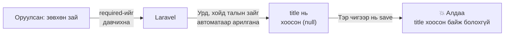
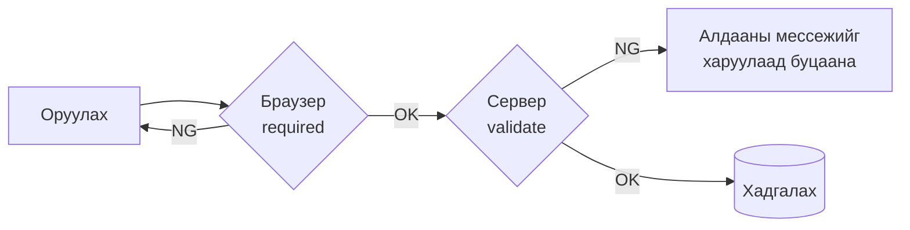
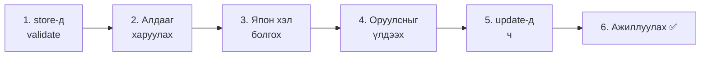
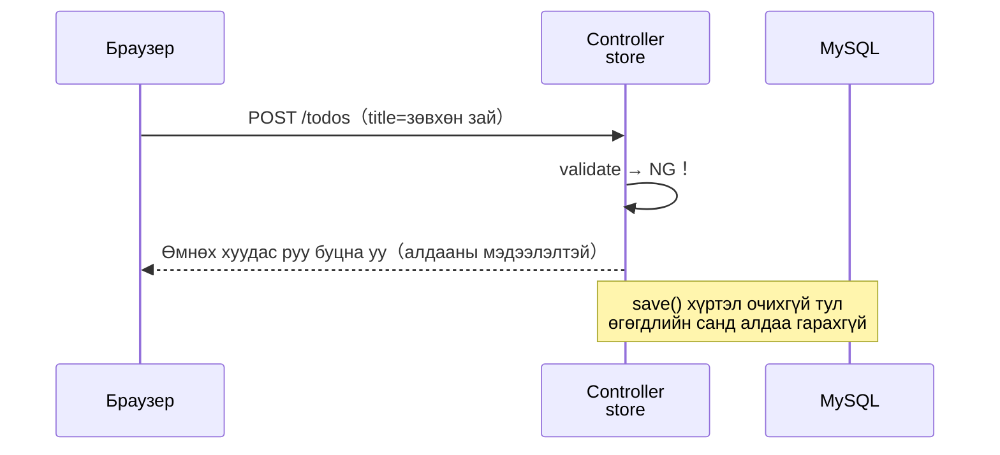
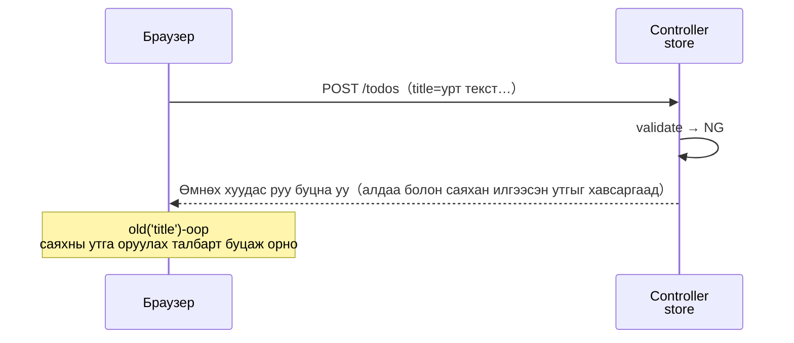
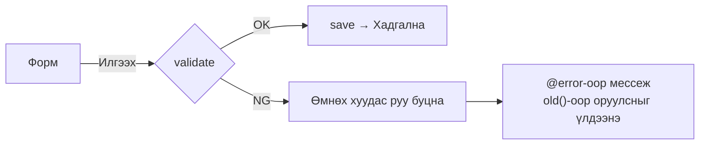

# Laravel-ийн анхан шат — Оруулсан утгыг шалгая (validation)

> 🇯🇵 Эх хувь (япон хэлээр): [20261105_資料_2.md](<../../../1年生_データ設計とアプリ開発/後期/20261105/20261105_資料_2.md>) <!-- original-ja-link -->

Todo нэмэх・засах боломжтой болсон ч, үнэндээ **буруу утга оруулбал алдааны дэлгэц гарчихдаг** асуудал байгаа.
Өнөөдөр оруулсан утгыг сервер талд шалгадаг **validation**-ийг сурна.

## Өнөөдрийн зорилго
- Зөвхөн браузерын шалгалт (`required`) хангалтгүй байдгийн шалтгааныг ойлгох
- `$request->validate()`-ээр оруулсан утгыг шалгаж чаддаг болох
- Алдааны мессежийг дэлгэцэд харуулж, оруулсан утгыг хадгалж үлдээж чаддаг болох

> 10/29-ний «Todo засах» хүртэлх хэсэг хийгдсэн төлөвөөс эхэлнэ.

---

## 1. Туршаад үзье: Зөвхөн зай оруулаад нэмбэл…？

http://localhost:8000/todos -ийг нээгээд, оруулах талбарт **зөвхөн хагас өргөнтэй зай (space)** оруулж `追加` (Нэмэх)-ийг дараад үзээрэй.

```
SQLSTATE[23000]: Integrity constraint violation: 1048 Column 'title' cannot be null
```

Алдааны дэлгэц гарчихлаа. Юу болсон бол?



1. HTML-ийн `required` нь зөвхөн «ямар нэг зүйл оруулсан эсэх»-ийг л хардаг. Зай ч «оруулсан» гэж тооцогдох тул давчихна
2. Laravel нь илгээсэн утгын **урд, хойд талын зайг автоматаар арилгадаг** (10/22-нд үзсэн). Үүний үр дүнд гарчиг хоосон (`null`) болно
3. `todos` хүснэгтийн `title` хоосон байж болохгүй тул хадгалах үед алдаа гарна

Түүнээс гадна браузерын хөгжүүлэгчийн хэрэгслийг (F12) ашиглавал `required`-ийг устгаад илгээх ч боломжтой.

---

## 2. Validation гэж юу вэ

**Validation** (баталгаажуулалт) гэдэг нь «оруулсан утга зөв эсэхийг **хадгалахаас өмнө** шалгах» явдал юм.

Шалгалтыг браузер болон сервер гэсэн 2 газарт хийж болно.

| | Браузерт шалгах | Серверт шалгах (validation) |
|---|---|---|
| Бичих газар | HTML (`required` гэх мэт) | Controller (`$request->validate()`) |
| Давуу тал | Илгээхээс өмнө шууд мэдэгдэнэ | **Тойрч гарах боломжгүй** |
| Сул тал | Хөгжүүлэгчийн хэрэгслээр устгаж болно・зөвхөн зайтай ч давчихна | Нэг удаа сервер рүү илгээх шаардлагатай |



Браузерын шалгалт бол «хэрэглэгчид зориулсан эелдэг тусламж», харин серверийн шалгалт бол «аппыг хамгаалах цоож».
**Серверийн шалгалтыг заавал бичнэ** гэдгийг санаарай.

---

## 3. Хийж үзье



Өөрчлөх файлууд дараах 3 (`src` дотор).

```
src/
├─ app/Http/Controllers/
│   └─ TodoController.php ············· 1・3・5. validate-ийг нэмж бичнэ
└─ resources/views/todos/
    ├─ index.blade.php ················ 2・4. Алдаа харуулах болон old()-ийг нэмж бичнэ
    └─ edit.blade.php ················· 5. Алдаа харуулах болон old()-ийг нэмж бичнэ
```

---

### 1. store-д validate бичих (C)

> Одоо энд байна：**🟢 1. validate** → 2. Алдаа харуулах → 3. Япон хэл → 4. Оруулсныг үлдээх → 5. update-д ч → 6. Ажиллуулах

`app/Http/Controllers/TodoController.php`-ийн `store` method-ийн **хамгийн эхэнд** ★ тэмдэгтэй хэсгийг нэмж бичнэ.

```php
    public function store(Request $request)
    {
        // ★ Оруулсан утгыг шалгана
        $request->validate([
            'title' => 'required|max:255',
        ]);

        $todo = new Todo();
        $todo->title = $request->input('title');
        $todo->save();

        return redirect('/todos');
    }
```

| Код | Утга |
|--------|------|
| `$request->validate([...])` | Илгээсэн утгыг шалгана |
| `'title' => ...` | Формын `name="title"`-ийн утгыг шалгана |
| `required` | Хоосон байж болохгүй (зөвхөн зай байсан ч Laravel арилгадаг тул хоосон болно) |
| `max:255` | 255 тэмдэгт хүртэл (`title` багана нь `VARCHAR(255)` учраас) |
| `\|` | Дүрэм хооронд тусгаарлагч. «`required` бас `max:255`» гэсэн утгатай |

**Шалгалтад тэнцэхгүй бол тэнд зогсоод, оруулах хуудас руу автоматаар буцаана.** Доор нь байгаа `save()` гүйцэтгэгдэхгүй.



✅ **Шалгах**：Дахиад зөвхөн зай оруулаад `追加` (Нэмэх)-ийг дараад үзээрэй.
Алдааны дэлгэц гарахгүй, жагсаалтын хуудас руу буцна. Todo ч нэмэгдээгүй байна.
……Гэхдээ **яагаад буцаагдсаныг дэлгэцээс мэдэх боломжгүй**. Дараагийн алхамд алдааны мессеж харуулна.

---

### 2. Алдааны мессеж харуулах (V)

> Одоо энд байна：1. validate → **🟢 2. Алдаа харуулах** → 3. Япон хэл → 4. Оруулсныг үлдээх → 5. update-д ч → 6. Ажиллуулах

`resources/views/todos/index.blade.php`-ийн формд ★ тэмдэгтэй хэсгийг нэмж бичнэ.

```html
    <form method="POST" action="/todos">
        @csrf
        <input type="text" name="title" placeholder="新しいTODOを入力" required>
        <button type="submit">追加</button>

        {{-- ★ Эндээс нэмнэ --}}
        @error('title')
            <p style="color: red;">{{ $message }}</p>
        @enderror
        {{-- ★ Энд хүртэл --}}
    </form>
```

| Код | Утга |
|--------|------|
| `@error('title')` 〜 `@enderror` | `title`-ийн шалгалтад тэнцээгүй үед л доторхыг харуулна |
| `{{ $message }}` | Алдааны мессеж |

✅ **Шалгах**：Зөвхөн зай оруулаад `追加` (Нэмэх)-ийг дарвал улаан үсгээр ингэж харагдана.

```
The title field is required.
```

Англиар гарч ирлээ. Дараагийн алхамд япон хэл болгоно.

---

### 3. Алдааны мессежийг япон хэл болгох (C)

> Одоо энд байна：1. validate → 2. Алдаа харуулах → **🟢 3. Япон хэл** → 4. Оруулсныг үлдээх → 5. update-д ч → 6. Ажиллуулах

`validate`-ийн 2 дахь аргумент болгож **мессежийн массив** нэмж бичнэ.

```php
        $request->validate([
            'title' => 'required|max:255',
        ], [
            'title.required' => 'タイトルを入力してください。',        // ★ Нэмэх
            'title.max' => 'タイトルは255文字以内で入力してください。',  // ★ Нэмэх
        ]);
```

| Код | Утга |
|--------|------|
| `'title.required' => '...'` | `title` нь `required`-д тэнцээгүй үеийн мессеж |
| `'title.max' => '...'` | `title` нь `max`-д тэнцээгүй үеийн мессеж |

`'баганын нэр.дүрэм'` хэлбэрээр дүрэм тус бүрт мессеж тогтоож болно.

✅ **Шалгах**：Зөвхөн зай оруулаад `追加` (Нэмэх)-ийг дарахад «タイトルを入力してください。» (Гарчгаа оруулна уу.) гэж харагдвал болно.

---

### 4. Оруулсан утгыг үлдээх (V)

> Одоо энд байна：1. validate → 2. Алдаа харуулах → 3. Япон хэл → **🟢 4. Оруулсныг үлдээх** → 5. update-д ч → 6. Ажиллуулах

Алдаагаар буцаагдахад оруулах талбар хоосон болчихдог.
Урт текст оруулж байсан бол дахиад эхнээс нь бичих хэрэгтэй болно.

`index.blade.php`-ийн `<input>`-д ★ тэмдэгтэй `value`-г нэмж бичнэ.

```html
        <input type="text" name="title" value="{{ old('title') }}" placeholder="新しいTODOを入力" required>
        {{--                            ~~~~~~~~~~~~~~~~~~~~~~~~~ ★ Нэмэх --}}
```

`old('title')` бол «**саяхан илгээсэн `title`-ийн утга**».
Алдаагаар буцаагдсан үед оруулах талбарт саяхны утгыг оруулж өгч болно.

Буцаах үед Laravel «саяхан илгээсэн утгыг» хамт санаж үлддэг тул `old()`-оор гаргаж авч болно.



---

### 5. update-д ч validation оруулах

> Одоо энд байна：1. validate → 2. Алдаа харуулах → 3. Япон хэл → 4. Оруулсныг үлдээх → **🟢 5. update-д ч** → 6. Ажиллуулах

Засварлахдаа ч зөвхөн зай оруулаад хадгалбал ижил алдаа гарна.
`TodoController.php`-ийн `update`-д ч `store`-той ижил `validate`-ийг нэмж бичнэ.

```php
    public function update(Request $request, $id)
    {
        // ★ store-той ижил шалгалт
        $request->validate([
            'title' => 'required|max:255',
        ], [
            'title.required' => 'タイトルを入力してください。',
            'title.max' => 'タイトルは255文字以内で入力してください。',
        ]);

        $todo = Todo::findOrFail($id);
        $todo->title = $request->input('title');
        $todo->is_done = $request->has('is_done');
        $todo->save();

        return redirect('/todos/' . $todo->id);
    }
```

`resources/views/todos/edit.blade.php`-ийн формыг ч ★ тэмдэгтэй хэсэг шиг өөрчилж бичнэ.

```html
    <form method="POST" action="/todos/{{ $todo->id }}">
        @csrf
        @method('PUT')
        <input type="text" name="title" value="{{ old('title', $todo->title) }}" required>  {{-- ★ old-ийг ашиглана --}}
        <label>
            <input type="checkbox" name="is_done" value="1" @checked($todo->is_done)>
            完了
        </label>
        <button type="submit">保存</button>

        {{-- ★ Эндээс нэмнэ --}}
        @error('title')
            <p style="color: red;">{{ $message }}</p>
        @enderror
        {{-- ★ Энд хүртэл --}}
    </form>
```

`old('title', $todo->title)` гэдэг нь «саяхан илгээсэн утга байвал түүнийг, **байхгүй бол одоогийн гарчгийг**» гэсэн утгатай.

| Нөхцөл | Оруулах талбарт орох зүйл |
|------|----------------|
| Засах хуудсыг анх нээсэн үед | Одоогийн гарчиг (`$todo->title`) |
| Алдаагаар буцаж ирсэн үед | Саяхан илгээсэн утга (`old('title')`) |

---

### 6. Ажиллуулах ✅

> Одоо энд байна：1. validate → 2. Алдаа харуулах → 3. Япон хэл → 4. Оруулсныг үлдээх → 5. update-д ч → **🟢 6. Ажиллуулах**

Дараах 4-ийг туршиж үзээрэй.

| | Хийх зүйл | Ийм болбол OK |
|---|---|---|
| ① | Нэмэх хэсэгт зөвхөн зай оруулаад `追加` (Нэмэх) | «タイトルを入力してください。» (Гарчгаа оруулна уу.) гэж гарна. Todo нэмэгдэхгүй |
| ② | Нэмэх хэсэгт энгийн Todo оруулаад `追加` (Нэмэх) | Өмнөх шигээ нэмэгдэнэ |
| ③ | Засах хуудсанд гарчгийг зөвхөн зай болгоод `保存` (Хадгалах) | Засах хуудас руу буцаж, «タイトルを入力してください。» гэж гарна |
| ④ | Хөгжүүлэгчийн хэрэгслээр (F12) `<input>`-ийн `required`-ийг устгаад, хоосон чигээр нь `追加` (Нэмэх) | Браузерын шалгалт байхгүй ч серверийн шалгалтаар зогсоно |

> **④-ийг хийх арга**
> 1. Оруулах талбар дээр баруун товшоод →「検証」(Inspect) (эсвэл「調べる」)
> 2. Хөгжүүлэгчийн хэрэгсэл дээр `<input ... required>`-ийн `required` дээр давхар товшоод устгана
> 3. Оруулах талбарыг хоосон чигээр нь `追加` (Нэмэх)-ийг дарна

✅ ④-д «タイトルを入力してください。» гэж гарвал **браузерын шалгалтыг тойрч гарсан ч апп хамгаалагдсан байгаа** гэдгийг баталж чадна.

---

## 4. Болохгүй байвал

> **🔥 Ажиллахгүй бол лог гарга!** → [【Чухал】Лог хэрхэн гаргах вэ](../20261022/【重要】ログの出し方.md)
> Гэхдээ validation-д тэнцээгүй тухай лог-д бичигдэхгүй (энгийн үйлдэл бөгөөд алдаа биш учраас).

| Шинж тэмдэг | Шалтгаан байгаа газар | Шийдэл |
|------|----------|------|
| Зөвхөн зай илгээхэд одоо ч `Column 'title' cannot be null` гарна | Controller | `validate`-ийг `save()`-ээс **өмнө** бичсэн эсэхийг шалгана |
| Буцаагдаж байгаа ч мессеж гарахгүй байна | View | `@error('title')` 〜 `@enderror`-ийг бичсэн эсэх, `'title'`-ийн үсгийн алдааг шалгана |
| Мессеж англиараа байна | Controller | `'title.required'`-ийн үсгийн алдааг шалгана (`.`-аар холбоно) |
| Буцаж ирэхэд оруулах талбар хоосон байна | View | `value="{{ old('title') }}"`-ийг бичсэн эсэхийг шалгана |
| Засах хуудсыг нээхэд оруулах талбар хоосон байна | View | `old('title', $todo->title)`-ийн 2 дахь хэсгийг (`$todo->title`) бичсэн эсэхийг шалгана |
| Засахдаа зөвхөн зай болгоход алдааны дэлгэц гарна | Controller | `update`-д ч `validate`-ийг бичсэн эсэхийг шалгана |

---

## 5. Дүгнэлт



| Өнөөдөр бичсэн зүйл | Товчхондоо |
|--------------|-----------|
| `$request->validate([...])` | Хадгалахаас өмнө сервер дээр оруулсан утгыг шалгана |
| `'required\|max:255'` | Хоосон байж болохгүй・255 тэмдэгт хүртэл |
| `'title.required' => '...'` | Алдааны мессежийг япон хэл болгоно |
| `@error('title')` 〜 `@enderror` | Алдааны мессежийг харуулна |
| `old('title')` | Алдаагаар буцахад саяхны оруулсан утгыг үлдээнэ |

**Браузерын шалгалт бол эелдэг тусламж, серверийн шалгалт бол цоож. Серверийн шалгалтыг заавал бичнэ.**

---

## 6. Цааш нь туршаад үзье (цаг үлдсэн хүмүүст)

Гарчгийг **20 тэмдэгт хүртэл** болгож үзээрэй. 21 буюу түүнээс дээш тэмдэгттэй Todo нэмэх гэвэл «タイトルは20文字以内で入力してください。» (Гарчгийг 20 тэмдэгтээс хэтрүүлэлгүй оруулна уу.) гэж харагддаг болгоно.

<details>
<summary>Зөвлөгөө</summary>

`store` болон `update` хоёуланд нь `max:255`-ийг `max:20` болгож, мессежийг ч «20文字以内» (20 тэмдэгтээс хэтрүүлэлгүй) болгож өөрчилнө.

```php
        $request->validate([
            'title' => 'required|max:20',
        ], [
            'title.required' => 'タイトルを入力してください。',
            'title.max' => 'タイトルは20文字以内で入力してください。',
        ]);
```

</details>

<!-- nav:start -->

---

| ⬅️ Өмнөх | 🗺️ Ерөнхий зураг | Дараагийнх ➡️ |
|:--|:--:|--:|
| [11/05 Seeder・Factory](20261105_資料_1.md) | [Материалын ерөнхий зураг](../../README.md) | [11/12 Нийтлэг хэсгийг эд анги болгох (@include)](../20261112/20261112_資料_1.md) |

<!-- nav:end -->
