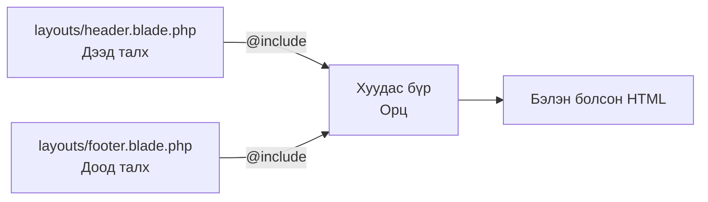
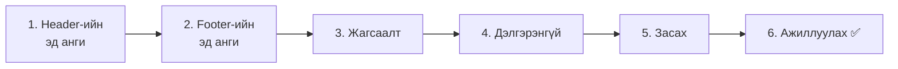
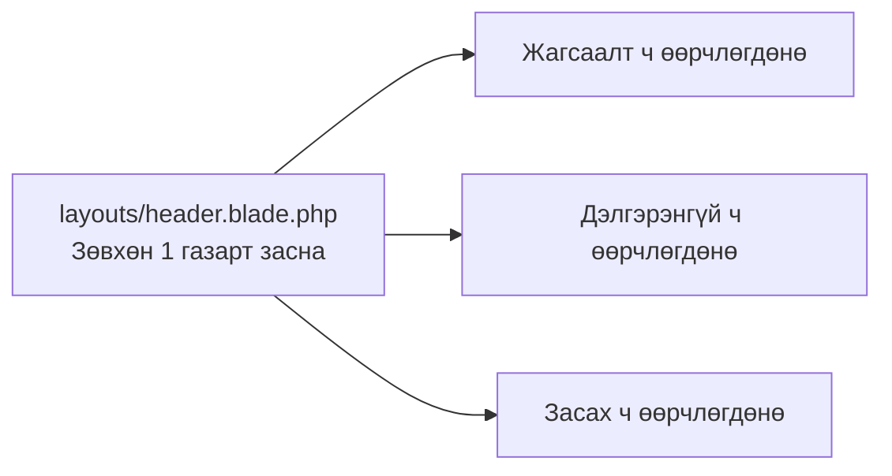
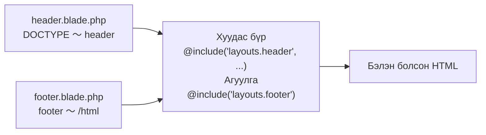

# Laravel-ийн анхан шат — Нийтлэг хэсгийг эд анги болгоё (@include)

> 🇯🇵 Эх хувь (япон хэлээр): [20261112_資料_1.md](<../../../1年生_データ設計とアプリ開発/後期/20261112/20261112_資料_1.md>) <!-- original-ja-link -->

Жагсаалт, дэлгэрэнгүй, засах гээд 3 хуудастай боллоо.
Гэхдээ аль ч файлд **ижил HTML**-ийг олон удаа бичсээр байна. Өнөөдөр тэр нийтлэг хэсгийг **эд ангийн файл** болгон салгаж, дуудаж оруулах аргыг сурна.

## Өнөөдрийн зорилго
- Нийтлэг хэсгийг эд анги болговол ямар давуу талтайг ойлгох
- Header・footer-ийг эд ангийн файл болгон салгаж, `@include`-ээр дуудаж оруулж чаддаг болох
- `@include`-д утга дамжуулж, хуудас бүрийн гарчгийг өөрчилж чаддаг болох
- Эд ангийг 1 газарт засахад бүх хуудас өөрчлөгддөг гэдгийг баталж чаддаг болох

> 11/5-ны «Баталгаажуулалт» хүртэлх хичээлийг хийж дуусгасан гэж үзээд эхэлнэ.

---

## 1. Ижил HTML-ийг олон удаа бичиж байна

Одоогийн 3 view-г харьцуулж харцгаая.

```
index.blade.php (жагсаалт)     show.blade.php (дэлгэрэнгүй)   edit.blade.php (засах)
┌─────────────────────────┐   ┌─────────────────────────┐   ┌─────────────────────────┐
│ <!DOCTYPE html>         │   │ <!DOCTYPE html>         │   │ <!DOCTYPE html>         │
│ <html lang="ja">        │   │ <html lang="ja">        │   │ <html lang="ja">        │
│ <head>                  │   │ <head>                  │   │ <head>                  │
│   <meta charset=...>    │   │   <meta charset=...>    │   │   <meta charset=...>    │
│   <title>TODOアプリ     │   │   <title>TODOの詳細     │   │   <title>TODOの編集     │
│ </head>                 │   │ </head>                 │   │ </head>                 │
│ <body>                  │   │ <body>                  │   │ <body>                  │
│ ┌─────────────────────┐ │   │ ┌─────────────────────┐ │   │ ┌─────────────────────┐ │
│ │ Жагсаалтын хэсэг    │ │   │ │ Дэлгэрэнгүйн хэсэг  │ │   │ │ Засах хуудасны хэсэг│ │
│ └─────────────────────┘ │   │ └─────────────────────┘ │   │ └─────────────────────┘ │
│ </body>                 │   │ </body>                 │   │ </body>                 │
│ </html>                 │   │ </html>                 │   │ </html>                 │
└─────────────────────────┘   └─────────────────────────┘   └─────────────────────────┘
```

Хуудас бүрд ялгаатай зүйл нь **`<title>` болон `<body>`-ийн доторх агуулга л** юм. Бусад нь 3-уулаа ижил.

Ижил зүйлийг олон удаа бичвэл ийм зүйл тохиолдоно.

```
A：「Бүх хуудасны дээд хэсэгт『TODOアプリ』руу очих холбоос нэммээр байна. 3 файлыг бүгдийг нь засах уу…？」
B：「Бүх хуудасны доод хэсэгт footer нэмэхдээ зөвхөн дэлгэрэнгүй хуудсанд нь нэмэхээ мартчихлаа」
C：「Хуудас 10 болж нэмэгдвэл 10 газарт засах болно」
```

---

## 2. Нийтлэг хэсгийг «эд анги» болгох

Тиймээс нийтлэг хэсгийг **дээд хагас** болон **доод хагас** гэсэн 2 эд ангийн файл болгон салгана.
Хуудас бүр эхэнд нь дээд хагасыг, төгсгөлд нь доод хагасыг **дуудаж оруулахад** л хангалттай болгоно.

```
layouts/header.blade.php (дээд хагасын эд анги)
┌─────────────────────────┐
│ <!DOCTYPE html>         │
│ <html> <head> … </head> │
│ <body>                  │
│ <header>…</header>      │ ← Дэлгэцийн дээд хэсэгт харагдах хэсэг
└─────────────────────────┘
            ＋
todos/index.blade.php (хуудас бүр)
┌─────────────────────────┐
│ Зөвхөн жагсаалтын хэсэг │
└─────────────────────────┘
            ＋
layouts/footer.blade.php (доод хагасын эд анги)
┌─────────────────────────┐
│ <footer>…</footer>      │ ← Дэлгэцийн доод хэсэгт харагдах хэсэг
│ </body>                 │
│ </html>                 │
└─────────────────────────┘
```

Жишээлбэл, энэ нь **сэндвич** шиг.
Дээд талх (header) болон доод талх (footer) үргэлж ижил, зөвхөн дунд нь хавчуулах орц (хуудас бүрийн агуулга) л ялгаатай.

Эд ангийг дуудаж оруулахдаа Blade-ийн **`@include`**-ийг ашиглана.

| Бичих арга | Утга |
|--------|------|
| `@include('layouts.header')` | `resources/views/layouts/header.blade.php`-ийн агуулгыг **яг энд тэр чигээр нь оруулна** |
| `@include('layouts.header', ['title' => '一覧'])` | Эд ангийг оруулахдаа «一覧» (Жагсаалт)-ыг `$title` гэсэн нэрээр дамжуулна |



> **`<head>` ба `<header>` нь өөр зүйл**
> Нэр нь төстэй ч үүрэг нь өөр.
>
> | Таг | Үүрэг | Дэлгэцэд харагдах уу? |
> |------|------|-------------|
> | `<head>` | Хуудасны мэдээлэл (тэмдэгтийн кодчилол, табын гарчиг гэх мэт). Браузерт зориулсан зүйл | Харагдахгүй |
> | `<header>` | Хуудасны дээд хэсэгт гарах хэсэг (аппын нэр, цэс гэх мэт) | Харагдана |
>
> Өнөөдрийн `header.blade.php`-д энэ **хоёр хоёулаа** орно.

---

## 3. Хийж үзье



Дараах 5 файлыг өөрчилнө (`src` дотор).

```
src/
└─ resources/views/
    ├─ layouts/
    │   ├─ header.blade.php ········· 1. Header-ийн эд анги (шинээр үүсгэнэ)
    │   └─ footer.blade.php ········· 2. Footer-ийн эд анги (шинээр үүсгэнэ)
    └─ todos/
        ├─ index.blade.php ·········· 3. Эд ангийг дуудаж оруулдаг болгож өөрчилнө
        ├─ show.blade.php ··········· 4. Эд ангийг дуудаж оруулдаг болгож өөрчилнө
        └─ edit.blade.php ··········· 5. Эд ангийг дуудаж оруулдаг болгож өөрчилнө
```

---

### 1. Header-ийн эд анги үүсгэх

> Одоо энд байна：**🟢 1. Header** → 2. Footer → 3. Жагсаалт → 4. Дэлгэрэнгүй → 5. Засах → 6. Ажиллуулах

`resources/views` дотор `layouts` хавтас үүсгээд, `header.blade.php` гэсэн файл үүсгэнэ.

```html
<!DOCTYPE html>
<html lang="ja">
<head>
    <meta charset="UTF-8">
    <title>{{ $title }} | TODOアプリ</title>
</head>
<body>
    <header>
        <a href="/todos">TODOアプリ</a>
    </header>
```

| Код | Утга |
|--------|------|
| `{{ $title }}` | Хуудас бүрээс дамжуулсан гарчиг орно. Браузерын таб дээр харагдана |
| `<header>` 〜 `</header>` | Бүх хуудасны дээд хэсэгт гарах хэсэг |

`</body>` болон `</html>`-ийг энд бичихгүй. **Footer-ийн эд анги**-д бичнэ.

---

### 2. Footer-ийн эд анги үүсгэх

> Одоо энд байна：1. Header → **🟢 2. Footer** → 3. Жагсаалт → 4. Дэлгэрэнгүй → 5. Засах → 6. Ажиллуулах

Мөн адил `resources/views/layouts` дотор `footer.blade.php`-г үүсгэнэ.

```html
    <footer>
        <p>© 2026 TODOアプリ</p>
    </footer>
</body>
</html>
```

Header-т нээсэн `<body>` болон `<html>`-ийг энд хаана.

---

### 3. Жагсаалтын хуудсыг өөрчилж бичих

> Одоо энд байна：1. Header → 2. Footer → **🟢 3. Жагсаалт** → 4. Дэлгэрэнгүй → 5. Засах → 6. Ажиллуулах

`resources/views/todos/index.blade.php`-г дараах байдлаар өөрчилж бичнэ.

```html
@include('layouts.header', ['title' => '一覧'])

    <h1>TODOアプリ</h1>

    <form method="POST" action="/todos">
        @csrf
        <input type="text" name="title" value="{{ old('title') }}" placeholder="新しいTODOを入力" required>
        <button type="submit">追加</button>

        @error('title')
            <p style="color: red;">{{ $message }}</p>
        @enderror
    </form>

    <ul>
        @foreach ($todos as $todo)
            <li>
                <form method="POST" action="/todos/{{ $todo->id }}/toggle" style="display: inline;">
                    @csrf
                    @method('PATCH')
                    <input type="checkbox" name="is_done" value="1" onchange="this.form.submit()" @checked($todo->is_done)>
                </form>
                <a href="/todos/{{ $todo->id }}">{{ $todo->title }}</a>
            </li>
        @endforeach
    </ul>

@include('layouts.footer')
```

Өөрчлөхөөс өмнөхтэй харьцуулбал ийм болсон байна.

| | Өөрчлөхөөс өмнө | Өөрчилсний дараа |
|---|---|---|
| `<!DOCTYPE html>` 〜 `<body>` | Бичигдсэн байна | `@include('layouts.header', ['title' => '一覧'])` гэсэн 1 мөр болгоно |
| `<body>`-ийн доторх агуулга | Хэвээрээ | Хэвээрээ |
| `</body>` `</html>` | Бичигдсэн байна | `@include('layouts.footer')` гэсэн 1 мөр болгоно |

`['title' => '一覧']` нь controller дээр `view('todos.index', ['todos' => $todos])` гэж бичсэнтэй ижил хэлбэртэй.
Эд анги дотор «一覧»-ыг `$title` гэсэн нэрээр ашиглаж болно.

✅ **Шалгах**：http://localhost:8000/todos -ийг нээгээд, жагсаалтын дээд талд «TODOアプリ» холбоос, доод талд «© 2026 TODOアプリ» гарч байвал болно.
Браузерын таб дээр «一覧 | TODOアプリ» гэж гарч байгааг ч шалгаарай.

---

### 4. Дэлгэрэнгүй хуудсыг өөрчилж бичих

> Одоо энд байна：1. Header → 2. Footer → 3. Жагсаалт → **🟢 4. Дэлгэрэнгүй** → 5. Засах → 6. Ажиллуулах

`resources/views/todos/show.blade.php`-г дараах байдлаар өөрчилж бичнэ.

```html
@include('layouts.header', ['title' => $todo->title])

    <h1>{{ $todo->title }}</h1>

    <p>番号：{{ $todo->id }}</p>

    <p>
        状態：
        @if ($todo->is_done)
            完了 ✅
        @else
            未完了
        @endif
    </p>

    <a href="/todos/{{ $todo->id }}/edit">編集</a>

    <form method="POST" action="/todos/{{ $todo->id }}" onsubmit="return confirm('削除しますか？');">
        @csrf
        @method('DELETE')
        <button type="submit">削除</button>
    </form>

    <a href="/todos">一覧にもどる</a>

@include('layouts.footer')
```

`['title' => $todo->title]` гэх мэтээр **хувьсагч** ч дамжуулж болно.
«牛乳を買う» (Сүү худалдаж авах) гэсэн ажлын дэлгэрэнгүй хуудсанд таб дээр «牛乳を買う | TODOアプリ» гэж харагдана.

✅ **Шалгах**：Жагсаалтаас Todo дээр товшоод, дэлгэрэнгүй хуудсанд ч header болон footer гарч байвал болно.

---

### 5. Засах хуудсыг өөрчилж бичих

> Одоо энд байна：1. Header → 2. Footer → 3. Жагсаалт → 4. Дэлгэрэнгүй → **🟢 5. Засах** → 6. Ажиллуулах

`resources/views/todos/edit.blade.php`-г дараах байдлаар өөрчилж бичнэ.

```html
@include('layouts.header', ['title' => '編集'])

    <h1>TODOの編集</h1>

    <form method="POST" action="/todos/{{ $todo->id }}">
        @csrf
        @method('PUT')
        <input type="text" name="title" value="{{ old('title', $todo->title) }}" required>
        <label>
            <input type="checkbox" name="is_done" value="1" @checked($todo->is_done)>
            完了
        </label>
        <button type="submit">保存</button>

        @error('title')
            <p style="color: red;">{{ $message }}</p>
        @enderror
    </form>

    <a href="/todos/{{ $todo->id }}">もどる</a>

@include('layouts.footer')
```

✅ **Шалгах**：Дэлгэрэнгүй хуудаснаас «編集» (Засах)-ыг дараад, засах хуудсанд ч header болон footer гарч байвал болно.

---

### 6. Ажиллуулах ✅：Эд ангийг 1 газарт засвал…？

> Одоо энд байна：1. Header → 2. Footer → 3. Жагсаалт → 4. Дэлгэрэнгүй → 5. Засах → **🟢 6. Ажиллуулах**

Эндээс эд анги болгосны хамгийн том давуу тал гарч ирнэ.
**Зөвхөн** `layouts/header.blade.php`-г нээгээд, «TODOアプリ»-г «わたしのTODO» (Миний TODO) болгож өөрчилж үзээрэй.

```html
    <header>
        <a href="/todos">わたしのTODO</a>  {{-- ★ Өөрчилнө --}}
    </header>
```

✅ **Шалгах**：Жагсаалт, дэлгэрэнгүй, засах гэсэн **3 хуудсыг бүгдийг нь** дахин нээж үзээрэй.
**Бүх хуудсанд** header нь «わたしのTODO» болж өөрчлөгдсөн бол амжилттай.



Эд анги болгоогүй байсан бол 3 файлыг бүгдийг нь засах хэрэгтэй байсан.
**Засах нь 1 газар, өөрчлөгдөх нь бүх хуудас**. Энэ бол эд анги болгохын хүч юм.

---

## 4. Болохгүй байвал

> **🔥 Ажиллахгүй бол лог гарга!** → [【Чухал】Лог хэрхэн гаргах вэ](../20261022/【重要】ログの出し方.md)

| Шинж тэмдэг | Шалтгаан байгаа газар | Шийдэл |
|------|----------|------|
| `View [layouts.header] not found.` | Эд анги | `resources/views/layouts/header.blade.php`-ийн байршил болон файлын нэрийг шалгана (`layouts` нь `s`-тэй. `footer` ч мөн адил) |
| `Undefined variable $title` | Хуудас бүр | `@include('layouts.header', ['title' => ...])`-ийн `['title' => ...]`-г бичихээ мартаагүй эсэхийг шалгана |
| Табын гарчиг хачин байна | Хуудас бүр | `['title' => ...]`-ийн `'title'` болон эд анги доторх `{{ $title }}`-ийн нэр ижил эсэхийг шалгана |
| Footer гарахгүй байна | Хуудас бүр | Хуудасны төгсгөлд `@include('layouts.footer')`-г бичсэн эсэхийг шалгана |
| `<!DOCTYPE html>` 2 удаа гарч ирнэ | Хуудас бүр | Хуудас бүрт `<!DOCTYPE html>` 〜 `<body>` үлдсэн эсэхийг шалгана (header-ийн эд ангид байгаа тул устгана) |

> **`@include` нь эхэнд болон төгсгөлд гэсэн 2 газарт**
> Хуудас бүрт `@include('layouts.header', ...)` болон `@include('layouts.footer')` гэсэн хоёр зааврыг **хоёр газарт** заавал бичнэ.
> Footer-ийг бичихээ мартвал `</body>` болон `</html>` байхгүй HTML болчихно (браузер харуулдаг ч зөв HTML биш).

---

## 5. Дүгнэлт



| Өнөөдөр бичсэн зүйл | Товчхондоо |
|--------------|-----------|
| `layouts/header.blade.php` | Бүх хуудасны дээд хагас (`<!DOCTYPE html>` 〜 `<header>`) |
| `layouts/footer.blade.php` | Бүх хуудасны доод хагас (`<footer>` 〜 `</html>`) |
| `@include('layouts.header', ['title' => ...])` | Дээд хагасын эд ангийг дуудаж оруулаад гарчгийг дамжуулна |
| `@include('layouts.footer')` | Доод хагасын эд ангийг дуудаж оруулна |

**Нийтлэг хэсгийг эд анги болго. Засах нь 1 газар, өөрчлөгдөх нь бүх хуудас.**

> **Өөр бичих арга ч бий**
> Laravel-д хуудасны бүхэл «хүрээ»-г 1 файл болгодог `@extends`・`@section`・`@yield`, мөн `<x-layout>` гэж бичдэг **component** гэсэн арга ч бий.
> Интернэтээс харвал «ижил зүйлийг өөр аргаар бичиж байгаа юм байна» гэж бодоорой.

<!-- nav:start -->

---

| ⬅️ Өмнөх | 🗺️ Ерөнхий зураг | Дараагийнх ➡️ |
|:--|:--:|--:|
| [11/05 Баталгаажуулалт](../20261105/20261105_資料_2.md) | [Материалын ерөнхий зураг](../../README.md) | [11/12 Ангилал нэмэх](20261112_資料_2.md) |

<!-- nav:end -->
