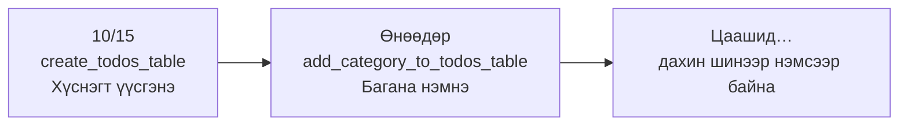
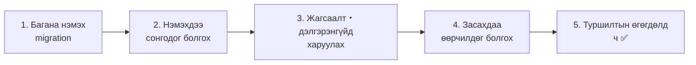
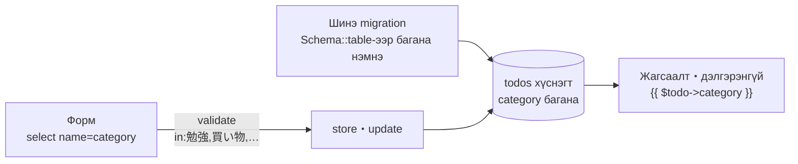

# Laravel-ийн анхан шат — Todo-д ангилал нэмье (багана нэмэх migration)

> 🇯🇵 Эх хувь (япон хэлээр): [20261112_資料_2.md](<../../../1年生_データ設計とアプリ開発/後期/20261112/20261112_資料_2.md>) <!-- original-ja-link -->

Todo олширч ирэхээр «энэ бол хичээлийн ажил», «энэ бол дэлгүүрээс юм авах» гэж **ангилмаар** санагдана.
Өнөөдөр Todo-д **ангилал (category)** онооно.

## Өнөөдрийн зорилго
- Аль хэдийн байгаа хүснэгтэд **migration-аар багана нэмж** чаддаг болох
- Select box-оор тогтсон сонголтуудаас ангилал сонгож чаддаг болох
- Сонгож болох ангиллаас өөр утга илгээгдэхээс сэргийлж, баталгаажуулалтын дүрэм (`in`)-ээр шалгаж чаддаг болох

> [Материал 1](./20261112_資料_1.md)-ийн «Нийтлэг хэсгийг эд анги болгоё» хүртэлх даалгаврыг хийж дуусгасан гэж үзээд эхэлнэ.

---

## 1. Өнөөдөр хийх зүйл

Ангиллыг дараах **4-өөс сонгодог** болгоно.

| Ангилал |
|---------|
| 勉強 (Хичээл) |
| 買い物 (Дэлгүүрээс юм авах) |
| 家のこと (Гэрийн ажил) |
| その他 (Бусад) |

```
TODOアプリ

[ 新しいTODOを入力 ] [ 勉強 ▼ ] [追加]

☐ [勉強] レポートを書く
☑ [買い物] 牛乳を買う
☐ [家のこと] 部屋のそうじ
```

`todos` хүснэгтэд `category` (ангилал) гэсэн 1 багана нэмнэ.

| id | title | **category** | is_done | created_at | updated_at |
|----|-------|-------------|---------|-----------|-----------|
| 1 | レポートを書く | **勉強** | 0 | … | … |
| 2 | 牛乳を買う | **買い物** | 1 | … | … |

---

## 2. Шинээр гарч ирэх зүйл: багана нэмэх migration

10/15-нд migration-аар `todos` хүснэгтийг **үүсгэсэн**.
Өнөөдөр аль хэдийн байгаа `todos` хүснэгтэд **багана нэмнэ**.

Энд нэг чухал дүрэм бий.

> **Нэг удаа ажиллуулсан migration-ийг өөрчилж бичихгүй. Шинэ migration нэмнэ.**



10/15-ны migration (`create_todos_table`)-д `category`-г нэмж бичсэн ч **аль хэдийн ажиллуулсан тул `migrate` хийсэн ч ажиллахгүй**.
Migration бол хүснэгтийн **өөрчлөлтийн бүртгэл (өдрийн тэмдэглэл)** юм. Өмнөх тэмдэглэлийг өөрчлөлгүй, шинэ хуудсанд «өнөөдөр багана нэмсэн» гэж нэмж бичсээр байна.

| | Хүснэгт үүсгэх (10/15) | Багана нэмэх (өнөөдөр) |
|---|---|---|
| Файлын нэр | `create_todos_table` | `add_category_to_todos_table` |
| Агуулга | `Schema::create('todos', ...)` | `Schema::table('todos', ...)` |
| Утга | Шинээр хүснэгт үүсгэнэ | Аль хэдийн байгаа хүснэгтийг өөрчилнө |

---

## 3. Хийж үзье



Өөрчлөх файлууд дараах байдалтай (`src` дотор).

```
src/
├─ database/
│   ├─ migrations/
│   │   └─ xxxx_add_category_to_todos_table.php ··· 1. Шинээр үүсгэнэ
│   ├─ seeders/TodoSeeder.php ····················· 5. Ангилал нэмнэ
│   └─ factories/TodoFactory.php ·················· 5. Ангилал нэмнэ
├─ resources/views/todos/
│   ├─ index.blade.php ···························· 2・3. Select box болон харуулах
│   ├─ show.blade.php ····························· 3. Харуулах
│   └─ edit.blade.php ····························· 4. Select box
└─ app/Http/Controllers/
    └─ TodoController.php ························· 2・4. store болон update
```

---

### 1. Багана нэмэх migration үүсгэх

> Одоо энд байна：**🟢 1. Migration** → 2. Нэмэх → 3. Харуулах → 4. Засах → 5. Туршилтын өгөгдөл

Дараах командаар migration файл үүсгэнэ.

```powershell
docker compose exec laravel php artisan make:migration add_category_to_todos_table
```

Нэрийг `add_〇〇_to_△△_table` гэж өгвөл Laravel «`△△` хүснэгтийг өөрчлөх гэж байгаа юм байна» гэж ойлгоод загварыг нь бэлдэж өгдөг.

`database/migrations/`-д `2026_11_12_xxxxxx_add_category_to_todos_table.php` үүсэх тул `up()` болон `down()`-ий доторхыг дараах байдлаар бичнэ.

```php
    public function up(): void
    {
        Schema::table('todos', function (Blueprint $table) {
            $table->string('category')->default('その他')->after('title');
        });
    }

    public function down(): void
    {
        Schema::table('todos', function (Blueprint $table) {
            $table->dropColumn('category');
        });
    }
```

| Код | Утга |
|--------|------|
| `Schema::table('todos', ...)` | Аль хэдийн байгаа `todos` хүснэгтийг өөрчилнө (үүсгэхдээ `Schema::create`) |
| `$table->string('category')` | `category` гэсэн текстэн багана нэмнэ |
| `->default('その他')` | Юу ч оруулаагүй үед «その他» (Бусад) болгоно |
| `->after('title')` | `title` баганын ард нэмнэ (phpMyAdmin-д харахад ойлгомжтой болгохын тулд) |
| `up()` | `migrate` хийх үед хийх зүйл (багана нэмнэ) |
| `down()` | Буцаах үед хийх зүйл (баганыг устгана) |

> **Яагаад `default('その他')`-г залгадаг вэ?**
> `todos` хүснэгтэд аль хэдийн хэдэн Todo орсон байгаа.
> Багана нэмэхэд одоо байгаа Todo-нуудын `category`-д юу оруулах вэ? `default` байвал одоо байгаа Todo бүгд «その他» (Бусад) болно.

Хадгалсны дараа migration-ийг ажиллуулна.

```powershell
docker compose exec laravel php artisan migrate
```

✅ **Шалгах**：phpMyAdmin-д `todos` хүснэгтийг нээж үзээрэй.
`title`-ийн ард `category` багана үүсч, одоо байгаа Todo бүгд «その他» (Бусад) болсон байвал болно.
**Одоо байгаа Todo устаагүй байна**. Учир нь `migrate` нь хараахан ажиллуулаагүй migration (өнөөдрийн 1)-ийг л ажиллуулдаг.

| Команд | Хийх зүйл | Одоо байгаа өгөгдөл |
|---------|---------|------------|
| `migrate` | Хараахан ажиллуулаагүй migration-ийг л ажиллуулна | **Үлдэнэ** |
| `migrate:fresh` | Бүх хүснэгтийг устгаад, бүх migration-ийг эхнээс нь ажиллуулна | Устна |

---

### 2. Нэмэхдээ ангилал сонгодог болгох

> Одоо энд байна：1. Migration → **🟢 2. Нэмэх** → 3. Харуулах → 4. Засах → 5. Туршилтын өгөгдөл

#### ① Нэмэх формд select box нэмэх (V)

`resources/views/todos/index.blade.php`-ийн нэмэх формд ★ тэмдэгтэй select box-ийг нэмж бичнэ.

```html
    <form method="POST" action="/todos">
        @csrf
        <input type="text" name="title" value="{{ old('title') }}" placeholder="新しいTODOを入力" required>

        {{-- ★ Эндээс нэмнэ --}}
        <select name="category">
            <option value="勉強">勉強</option>
            <option value="買い物">買い物</option>
            <option value="家のこと">家のこと</option>
            <option value="その他">その他</option>
        </select>
        {{-- ★ Энд хүртэл --}}

        <button type="submit">追加</button>

        @error('title')
            <p style="color: red;">{{ $message }}</p>
        @enderror
    </form>
```

| Код | Утга |
|--------|------|
| `<select name="category">` | Сонгосон зүйлийг `category` гэсэн нэрээр илгээнэ |
| `<option value="勉強">勉強</option>` | Сонголт. `value`-ийн утга илгээгдэнэ |

#### ② store-д ангиллыг ч хадгалах (C)

`app/Http/Controllers/TodoController.php`-ийн `store`-д ★ тэмдэгтэй хэсгийг нэмж бичнэ.

```php
    public function store(Request $request)
    {
        $request->validate([
            'title' => 'required|max:255',
            'category' => 'required|in:勉強,買い物,家のこと,その他',  // ★ Нэмэх
        ], [
            'title.required' => 'タイトルを入力してください。',
            'title.max' => 'タイトルは255文字以内で入力してください。',
            'category.required' => 'カテゴリを選んでください。',           // ★ Нэмэх
            'category.in' => 'カテゴリは、リストの中から選んでください。',  // ★ Нэмэх
        ]);

        $todo = new Todo();
        $todo->title = $request->input('title');
        $todo->category = $request->input('category');  // ★ Нэмэх
        $todo->save();

        return redirect('/todos');
    }
```

| Код | Утга |
|--------|------|
| `'category' => 'required\|in:勉強,買い物,家のこと,その他'` | `category` нь эдгээр 4-ийн **аль нэг** нь байх ёстой |
| `$todo->category = $request->input('category')` | Сонгосон ангиллыг оруулна |

> **Select box байхад яагаад `in`-ээр шалгадаг вэ?**
> Select box-д ердөө 4 сонголт байгаа ч 11/5-нд үзсэнчлэн **браузерын шалгалтыг тойрч гарах боломжтой**.
> Хөгжүүлэгчийн хэрэгслээр `<option value="勉強">`-г `<option value="ゲーム">` (Тоглоом) болгож өөрчлөөд илгээх ч боломжтой.
> Сервер талд `in` дүрмээр заасан 4 утгаас бусдыг хүлээн авахгүй.

---

### 3. Жагсаалт болон дэлгэрэнгүйд ангиллыг харуулах

> Одоо энд байна：1. Migration → 2. Нэмэх → **🟢 3. Харуулах** → 4. Засах → 5. Туршилтын өгөгдөл

#### ① Жагсаалт (V)

`index.blade.php`-ийн `<li>` дотор ★ тэмдэгтэй хэсгийг нэмж бичнэ.

```html
            <li>
                <form method="POST" action="/todos/{{ $todo->id }}/toggle" style="display: inline;">
                    @csrf
                    @method('PATCH')
                    <input type="checkbox" name="is_done" value="1" onchange="this.form.submit()" @checked($todo->is_done)>
                </form>
                [{{ $todo->category }}]  {{-- ★ Нэмэх --}}
                <a href="/todos/{{ $todo->id }}">{{ $todo->title }}</a>
            </li>
```

#### ② Дэлгэрэнгүй (V)

`show.blade.php`-ийн «番号» (Дугаар)-ын доор ★ тэмдэгтэй 1 мөрийг нэмж бичнэ.

```html
    <p>番号：{{ $todo->id }}</p>

    <p>カテゴリ：{{ $todo->category }}</p>  {{-- ★ Нэмэх --}}
```

✅ **Шалгах**：Жагсаалт дээр ангилал сонгоод Todo нэмж үзээрэй.
Жагсаалтад `[勉強] レポートを書く` гэх мэтээр харагдаж, дэлгэрэнгүй хуудсанд ч «カテゴリ：勉強» (Ангилал: Хичээл) гэж гарвал болно.

---

### 4. Засахдаа ангиллыг өөрчилдөг болгох

> Одоо энд байна：1. Migration → 2. Нэмэх → 3. Харуулах → **🟢 4. Засах** → 5. Туршилтын өгөгдөл

#### ① Засах формд select box нэмэх (V)

`edit.blade.php`-ийн формд ★ тэмдэгтэй select box-ийг нэмж бичнэ.

```html
    <form method="POST" action="/todos/{{ $todo->id }}">
        @csrf
        @method('PUT')
        <input type="text" name="title" value="{{ old('title', $todo->title) }}" required>

        {{-- ★ Эндээс нэмнэ --}}
        <select name="category">
            <option value="勉強" @selected($todo->category === '勉強')>勉強</option>
            <option value="買い物" @selected($todo->category === '買い物')>買い物</option>
            <option value="家のこと" @selected($todo->category === '家のこと')>家のこと</option>
            <option value="その他" @selected($todo->category === 'その他')>その他</option>
        </select>
        {{-- ★ Энд хүртэл --}}

        <label>
            <input type="checkbox" name="is_done" value="1" @checked($todo->is_done)>
            完了
        </label>
        <button type="submit">保存</button>

        @error('title')
            <p style="color: red;">{{ $message }}</p>
        @enderror
    </form>
```

| Код | Утга |
|--------|------|
| `@selected($todo->category === '勉強')` | Одоогийн ангилал «勉強» (Хичээл) бол энэ сонголтыг анхнаас нь сонгосон байдалтай болгоно |

`@selected` бол checkbox-ийн `@checked`-ийн select box хувилбар юм.
`( )` доторх нь `true` байх үед л `<option>`-д `selected`-ийг залгана.

#### ② update-д ангиллыг ч хадгалах (C)

`TodoController.php`-ийн `update`-д `store`-той адилаар ★ тэмдэгтэй хэсгийг нэмж бичнэ.

```php
    public function update(Request $request, $id)
    {
        $request->validate([
            'title' => 'required|max:255',
            'category' => 'required|in:勉強,買い物,家のこと,その他',  // ★ Нэмэх
        ], [
            'title.required' => 'タイトルを入力してください。',
            'title.max' => 'タイトルは255文字以内で入力してください。',
            'category.required' => 'カテゴリを選んでください。',           // ★ Нэмэх
            'category.in' => 'カテゴリは、リストの中から選んでください。',  // ★ Нэмэх
        ]);

        $todo = Todo::findOrFail($id);
        $todo->title = $request->input('title');
        $todo->category = $request->input('category');  // ★ Нэмэх
        $todo->is_done = $request->has('is_done');
        $todo->save();

        return redirect('/todos/' . $todo->id);
    }
```

✅ **Шалгах**：Засах хуудсыг нээхэд одоогийн ангилал анхнаасаа сонгогдсон байгаа эсэхийг шалгаарай.
Ангиллыг өөрчлөөд `保存` (Хадгалах)-ыг дарж, дэлгэрэнгүй хуудасны ангилал өөрчлөгдвөл болно.

---

### 5. Туршилтын өгөгдөлд ч ангилал оруулах

> Одоо энд байна：1. Migration → 2. Нэмэх → 3. Харуулах → 4. Засах → **🟢 5. Туршилтын өгөгдөл**

11/5-нд хийсэн Seeder болон Factory-д ч ангилал нэмж өгнө.

#### ① TodoSeeder (тогтсон өгөгдөл)

`database/seeders/TodoSeeder.php`-ийн массив болон `foreach`-д ★ тэмдэгтэй хэсгийг нэмж бичнэ.

```php
        $todos = [
            ['title' => '牛乳を買う',     'category' => '買い物', 'is_done' => false],  // ★ category-г нэмэх
            ['title' => 'レポートを出す', 'category' => '勉強',   'is_done' => true],   // ★
            ['title' => '宿題をする',     'category' => '勉強',   'is_done' => false],  // ★
        ];

        foreach ($todos as $data) {
            $todo = new Todo();
            $todo->title = $data['title'];
            $todo->category = $data['category'];  // ★ Нэмэх
            $todo->is_done = $data['is_done'];
            $todo->save();
        }
```

#### ② TodoFactory (автоматаар үүсгэх өгөгдөл)

`database/factories/TodoFactory.php`-ийн `definition()`-д ★ тэмдэгтэй 1 мөрийг нэмж бичнэ.

```php
        return [
            'title' => fake()->randomElement([
                '牛乳を買う',
                'レポートを出す',
                '宿題をする',
                '部屋のそうじ',
                '本を返す',
                'ゴミを出す',
            ]),
            'category' => fake()->randomElement(['勉強', '買い物', '家のこと', 'その他']),  // ★ Нэмэх
            'is_done' => fake()->boolean(),
        ];
```

```powershell
docker compose exec laravel php artisan migrate:fresh --seed
```

✅ **Шалгах**：Жагсаалтыг нээгээд 23 Todo тус бүрд ангилал оноогдсон байвал болно.
`migrate:fresh` нь бүх migration-ийг эхнээс нь ажиллуулдаг тул **өнөөдрийн migration ч хамт** ажиллана.

---

## 4. Болохгүй байвал

> **🔥 Ажиллахгүй бол лог гарга!** → [【Чухал】Лог хэрхэн гаргах вэ](../20261022/【重要】ログの出し方.md)

| Шинж тэмдэг | Шалтгаан байгаа газар | Шийдэл |
|------|----------|------|
| `Unknown column 'category'` | Migration | `php artisan migrate`-ийг ажиллуулсан эсэхийг шалгана |
| `migrate` хийсэн ч `category` багана үүсэхгүй байна | Migration | 10/15-ны migration-д нэмж бичсэн биш эсэхийг шалгана (**шинэ migration**-д бичнэ) |
| «カテゴリは、リストの中から選んでください。» (Ангиллыг жагсаалтаас сонгоно уу.) гэж гарна | View・Controller | `<option value="...">` болон `in:...`-ийн ангиллын нэр **нэг ч тэмдэгт зөрөлгүй** ижил эсэхийг шалгана |
| Нэмсэн ч ангилал бүгд «その他» (Бусад) болж байна | Controller | `store`-д `$todo->category = $request->input('category');` байгаа эсэхийг шалгана |
| Засах хуудсанд одоогийн ангилал сонгогдоогүй байна | View | `@selected($todo->category === '...')`-г бичсэн эсэх, ангиллын нэрийг шалгана |

---

## 5. Дүгнэлт



| Өнөөдөр бичсэн зүйл | Товчхондоо |
|--------------|-----------|
| `make:migration add_category_to_todos_table` | Аль хэдийн байгаа хүснэгтэд багана нэмэх migration үүсгэнэ |
| `Schema::table(...)` болон `->default(...)` | Багана нэмнэ. Одоо байгаа өгөгдөлд `default`-ийн утга орно |
| `php artisan migrate` | Хараахан ажиллуулаагүй migration-ийг л ажиллуулна (өгөгдөл үлдэнэ) |
| `<select>` болон `<option>` | Тогтсон сонголтуудаас сонгоно |
| `@selected(...)` | Одоогийн утгыг анхнаас нь сонгосон байдалтай болгоно (`@checked`-ийн select box хувилбар) |
| `'in:勉強,買い物,…'` | Заасан утгуудаас бусдыг сервер талд хүлээн авахгүй |

**Нэг удаа ажиллуулсан migration-ийг өөрчилж бичихгүй. Өөрчлөлтийг шинэ migration-аар нэмсээр байна.**

---

## 6. Цааш нь туршаад үзье (цаг үлдсэн хүмүүст)

Ангилалд «部活» (Дугуйлан) нэмж үзээрэй.
Аль файлуудыг засах хэрэгтэйг өөрөө бодож үзээрэй.

<details>
<summary>Зөвлөгөө</summary>

«部活»-ыг дараах **4 газарт** нэмнэ.

1. `index.blade.php`-ийн нэмэх формын `<option>`
2. `edit.blade.php`-ийн засах формын `<option>` (`@selected` ч мөн)
3. `TodoController.php`-ийн `store`-ийн `in:...`
4. `TodoController.php`-ийн `update`-ийн `in:...`

(Factory-д ч «部活» гаргамаар байвал `TodoFactory.php`-ийн `randomElement`-д ч нэмнэ)

Ижил ангиллын жагсаалтыг **4 газарт бичиж байгааг** анзаарсан уу?
1 газарт нэмэхээ мартвал «сонгож болдог ч хадгалж чадахгүй» гэх мэт bug гарна. Ийм газрыг ч үнэндээ Материал 1-ийнх шиг **нийтлэг болгомоор** байгаа юм.

</details>

<!-- nav:start -->

---

| ⬅️ Өмнөх | 🗺️ Ерөнхий зураг | Дараагийнх ➡️ |
|:--|:--:|--:|
| [11/12 Нийтлэг хэсгийг эд анги болгох (@include)](20261112_資料_1.md) | [Материалын ерөнхий зураг](../../README.md) | [11/19 Сурагчийн бүртгэл ① Жагсаалт, дэлгэрэнгүй](../20261119/20261119_資料_1.md) |

<!-- nav:end -->
