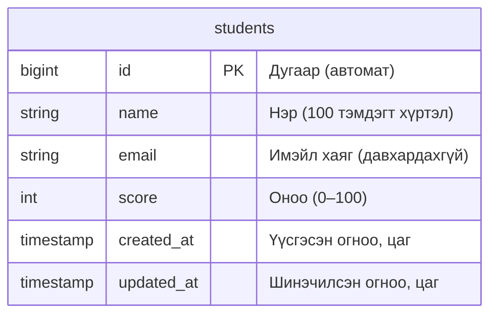
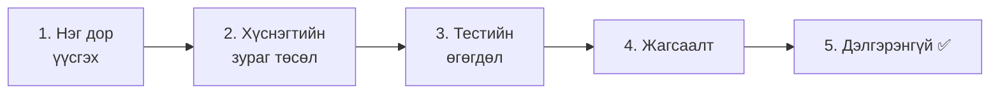
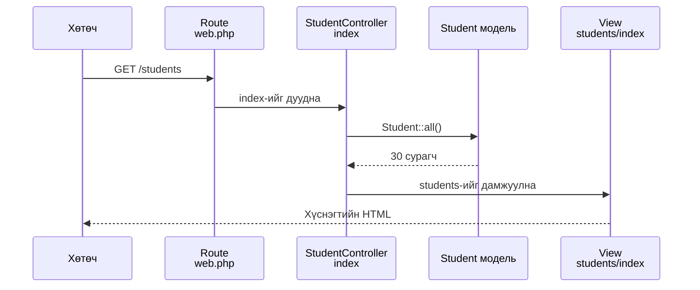

# Сурагчийн бүртгэлийн апп хийцгээе ① — Бэлтгэл, жагсаалт ба дэлгэрэнгүй

> 🇯🇵 Эх хувь (япон хэлээр): [20261119_資料_1.md](<../../../1年生_データ設計とアプリ開発/後期/20261119/20261119_資料_1.md>) <!-- original-ja-link -->

Өнөөдрөөс эхлэн шинэ **сурагчийн бүртгэлийн апп** хийнэ.
Todo аппаас сурсан зүйлээ ашиглаад, энэ удаад **өөрийнхөө хүчээр** хийж үзье.

## Өнөөдрийн зорилго
- `make:model -mf` командаар модель, миграци, Factory-г нэг дор үүсгэж чаддаг болох
- Сурагчдын хүснэгт үүсгээд, тестийн өгөгдөл оруулж чаддаг болох
- Сурагчдын жагсаалтын хуудас болон дэлгэрэнгүй хуудсыг хийж чаддаг болох

> Дадлагын орчны (`php-study`) mysql болон laravel-ийг асаагаад эхэлнэ.
> Сурагчийн бүртгэлийн аппыг Todo апптай **ижил төсөл (`src`)** дотор нэмж хийнэ.

---

## 1. Сурагчийн бүртгэлийн апп гэж юу вэ

Энэ нь багш сурагчдын **нэр, имэйл хаяг, оноог** удирдахад зориулсан апп юм.

```
生徒管理アプリ

[ 生徒を追加 ]

| 名前       | 点数 |
|------------|------|
| 山田 太郎  |  85  |
| 佐藤 花子  |  92  |
| 鈴木 一郎  |  70  |
```

Энэ аппыг цаашид 3 удаагийн хичээлээр бага багаар хөгжүүлнэ.

| Удаа | Хийх зүйл |
|----|---------|
| **1 дэх удаа (өнөөдөр)** | Сурагчдын жагсаалт, дэлгэрэнгүй, нэмэх, засах, устгах (CRUD) |
| 2 дахь удаа | Нэвтрэлт (зөвхөн багш ашигладаг болгох) |
| 3 дахь удаа | Холбоо буюу relation (аль багш аль сурагчийг бүртгэснийг тэмдэглэх) |

> **2-р курстэй холбогдох апп**
> 2-р курст энэ аппыг **API** (дэлгэц биш, зөвхөн өгөгдөл буцаадаг бүтэц) болгон өөрчилж хийнэ.
> Өнөөдөр хийх хүснэгт болон URL-уудыг 2-р курст ч яг хэвээр нь ашиглана.

### Todo апптай харьцуулж үзье

Хийх арга нь Todo апптай бараг адилхан.

| | Todo апп | Сурагчийн бүртгэлийн апп |
|---|---|---|
| Хүснэгт | `todos` | `students` |
| Модель | `Todo` | `Student` |
| Контроллер | `TodoController` | `StudentController` |
| URL | `/todos` | `/students` |
| View-ийн хавтас | `resources/views/todos/` | `resources/views/students/` |

### Сурагчдын хүснэгт



Todo-ийн хүснэгтээс дараах зүйлсээр ялгаатай.

| Багана | Шинэ зүйл |
|----|------------|
| `email` | **Ижил имэйл хаягтай хоёр сурагчийг бүртгэж болохгүй** (давхардахгүй) |
| `score` | Тэмдэгт мөр биш, **бүхэл тоо** (`integer`) хадгална |

---

## 2. Хийж үзье



### 1. Модель, миграци, Factory-г нэг дор үүсгэх

> Одоо энд байна: **🟢 1. Нэг дор үүсгэх** → 2. Зураг төсөл → 3. Тестийн өгөгдөл → 4. Жагсаалт → 5. Дэлгэрэнгүй

Todo-ийн үед миграци, модель, Factory-г нэг нэгээр нь үүсгэсэн.
Энэ удаад **нэг командаар нэг дор** үүсгэнэ.

```powershell
docker compose exec laravel php artisan make:model Student -mf
```

| Хэсэг | Утга |
|------|------|
| `make:model Student` | `Student` модель үүсгэх |
| `-m` | Миграцийг хамт үүсгэх (**m**igration) |
| `-f` | Factory-г хамт үүсгэх (**f**actory) |

Дараах 3 файл үүснэ.

```
src/
├─ app/Models/Student.php ··································· Модель
├─ database/migrations/xxxx_create_students_table.php ······· Миграци
└─ database/factories/StudentFactory.php ···················· Factory
```

`-f` тавьсан учраас модельд анхнаасаа `HasFactory` орсон байна (Todo-ийн үед гараар нэмж бичсэн).

```php
class Student extends Model
{
    /** @use HasFactory<\Database\Factories\StudentFactory> */
    use HasFactory;
}
```

---

### 2. Хүснэгтийн зураг төслийг бичих (миграци)

> Одоо энд байна: 1. Нэг дор үүсгэх → **🟢 2. Зураг төсөл** → 3. Тестийн өгөгдөл → 4. Жагсаалт → 5. Дэлгэрэнгүй

`database/migrations/xxxx_create_students_table.php`-г нээгээд, `up()`-ийн доторхыг дараах байдлаар өөрчилнө.

```php
    public function up(): void
    {
        Schema::create('students', function (Blueprint $table) {
            $table->id();
            $table->string('name', 100);
            $table->string('email')->unique();
            $table->integer('score')->default(0);
            $table->timestamps();
        });
    }
```

| Код | Утга |
|--------|------|
| `$table->string('name', 100)` | Нэр. 100 тэмдэгт хүртэл |
| `$table->string('email')->unique()` | Имэйл хаяг. **Ижил утгыг хоёр удаа оруулж болохгүй** |
| `$table->integer('score')->default(0)` | Оноо. Бүхэл тоо бөгөөд юу ч оруулаагүй бол 0 |

👀 **Ажиллуулахаас өмнө харж аваарай**: phpMyAdmin (http://localhost:8080)-ий `laravel` өгөгдлийн санд `students` хүснэгт **одоохондоо байхгүй** гэдгийг шалгаарай.
Зураг төслийг бичсэн төдийгөөр хүснэгт хараахан үүсээгүй байна.

```powershell
docker compose exec laravel php artisan migrate
```

✅ **Шалгах**: phpMyAdmin дээр `students` хүснэгт үүссэн байвал болно.

---

### 3. Тестийн өгөгдөл оруулах (Factory, Seeder)

> Одоо энд байна: 1. Нэг дор үүсгэх → 2. Зураг төсөл → **🟢 3. Тестийн өгөгдөл** → 4. Жагсаалт → 5. Дэлгэрэнгүй

#### ① Factory-д сурагчийг хэрхэн үүсгэхийг бичих

`database/factories/StudentFactory.php`-ийн `definition()`-ийн доторхыг дараах байдлаар өөрчилнө.

```php
    public function definition(): array
    {
        return [
            'name' => fake('ja_JP')->name(),
            'email' => fake()->unique()->safeEmail(),
            'score' => fake()->numberBetween(0, 100),
        ];
    }
```

| Код | Утга |
|--------|------|
| `fake('ja_JP')->name()` | **Япон нэрийг** санамсаргүйгээр үүсгэнэ (жишээ нь: 山田 太郎) |
| `fake()->unique()->safeEmail()` | Имэйл хаягийг санамсаргүйгээр үүсгэнэ. `unique()`-ээр ижил хаяг давтагдахгүй болгоно |
| `fake()->numberBetween(0, 100)` | 0-ээс 100 хүртэлх бүхэл тоог санамсаргүйгээр үүсгэнэ |

> Жинхэнэ сурагчдын нэр, имэйл хаягийг дадлагад ашиглахгүй. Factory-гээр **зохиомол өгөгдөл** үүсгэнэ.

#### ② Seeder үүсгээд 30 сурагч оруулах

```powershell
docker compose exec laravel php artisan make:seeder StudentSeeder
```

`database/seeders/StudentSeeder.php`-ийн `run()`-ийн доторхыг дараах байдлаар өөрчилнө.

```php
<?php

namespace Database\Seeders;

use App\Models\Student;
use Illuminate\Database\Seeder;

class StudentSeeder extends Seeder
{
    public function run(): void
    {
        Student::factory()->count(30)->create();
    }
}
```

`database/seeders/DatabaseSeeder.php`-д ★ тэмдэгтэй 1 мөрийг нэмж бичнэ.

```php
    public function run(): void
    {
        $this->call(TodoSeeder::class);
        $this->call(StudentSeeder::class);  // ★ Нэмэх
    }
```

```powershell
docker compose exec laravel php artisan migrate:fresh --seed
```

✅ **Шалгах**: phpMyAdmin дээр `students` хүснэгтийг нээгээд, 30 сурагч орсон байвал болно.
(`migrate:fresh` учраас Todo-ийн өгөгдөл ч анхны төлөвтөө буцна)

---

### 4. Жагсаалтын хуудас хийх

> Одоо энд байна: 1. Нэг дор үүсгэх → 2. Зураг төсөл → 3. Тестийн өгөгдөл → **🟢 4. Жагсаалт** → 5. Дэлгэрэнгүй

#### ① Контроллер үүсгэх

```powershell
docker compose exec laravel php artisan make:controller StudentController
```

`app/Http/Controllers/StudentController.php`-г дараах байдлаар бичнэ.

```php
<?php

namespace App\Http\Controllers;

use App\Models\Student;
use Illuminate\Http\Request;

class StudentController extends Controller
{
    public function index()
    {
        $students = Student::all();

        return view('students.index', ['students' => $students]);
    }
}
```

`TodoController`-ийн `index`-ээс ялгаатай нь зөвхөн `Todo` нь `Student` болсон явдал.

#### ② Route бичих

`routes/web.php`-д ★ тэмдэгтэй 2 мөрийг нэмж бичнэ.

```php
use App\Http\Controllers\StudentController;  // ★ Нэмэх (дээд хэсэгт бичнэ)

// (Todo-ийн route-уудыг орхив)

Route::get('/students', [StudentController::class, 'index']);  // ★ Нэмэх
```

#### ③ View үүсгэх

`resources/views` дотор `students` хавтас үүсгээд, `index.blade.php` файл үүсгэнэ.
11/12-нд хийсэн **толгой (header) болон хөл (footer) хэсгийн бүрэлдэхүүнүүдийг** энд ч ашиглана.

```html
@include('layouts.header', ['title' => '生徒一覧'])

    <h1>生徒一覧</h1>

    <table border="1">
        <tr>
            <th>名前</th>
            <th>点数</th>
        </tr>
        @foreach ($students as $student)
            <tr>
                <td><a href="/students/{{ $student->id }}">{{ $student->name }}</a></td>
                <td>{{ $student->score }}</td>
            </tr>
        @endforeach
    </table>

@include('layouts.footer')
```

| Код | Утга |
|--------|------|
| `<table>` | Хүснэгт үүсгэнэ. `<tr>` нь 1 мөр, `<th>` нь гарчиг, `<td>` нь нүд |
| `border="1"` | Хүснэгтэд хүрээний шугам нэмнэ |

#### ④ Header-т 「生徒管理」(Сурагчийн бүртгэл) руу орох холбоос нэмэх

`resources/views/layouts/header.blade.php`-д ★ тэмдэгтэй холбоосыг нэмж бичнэ.

```html
    <header>
        <a href="/todos">TODOアプリ</a>
        <a href="/students">生徒管理</a>  {{-- ★ Нэмэх --}}
    </header>
```

**Бүрэлдэхүүн хэсгийг ганцхан газар засахад л Todo-ийн хуудсан дээр ч, сурагчдын хуудсан дээр ч холбоос гарч ирнэ** (энэ нь 11/12-нд сурсан нийтлэг хэсгийг дахин ашиглахын давуу тал юм).

`/students`-ийг нээснээс эхлээд жагсаалт харагдах хүртэлх урсгал нь Todo-ийн үетэй адилхан.



✅ **Шалгах**: http://localhost:8000/students -ийг нээгээд, 30 сурагч хүснэгтээр харагдвал болно.

---

### 5. Дэлгэрэнгүй хуудас хийх

> Одоо энд байна: 1. Нэг дор үүсгэх → 2. Зураг төсөл → 3. Тестийн өгөгдөл → 4. Жагсаалт → **🟢 5. Дэлгэрэнгүй**

#### ① Контроллерт show нэмж бичих

`StudentController.php`-д ★ тэмдэгтэй `show`-г нэмж бичнэ.

```php
    // ★ Эндээс нэмэх
    public function show($id)
    {
        $student = Student::findOrFail($id);

        return view('students.show', ['student' => $student]);
    }
    // ★ Энд хүртэл
```

#### ② Route нэмж бичих

```php
Route::get('/students', [StudentController::class, 'index']);
Route::get('/students/{id}', [StudentController::class, 'show']);  // ★ Нэмэх
```

#### ③ View үүсгэх

`resources/views/students/show.blade.php` файл үүсгэнэ.

```html
@include('layouts.header', ['title' => $student->name])

    <h1>{{ $student->name }}</h1>

    <p>番号：{{ $student->id }}</p>
    <p>メールアドレス：{{ $student->email }}</p>
    <p>点数：{{ $student->score }}点</p>

    <a href="/students">一覧にもどる</a>

@include('layouts.footer')
```

✅ **Шалгах**: Жагсаалтаас сурагчийн нэр дээр дарахад дэлгэрэнгүй хуудас гарч ирвэл болно.
http://localhost:8000/students/999 гэх мэт байхгүй сурагчийн URL-ийг нээхэд `404 Not Found` гардаг эсэхийг ч шалгаарай.

---

## 3. Болохгүй байвал

> **🔥 Ажиллахгүй бол лог гарга!** → [【Чухал】Лог хэрхэн гаргах вэ](../20261022/【重要】ログの出し方.md)

| Шинж тэмдэг | Шалтгаан байгаа газар | Шийдэл |
|------|----------|------|
| `Table 'laravel.students' doesn't exist` | Миграци | `php artisan migrate` (эсвэл `migrate:fresh --seed`)-ийг ажиллуулсан эсэхээ шалгах |
| `Call to undefined method App\Models\Student::factory()` | Модель | `make:model`-д `-f` тавихаа мартсан. `Student.php`-д `use HasFactory;`-г нэмж бичих |
| Нэр нь англиар (жишээ нь: John Smith) гарч байна | Factory | `fake('ja_JP')->name()`-ийн `'ja_JP'`-г бичсэн эсэхээ шалгах |
| `Target class [StudentController] does not exist.` | Route | `web.php`-ийн дээд хэсэгт `use App\Http\Controllers\StudentController;` байгаа эсэхийг шалгах |
| `View [students.index] not found.` | View | `resources/views/students/index.blade.php`-ийн байршлыг шалгах (`students` нэрийн төгсгөлд `s` байгаа эсэхийг шалгах) |
| `Undefined variable $title` | View | `@include('layouts.header', ['title' => ...])`-ийн `['title' => ...]`-г бичихээ мартаагүй эсэхийг шалгах |

---

## 4. Дүгнэлт

| Өнөөдөр бичсэн зүйл | Товчхондоо |
|--------------|-----------|
| `make:model Student -mf` | Модель, миграци, Factory-г нэг дор үүсгэнэ |
| `->unique()` (миграци) | Ижил утгыг хоёр удаа оруулж болохгүй багана болгоно |
| `$table->integer(...)` | Бүхэл тооны багана |
| `fake('ja_JP')->name()` | Япон нэрийг санамсаргүйгээр үүсгэнэ |
| `index` ба `show` | Todo-тэй ижил хэлбэрээр жагсаалт, дэлгэрэнгүйг хийнэ |
| `<table>` | Жагсаалтыг хүснэгтээр харуулна |

**Хийх арга нь Todo-тэй адилхан. `Todo` гэсэн нэрийг `Student` болгож сольж бодвол өөрөө хийж чадна.**

Дараа нь сурагч нэмэх, засах, устгах боломжтой болгоно → [Сурагчийн бүртгэлийн апп хийцгээе ② — Нэмэх, засах, устгах](./20261119_資料_2.md)

<!-- nav:start -->

---

| ⬅️ Өмнөх | 🗺️ Ерөнхий зураг | Дараагийнх ➡️ |
|:--|:--:|--:|
| [11/12 Ангилал нэмэх](../20261112/20261112_資料_2.md) | [Материалын ерөнхий зураг](../../README.md) | [11/19 Сурагчийн бүртгэл ② Нэмэх, засах, устгах](20261119_資料_2.md) |

<!-- nav:end -->
