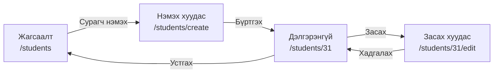
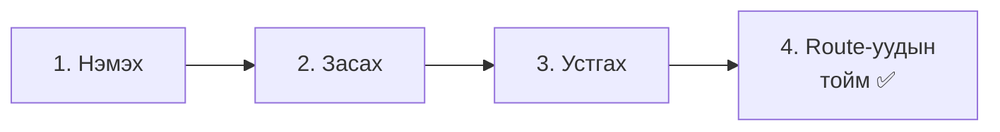
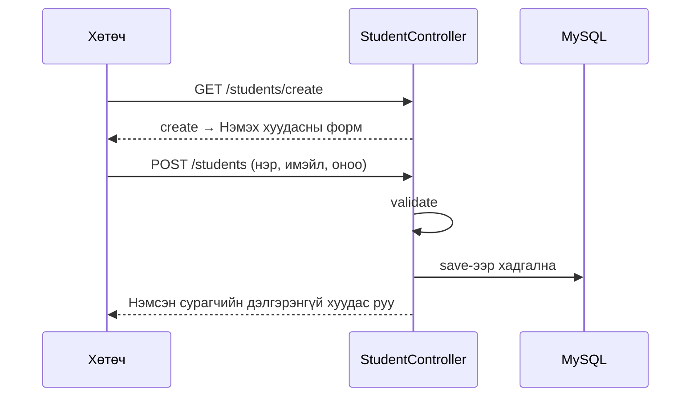
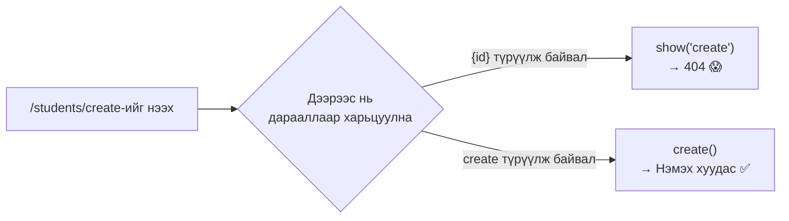
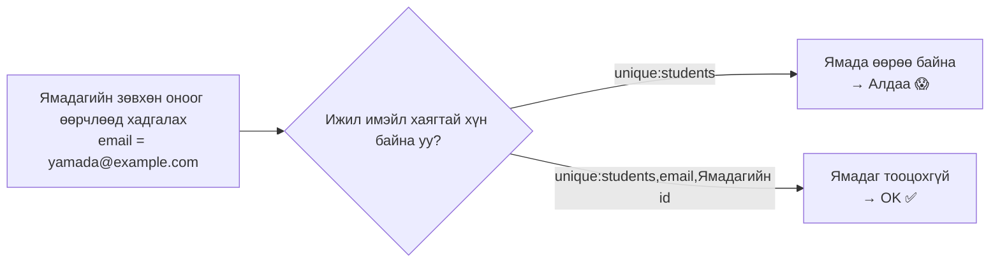

# Сурагчийн бүртгэлийн апп хийцгээе ② — Нэмэх, засах, устгах

> 🇯🇵 Эх хувь (япон хэлээр): [20261119_資料_2.md](<../../../1年生_データ設計とアプリ開発/後期/20261119/20261119_資料_2.md>) <!-- original-ja-link -->

[Материал 1](./20261119_資料_1.md)-д сурагчдын жагсаалт болон дэлгэрэнгүй хуудас бэлэн болсон.
Одоо сурагчийг **нэмэх, засах, устгах** боломжтой болгоно.

## Өнөөдрийн зорилго
- Олон талбар бүхий формыг нэмэх зориулалттай тусдаа хуудсанд хийж чаддаг болох
- Имэйл хаяг давхардсан эсэх (`unique`), онооны хүрээ (`integer`, `min`, `max`)-г шалгаж чаддаг болох
- Засах үед **өөрийнх нь имэйл хаягийг давхардлын шалгалтаас хасаж** чаддаг болох

> Материал 1-ийн «жагсаалт, дэлгэрэнгүй» хийгдсэн төлөвөөс эхэлнэ.

---

## 1. Todo-оос ялгаатай зүйлс

Хийх арга нь Todo-тэй бараг адилхан ч, 2 ялгаатай зүйл бий.

| | Todo апп | Сурагчийн бүртгэлийн апп |
|---|---|---|
| Нэмэх формын байршил | Жагсаалтын хуудасны дээд хэсэгт | **Нэмэх зориулалттай хуудас** (`/students/create`) хийнэ |
| Оруулах талбар | Зөвхөн гарчиг | Нэр, имэйл хаяг, оноо гэсэн **3 талбар** |

Оруулах талбар олон учраас жагсаалтын дээд хэсэгт байрлуулбал харахад төвөгтэй болно. Тиймээс **нэмэх зориулалттай хуудсыг** тусад нь хийнэ.



---

## 2. Хийж үзье



### 1. Нэмэх боломжтой болгох

> Одоо энд байна: **🟢 1. Нэмэх** → 2. Засах → 3. Устгах → 4. Route-уудын тойм

#### ① Нэмэх хуудсыг харуулах (create)

`StudentController.php`-д ★ тэмдэгтэй `create`-г нэмж бичнэ.

```php
    // ★ Эндээс нэмэх
    public function create()
    {
        return view('students.create');
    }
    // ★ Энд хүртэл
```

`create` бол **нэмэх формыг зөвхөн харуулдаг** метод юм. Өгөгдлийн санг ашиглахгүй.

#### ② Нэмэх хуудасны view үүсгэх

`resources/views/students/create.blade.php` файл үүсгэнэ.

```html
@include('layouts.header', ['title' => '生徒の追加'])

    <h1>生徒の追加</h1>

    <form method="POST" action="/students">
        @csrf

        <p>
            名前：
            <input type="text" name="name" value="{{ old('name') }}" required>
            @error('name') <span style="color: red;">{{ $message }}</span> @enderror
        </p>

        <p>
            メールアドレス：
            <input type="email" name="email" value="{{ old('email') }}" required>
            @error('email') <span style="color: red;">{{ $message }}</span> @enderror
        </p>

        <p>
            点数：
            <input type="number" name="score" value="{{ old('score') }}" min="0" max="100" required>
            @error('score') <span style="color: red;">{{ $message }}</span> @enderror
        </p>

        <button type="submit">登録</button>
    </form>

    <a href="/students">一覧にもどる</a>

@include('layouts.footer')
```

| Код | Утга |
|--------|------|
| `type="email"` | Имэйл хаяг оруулах талбар. Хөтөч имэйл хаягийн хэлбэртэй эсэхийг шалгаж өгнө |
| `type="number" min="0" max="100"` | Тоо оруулах талбар. Зөвхөн 0–100 хүртэлх тоо оруулдаг болгоно |
| `@error('name')` ~ `@enderror` | Оруулах талбар бүрт алдааны мессеж гаргана (11/5-тай адилхан) |
| `old('name')` | Алдаанаас болж буцаж ирэхэд оруулсан утгыг үлдээнэ (11/5-тай адилхан) |

Жагсаалтын хуудасны (`students/index.blade.php`) `<h1>`-ийн доор нэмэх хуудас руу орох холбоосыг ч нэмж өгнө.

```html
    <h1>生徒一覧</h1>

    <a href="/students/create">生徒を追加</a>  {{-- ★ Нэмэх --}}
```

#### ③ Хадгалах (store)

`StudentController.php`-д ★ тэмдэгтэй `store`-г нэмж бичнэ.

```php
    // ★ Эндээс нэмэх
    public function store(Request $request)
    {
        $request->validate([
            'name' => 'required|max:100',
            'email' => 'required|email|unique:students',
            'score' => 'required|integer|min:0|max:100',
        ], [
            'name.required' => '名前を入力してください。',
            'name.max' => '名前は100文字以内で入力してください。',
            'email.required' => 'メールアドレスを入力してください。',
            'email.email' => 'メールアドレスの形で入力してください。',
            'email.unique' => 'そのメールアドレスは、すでに登録されています。',
            'score.required' => '点数を入力してください。',
            'score.integer' => '点数は整数で入力してください。',
            'score.min' => '点数は0以上で入力してください。',
            'score.max' => '点数は100以下で入力してください。',
        ]);

        $student = new Student();
        $student->name = $request->input('name');
        $student->email = $request->input('email');
        $student->score = $request->input('score');
        $student->save();

        return redirect('/students/' . $student->id);
    }
    // ★ Энд хүртэл
```

Шинээр гарч ирж буй validation-ий дүрмүүд.

| Дүрэм | Утга |
|--------|------|
| `email` | Имэйл хаягийн хэлбэртэй эсэх (`@` байгаа эсэх гэх мэт) |
| `unique:students` | `students` хүснэгтэд **ижил утга хараахан байхгүй эсэх** |
| `integer` | Бүхэл тоо эсэх |
| `min:0`, `max:100` | 0-ээс их буюу тэнцүү, 100-аас бага буюу тэнцүү эсэх (`integer`-тэй хамт ашиглавал **тооны хэмжээгээр** шалгана) |

> **`max:100` нь 2 газарт өөр утгатай**
> `name`-ийн `max:100` нь «**100 тэмдэгт** хүртэл», `score`-ийн `max:100` нь «**100 ба түүнээс бага**» гэсэн утгатай.
> `integer` байвал тооны хэмжээгээр, байхгүй бол тэмдэгтийн тоогоор шалгана.

Хадгалсны дараа нэмсэн сурагчийн дэлгэрэнгүй хуудас руу шилжинэ.

Нэмэх үйлдэл нь «формыг харуулах (`create`)» ба «хадгалах (`store`)» гэсэн **2 удаагийн харилцаанд** хуваагддаг.



#### ④ Route нэмж бичих

`routes/web.php`-д ★ тэмдэгтэй 2 мөрийг нэмж бичнэ. **Бичих дараалалд анхаараарай.**

```php
Route::get('/students', [StudentController::class, 'index']);
Route::get('/students/create', [StudentController::class, 'create']);  // ★ Нэмэх ({id}-ээс дээр!)
Route::post('/students', [StudentController::class, 'store']);         // ★ Нэмэх
Route::get('/students/{id}', [StudentController::class, 'show']);
```

> ⚠️ **`/students/create`-г `/students/{id}`-ээс дээр бичнэ**
> Route-уудыг **дээрээс нь дарааллаар** нь харьцуулдаг.
> `/students/{id}`-г түрүүлж бичвэл `/students/create`-ийн `create`-г `{id}` гэж ойлгочихно.
> Тэгвэл `show('create')` ажиллаж, `id` нь `create` гэсэн сурагчийг хайгаад `404 Not Found` болно.



✅ **Шалгах**: Жагсаалтын 「生徒を追加」(Сурагч нэмэх)-ээр орж 1 сурагч бүртгэж үзээрэй. Мөн дараах 3 зүйлийг туршина.

| Хийх зүйл | Ингэж гарвал болно |
|---------|------------|
| Ердийн байдлаар бүртгэх | Дэлгэрэнгүй хуудас гарна |
| Жагсаалтад байгаа сурагчтай **ижил имэйл хаягаар** бүртгэх | 「そのメールアドレスは、すでに登録されています。」(Тэр имэйл хаяг аль хэдийн бүртгэгдсэн байна.) гэж гарна |
| Хөгжүүлэгчийн хэрэгслээр (DevTools) онооны `max="100"`-г устгаад `150`-аар бүртгэх | 「点数は100以下で入力してください。」(Оноог 100 ба түүнээс бага тоогоор оруулна уу.) гэж гарна |

---

### 2. Засах боломжтой болгох

> Одоо энд байна: 1. Нэмэх → **🟢 2. Засах** → 3. Устгах → 4. Route-уудын тойм

#### ① Засах хуудсыг харуулах (edit)

`StudentController.php`-д ★ тэмдэгтэй `edit`-г нэмж бичнэ.

```php
    // ★ Эндээс нэмэх
    public function edit($id)
    {
        $student = Student::findOrFail($id);

        return view('students.edit', ['student' => $student]);
    }
    // ★ Энд хүртэл
```

#### ② Засах хуудасны view үүсгэх

`resources/views/students/edit.blade.php` файл үүсгэнэ. Нэмэх хуудаснаас ялгаатай хэсгүүдэд ★ тэмдэг тавьсан.

```html
@include('layouts.header', ['title' => '生徒の編集'])

    <h1>生徒の編集</h1>

    <form method="POST" action="/students/{{ $student->id }}">  {{-- ★ Илгээх хаяг --}}
        @csrf
        @method('PUT')  {{-- ★ PUT --}}

        <p>
            名前：
            <input type="text" name="name" value="{{ old('name', $student->name) }}" required>  {{-- ★ Одоогийн утга --}}
            @error('name') <span style="color: red;">{{ $message }}</span> @enderror
        </p>

        <p>
            メールアドレス：
            <input type="email" name="email" value="{{ old('email', $student->email) }}" required>  {{-- ★ Одоогийн утга --}}
            @error('email') <span style="color: red;">{{ $message }}</span> @enderror
        </p>

        <p>
            点数：
            <input type="number" name="score" value="{{ old('score', $student->score) }}" min="0" max="100" required>  {{-- ★ Одоогийн утга --}}
            @error('score') <span style="color: red;">{{ $message }}</span> @enderror
        </p>

        <button type="submit">保存</button>
    </form>

    <a href="/students/{{ $student->id }}">もどる</a>

@include('layouts.footer')
```

Дэлгэрэнгүй хуудсанд (`students/show.blade.php`) ч засах хуудас руу орох холбоосыг нэмж өгнө.

```html
    <p>点数：{{ $student->score }}点</p>

    <a href="/students/{{ $student->id }}/edit">編集</a>  {{-- ★ Нэмэх --}}
```

#### ③ Хадгалах (update)

`StudentController.php`-д ★ тэмдэгтэй `update`-г нэмж бичнэ.

```php
    // ★ Эндээс нэмэх
    public function update(Request $request, $id)
    {
        // ① Эхлээд мэдээллийг нь засах сурагчийг авчирна
        $student = Student::findOrFail($id);

        // ② Шалгана (email-ийн хувьд энэ сурагчийг өөрийг нь давхардлын шалгалтаас хасна)
        $request->validate([
            'name' => 'required|max:100',
            'email' => 'required|email|unique:students,email,' . $student->id,
            'score' => 'required|integer|min:0|max:100',
        ], [
            'name.required' => '名前を入力してください。',
            'name.max' => '名前は100文字以内で入力してください。',
            'email.required' => 'メールアドレスを入力してください。',
            'email.email' => 'メールアドレスの形で入力してください。',
            'email.unique' => 'そのメールアドレスは、すでに登録されています。',
            'score.required' => '点数を入力してください。',
            'score.integer' => '点数は整数で入力してください。',
            'score.min' => '点数は0以上で入力してください。',
            'score.max' => '点数は100以下で入力してください。',
        ]);

        // ③ Утгыг сольж бичээд хадгална
        $student->name = $request->input('name');
        $student->email = $request->input('email');
        $student->score = $request->input('score');
        $student->save();

        return redirect('/students/' . $student->id);
    }
    // ★ Энд хүртэл
```

##### `unique:students,email,`-ийн ард `$student->id`-г залгах шалтгаан

Засах хуудсан дээр **зөвхөн оноог** өөрчлөөд хадгалсан гэж бодъё.
Имэйл хаягийг өөрчлөөгүй учраас `students` хүснэгтэд **өөрийнх нь имэйл хаяг** аль хэдийн байгаа.
`store`-той адил `unique:students` хэвээр байвал «аль хэдийн бүртгэгдсэн байна» гэсэн алдаа гарчихна.



| Бичих арга | Утга |
|--------|------|
| `unique:students` | `students` хүснэгтэд ижил утга байхгүй эсэх |
| `unique:students,email,` . `$student->id` | `students` хүснэгтийн `email` баганад ижил утга байхгүй эсэх. **Гэхдээ энэ сурагчийг (`$student->id`) тооцохгүй** |

> **Яагаад `$id` биш `$student->id`-г ашигладаг вэ?**
> `$id` бол URL-аас ирсэн утга. URL-ийг хэрэглэгч хүссэнээрээ өөрчилж чадна.
> Нэгэнт `findOrFail`-ээр авчирсан `$student->id` бол **өгөгдлийн сангаас ирсэн, найдвартай утга** юм.
> Laravel-ийн албан ёсны баримт бичигт ч давхардлын шалгалтаас хасах ID-д «хэрэглэгчийн илгээсэн утгыг бүү ашигла» гэж анхааруулсан байдаг.
> Тиймээс **эхлээд `findOrFail`-ээр авчрахаар** дарааллыг нь зохион байгуулсан.

#### ④ Route нэмж бичих

```php
Route::get('/students/{id}', [StudentController::class, 'show']);
Route::get('/students/{id}/edit', [StudentController::class, 'edit']);  // ★ Нэмэх
Route::put('/students/{id}', [StudentController::class, 'update']);     // ★ Нэмэх
```

✅ **Шалгах**: Дараах 3 зүйлийг туршиж үзээрэй.

| Хийх зүйл | Ингэж гарвал болно |
|---------|------------|
| Зөвхөн оноог өөрчлөөд хадгалах | Алдаа гарахгүй, дэлгэрэнгүй хуудасны оноо өөрчлөгдөнө |
| Нэрийг өөрчлөөд хадгалах | Дэлгэрэнгүй хуудасны нэр өөрчлөгдөнө |
| Имэйл хаягийг **өөр сурагчийнхтай** ижил болгоод хадгалах | 「そのメールアドレスは、すでに登録されています。」(Тэр имэйл хаяг аль хэдийн бүртгэгдсэн байна.) гэж гарна |

---

### 3. Устгах боломжтой болгох

> Одоо энд байна: 1. Нэмэх → 2. Засах → **🟢 3. Устгах** → 4. Route-уудын тойм

#### ① destroy бичих

`StudentController.php`-д ★ тэмдэгтэй `destroy`-г нэмж бичнэ.

```php
    // ★ Эндээс нэмэх
    public function destroy($id)
    {
        $student = Student::findOrFail($id);
        $student->delete();

        return redirect('/students');
    }
    // ★ Энд хүртэл
```

#### ② Дэлгэрэнгүй хуудсанд устгах товч нэмэх

`students/show.blade.php`-ийн засах холбоосын доор ★ тэмдэгтэй формыг нэмж бичнэ.

```html
    <a href="/students/{{ $student->id }}/edit">編集</a>

    {{-- ★ Эндээс нэмэх --}}
    <form method="POST" action="/students/{{ $student->id }}" onsubmit="return confirm('削除しますか？');">
        @csrf
        @method('DELETE')
        <button type="submit">削除</button>
    </form>
    {{-- ★ Энд хүртэл --}}
```

#### ③ Route нэмж бичих

```php
Route::delete('/students/{id}', [StudentController::class, 'destroy']);  // ★ Нэмэх
```

✅ **Шалгах**: Дэлгэрэнгүй хуудсан дээр 「削除」(Устгах)-ийг дарахад тэр сурагч жагсаалтаас алга болвол болно.

---

### 4. Route-уудын тойм ✅

> Одоо энд байна: 1. Нэмэх → 2. Засах → 3. Устгах → **🟢 4. Route-уудын тойм**

Сурагчийн бүртгэлийн аппын route нийт **7** болсон. `routes/web.php` дараах байдалтай болсон байна.

```php
Route::get('/students', [StudentController::class, 'index']);
Route::get('/students/create', [StudentController::class, 'create']);
Route::post('/students', [StudentController::class, 'store']);
Route::get('/students/{id}', [StudentController::class, 'show']);
Route::get('/students/{id}/edit', [StudentController::class, 'edit']);
Route::put('/students/{id}', [StudentController::class, 'update']);
Route::delete('/students/{id}', [StudentController::class, 'destroy']);
```

| Route | Хариуцагч | Хийх зүйл | Дэлгэц |
|--------|------|---------|------|
| `GET /students` | `index` | Жагсаалтыг харуулна | Бий |
| `GET /students/create` | `create` | Нэмэх хуудсыг харуулна | Бий |
| `POST /students` | `store` | Нэмээд хадгална | Байхгүй (дэлгэрэнгүй рүү) |
| `GET /students/{id}` | `show` | Дэлгэрэнгүйг харуулна | Бий |
| `GET /students/{id}/edit` | `edit` | Засах хуудсыг харуулна | Бий |
| `PUT /students/{id}` | `update` | Сольж бичээд хадгална | Байхгүй (дэлгэрэнгүй рүү) |
| `DELETE /students/{id}` | `destroy` | Устгана | Байхгүй (жагсаалт руу) |

> **Эдгээр 7 бол Laravel-ийн тогтсон хэлбэр**
> Жагсаалт, нэмэх, дэлгэрэнгүй, засах, устгах үйлдлийг бүгдийг нь хийвэл ихэнх аппад эдгээр 7 route хэрэгтэй болдог.
> Тиймээс Laravel-д эдгээр 7 route-ийг **1 мөрөөр бичих** `Route::resource('students', StudentController::class);` гэсэн арга бас бий.
> Өнөөдөр нэг бүрийн утгыг ойлгохын тулд 7 мөрөөр бичсэн.
>
> **2-р курст** эдгээрээс **зөвхөн дэлгэц харуулдаг `create`, `edit`-ийг оруулахгүй үлдсэн 5-ыг** API болгон өөрчилж хийнэ.

---

## 3. Болохгүй байвал

> **🔥 Ажиллахгүй бол лог гарга!** → [【Чухал】Лог хэрхэн гаргах вэ](../20261022/【重要】ログの出し方.md)

| Шинж тэмдэг | Шалтгаан байгаа газар | Шийдэл |
|------|----------|------|
| 「生徒を追加」(Сурагч нэмэх)-ийг дарахад `404 Not Found` гарна | Route | `/students/create`-ийн route нь `/students/{id}`-ээс **дээр** байгаа эсэхийг шалгах |
| Зөвхөн оноог өөрчлөөд хадгалахад «аль хэдийн бүртгэгдсэн байна» гэж гарна | Контроллер | `update`-ийн `unique:students,email,`-ийн ард `. $student->id` байгаа эсэхийг шалгах |
| Өөр сурагчтай ижил имэйл хаягаар бүртгэгдчихдэг | Контроллер | `store`-д `unique:students` байгаа эсэхийг шалгах |
| `SQLSTATE[23000]: ... Duplicate entry` | Контроллер | Validation-ий `unique`-г бичихээ мартаагүй эсэхийг шалгах (өгөгдлийн сангийн талын `unique` дээр зогссон байна) |
| Оноонд `150` оруулсан ч бүртгэгдчихдэг | Контроллер | `score`-д `integer` байгаа эсэхийг шалгах (байхгүй бол тооны хэмжээгээр биш **тэмдэгтийн тоогоор** (3 тэмдэгт) шалгачихна) |
| Алдаанаас болж буцаж ирэхэд оруулах талбар хоосон болчихно | View | `value="{{ old('...') }}"`-г бичсэн эсэхээ шалгах |

---

## 4. Дүгнэлт

| Өнөөдөр бичсэн зүйл | Товчхондоо |
|--------------|-----------|
| `create` ба `create.blade.php` | Нэмэх формыг зөвхөн харуулдаг хуудас |
| `email`, `unique:students` | Имэйл хаягийн хэлбэртэй эсэх, давхардаагүй эсэх |
| `integer`, `min:0`, `max:100` | 0–100 хүртэлх бүхэл тоо эсэх |
| `unique:students,email,` . `$student->id` | Засах үед өөрийг нь давхардлын шалгалтаас хасна |
| `/students/create`-г `{id}`-ээс дээр | Route-уудыг дээрээс нь дарааллаар харьцуулдаг |
| 7 route | Жагсаалт, нэмэх, дэлгэрэнгүй, засах, устгахын Laravel-ийн тогтсон хэлбэр |

**Todo-оос сурсан зүйлээрээ л шинэ апп хийж чадлаа.** Дараагийн хичээлээр энэ аппад **нэвтрэлт** нэмж, зөвхөн багш ашигладаг болгоно.

<!-- nav:start -->

---

| ⬅️ Өмнөх | 🗺️ Ерөнхий зураг | Дараагийнх ➡️ |
|:--|:--:|--:|
| [11/19 Сурагчийн бүртгэл ① Жагсаалт, дэлгэрэнгүй](20261119_資料_1.md) | [Материалын ерөнхий зураг](../../README.md) | [11/26 Сурагчийн бүртгэл ③ Нэвтрэлт](../20261126/20261126_資料_1.md) |

<!-- nav:end -->
