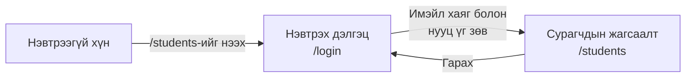
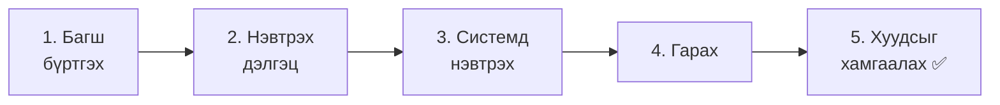
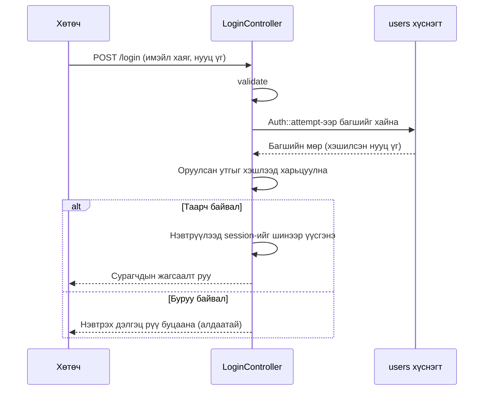
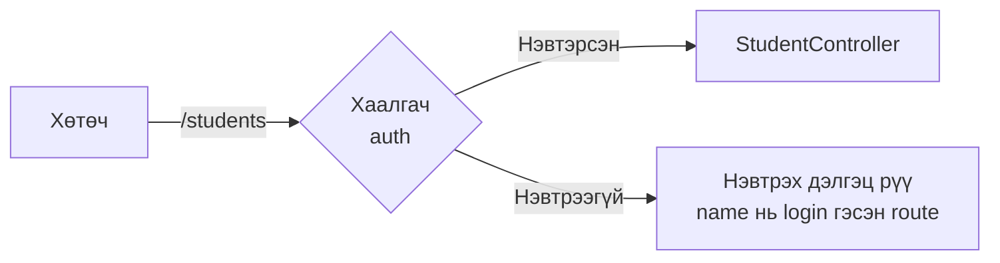
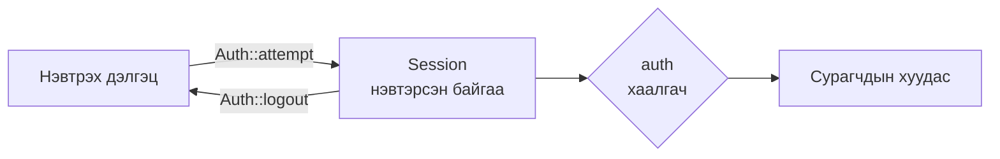

# Сурагчийн бүртгэлийн апп хийцгээе ③ — Нэвтрэлт

> 🇯🇵 Эх хувь (япон хэлээр): [20261126_資料_1.md](<../../../1年生_データ設計とアプリ開発/後期/20261126/20261126_資料_1.md>) <!-- original-ja-link -->

Сурагчдын нэр, имэйл хаяг бол **хэн дуртай нь харж болохгүй мэдээлэл** юм.
Өнөөдөр сурагчийн бүртгэлийн аппад **нэвтрэлт** нэмж, зөвхөн багш ашигладаг болгоно.

## Өнөөдрийн зорилго
- Нэвтрэлтийн ажиллах зарчмыг (нууц үгийн хэшлэлт, session) ойлгох
- Нэвтрэх дэлгэц болон гарах (logout) үйлдлийг хийж чаддаг болох
- Нэвтрээгүй хүн сурагчдын хуудсыг харж чадахгүй болгож чаддаг болох (`auth`)

> 11/19-ний «Сурагчийн бүртгэлийн апп (нэмэх, засах, устгах)» хийгдсэн төлөвөөс эхэлнэ.

---

## 1. Нэвтрэлтийн ажиллах зарчим

### Өнөөдөр хийх зүйл



- Нэвтрээгүй хүн `/students`-ийг нээвэл **нэвтрэх дэлгэц рүү шилжүүлэгдэнэ**
- Зөв имэйл хаяг, нууц үг оруулбал сурагчдын хуудсыг ашиглаж болно
- Todo аппын хуудсуудыг өмнөх шигээ хэн ч ашиглаж болно

### Багш нарыг `users` хүснэгтэд хадгална

Нэвтрэх багш нарыг Laravel-д **анхнаасаа байдаг `users` хүснэгтэд** хадгална.
(Үнэндээ дадлагын орчныг анх асаасан цагаас хойш энэ хүснэгт байсаар ирсэн)

| Багана | Утга |
|----|------|
| `name` | Багшийн нэр |
| `email` | Нэвтрэхэд ашиглах имэйл хаяг |
| `password` | Нууц үг (**хэшлээд** хадгална) |

### Нууц үгийн «хэшлэлт»

Нууц үгийг **өгөгдлийн санд шууд хэвээр нь хадгалж болохгүй**.
Хэрэв өгөгдлийн сангийн агуулга алдагдвал бүх хүний нууц үг ил болчихно.

Тиймээс нууц үгийг **хэшлээд** (буцааж сэргээх боломжгүй, утгагүй мэт тэмдэгт мөр болгон хувиргаад) хадгална.

```
Оруулсан нууц үг           Өгөгдлийн санд хадгалагдах зүйл
password          ─→     $2y$12$Kx8f3...(60 орчим тэмдэгттэй, утгагүй мэт тэмдэгт мөр)
```

| | Энгийн шифрлэлт | Хэшлэлт |
|---|---|---|
| Буцааж сэргээж болох уу? | Болно (түлхүүр байвал) | **Болохгүй** |
| Нэвтрэх үед яах вэ? | — | Оруулсан нууц үгийг мөн адил хэшлээд **харьцуулна** |

Хэшлэлтийг Laravel автоматаар хийж өгнө.

### Session: «нэвтэрсэн байгаа»-г санаж байх зарчим

Нэг удаа нэвтэрсний дараа хуудас шилжих бүрт нууц үгээ дахин оруулах нь их төвөгтэй.
Laravel **session** гэдэг зарчмаар «энэ хүн нэвтэрсэн байгаа»-г санаж байдаг.

> Жишээ нь, **тоглоомын хүрээлэнгийн нэвтрэх бугуйвч** шиг юм.
> Орох хаалган дээр (нэвтрэх дэлгэц) тасалбараа (нууц үг) үзүүлбэл бугуйвч өгнө.
> Түүнээс хойш бугуйвчаа үзүүлэхэд л ямар ч тоглоом руу (хуудас) орж болно.

---

## 2. Хийж үзье



Өөрчлөх файлууд дараах байдалтай (`src` дотор).

```
src/
├─ database/seeders/
│   ├─ UserSeeder.php ·················· 1. Багш бүртгэх (шинээр үүсгэнэ)
│   └─ DatabaseSeeder.php ·············· 1. UserSeeder-ийг дуудна
├─ app/Http/Controllers/
│   └─ LoginController.php ············· 2, 3, 4. Нэвтрэх, гарах (шинээр үүсгэнэ)
├─ resources/views/
│   ├─ login.blade.php ················· 2. Нэвтрэх дэлгэц (шинээр үүсгэнэ)
│   └─ layouts/header.blade.php ········ 4. Багшийн нэр болон гарах товч
└─ routes/web.php ······················ 2, 3, 4, 5. Route
```

---

### 1. Багш бүртгэх (Seeder)

> Одоо энд байна: **🟢 1. Багш бүртгэх** → 2. Нэвтрэх дэлгэц → 3. Нэвтрэх → 4. Гарах → 5. Хуудсыг хамгаалах

```powershell
docker compose exec laravel php artisan make:seeder UserSeeder
```

`database/seeders/UserSeeder.php`-г дараах байдлаар бичнэ.

```php
<?php

namespace Database\Seeders;

use App\Models\User;
use Illuminate\Database\Seeder;

class UserSeeder extends Seeder
{
    public function run(): void
    {
        $user = new User();
        $user->name = '山田先生';
        $user->email = 'teacher@example.com';
        $user->password = 'password';  // Хадгалах үед автоматаар хэшлэгдэнэ
        $user->save();
    }
}
```

`database/seeders/DatabaseSeeder.php`-ийн **хамгийн дээд хэсэгт** ★ тэмдэгтэй 1 мөрийг нэмж бичнэ.

```php
    public function run(): void
    {
        $this->call(UserSeeder::class);  // ★ Нэмэх
        $this->call(TodoSeeder::class);
        $this->call(StudentSeeder::class);
    }
```

```powershell
docker compose exec laravel php artisan migrate:fresh --seed
```

✅ **Шалгах**: phpMyAdmin дээр `users` хүснэгтийг нээж үзээрэй.
Ямада багшийн `password` нь `password` биш, **`$2y$12$...` гэх мэт утгагүй мэт тэмдэгт мөр** болсон байвал болно.

> **Яагаад автоматаар хэшлэгддэг вэ?**
> `app/Models/User.php`-г нээвэл `'password' => 'hashed'` гэсэн 1 мөр байгаа.
> Энэ бол «`password`-д утга оруулбал автоматаар хэшлээрэй» гэсэн тохиргоо. Laravel анхнаасаа бичээд өгчихсөн байдаг.

> ⚠️ **phpMyAdmin дээр багшийг шууд бүү нэм**
> phpMyAdmin дээр `password`-д `password` гэж оруулбал хэшлэгдэхгүйгээр шууд хэвээрээ хадгалагдаж, нэвтэрч чадахгүй болно.
> Багшийг Seeder-ээр (эсвэл дараа нь хийх төрлийн дэлгэцээр) бүртгэнэ.

---

### 2. Нэвтрэх дэлгэц хийх

> Одоо энд байна: 1. Багш бүртгэх → **🟢 2. Нэвтрэх дэлгэц** → 3. Нэвтрэх → 4. Гарах → 5. Хуудсыг хамгаалах

#### ① Контроллер үүсгэх

```powershell
docker compose exec laravel php artisan make:controller LoginController
```

`app/Http/Controllers/LoginController.php`-г дараах байдлаар бичнэ.

```php
<?php

namespace App\Http\Controllers;

use Illuminate\Http\Request;
use Illuminate\Support\Facades\Auth;

class LoginController extends Controller
{
    // Нэвтрэх дэлгэцийг харуулна
    public function showForm()
    {
        return view('login');
    }
}
```

#### ② View үүсгэх

`resources/views/login.blade.php` файл үүсгэнэ.

```html
@include('layouts.header', ['title' => 'ログイン'])

    <h1>ログイン</h1>

    <form method="POST" action="/login">
        @csrf

        <p>
            メールアドレス：
            <input type="email" name="email" value="{{ old('email') }}" required>
        </p>

        <p>
            パスワード：
            <input type="password" name="password" required>
        </p>

        @error('email')
            <p style="color: red;">{{ $message }}</p>
        @enderror

        <button type="submit">ログイン</button>
    </form>

@include('layouts.footer')
```

| Код | Утга |
|--------|------|
| `type="password"` | Оруулсан тэмдэгтүүд `●●●` гэж харагддаг оруулах талбар |
| Нууц үгэнд `old()` байхгүй | Аюулгүй байдлын үүднээс алдаанаас болж буцаж ирсэн ч нууц үгийг үлдээхгүй |

#### ③ Route бичих

`routes/web.php`-д ★ тэмдэгтэй хэсгийг нэмж бичнэ.

```php
use App\Http\Controllers\LoginController;  // ★ Нэмэх (дээд хэсэгт бичнэ)

Route::get('/login', [LoginController::class, 'showForm'])->name('login');  // ★ Нэмэх
```

| Код | Утга |
|--------|------|
| `->name('login')` | Энэ route-д `login` гэсэн **нэр** өгнө |

> **Яагаад нэр өгдөг вэ?**
> Дараа нь «5. Хуудсыг хамгаалах» хэсэгт нэвтрээгүй хүнийг **нэвтрэх дэлгэц рүү шилжүүлэх** зарчмыг ашиглана.
> Тэр үед Laravel `login` гэсэн нэртэй route-ийг хайж олоод тийш нь шилжүүлдэг. Нэр байхгүй бол хаашаа шилжүүлэхээ мэдэхгүй.

✅ **Шалгах**: http://localhost:8000/login -ийг нээгээд нэвтрэх дэлгэц гарч ирвэл болно.

---

### 3. Нэвтрэх боломжтой болгох

> Одоо энд байна: 1. Багш бүртгэх → 2. Нэвтрэх дэлгэц → **🟢 3. Нэвтрэх** → 4. Гарах → 5. Хуудсыг хамгаалах

#### ① login метод бичих

`LoginController.php`-д ★ тэмдэгтэй `login`-г нэмж бичнэ.

```php
    // ★ Эндээс нэмэх
    public function login(Request $request)
    {
        // ① Оруулсан утгыг шалгана
        $credentials = $request->validate([
            'email' => 'required|email',
            'password' => 'required',
        ]);

        // ② Имэйл хаяг болон нууц үг зөв эсэхийг шалгана
        if (Auth::attempt($credentials)) {
            // ③ Зөв бол session-ийг шинээр үүсгээд сурагчдын жагсаалт руу
            $request->session()->regenerate();

            return redirect()->intended('/students');
        }

        // ④ Буруу бол нэвтрэх дэлгэц рүү буцаана
        return back()->withErrors([
            'email' => 'メールアドレスかパスワードがちがいます。',
        ])->onlyInput('email');
    }
    // ★ Энд хүртэл
```

| Код | Утга |
|--------|------|
| `$credentials = $request->validate([...])` | Шалгасны дараа `email` болон `password`-г гаргаж авна |
| `Auth::attempt($credentials)` | `users` хүснэгтээс тухайн имэйл хаягтай багшийг хайж, нууц үгийг хэшлээд харьцуулна. Таарвал **нэвтрүүлээд** `true` буцаана |
| `$request->session()->regenerate()` | Session-ийг (бугуйвчийг) шинээр үүсгэнэ. Өөр хүний бугуйвчийг ашиглахаас сэргийлэхийн тулд |
| `redirect()->intended('/students')` | Нэвтрэхээс өмнө нээх гэж байсан хуудас руу буцна. Тийм хуудас байхгүй бол `/students` руу |
| `back()->withErrors([...])` | Өмнөх хуудас (нэвтрэх дэлгэц) руу буцааж, алдааны мессеж гаргана |
| `->onlyInput('email')` | Буцах үед зөвхөн имэйл хаягийг үлдээнэ (нууц үгийг үлдээхгүй) |

Нэвтрэх урсгалыг зургаар үзүүлбэл дараах байдалтай.



> **«Имэйл хаяг эсвэл нууц үг буруу байна» гэж нийлүүлж хэлдгийн шалтгаан**
> «Энэ имэйл хаяг бүртгэгдээгүй байна» гэж хэлчихвэл муу санаатай хүн «энэ имэйл хаяг бүртгэлтэй юм байна» гэдгийг мэдчихнэ.
> Аль нь буруу байгааг зориуд хэлдэггүй.

#### ② Route нэмж бичих

```php
Route::get('/login', [LoginController::class, 'showForm'])->name('login');
Route::post('/login', [LoginController::class, 'login']);  // ★ Нэмэх
```

✅ **Шалгах**: Нэвтрэх дэлгэц дээр дараах 2 зүйлийг туршиж үзээрэй.

| Оруулах утга | Ингэж гарвал болно |
|------|------------|
| `teacher@example.com` ／ `password` | Сурагчдын жагсаалт руу шилжинэ |
| `teacher@example.com` ／ `abc` | 「メールアドレスかパスワードがちがいます。」(Имэйл хаяг эсвэл нууц үг буруу байна.) гэж гарна |

---

### 4. Гарах болон нэвтэрсэн төлөвийн харагдац

> Одоо энд байна: 1. Багш бүртгэх → 2. Нэвтрэх дэлгэц → 3. Нэвтрэх → **🟢 4. Гарах** → 5. Хуудсыг хамгаалах

#### ① logout метод бичих

`LoginController.php`-д ★ тэмдэгтэй `logout`-г нэмж бичнэ.

```php
    // ★ Эндээс нэмэх
    public function logout(Request $request)
    {
        Auth::logout();

        $request->session()->invalidate();
        $request->session()->regenerateToken();

        return redirect('/login');
    }
    // ★ Энд хүртэл
```

| Код | Утга |
|--------|------|
| `Auth::logout()` | Системээс гарна |
| `$request->session()->invalidate()` | Session-ийг (бугуйвч) хүчингүй болгоно |
| `$request->session()->regenerateToken()` | `@csrf`-ийн токеныг мөн шинээр үүсгэнэ |

#### ② Route нэмж бичих

```php
Route::post('/logout', [LoginController::class, 'logout']);  // ★ Нэмэх
```

> **Гарах үйлдэл ч POST**
> Гарах нь «нэвтэрсэн байгаа» гэсэн **төлөвийг өөрчилдөг** үйлдэл учраас холбоосоор (GET) биш, формын товчоор (POST) илгээнэ.
> (10/29-нд сурсан «өгөгдөл өөрчлөх үед формын товчоор илгээнэ» гэсэн санаатай адилхан)

#### ③ Header-т багшийн нэр болон гарах товчийг харуулах

`resources/views/layouts/header.blade.php`-д ★ тэмдэгтэй хэсгийг нэмж бичнэ.

```html
    <header>
        <a href="/todos">TODOアプリ</a>
        <a href="/students">生徒管理</a>

        {{-- ★ Эндээс нэмэх --}}
        @auth
            {{ Auth::user()->name }} さん
            <form method="POST" action="/logout" style="display: inline;">
                @csrf
                <button type="submit">ログアウト</button>
            </form>
        @endauth

        @guest
            <a href="/login">ログイン</a>
        @endguest
        {{-- ★ Энд хүртэл --}}
    </header>
```

| Код | Утга |
|--------|------|
| `@auth` ~ `@endauth` | **Нэвтэрсэн үед** л харуулна |
| `@guest` ~ `@endguest` | **Нэвтрээгүй үед** л харуулна |
| `Auth::user()->name` | Нэвтэрсэн багшийн нэр |

✅ **Шалгах**: Нэвтэрвэл header дээр 「山田先生 さん」(Ямада багш) болон 「ログアウト」(Гарах) товч гарч ирнэ.
「ログアウト」(Гарах)-ыг дарахад нэвтрэх дэлгэц рүү буцаж, header нь 「ログイン」(Нэвтрэх) холбоос болж өөрчлөгдвөл болно.
(Header нь бүрэлдэхүүн хэсэг учраас Todo-ийн хуудсан дээр ч адилхан гарна)

---

### 5. Нэвтрээгүй хүнээс хуудсыг хамгаалах

> Одоо энд байна: 1. Багш бүртгэх → 2. Нэвтрэх дэлгэц → 3. Нэвтрэх → 4. Гарах → **🟢 5. Хуудсыг хамгаалах**

Одоогийн байдлаар нэвтрээгүй байсан ч `/students`-ийг нээж чадна.
`routes/web.php`-ийн сурагчдын route-уудыг ★ шиг **`auth` бүлгээр** хүрээлнэ.

```php
// ★ Эндээс: зөвхөн нэвтэрсэн хүн ашиглаж болох route-ууд
Route::middleware('auth')->group(function () {
    Route::get('/students', [StudentController::class, 'index']);
    Route::get('/students/create', [StudentController::class, 'create']);
    Route::post('/students', [StudentController::class, 'store']);
    Route::get('/students/{id}', [StudentController::class, 'show']);
    Route::get('/students/{id}/edit', [StudentController::class, 'edit']);
    Route::put('/students/{id}', [StudentController::class, 'update']);
    Route::delete('/students/{id}', [StudentController::class, 'destroy']);
});
// ★ Энд хүртэл
```

| Код | Утга |
|--------|------|
| `Route::middleware('auth')` | «Нэвтэрсэн эсэх»-ийг route-ийн **өмнө** шалгана |
| `->group(function () { ... })` | `{ }` доторх **бүх** route-д тэр шалгалтыг нэмнэ |

**Middleware** бол контроллерийн **өмнө зогсох хаалгач** шиг зүйл юм.



✅ **Шалгах**: Дараах дарааллаар туршиж үзээрэй.

1. Гарсны дараа http://localhost:8000/students -ийг нээх → **Нэвтрэх дэлгэц рүү шилжүүлэгдэнэ**
2. Шууд нэвтрэх → **Сурагчдын жагсаалт руу буцна** (`intended`-ийн ачаар)
3. Гараад http://localhost:8000/todos -ийг нээх → **Todo-г нэвтрэлгүйгээр ашиглаж болно**

---

## 3. Route-уудын тойм

`routes/web.php`-ийн нэвтрэлт болон сурагчдын route-ууд дараах байдалтай болсон.

```php
// Нэвтрэх, гарах
Route::get('/login', [LoginController::class, 'showForm'])->name('login');
Route::post('/login', [LoginController::class, 'login']);
Route::post('/logout', [LoginController::class, 'logout']);

// Зөвхөн нэвтэрсэн хүнд
Route::middleware('auth')->group(function () {
    Route::get('/students', [StudentController::class, 'index']);
    // … (сурагчдын 7 route)
});
```

---

## 4. Болохгүй байвал

> **🔥 Ажиллахгүй бол лог гарга!** → [【Чухал】Лог хэрхэн гаргах вэ](../20261022/【重要】ログの出し方.md)

| Шинж тэмдэг | Шалтгаан байгаа газар | Шийдэл |
|------|----------|------|
| `Route [login] not defined.` | Route | `/login`-ийн route-д `->name('login')` залгасан эсэхийг шалгах |
| Зөв байх ёстой атал нэвтэрч чадахгүй | Өгөгдөл | phpMyAdmin дээр багшийн `password` нь `$2y$...` болсон эсэхийг шалгах. Нууц үг хэшлэгдээгүй хэвээр байвал `migrate:fresh --seed`-ээр Seeder-ээс дахин оруулах |
| `Class "App\Http\Controllers\Auth" not found` | Контроллер | `LoginController.php`-ийн дээд хэсэгт `use Illuminate\Support\Facades\Auth;` байгаа эсэхийг шалгах |
| Гарах товчийг дарахад `419 Page Expired` гарна | View | Гарах форм дээр `@csrf` байгаа эсэхийг шалгах (дадлагын орчинд `@csrf` байхгүй байсан ч гарахгүй тохиолдол бий) |
| Гарах холбоосыг дарахад `The GET method is not supported` гарна | View | Гарах үйлдлийг `<a>` биш, `<form method="POST">`-ийн товч болгох |
| Нэвтрээгүй байхад сурагчдын хуудсыг харж чадаж байна | Route | Сурагчдын route-ууд `Route::middleware('auth')->group(...)`-ийн `{ }`-ийн **дотор** байгаа эсэхийг шалгах |

---

## 5. Дүгнэлт



| Өнөөдөр бичсэн зүйл | Товчхондоо |
|--------------|-----------|
| `'password' => 'hashed'` (User модель) | Нууц үгийг автоматаар хэшилнэ (анхнаасаа бичигдсэн байдаг) |
| `Auth::attempt($credentials)` | Имэйл хаяг болон нууц үг зөв бол нэвтрүүлнэ |
| `$request->session()->regenerate()` | Нэвтэрсний дараа session-ийг шинээр үүсгэнэ |
| `Auth::logout()` | Системээс гарна |
| `@auth`, `@guest` | Нэвтэрсэн үед, нэвтрээгүй үед л харуулна |
| `Auth::user()` | Нэвтэрсэн багш |
| `Route::middleware('auth')->group(...)` | Зөвхөн нэвтэрсэн хүн ашиглаж болох route болгоно |
| `->name('login')` | Нэвтрээгүй хүнийг шилжүүлэх газар |

**Нууц үгийг хэшилнэ. Нэвтэрсэн төлөвийг session хадгална. Хуудсыг middleware хамгаална.**

> **2-р курст** энэ session-ий оронд **token** (Sanctum)-оор нэвтрэлтийг шалгадаг зарчим болгон өөрчилж хийнэ.
> Учир нь дэлгэцгүй API-д «бугуйвч»-ийн оронд «нууц кодын тэмдэгт мөр»-ийг хүсэлт болгонд хамт илгээдэг.

Дараагийн хичээлээр сурагчийг **аль багш бүртгэснийг** тэмдэглэж чаддаг болгоно (relation).

<!-- nav:start -->

---

| ⬅️ Өмнөх | 🗺️ Ерөнхий зураг | Дараагийнх ➡️ |
|:--|:--:|--:|
| [11/19 Сурагчийн бүртгэл ② Нэмэх, засах, устгах](../20261119/20261119_資料_2.md) | [Материалын ерөнхий зураг](../../README.md) | [12/03 Сурагчийн бүртгэл ④ Холбоос (relation)](../20261203/20261203_資料_1.md) |

<!-- nav:end -->
