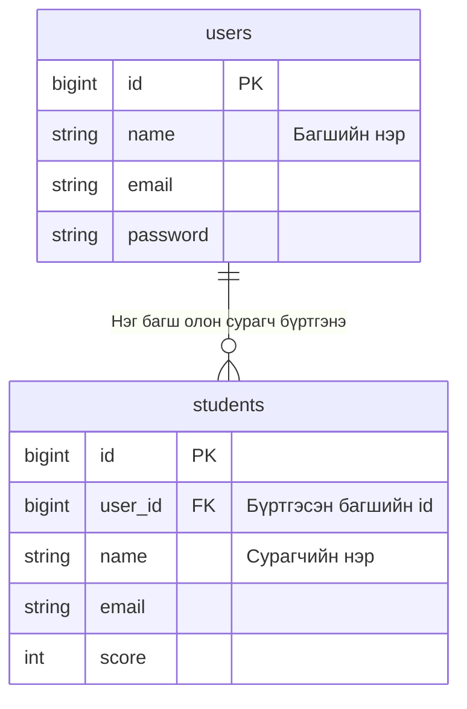
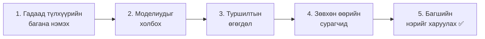
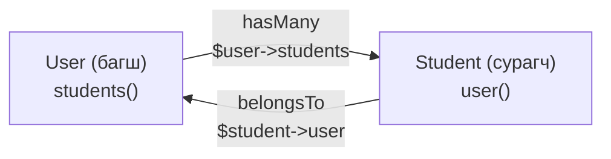
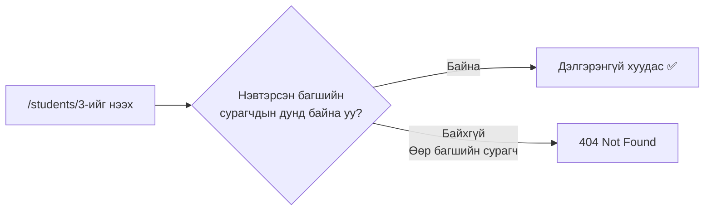
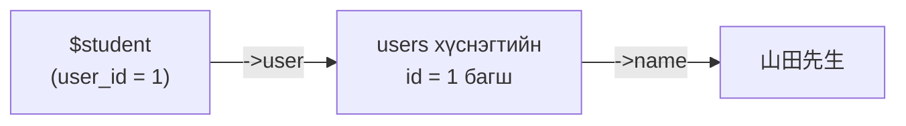
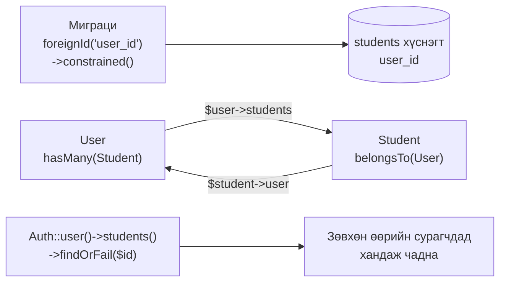

# Сурагчийн бүртгэлийн апп хийцгээе ④ — Холбоос (relation): багш, сурагчийг холбох

> 🇯🇵 Эх хувь (япон хэлээр): [20261203_資料_1.md](<../../../1年生_データ設計とアプリ開発/後期/20261203/20261203_資料_1.md>) <!-- original-ja-link -->

Өмнөх хичээлээр багш нэвтэрч чаддаг боллоо.
Гэхдээ одоогоор **аль ч багш нэвтэрсэн байсан, бүх сурагч харагдаж** байна.
Өнөөдөр сурагч бүрийг **аль багш бүртгэснийг** хадгалж, **зөвхөн өөрийн сурагчдаа** удирдаж чаддаг болгоно.

## Өнөөдрийн зорилго
- Нэгээс олон холбоог ER диаграм болон хүснэгтээр (гадаад түлхүүр) илэрхийлж чаддаг болох
- `hasMany`・`belongsTo` ашиглан моделиудыг хооронд нь холбож чаддаг болох
- Нэвтэрсэн багшийн сурагчдыг л жагсаалтаар харах, дэлгэрэнгүйг нь үзэх, засах, устгах боломжтой болгох

> 11/26-ны «Нэвтрэх» хэсэг ажиллаж байгаа төлөвөөс эхэлнэ.

---

## 1. Багш ба сурагчийн холбоо

### Нэг багш олон сурагчийг хариуцна



| Багш (users) | Сурагч (students) |
|--------------|-----------------|
| Ямада багш (id: 1) | Ямада багшийн сурагч 15 |
| Сато багш (id: 2) | Сато багшийн сурагч 15 |

Ийм холбоог **нэгээс олон** холбоо гэнэ.

- Багшийн талаас харвал сурагч **олон** (олон тал)
- Сурагчийн талаас харвал багш **нэг** (1)

### Гадаад түлхүүр: сурагчид «багшийн дугаар»-ыг хадгалуулах

Сурагчийн хүснэгтэд **бүртгэсэн багшийн `id`**-г хадгалах багана (`user_id`) нэмнэ.

| id | **user_id** | name | email | score |
|----|------------|------|-------|-------|
| 1 | **1** | 田中 一郎 | … | 85 |
| 2 | **1** | 鈴木 花子 | … | 92 |
| 3 | **2** | 高橋 次郎 | … | 70 |

`user_id` нь `1` байгаа сурагчид Ямада багшийнх, `2` байгаа сурагчид Сато багшийнх юм.

Ийм **өөр хүснэгтийн `id`-г хадгалдаг багана**-г **гадаад түлхүүр** (foreign key) гэнэ.

> **Яагаад багшийн «нэр»-ийг биш, «id»-г хадгалдаг вэ?**
> Нэрийг хадгалбал багш нэрээ солих үед сурагчийн бүх мөрийг засах хэрэгтэй болно.
> `id` байвал багшийн нэр өөрчлөгдсөн ч сурагчийн мөрүүдийг засах шаардлагагүй.

---

## 2. Хийж үзье



Өөрчлөх файлууд нь дараах байдалтай (`src` дотор).

```
src/
├─ database/
│   ├─ migrations/xxxx_add_user_id_to_students_table.php ··· 1. Шинээр үүсгэнэ
│   ├─ factories/StudentFactory.php ························· 3. user_id нэмнэ
│   └─ seeders/
│       ├─ UserSeeder.php ··································· 3. Багшийн тоог 2 болгоно
│       └─ StudentSeeder.php ································ 3. Багш бүрт сурагч үүсгэнэ
├─ app/Models/
│   ├─ User.php ············································· 2. students() нэмнэ
│   └─ Student.php ·········································· 2. user() нэмнэ
├─ app/Http/Controllers/StudentController.php ··············· 4. Зөвхөн өөрийн сурагчдад ханддаг болгоно
└─ resources/views/students/show.blade.php ·················· 5. Багшийн нэрийг харуулна
```

---

### 1. Гадаад түлхүүрийн багана нэмэх (миграци)

> Одоо энд байна: **🟢 1. Гадаад түлхүүр** → 2. Модель → 3. Туршилтын өгөгдөл → 4. Зөвхөн өөрийн сурагчид → 5. Багшийн нэр

11/12-нд сурсан **багана нэмэх миграци**-ийг үүсгэнэ.

```powershell
docker compose exec laravel php artisan make:migration add_user_id_to_students_table
```

`up()` болон `down()`-ийн доторх кодыг дараах байдлаар бичнэ.

```php
    public function up(): void
    {
        Schema::table('students', function (Blueprint $table) {
            $table->foreignId('user_id')
                ->after('id')
                ->constrained()
                ->cascadeOnDelete();
        });
    }

    public function down(): void
    {
        Schema::table('students', function (Blueprint $table) {
            $table->dropForeign(['user_id']);
            $table->dropColumn('user_id');
        });
    }
```

| Код | Утга |
|--------|------|
| `foreignId('user_id')` | Гадаад түлхүүрт зориулсан `user_id` багана нэмнэ (`id`-тай адил том бүхэл тооны багана) |
| `->after('id')` | `id` баганын ард нэмнэ (харахад хялбар болгох үүднээс) |
| `->constrained()` | `user_id`-д **зөвхөн `users` хүснэгтэд байгаа `id`-г л оруулж болдог** болгоно (гадаад түлхүүрийн хязгаарлалт) |
| `->cascadeOnDelete()` | Багш устгагдвал тухайн багшийн сурагчдыг хамт устгана |
| `dropForeign` → `dropColumn` | Буцаахдаа эхлээд хязгаарлалтыг авч хаяад, дараа нь баганыг устгана |

> **`constrained()` яаж «`users` хүснэгт» гэдгийг мэддэг вэ?**
> Баганын нэр нь `user_id` учраас. Laravel «`user_id` бол `users` хүснэгтийн `id` байх нь» гэж өөрөө ойлгодог.

**Одоохондоо `migrate` хийхгүй.** Шалтгааныг «3. Туршилтын өгөгдөл» хэсэгт тайлбарлана.

---

### 2. Моделиудыг холбох (hasMany・belongsTo)

> Одоо энд байна: 1. Гадаад түлхүүр → **🟢 2. Модель** → 3. Туршилтын өгөгдөл → 4. Зөвхөн өөрийн сурагчид → 5. Багшийн нэр

Зөвхөн хүснэгтүүдийг холбоод зогсвол PHP кодоос «энэ багшийн сурагчид»-ыг авч чадахгүй.
**Модельд ч бас холбоосоо бичнэ.**

#### ① Багшид (User) «олон сурагчтай» гэж бичих

`app/Models/User.php`-д ★ тэмдэгтэй хэсгийг нэмж бичнэ.

```php
use Illuminate\Database\Eloquent\Relations\HasMany;  // ★ Нэмэх (дээд талын use-уудын дунд)

class User extends Authenticatable
{
    // (Анхнаасаа байгаа кодыг хэвээр нь үлдээнэ)

    // ★ Эндээс нэмэх: энэ багшийн бүртгэсэн сурагчид
    public function students(): HasMany
    {
        return $this->hasMany(Student::class);
    }
    // ★ Энд хүртэл
}
```

#### ② Сурагчид (Student) «нэг багштай» гэж бичих

`app/Models/Student.php`-д ★ тэмдэгтэй хэсгийг нэмж бичнэ.

```php
<?php

namespace App\Models;

use Illuminate\Database\Eloquent\Factories\HasFactory;
use Illuminate\Database\Eloquent\Model;
use Illuminate\Database\Eloquent\Relations\BelongsTo;  // ★ Нэмэх

class Student extends Model
{
    /** @use HasFactory<\Database\Factories\StudentFactory> */
    use HasFactory;

    // ★ Эндээс нэмэх: энэ сурагчийг бүртгэсэн багш
    public function user(): BelongsTo
    {
        return $this->belongsTo(User::class);
    }
    // ★ Энд хүртэл
}
```

| Модель | Бичсэн зүйл | Утга | Хэрэглэх арга |
|--------|----------|------|-------|
| `User` | `hasMany(Student::class)` | Багш **олон** сурагчтай (has many) | `$user->students`-ээр тухайн багшийн **бүх** сурагчийг авна |
| `Student` | `belongsTo(User::class)` | Сурагч нэг багшид **харьяалагдана** (belongs to) | `$student->user`-ээр тухайн сурагчийн **нэг** багшийг авна |



> **Нэрлэх дүрэм**
> «Олон» талыг **олон тоогоор** (`students`), «нэг» талыг **ганц тоогоор** (`user`) нэрлэнэ.
> Англиар уншихад `$user->students` (багшийн сурагчид), `$student->user` (сурагчийн багш) гэж ойлгомжтой уншигдана.

---

### 3. Туршилтын өгөгдлийг дахин үүсгэх

> Одоо энд байна: 1. Гадаад түлхүүр → 2. Модель → **🟢 3. Туршилтын өгөгдөл** → 4. Зөвхөн өөрийн сурагчид → 5. Багшийн нэр

#### Яагаад `migrate` биш `migrate:fresh` вэ?

Одоогийн `students` хүснэгтэд 30 сурагч байгаа.
Үүнд `user_id` багана нэмбэл **одоо байгаа 30 сурагчийн `user_id`-д юу оруулах вэ?**
`constrained()` байгаа тул `users` хүснэгтэд байхгүй дугаарыг оруулж болохгүй.

Тиймээс энэ удаа `migrate:fresh --seed`-ээр **хүснэгтийг шинээр үүсгэж, багштай нь холбосон сурагчдыг дахин оруулна**.
Үүний тулд эхлээд Seeder болон Factory-г засна.

#### ① Багшийн тоог 2 болгох (UserSeeder)

`database/seeders/UserSeeder.php`-ийн `run()`-д ★ тэмдэгтэй 2 дахь багшийг нэмж бичнэ.

```php
    public function run(): void
    {
        $user = new User();
        $user->name = '山田先生';
        $user->email = 'teacher@example.com';
        $user->password = 'password';
        $user->save();

        // ★ Эндээс нэмэх
        $user = new User();
        $user->name = '佐藤先生';
        $user->email = 'teacher2@example.com';
        $user->password = 'password';
        $user->save();
        // ★ Энд хүртэл
    }
```

#### ② Багш бүрт 15 сурагч үүсгэх (StudentSeeder)

`database/seeders/StudentSeeder.php`-ийн `run()`-ийг дараах байдлаар өөрчилнө.

```php
<?php

namespace Database\Seeders;

use App\Models\Student;
use App\Models\User;  // ★ Нэмэх
use Illuminate\Database\Seeder;

class StudentSeeder extends Seeder
{
    public function run(): void
    {
        // Багш бүрт 15 сурагч үүсгэнэ
        foreach (User::all() as $user) {
            Student::factory()->count(15)->for($user)->create();
        }
    }
}
```

| Код | Утга |
|--------|------|
| `User::all()` | Бүх багшийг авчирна |
| `->for($user)` | «Энэ багшийн сурагч болгож үүсгээрэй» гэсэн үг. `user_id`-д `$user->id` орно |

#### ③ Factory-д ч бас user_id нэмэх (StudentFactory)

`database/factories/StudentFactory.php`-ийн `definition()`-д ★ тэмдэгтэй 1 мөрийг нэмж бичнэ.

```php
use App\Models\User;  // ★ Нэмэх (дээд талд бичнэ)

    public function definition(): array
    {
        return [
            'user_id' => User::factory(),  // ★ Нэмэх
            'name' => fake('ja_JP')->name(),
            'email' => fake()->unique()->safeEmail(),
            'score' => fake()->numberBetween(0, 100),
        ];
    }
```

`User::factory()` нь «багш заагаагүй бол нэг багш мөн үүсгээрэй» гэсэн утгатай.
Өнөөдрийн Seeder дээр `->for($user)`-ээр багшийг зааж өгсөн тул шинэ багш үүсэхгүй.

#### ④ Дахин үүсгэх

```powershell
docker compose exec laravel php artisan migrate:fresh --seed
```

✅ **Шалгах**: phpMyAdmin дээр дараах 2 зүйлийг шалгаарай.

- `users` хүснэгтэд Ямада багш, Сато багш гэсэн 2 багш байгаа
- `students` хүснэгтэд `user_id` багана байгаа бөгөөд `1`-тэй сурагч 15, `2`-той сурагч 15 байгаа

---

### 4. Зөвхөн өөрийн сурагчдыг харж чаддаг болгох

> Одоо энд байна: 1. Гадаад түлхүүр → 2. Модель → 3. Туршилтын өгөгдөл → **🟢 4. Зөвхөн өөрийн сурагчид** → 5. Багшийн нэр

`app/Http/Controllers/StudentController.php`-ийг өөрчилнө.
Дээд талд нь `use Illuminate\Support\Facades\Auth;`-ийг нэмж бичээд, ★ тэмдэгтэй хэсгүүдийг өөрчилнө.

```php
use Illuminate\Support\Facades\Auth;  // ★ Нэмэх
```

#### ① Жагсаалт (index): зөвхөн өөрийн сурагчид

```php
    public function index()
    {
        $students = Auth::user()->students;  // ★ Student::all()-аас өөрчилнө

        return view('students.index', ['students' => $students]);
    }
```

`Auth::user()` нь нэвтэрсэн байгаа багш юм.
`->students`-ээр **тухайн багшийн сурагчдыг л** авна. Энэ нь 2-т бичсэн `hasMany`-ийн ачаар боломжтой болж байгаа юм.

#### ② Нэмэх (store): бүртгэсэн багшийг хадгалах

```php
        $student = new Student();
        $student->user_id = Auth::id();  // ★ Нэмэх: нэвтэрсэн багшийн id
        $student->name = $request->input('name');
        $student->email = $request->input('email');
        $student->score = $request->input('score');
        $student->save();
```

| Код | Утга |
|--------|------|
| `Auth::id()` | Нэвтэрсэн багшийн `id` |

#### ③ Дэлгэрэнгүй・засах・устгах: зөвхөн өөрийн сурагчдад хандаж чаддаг болгох

`show`・`edit`・`update`・`destroy` гэсэн 4 функцэд байгаа `Student::findOrFail($id)`-г **бүгдийг нь** дараах байдлаар өөрчилнө.

```php
        // Өөрчлөхийн өмнө
        $student = Student::findOrFail($id);

        // Өөрчилсний дараа
        $student = Auth::user()->students()->findOrFail($id);
```

`Auth::user()->students()` нь «нэвтэрсэн багшийн сурагчдын дундаас», `findOrFail($id)` нь «`id` нь таарах сурагчийг хайх» гэсэн утгатай.
**Өөр багшийн сурагчийн `id`-гаар хандах гэвэл тэр сурагч олдохгүй тул `404 Not Found`** гарна.



> **`students` ба `students()`-ийн ялгаа**
>
> | Бичих хэлбэр | Утга | Хэрэглэх үе |
> |-------|------|---------|
> | `Auth::user()->students` | Тухайн багшийн сурагчдыг **бүгдийг нь авчирна** | Жагсаалт (бүгд хэрэгтэй) |
> | `Auth::user()->students()` | «Тухайн багшийн сурагчдын дундаас» гэсэн **нөхцөлийг л** тавина. Араас нь `->findOrFail($id)` гэх мэтийг үргэлжлүүлж бичиж болно | Дэлгэрэнгүй・засах・устгах (нэг хүнийг хайх) |

✅ **Шалгах**: дараах дарааллаар туршиж үзээрэй.

| Хийх зүйл | Ийм болбол OK |
|---------|------------|
| Ямада багшаар (`teacher@example.com`) нэвтэрч жагсаалтыг нээх | Зөвхөн 15 сурагч харагдана |
| Нэг сурагч нэмэх | phpMyAdmin дээр нэмсэн сурагчийн `user_id` нь `1` болсон байна |
| Жагсаалтаас нэг сурагчийн дэлгэрэнгүй хуудсыг нээж, URL дахь дугаарыг тэмдэглэж авах (жишээ нь `/students/3`) | — |
| Гарч (logout), Сато багшаар (`teacher2@example.com`) нэвтрэх | Жагсаалтад Ямада багшийнхаас өөр 15 сурагч харагдана |
| Тэмдэглэж авсан Ямада багшийн сурагчийн URL-ийг шууд нээх | **`404 Not Found`** гарна (өөр багшийн сурагчийг харж чадахгүй) |

---

### 5. Дэлгэрэнгүй хуудсанд бүртгэсэн багшийн нэрийг харуулах

> Одоо энд байна: 1. Гадаад түлхүүр → 2. Модель → 3. Туршилтын өгөгдөл → 4. Зөвхөн өөрийн сурагчид → **🟢 5. Багшийн нэр**

`resources/views/students/show.blade.php`-д ★ тэмдэгтэй 1 мөрийг нэмж бичнэ.

```html
    <p>番号：{{ $student->id }}</p>
    <p>メールアドレス：{{ $student->email }}</p>
    <p>点数：{{ $student->score }}点</p>
    <p>登録した先生：{{ $student->user->name }}</p>  {{-- ★ Нэмэх --}}
```

`$student->user`-ээр тухайн сурагчийн багшийг (`belongsTo`), `->name`-ээр тэр багшийн нэрийг авна.
SQL-ийн `JOIN` бичихгүйгээр Laravel `users` хүснэгтээс авчирч өгдөг.

✅ **Шалгах**: дэлгэрэнгүй хуудсанд «登録した先生：山田先生» (Бүртгэсэн багш: Ямада багш) гэх мэтээр харагдвал OK.



---

## 3. Болохгүй байвал

> **🔥 Ажиллахгүй байвал логоо гарга!** → [【Чухал】Лог хэрхэн гаргах вэ](../20261022/【重要】ログの出し方.md)

| Шинж тэмдэг | Шалтгааны байршил | Шийдэл |
|------|----------|------|
| `migrate` хийхэд `Cannot add or update a child row: a foreign key constraint fails` | Миграци | Одоо байгаа сурагчдад оноох багш байхгүй. `migrate:fresh --seed`-ээр дахин үүсгэнэ |
| `Call to undefined method App\Models\User::students()` | Модель | `User.php`-д `students()` метод бичсэн эсэхийг шалгана |
| `Return value must be of type App\Models\HasMany` | Модель | `User.php`-ийн дээд талд `use Illuminate\Database\Eloquent\Relations\HasMany;` байгаа эсэхийг шалгана (`Student.php`-ийн `BelongsTo` ч мөн адил) |
| Жагсаалтад бүх (30) сурагч гарч байна | Контроллер | `index` нь `Auth::user()->students` болсон эсэхийг шалгана |
| Өөр багшийн сурагчийн дэлгэрэнгүй хуудас харагдаж байна | Контроллер | `show`・`edit`・`update`・`destroy` **4-үүлэнг нь** `Auth::user()->students()->findOrFail($id)` болгож өөрчилсөн эсэхийг шалгана |
| Сурагч нэмэхэд `Field 'user_id' doesn't have a default value` | Контроллер | `store`-д `$student->user_id = Auth::id();` байгаа эсэхийг шалгана |
| Багшийн нэрийн хэсэгт `Attempt to read property "name" on null` | Модель・өгөгдөл | `Student.php`-д `user()` бичсэн эсэх, тухайн сурагчийн `user_id`-тай багш байгаа эсэхийг шалгана |

---

## 4. Дүгнэлт



| Өнөөдөр бичсэн зүйл | Товчхондоо |
|--------------|-----------|
| `foreignId('user_id')->constrained()` | Гадаад түлхүүрийн багана нэмж, зөвхөн `users`-д байгаа `id`-г оруулж болдог болгоно |
| `hasMany(Student::class)` | Багш олон сурагчтай (`$user->students`) |
| `belongsTo(User::class)` | Сурагч нэг багшид харьяалагдана (`$student->user`) |
| `->for($user)` (Factory) | Энэ багшийн сурагч болгож туршилтын өгөгдөл үүсгэнэ |
| `Auth::id()` | Нэвтэрсэн багшийн `id` |
| `Auth::user()->students` | Нэвтэрсэн багшийн бүх сурагч |
| `Auth::user()->students()->findOrFail($id)` | Өөрийн сурагчдын дундаас нэгийг хайна. Өөр багшийн сурагч бол 404 |

**Хүснэгтүүдийг гадаад түлхүүрээр холбоно. Моделиудыг hasMany・belongsTo-гоор холбоно.**

Ингээд сурагч удирдах апп бэлэн боллоо 🎉
Жагсаалт харах, нэмэх, дэлгэрэнгүй үзэх, засах, устгах (CRUD), нэвтрэх, холбоос гээд вэб аппын чухал бүтцүүд бүгд бүрдлээ.

> **2-р курст** энэ аппыг **API** болгон өөрчилнө.
> Хүснэгтүүд (`users`・`students`) болон холбоосуудыг (`hasMany`・`belongsTo`) **хэвээр нь** ашиглана.
> Өөрчлөгдөх зүйл нь «HTML дэлгэц буцаадаг» хэсэг «JSON өгөгдөл буцаадаг» болох, мөн нэвтрэх арга session-оос token руу шилжих явдал юм.

<!-- nav:start -->

---

| ⬅️ Өмнөх | 🗺️ Ерөнхий зураг | Дараагийнх ➡️ |
|:--|:--:|--:|
| [11/26 Сурагчийн бүртгэл ③ Нэвтрэлт](../20261126/20261126_資料_1.md) | [Материалын ерөнхий зураг](../../README.md) | [12/10 Сурагчийн бүртгэл ⑤ Багшийн шинэ бүртгэл](../20261210/20261210_資料_1.md) |

<!-- nav:end -->
