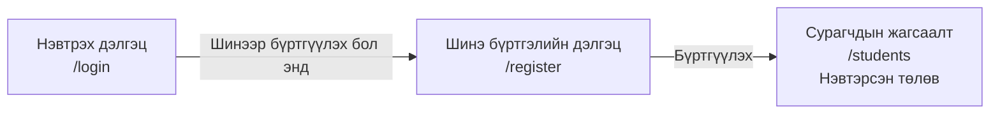
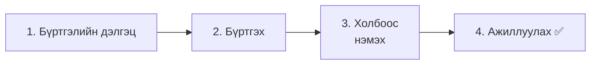
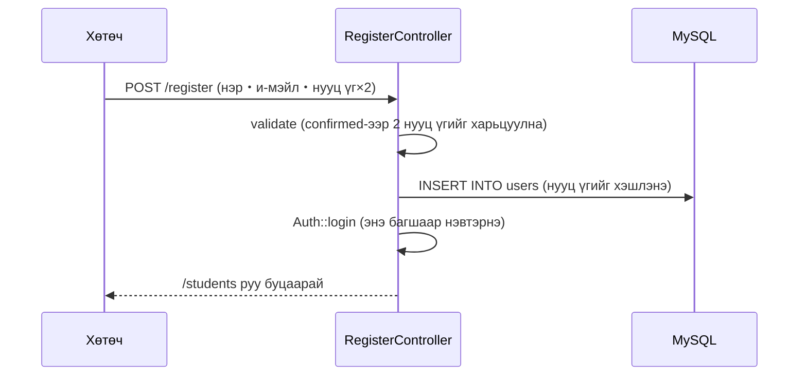

# Сурагчийн бүртгэлийн апп хийцгээе ⑤ — Багшийн шинэ бүртгэл

> 🇯🇵 Эх хувь (япон хэлээр): [20261210_資料_1.md](<../../../1年生_データ設計とアプリ開発/後期/20261210/20261210_資料_1.md>) <!-- original-ja-link -->

Одоогоор багшийг **зөвхөн Seeder-ээр л бүртгэж** чадаж байна. Шинэ багш ирэх бүрт програмаа өөрчилж бичих нь их төвөгтэй.
Өнөөдөр аппын хуудаснаас **багшийн бүртгэл (account) үүсгэж** чаддаг (шинэ бүртгэл, sign-up) болгоно.

## Өнөөдрийн зорилго
- Шинэ бүртгэлийн дэлгэц хийж, багшийг `users` хүснэгтэд хадгалж чаддаг болох
- Нууц үгийн давтан оруулгыг валидациар (`confirmed`) шалгаж чаддаг болох
- Бүртгүүлсний дараа шууд нэвтэрсэн төлөвт оруулж чаддаг болох (`Auth::login`)

> 12/3-ны «Холбоос (relation)» хүртэл хийгдсэн төлөвөөс эхэлнэ.

---

## 1. Өнөөдөр хийх зүйл



```
新規登録

名前：             [ 鈴木先生            ]
メールアドレス：   [ suzuki@example.com  ]
パスワード：       [ ●●●●●●●●            ]
パスワード（確認）：[ ●●●●●●●●            ]

[登録]
```

### Нэвтрэхээс ялгаатай нь

11/26-нд хийсэн нэвтрэх функцтэй бараг ижил бүтэцтэй.

| | Нэвтрэх (11/26) | Шинэ бүртгэл (өнөөдөр) |
|---|---|---|
| URL | `/login` | `/register` |
| Хийх зүйл | `users`-д байгаа багш мөн эсэхийг **шалгана** | `users`-д шинэ багш **нэмнэ** |
| Оруулах талбар | И-мэйл хаяг・нууц үг | Нэр・и-мэйл хаяг・нууц үг・**нууц үг (баталгаажуулах)** |
| Эцэст нь | `Auth::attempt()`-ээр нэвтэрнэ | `Auth::login()`-оор нэвтэрнэ |

> **2-р курст** энэ шинэ бүртгэлийг ч бас API (`POST /api/register`) болгон өөрчилнө.
> Шалгах дүрмүүдийг (валидаци) 2-р курст ч хэвээр нь ашиглана.

---

## 2. Хийж үзье



Өөрчлөх файлууд нь дараах байдалтай (`src` дотор).

```
src/
├─ app/Http/Controllers/
│   └─ RegisterController.php ·········· 1・2. Шинэ бүртгэл (шинээр үүсгэнэ)
├─ resources/views/
│   ├─ register.blade.php ·············· 1. Шинэ бүртгэлийн дэлгэц (шинээр үүсгэнэ)
│   ├─ login.blade.php ················· 3. Шинэ бүртгэл рүү очих холбоос
│   └─ layouts/header.blade.php ········ 3. Шинэ бүртгэл рүү очих холбоос
└─ routes/web.php ······················ 1・2. Route
```

---

### 1. Шинэ бүртгэлийн дэлгэц хийх

> Одоо энд байна: **🟢 1. Бүртгэлийн дэлгэц** → 2. Бүртгэх → 3. Холбоос → 4. Ажиллуулах

#### ① Контроллер үүсгэх

```powershell
docker compose exec laravel php artisan make:controller RegisterController
```

`app/Http/Controllers/RegisterController.php`-ийг дараах байдлаар бичнэ.

```php
<?php

namespace App\Http\Controllers;

use App\Models\User;
use Illuminate\Http\Request;
use Illuminate\Support\Facades\Auth;

class RegisterController extends Controller
{
    // Шинэ бүртгэлийн дэлгэцийг харуулна
    public function showForm()
    {
        return view('register');
    }
}
```

#### ② View үүсгэх

`resources/views/register.blade.php`-ийг үүсгэнэ.

```html
@include('layouts.header', ['title' => '新規登録'])

    <h1>新規登録</h1>

    <form method="POST" action="/register">
        @csrf

        <p>
            名前：
            <input type="text" name="name" value="{{ old('name') }}" required>
            @error('name') <span style="color: red;">{{ $message }}</span> @enderror
        </p>

        <p>
            メールアドレス：
            <input type="email" name="email" value="{{ old('email') }}" required>
            @error('email') <span style="color: red;">{{ $message }}</span> @enderror
        </p>

        <p>
            パスワード（8文字以上）：
            <input type="password" name="password" required>
            @error('password') <span style="color: red;">{{ $message }}</span> @enderror
        </p>

        <p>
            パスワード（確認）：
            <input type="password" name="password_confirmation" required>
        </p>

        <button type="submit">登録</button>
    </form>

    <a href="/login">ログインはこちら</a>

@include('layouts.footer')
```

| Код | Утга |
|--------|------|
| `name="password"` | Нууц үг |
| `name="password_confirmation"` | Нууц үгийг **баталгаажуулахын тулд давтан оруулах талбар**. Нэрийг нь `password`-ийн ард `_confirmation` залгаж өгөх нь **тогтсон дүрэм** |

> **Яагаад нууц үгийг 2 удаа оруулдаг вэ?**
> Нууц үг `●●●` хэлбэрээр харагддаг тул буруу бичсэн ч анзаарахгүй.
> 2 удаа оруулуулж, **ижил эсэхийг** нь харьцуулбал буруу бичсэнээ анзаарч чадна.

#### ③ Route бичих

`routes/web.php`-д ★ тэмдэгтэй хэсгийг нэмж бичнэ.

```php
use App\Http\Controllers\RegisterController;  // ★ Нэмэх (дээд талд бичнэ)

Route::get('/register', [RegisterController::class, 'showForm']);  // ★ Нэмэх
```

✅ **Шалгах**: <http://localhost:8000/register> хаягийг нээгээд шинэ бүртгэлийн дэлгэц гарвал OK.

---

### 2. Бүртгэж чаддаг болгох

> Одоо энд байна: 1. Бүртгэлийн дэлгэц → **🟢 2. Бүртгэх** → 3. Холбоос → 4. Ажиллуулах

#### ① register метод бичих

`RegisterController.php`-д ★ тэмдэгтэй `register`-ийг нэмж бичнэ.

```php
    // ★ Эндээс нэмэх
    public function register(Request $request)
    {
        // ① Оруулсан утгыг шалгана
        $request->validate([
            'name' => 'required|string|max:255',
            'email' => 'required|email|unique:users,email',
            'password' => 'required|min:8|confirmed',
        ], [
            'name.required' => '名前を入力してください。',
            'name.max' => '名前は255文字以内で入力してください。',
            'email.required' => 'メールアドレスを入力してください。',
            'email.email' => 'メールアドレスの形で入力してください。',
            'email.unique' => 'そのメールアドレスは、すでに登録されています。',
            'password.required' => 'パスワードを入力してください。',
            'password.min' => 'パスワードは8文字以上で入力してください。',
            'password.confirmed' => 'パスワード（確認）が一致しません。',
        ]);

        // ② Багшийг хадгална
        $user = new User();
        $user->name = $request->input('name');
        $user->email = $request->input('email');
        $user->password = $request->input('password');  // Хадгалах үед автоматаар хэшлэгдэнэ
        $user->save();

        // ③ Шууд нэвтрүүлнэ
        Auth::login($user);
        $request->session()->regenerate();

        // ④ Сурагчдын жагсаалт руу
        return redirect('/students');
    }
    // ★ Энд хүртэл
```

Шинээр гарч ирж байгаа зүйлс.

| Код | Утга |
|--------|------|
| `string` | Тэмдэгт мөр байх |
| `unique:users,email` | `users` хүснэгтийн `email` баганад ижил утга байхгүй эсэх (нэг и-мэйл хаягаар 2 удаа бүртгүүлж болохгүй) |
| `min:8` | Дор хаяж 8 тэмдэгт (`integer` байхгүй тул **тэмдэгтийн тоогоор** шалгана) |
| `confirmed` | `password` болон `password_confirmation` **ижил эсэх** |
| `Auth::login($user)` | Нууц үгийг шалгалгүйгээр **энэ багшаар нэвтрүүлнэ** |

> **`Auth::attempt` ба `Auth::login`-ийн ялгаа**
>
> | | `Auth::attempt($credentials)` (11/26) | `Auth::login($user)` (өнөөдөр) |
> |---|---|---|
> | Нууц үгийг | шалгана | шалгахгүй |
> | Хэрэглэх үе | Нэвтрэх дэлгэц (тухайн хүн мөн эсэх нь тодорхойгүй) | Шинэ бүртгэлийн дараа шууд (саяхан бүртгүүлсэн хүн өөрөө гэдэг нь тодорхой) |
>
> Бүртгүүлсний дараа дахиад нэвтрэх дэлгэц дээр нууц үгээ оруулуулах нь төвөгтэй биз дээ.
> Хэрэглэгч дөнгөж бүртгүүлсэн тул шууд нэвтрүүлнэ.

> **Нууц үгийг шууд хадгалж болох уу?**
> 11/26-нд сурсанчлан `User` моделийн `'password' => 'hashed'`-ийн ачаар **хадгалах үед автоматаар хэшлэгдэнэ**.
> 2-р курсийн материалд `Hash::make(...)`-ээр өөрөө хэшлэдэг ч Laravel аль хэдийн хэшлэгдсэн утгыг дахин хэшлэдэггүй тул аль ч хэлбэрээр бичсэн зөв ажиллана.

#### ② Route нэмж бичих

```php
Route::get('/register', [RegisterController::class, 'showForm']);
Route::post('/register', [RegisterController::class, 'register']);  // ★ Нэмэх
```



---

### 3. Шинэ бүртгэл рүү очих холбоос нэмэх

> Одоо энд байна: 1. Бүртгэлийн дэлгэц → 2. Бүртгэх → **🟢 3. Холбоос** → 4. Ажиллуулах

#### ① Нэвтрэх дэлгэцэд

`resources/views/login.blade.php`-ийн `</form>`-ийн доор ★ тэмдэгтэй 1 мөрийг нэмж бичнэ.

```html
        <button type="submit">ログイン</button>
    </form>

    <a href="/register">新規登録はこちら</a>  {{-- ★ Нэмэх --}}
```

#### ② Header-т

`resources/views/layouts/header.blade.php`-ийн `@guest` дотор ★ тэмдэгтэй 1 мөрийг нэмж бичнэ.

```html
        @guest
            <a href="/login">ログイン</a>
            <a href="/register">新規登録</a>  {{-- ★ Нэмэх --}}
        @endguest
```

Нэвтрээгүй үед л header-т «新規登録» (Шинэ бүртгэл) гарч ирнэ.

---

### 4. Ажиллуулах ✅

> Одоо энд байна: 1. Бүртгэлийн дэлгэц → 2. Бүртгэх → 3. Холбоос → **🟢 4. Ажиллуулах**

Гарсны (logout) дараа дараах дарааллаар туршиж үзээрэй.

| | Хийх зүйл | Ийм болбол OK |
|---|---|---|
| ① | Шинэ бүртгэлээр нэр «鈴木先生» (Сузуки багш)・и-мэйл хаяг `suzuki@example.com`・нууц үг `password123` (2 удаа ижил) гэж бүртгүүлэх | Сурагчдын жагсаалт руу шилжиж, header-т «鈴木先生 さん» гэж гарна |
| ② | Сурагчдын жагсаалтыг харах | **Сурагч 0** (Сузуки багш хараахан хэнийг ч бүртгээгүй учраас. 12/3-ны холбоосын ачаар) |
| ③ | phpMyAdmin дээр `users` хүснэгтийг харах | Сузуки багш байгаа бөгөөд `password` нь хэшлэгдсэн (`$2y$12$...`) байна |
| ④ | Гараад, Сузуки багшийн и-мэйл хаяг, нууц үгээр нэвтрэх | Нэвтэрч чадна |
| ⑤ | Дахин `suzuki@example.com`-оор шинээр бүртгүүлэх | «そのメールアドレスは、すでに登録されています。» (Энэ и-мэйл хаяг аль хэдийн бүртгэгдсэн байна.) гэж гарна |
| ⑥ | Нууц үг болон баталгаажуулах талбарт өөр өөр утга оруулж бүртгүүлэх | «パスワード（確認）が一致しません。» (Нууц үг (баталгаажуулах) таарахгүй байна.) гэж гарна |
| ⑦ | Нууц үгийг `abc` гэж бүртгүүлэх | «パスワードは8文字以上で入力してください。» (Нууц үгээ дор хаяж 8 тэмдэгтээр оруулна уу.) гэж гарна |

---

## 3. Route-уудын дүгнэлт

Нэвтрэх・шинэ бүртгэлтэй холбоотой route-ууд дараах байдалтай боллоо.

```php
// Нэвтрэх・гарах
Route::get('/login', [LoginController::class, 'showForm'])->name('login');
Route::post('/login', [LoginController::class, 'login']);
Route::post('/logout', [LoginController::class, 'logout']);

// Шинэ бүртгэл
Route::get('/register', [RegisterController::class, 'showForm']);
Route::post('/register', [RegisterController::class, 'register']);
```

Шинэ бүртгэлийн route-ийг `Route::middleware('auth')`-ийн **гадна** бичнэ.
Учир нь энэ бол хараахан бүртгэлгүй (нэвтэрч чадахгүй) хүний ашиглах хуудас юм.

---

## 4. Болохгүй байвал

> **🔥 Ажиллахгүй байвал логоо гарга!** → [【Чухал】Лог хэрхэн гаргах вэ](../20261022/【重要】ログの出し方.md)

| Шинж тэмдэг | Шалтгааны байршил | Шийдэл |
|------|----------|------|
| Ижил нууц үг оруулсан ч «一致しません» (таарахгүй байна) гэж гарч байна | View | Баталгаажуулах талбарын нэр `password_confirmation` болсон эсэхийг шалгана (бичлэг нь ганц үсгээр ч зөрвөл харьцуулж чадахгүй) |
| Шинэ бүртгэлийн дэлгэцийг нээхэд нэвтрэх дэлгэц рүү шилжүүлж байна | Route | `/register` route нь `Route::middleware('auth')`-ийн `{ }`-ийн **гадна** байгаа эсэхийг шалгана |
| Бүртгүүлсэн ч нэвтэрсэн төлөвт орохгүй байна | Контроллер | `Auth::login($user);` бичсэн эсэхийг шалгана |
| Бүртгүүлсэн багшаар нэвтэрч чадахгүй байна | Өгөгдөл | phpMyAdmin дээр `password` хэшлэгдсэн эсэхийг шалгана. `User.php`-ийн `'password' => 'hashed'`-ийг устгаагүй эсэхийг шалгана |
| `Class "App\Http\Controllers\User" not found` | Контроллер | `RegisterController.php`-ийн дээд талд `use App\Models\User;` байгаа эсэхийг шалгана |
| `Target class [RegisterController] does not exist.` | Route | `web.php`-ийн дээд талд `use App\Http\Controllers\RegisterController;` байгаа эсэхийг шалгана |

---

## 5. Дүгнэлт

| Өнөөдөр бичсэн зүйл | Товчхондоо |
|--------------|-----------|
| `name="password_confirmation"` | Нууц үгийг баталгаажуулахын тулд давтан оруулах талбар. Нэр нь тогтсон дүрэмтэй |
| `confirmed` | `password` болон `password_confirmation` ижил эсэхийг шалгана |
| `unique:users,email` | Ижил и-мэйл хаягтай 2 багш бүртгэж болохгүй |
| `min:8` | Нууц үг дор хаяж 8 тэмдэгттэй байна |
| `new User()` → `save()` | Багшийг хадгална (нууц үг автоматаар хэшлэгдэнэ) |
| `Auth::login($user)` | Нууц үгийг шалгалгүйгээр тухайн багшаар нэвтрүүлнэ |

**Шинэ бүртгэл бол «хэрэглэгч нэмээд шууд нэвтрүүлэх». Нэвтрэх бол «тухайн хүн мөн эсэхийг шалгаад нэвтрүүлэх».**

Ингээд багш өөрөө бүртгэлээ үүсгэж, өөрийн сурагчдаа удирдаж чаддаг апп боллоо.

<!-- nav:start -->

---

| ⬅️ Өмнөх | 🗺️ Ерөнхий зураг | Дараагийнх ➡️ |
|:--|:--:|--:|
| [12/03 Сурагчийн бүртгэл ④ Холбоос (relation)](../20261203/20261203_資料_1.md) | [Материалын ерөнхий зураг](../../README.md) | — |

<!-- nav:end -->
