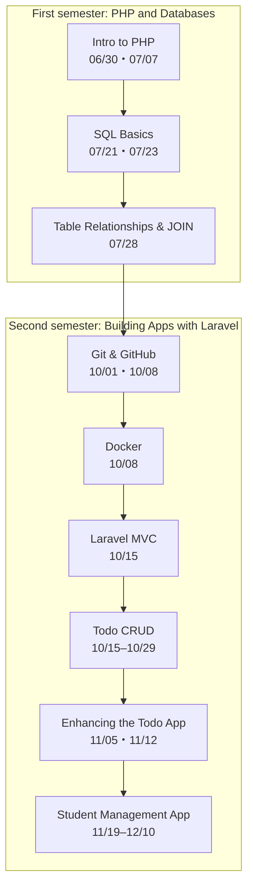

# Year 1 | Data Design and App Development — Overview of the Materials

> 🇯🇵 Original (Japanese version): [README.md](<../1年生_データ設計とアプリ開発/README.md>) <!-- original-ja-link -->

In this course, we go step by step: **build PHP-powered pages → save data in a database → build apps with Laravel**.

Every handout has **navigation links at the very bottom of the page** that take you to the previous or next handout, or back to this page.
If you ever get lost, come back to this page.

## The Big Picture

Pages to check when you get stuck

| When... | Page to check |
|:--|:--|
| You forgot a command | [Key Command List](後期/重要コマンド一覧.md) |
| Laravel isn't working the way you expect | [[Important] How to Output Logs](後期/20261022/【重要】ログの出し方.md) |
| You forgot how to start the PHP and MySQL setup used in the first semester | [Todo App: How to Start It](前期/20260723/Todo管理アプリ起動する流れ.md) |

---

## First Semester: PHP and Databases

| Date | Handout | Exercises & Answers | Extra |
|:--|:--|:--|:--|
| 06/30 | [Intro to PHP](前期/20260630/20260630_資料.md) | [Exercises](前期/20260630/20260630_演習.md)・[Answers](前期/20260630/20260630_解答.md) | [How to Run the PHP Development Server](前期/PHP開発サーバーの立て方.md) |
| 07/07 | [PHP Basics and Forms](前期/20260707/20260707_資料.md) | [Exercises](前期/20260707/20260707_演習.md)・[Answers](前期/20260707/20260707_解答.md) | |
| 07/14 | [Practice Problems](前期/20260714/20260714_資料_1.md) | | |
| 07/21 | [Why Do We Need a Database?](前期/20260721/20260721_資料.md) [SQL Basics 1 (SELECT)](前期/20260721/20260721_資料_2.md) | [Exercises](前期/20260721/20260721_演習.md)・[Answers](前期/20260721/20260721_解答.md) | [How to Set Up a Database Server (XAMPP)](前期/データベースサーバーの立て方/データベースサーバーの立て方.md) [Intro to Relational Databases](前期/20260721/リレーショナルデータベース入門.md) |
| 07/23 | [SQL Basics 2 (INSERT, UPDATE, DELETE)](前期/20260723/20260723_資料.md) | [Exercises](前期/20260723/20260723_演習.md)・[Answers](前期/20260723/20260723_解答.md) | [Todo App: How to Start It](前期/20260723/Todo管理アプリ起動する流れ.md) [Fixing PDO_MySQL Connection Errors](前期/20260723/PDO_MySQL接続エラー対処法.md) |
| 07/28 | [Table Relationships & JOIN](前期/20260728/20260728_資料.md) | [Exercises](前期/20260728/20260728_演習.md)・[Answers](前期/20260728/20260728_解答.md) | [Intro to JOIN](前期/20260728/JOIN入門.md) |

## Second Semester: Building Apps with Laravel

| Date | Handout | Extra |
|:--|:--|:--|
| 10/01 | [First Semester Review](後期/20261001/20261001_復習.md) [Intro to Version Control](後期/20261001/20261001_資料_1.md) | |
| 10/08 | [GitHub Accounts and Repositories](後期/20261008/20261008_資料_1.md) [Pushing the Practice Environment](後期/20261008/20261008_資料_2.md) [Intro to Docker](後期/20261008/20261008_資料_3.md) | |
| 10/15 | [How MVC Works](後期/20261015/20261015_資料_1.md) [Todo List](後期/20261015/20261015_資料_2.md) | |
| 10/22 | [Adding a Todo (CREATE)](後期/20261022/20261022_資料_1.md) [Todo Details (SHOW)](後期/20261022/20261022_資料_2.md) | [[Important] How to Output Logs](後期/20261022/【重要】ログの出し方.md) |
| 10/29 | [Editing a Todo (UPDATE)](後期/20261029/20261029_資料_1.md) [Toggling Completion (PATCH)](後期/20261029/20261029_資料_2.md) [Deleting a Todo (DELETE)](後期/20261029/20261029_資料_3.md) | |
| 11/05 | [Seeders & Factories](後期/20261105/20261105_資料_1.md) [Validation](後期/20261105/20261105_資料_2.md) | |
| 11/12 | [Extracting Shared Parts into Partials (@include)](後期/20261112/20261112_資料_1.md) [Adding Categories](後期/20261112/20261112_資料_2.md) | |
| 11/19 | [Student Management 1: List & Details](後期/20261119/20261119_資料_1.md) [Student Management 2: Add, Edit & Delete](後期/20261119/20261119_資料_2.md) | |
| 11/26 | [Student Management 3: Login](後期/20261126/20261126_資料_1.md) | |
| 12/03 | [Student Management 4: Relationships](後期/20261203/20261203_資料_1.md) | |
| 12/10 | [Student Management 5: Teacher Registration](後期/20261210/20261210_資料_1.md) | |

Available anytime: [Key Command List](後期/重要コマンド一覧.md)
