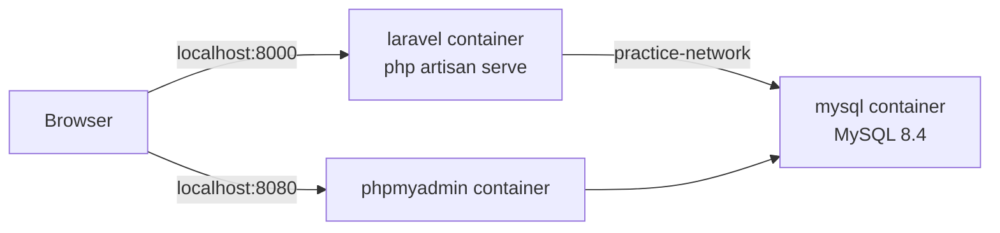
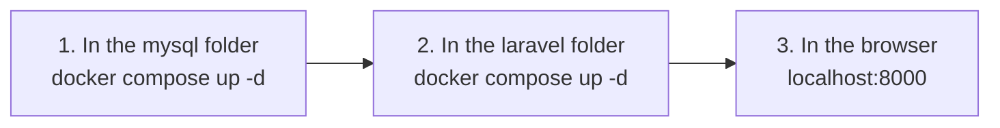

# Laravel × MySQL Practice Environment (Docker)

> 🇯🇵 Original (Japanese version): [README.md](<../../1年生_データ設計とアプリ開発/practice/README.md>) <!-- original-ja-link -->

We run Laravel and MySQL as **separate containers**.
The two containers are connected through a network called `practice-network`.



```
practice/
  mysql/
    compose.yaml    ← MySQL and phpMyAdmin
  laravel/
    compose.yaml    ← Laravel
    Dockerfile
    entrypoint.sh
    src/            ← Laravel is created automatically the first time you start it
```

> Start Docker Desktop and make sure the bottom-left corner says **Engine running** before you begin.
> How to install Docker Desktop → [Installing Docker Desktop](../後期/20261008/20261008_資料.md)

> **Stop XAMPP first**
> If you use XAMPP, open the XAMPP Control Panel and **Stop** everything that is running (Apache, MySQL, etc.) before you begin.
> If XAMPP's MySQL is running, it uses the same port `3306`, so the MySQL container can't start.

---

## 1. Where to Put It

Create a folder called `git` on the C drive, and put each project inside it.

```
C:\git\practice
```

You can also put it on your desktop.

> **Remember where you saved it**
> Every time you start or stop the environment, you `cd` into that folder. If you lose track of where you saved it, you won't be able to work with it.

> **Avoid OneDrive folders**
> If you put it inside `C:\Users\<username>\OneDrive\...`, OneDrive syncing can slow it down or cause errors.
> On some PCs, the desktop is inside OneDrive, so if you're not sure, put it in `C:\git`.

---

## 2. Starting It Up (Order Matters)

**Always start mysql first, then laravel.**
This is because the `practice-network` network is created when you start mysql.



Run these in PowerShell. (If you saved it somewhere other than `C:\git\practice`, replace the path with your own location.)

```powershell
cd C:\git\practice\mysql
docker compose up -d
```

```powershell
cd C:\git\practice\laravel
docker compose up -d
```

**The first time only**, installing Laravel takes a few minutes. You can check the progress with the following command (press `Ctrl + C` to stop watching).

```powershell
docker compose logs -f
```

When you see `Server running on [http://0.0.0.0:8000]`, you're ready to go.

| URL to open | What you'll see |
|---------|--------------|
| http://localhost:8000 | The Laravel home page ✅ |
| http://localhost:8080 | phpMyAdmin (tables have been created in the `laravel` database ✅) |

---

## 3. Stopping It

Stop the containers in the **reverse order** you started them (laravel → mysql).

```powershell
cd C:\git\practice\laravel
docker compose down
```

```powershell
cd C:\git\practice\mysql
docker compose down
```

Running `down` does not erase the contents of the database (they stay in the `mysql-data` volume).

---

## 4. Connection Settings

| Item | From Laravel | From your PC (A5:SQL Mk-2, etc.) |
|------|-------------|--------------------------|
| Host | `mysql` | `127.0.0.1` |
| Port | `3306` | `3306` |
| Database | `laravel` | `laravel` |
| Username | `laravel` | `laravel` |
| Password | `password` | `password` |

On the PC side, the port is `3306`, the same as XAMPP's MySQL. That's why you need to stop XAMPP's MySQL.
Laravel's settings are written in `laravel/src/.env`.

---

## 5. Using artisan Commands

Run `php artisan` inside the laravel container. In the laravel folder, type the following:

```powershell
docker compose exec laravel php artisan migrate
docker compose exec laravel php artisan make:controller TodoController
```

---

## 6. Troubleshooting

| Symptom | Fix |
|------|------|
| `network practice-network declared as external, but could not be found` | You didn't start mysql first → run `docker compose up -d` in the mysql folder |
| The log keeps showing `MySQL の起動を待っています...` | Check whether the mysql container is running under `Containers` in Docker Desktop |
| `port is already allocated` (the port is already in use) | Stop services such as MySQL in the XAMPP Control Panel. Also stop anything else using the same port, such as `php -S` |
| The first-time installation failed partway through | In the laravel folder, run `docker compose down` → delete the `src` folder → run `docker compose up -d` again |
| You want to reset the database from scratch | Run `docker compose down -v` in the mysql folder (**this deletes all data**) |
