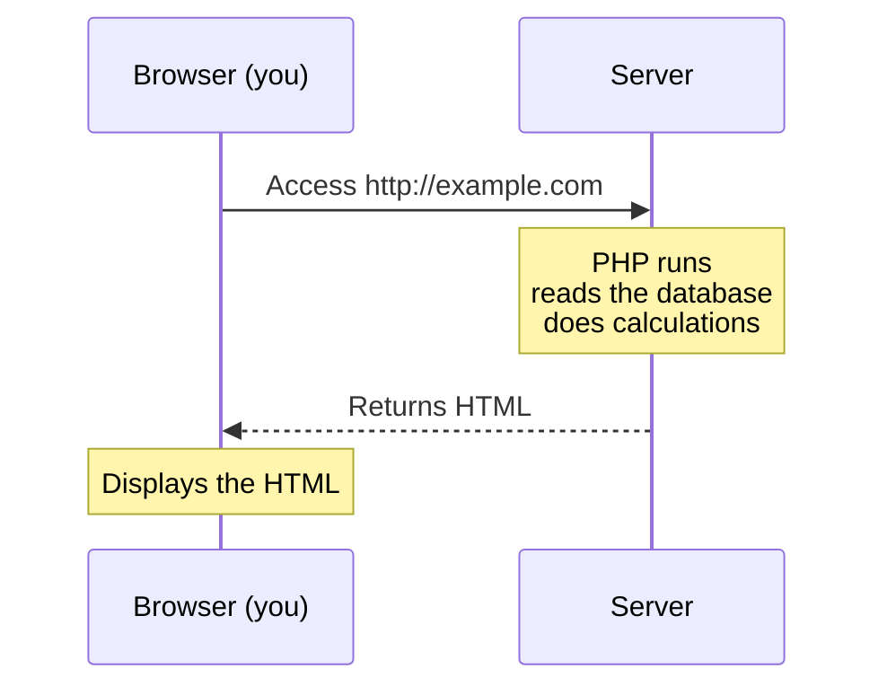

# Year 1 | Data Design and App Development — 2026/06/30

> 🇯🇵 Original (Japanese version): [20260630_資料.md](<../../../1年生_データ設計とアプリ開発/前期/20260630/20260630_資料.md>) <!-- original-ja-link -->

---

## How You Are Graded in This Course

| Item | Weight |
| --- | --- |
| Attendance | 30% |
| Classroom conduct | 10% |
| Assignments | 60% |

> ⚠️ **Important: If your attendance falls below 60%, you cannot earn credit for this course, regardless of your grades for assignments and classroom conduct.**\
> Being late or leaving early may be counted as an absence at the instructor's discretion. Please always arrive on time.

---

## Today's Goals

- Explain the difference between the server side and the client side
- Set up an environment for running PHP
- Run your first PHP file

---

## 1. The Difference Between the Client Side and the Server Side

```
Client side (what you learned last semester)
  Runs in the browser → HTML / CSS / JavaScript
  Runs on the user's device

Server side (what you'll learn starting this semester)
  Runs on the server → PHP / Python / Ruby / Go, etc.
  Runs on the server first, then the result is sent to the browser
```

**Why do we need the server side?**

| What you want to do | Client only | Needs a server |
| --- | --- | --- |
| Display text | ✅ Possible | — |
| Read from a database | ❌ Not possible | ✅ Required |
| Manage passwords securely | ❌ Unsafe | ✅ Required |
| Login feature | ❌ Not possible | ✅ Required |

---

## 2. What Is PHP?

**PHP = a server-side programming language specialized for web app development.**

Communication between the browser and the server works like this:



**Let's compare it with JavaScript:**

| Item | JavaScript | PHP |
| --- | --- | --- |
| Where it runs | Browser | Server |
| Variable syntax | `let x = 5;` | `$x = 5;` |
| String concatenation | `"Hello" + "World"` | `"Hello" . "World"` |
| Arrays | `let arr = [1, 2, 3]` | `$arr = [1, 2, 3]` |
| Output | `console.log()` | `echo` |

---

## 3. Environment Setup: Installing PHP

### On Mac (using Homebrew)

If Homebrew isn't installed yet, install it first by following the steps at [brew.sh](https://brew.sh).

```bash
brew install php
```

### On Windows

1. Go to [windows.php.net/download](https://windows.php.net/download/)
2. Download the "VS16 x64 Non Thread Safe" ZIP
3. Extract it to `C:\php`
4. Add `C:\php` to the PATH environment variable

### Check That It Works

```bash
php --version
# → If you see PHP 8.x.x ..., you're good
```

---

## 4. Your First PHP File

### Create a working folder (anywhere is fine)

```
Mac:     ~/study/
Windows: C:\Users\<username>\study\
```

### Create `index.php`

```php
<?php
// PHP code starts with <?php
// echo is the equivalent of JS's console.log

echo "こんにちは PHP！";

// Variables start with $ (a big difference from JavaScript)
$namae = "田中太郎";
$nenrei = 20;

// Embed variables inside a string (double quotes only)
echo "名前: $namae";
echo "年齢: {$nenrei}歳";  // Wrapping it in {} is the safe way

// Equivalent to JS template literals
// JS: `名前: ${namae}`
// PHP: "名前: {$namae}"
?>
```

**Start a local server and check it in the browser:**

```bash
# Move to the study folder first, then run
cd ~/study
php -S localhost:8000
```

Go to `http://localhost:8000/index.php`

---

## 5. Basic PHP Syntax (Compared with JS)

```php
<?php
// ========== Variables ==========
$name = "Alice";      // Equivalent to JS's let (needs $)
$age = 20;
$pi = 3.14;
$isStudent = true;

// ========== Output ==========
echo "Hello";          // Output without a line break
echo "World\n";        // \n adds a line break
echo $name . "\n";     // . concatenates strings (equivalent to JS's +)

// You can mix PHP tags and HTML (a PHP feature)
?>
<h1>こんにちは、<?= $name ?>さん！</h1>
<!-- <?= is shorthand for echo -->
<?php

// ========== Conditionals (same idea as JS) ==========
if ($age >= 18) {
    echo "成人です\n";
} else {
    echo "未成年です\n";
}

// ========== Loops ==========
for ($i = 1; $i <= 5; $i++) {   // $i works like i in JS
    echo $i . "回目\n";
}

// ========== Arrays ==========
$fruits = ["りんご", "みかん", "ぶどう"];
echo $fruits[0] . "\n";  // → りんご

// Looping through an array
foreach ($fruits as $fruit) {  // Equivalent to JS's forEach
    echo $fruit . "\n";
}
?>
```

---

## Summary

| Concept | JavaScript | PHP |
| --- | --- | --- |
| Variables | `let x` | `$x` |
| Output | `console.log()` | `echo` |
| String concatenation | `"a" + "b"` | `"a" . "b"` |
| Looping through arrays | `forEach` | `foreach` |
| Where it runs | Browser | Server |

---

## Coming Up Next Time

We'll study PHP variables, types, operators, arrays, and associative arrays in depth.\
As you learn, keep in mind that PHP uses different syntax to express the same concepts you learned in JavaScript.

<!-- nav:start -->

---

📎 Also read → [How to Run the PHP Development Server](../PHP開発サーバーの立て方.md)

| ⬅️ Previous | 🗺️ Overview | Next ➡️ |
|:--|:--:|--:|
| — | [Overview of the Materials](../../README.md) | [06/30 Exercises](20260630_演習.md) |

<!-- nav:end -->
