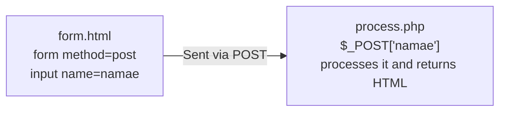
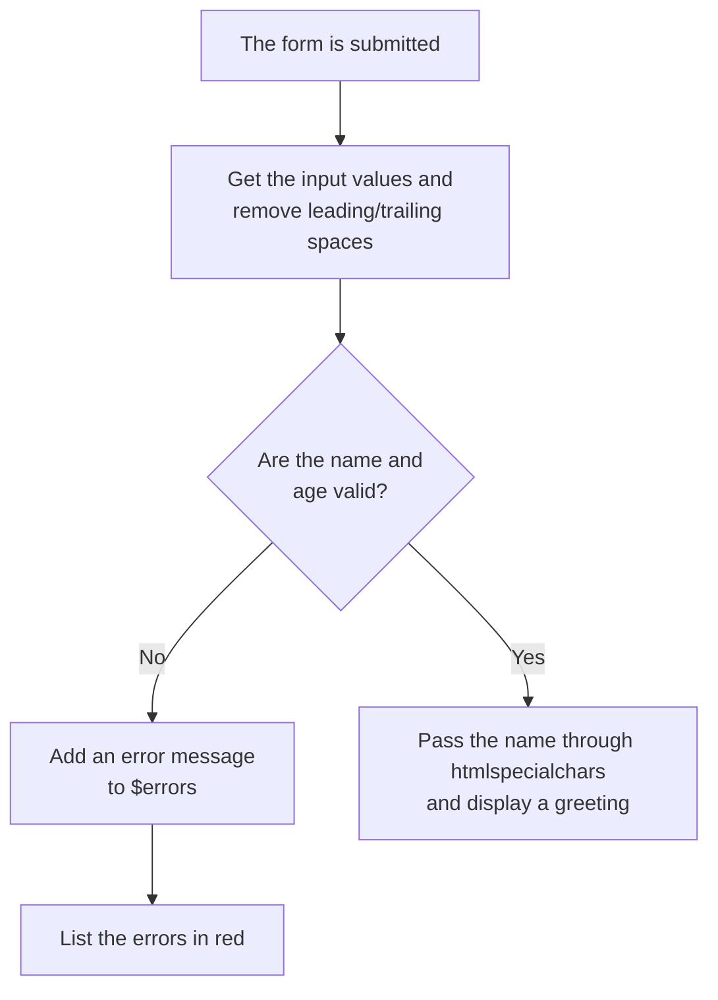

# Year 1 | Data Design and App Development — 2026/07/07

> 🇯🇵 Original (Japanese version): [20260707_資料.md](<../../../1年生_データ設計とアプリ開発/前期/20260707/20260707_資料.md>) <!-- original-ja-link -->

---

## Today's Goals

- Use PHP variables, types, arrays, and associative arrays
- Write conditionals and functions
- Receive HTML form data in PHP and handle it safely

---

## 1. Variables and Types

```php
<?php
// Variables always start with $
$namae    = "田中太郎";   // String (string)
$nenrei   = 20;           // Integer (int)
$身長     = 1.75;         // Floating-point number (float)
$isStudent = true;        // Boolean (bool)

// Check the type with gettype() (equivalent to JS's typeof)
echo gettype($namae);     // → string
echo gettype($nenrei);    // → integer

// Type conversion
$str = "42";
$num = (int)$str;         // Convert a string to an integer
echo $num + 1;            // → 43
```

---

## 2. Working with Strings

```php
<?php
$namae = "田中太郎";

echo mb_strlen($namae);   // → 4 (number of characters; mb_ functions handle Japanese)

// Embedding variables
echo "名前: {$namae}さん";

// Commonly used string functions
echo strtolower("HELLO");              // → hello
echo strtoupper("hello");              // → HELLO
echo trim("  hello  ");                // → hello (removes leading and trailing spaces)
echo str_replace("猫", "犬", "猫が好き"); // → 犬が好き
```

---

## 3. Arrays

```php
<?php
$scores = [85, 72, 91, 68, 78];

echo $scores[0];          // → 85 (starts at 0)
echo count($scores);      // → 5 (equivalent to JS's .length)

$scores[] = 95;           // Add to the end (equivalent to JS's push)
sort($scores);            // Sort in ascending order
rsort($scores);           // Sort in descending order

// Commonly used array functions
$doubled  = array_map(fn($x) => $x * 2, $scores);       // JS's map
$big      = array_filter($scores, fn($x) => $x >= 80);  // JS's filter
$total    = array_sum($scores);                           // Total
$average  = array_sum($scores) / count($scores);          // Average
```

---

## 4. Associative Arrays (Equivalent to JS Objects)

```php
<?php
// Associative array = pairs of keys and values
$person = [
    "namae"  => "田中太郎",
    "nenrei" => 20,
    "email"  => "tanaka@example.com",
];

echo $person["namae"];   // → 田中太郎

$person["hobby"] = "プログラミング";  // Add a key
$person["nenrei"] = 21;               // Change a value

// Get the keys and values with foreach
foreach ($person as $key => $value) {
    echo "{$key}: {$value}\n";
}

// ========== Arrays of associative arrays (like arrays of objects in JS) ==========
$students = [
    ["id" => 1, "name" => "田中太郎", "score" => 85],
    ["id" => 2, "name" => "鈴木花子", "score" => 72],
];

foreach ($students as $student) {
    echo "ID:{$student['id']} {$student['name']} {$student['score']}点\n";
}
```

---

## 5. Conditionals

```php
<?php
$score = 72;

// if/elseif/else (in PHP, you write elseif)
if ($score >= 90) {
    echo "S評価";
} elseif ($score >= 80) {
    echo "A評価";
} elseif ($score >= 70) {
    echo "B評価";
} else {
    echo "D評価";
}

// Ternary operator (same as JS)
$result = ($score >= 60) ? "合格" : "不合格";

// match expression (PHP 8.0 and later; an improved version of switch)
$status = "active";
$label = match($status) {
    "active"   => "有効",
    "inactive" => "無効",
    default    => "不明",
};
echo $label;  // → 有効
```

---

## 6. Functions

```php
<?php
// Function with type declarations (you can specify types for parameters and return values)
function calcTax(float $price, float $taxRate = 0.1): float {
    return $price * (1 + $taxRate);
}

echo calcTax(1000);       // → 1100 (default 10%)
echo calcTax(1000, 0.08); // → 1080 (8%)

// Returning multiple values (return them as an associative array)
function calcStats(array $numbers): array {
    return [
        "total"   => array_sum($numbers),
        "average" => array_sum($numbers) / count($numbers),
        "max"     => max($numbers),
        "min"     => min($numbers),
    ];
}

$stats = calcStats([85, 72, 91, 68]);
echo "平均: " . $stats["average"];  // → 平均: 79

// Arrow functions (PHP 7.4 and later)
$double = fn($n) => $n * 2;
echo $double(5);  // → 10
```

---

## 7. Forms and Receiving Data ($_POST)

What the user types into the form reaches PHP like this:



### form.html

```html
<form action="process.php" method="post">
  <input type="text"  name="namae"   placeholder="名前">
  <input type="number" name="age"    placeholder="年齢">
  <textarea name="message"></textarea>
  <button type="submit">送信する</button>
</form>
```

### process.php

```php
<?php
$namae   = $_POST["namae"]   ?? "";
$age     = $_POST["age"]     ?? "";
$message = $_POST["message"] ?? "";

// !! Important !! XSS protection: neutralize HTML tags with htmlspecialchars
$safeName    = htmlspecialchars($namae,   ENT_QUOTES, 'UTF-8');
$safeMessage = htmlspecialchars($message, ENT_QUOTES, 'UTF-8');

echo "<p>名前: {$safeName}</p>";
echo "<p>年齢: {$age}歳</p>";
echo "<p>メッセージ: {$safeMessage}</p>";
?>
```

---

## 8. Protecting Against XSS

```php
<?php
// ❌ Dangerous example (no htmlspecialchars)
$input = "<script>alert('ハッキング！')</script>";
echo $input;
// → The browser ends up running the <script>!

// ✅ Safe example
echo htmlspecialchars($input, ENT_QUOTES, 'UTF-8');
// → It's displayed as plain text, like &lt;script&gt;...
?>
```

> **Rule:** Always pass user input through `htmlspecialchars()` before displaying it!

---

## 9. Validation (Checking Input)

The code below checks the input in this order:



```php
<?php
$errors = [];
$namae  = "";
$age    = "";

if ($_SERVER["REQUEST_METHOD"] === "POST") {
    $namae = trim($_POST["namae"] ?? "");
    $age   = trim($_POST["age"]   ?? "");

    if (empty($namae)) {
        $errors[] = "名前は必須です";
    } elseif (mb_strlen($namae) > 50) {
        $errors[] = "名前は50文字以内にしてください";
    }

    if (empty($age)) {
        $errors[] = "年齢は必須です";
    } elseif (!is_numeric($age) || $age < 0 || $age > 150) {
        $errors[] = "年齢は0〜150の数値を入力してください";
    }

    if (empty($errors)) {
        $safeName = htmlspecialchars($namae, ENT_QUOTES, 'UTF-8');
        echo "<p>こんにちは、{$safeName}さん（{$age}歳）！</p>";
    }
}

if (!empty($errors)) {
    echo "<ul style='color:red;'>";
    foreach ($errors as $error) {
        echo "<li>" . htmlspecialchars($error) . "</li>";
    }
    echo "</ul>";
}
?>
```

---

## Summary

| Feature | JavaScript | PHP |
| --- | --- | --- |
| Variables | `let x = 1` | `$x = 1` |
| Array length | `arr.length` | `count($arr)` |
| Add to the end | `arr.push(v)` | `$arr[] = v` |
| forEach | `arr.forEach(fn)` | `foreach ($arr as $v)` |
| Objects | `{key: value}` | `["key" => value]` |
| else if | `else if` | `elseif` |
| Arrow functions | `(x) => x * 2` | `fn($x) => $x * 2` |
| Receiving form data | `fetch` / `FormData` | `$_POST["name"]` |
| XSS protection | Use `textContent` | `htmlspecialchars()` |

---

## Coming Up Next Time

We'll learn "why we need a database" through hands-on experience.  
You'll see for yourself the limits of trying to manage data with PHP arrays alone.

<!-- nav:start -->

---

| ⬅️ Previous | 🗺️ Overview | Next ➡️ |
|:--|:--:|--:|
| [06/30 Exercises](../20260630/20260630_演習.md) | [Overview of the Materials](../../README.md) | [07/07 Exercises](20260707_演習.md) |

<!-- nav:end -->
