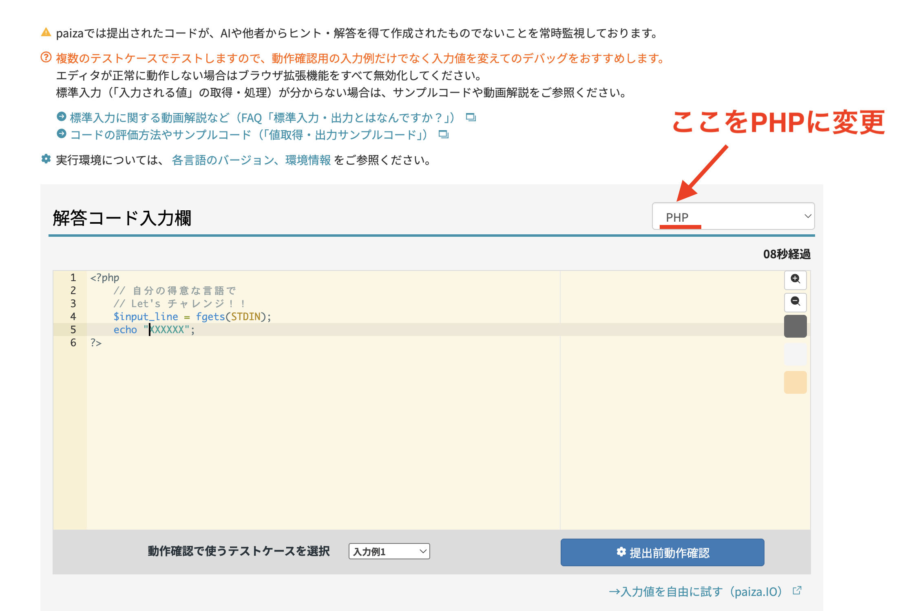

# Practice Problems (July 14, 2026)

> 🇯🇵 Original (Japanese version): [20260714_資料_1.md](<../../../1年生_データ設計とアプリ開発/前期/20260714/20260714_資料_1.md>) <!-- original-ja-link -->

Now that you can run a PHP server, start by working through the exercises we've done so far.

## Preparation

- [How to Run the PHP Development Server](../PHP開発サーバーの立て方.md)

## Exercises

1. [20260630_演習](../20260630/20260630_演習.md)
2. [20260707_演習](../20260707/20260707_演習.md)


You may write all the problems together in a single `index.php`, or you can put each problem in its own file (e.g., `1-1.php` / `1-2.php`), following the approach in "Accessing Files with a Directory for Each Chapter" in [How to Run the PHP Development Server](../PHP開発サーバーの立て方.md).

### Example Directory Structure

```
study/
  index.php
  0630/
    1.php
    2.php
    3.php
    4.php
  0707/
    1-1.php
    1-2.php
    2-1.php
```

### Command to Start the Server

`cd` means "change directory."

```bash
cd /Users/<username>/Desktop/study
php -S localhost:8000
```

### How to Access the URLs

Since the server is started directly in the `study` directory (`php -S localhost:8000`), each URL matches the file's relative path from `study/`.

```
http://localhost:8000/0630/1.php
http://localhost:8000/0630/2.php
http://localhost:8000/0707/1-1.php
http://localhost:8000/0707/1-2.php
```

## About Using AI

**You're allowed to use AI tools such as Gemini!** However, keep the following points in mind.

- Understand the language
- Don't memorize things you can look up
- If you don't understand something, ask the AI to "add comments explaining the code"


## If You Finish the Exercises and Have Time, Sign Up for Paiza and Try the Skill Check in PHP

https://paiza.jp/challenges

The submission language is set to a different language by default, so change it to PHP as shown in the image below.



**Note: Paiza's skill check constantly monitors whether code was written with hints or answers from AI or other people.** Unlike the exercises so far, solve these on your own without using AI.

<!-- nav:start -->

---

| ⬅️ Previous | 🗺️ Overview | Next ➡️ |
|:--|:--:|--:|
| [07/07 Exercises](../20260707/20260707_演習.md) | [Overview of the Materials](../../README.md) | [07/21 Why Do We Need a Database?](../20260721/20260721_資料.md) |

<!-- nav:end -->
