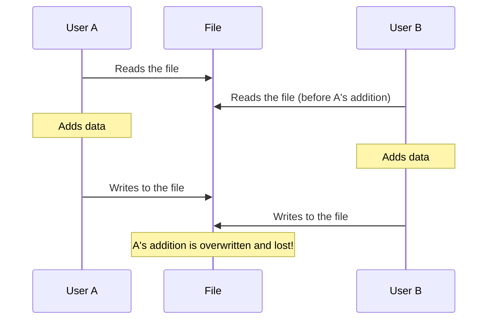
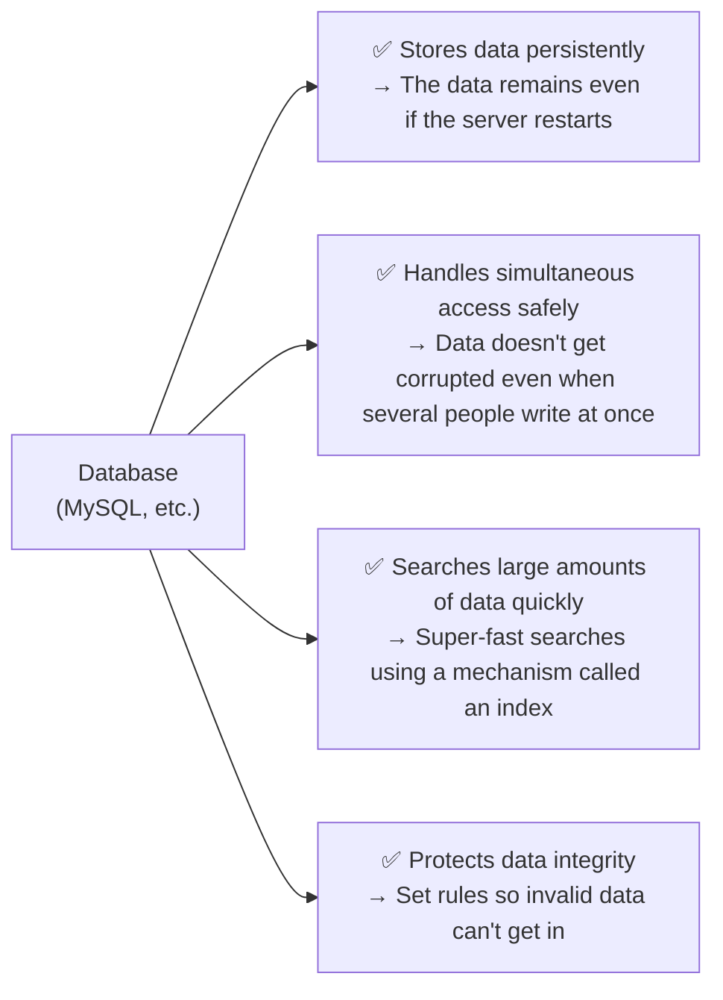
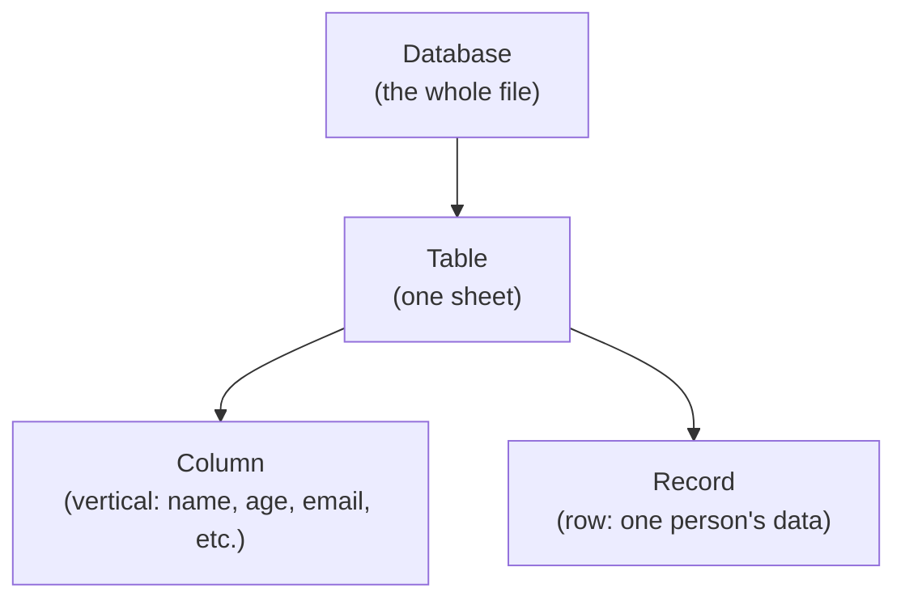
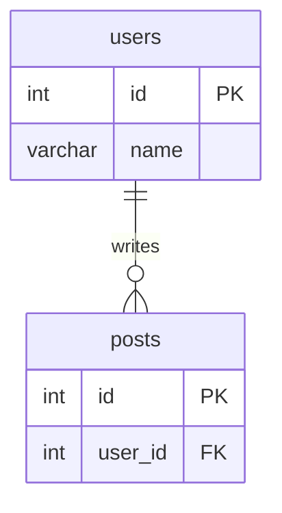

# Session 06 | Why Do We Need a Database? — PHP Arrays Alone Have Limits

> 🇯🇵 Original (Japanese version): [20260721_資料.md](<../../../1年生_データ設計とアプリ開発/前期/20260721/20260721_資料.md>) <!-- original-ja-link -->

## Today's Goals
- Explain the problems with managing data using only PHP arrays
- Understand what a database solves
- Explain the basic concepts of MySQL (tables, rows, columns)

---

## 1. Try Managing Data with Arrays Only

First, let's try building a "user management system" using only PHP arrays.

```php
<?php
// An attempt to save state in a file
// users.php
$users = [
    ["id" => 1, "name" => "田中太郎", "email" => "tanaka@example.com"],
    ["id" => 2, "name" => "鈴木花子", "email" => "suzuki@example.com"],
];

// Function that adds a new user
function addUser(array &$users, string $name, string $email): void {
    $newId = count($users) + 1;
    $users[] = ["id" => $newId, "name" => $name, "email" => $email];
}

addUser($users, "山田次郎", "yamada@example.com");

// Display
foreach ($users as $user) {
    echo "{$user['id']}: {$user['name']}\n";
}
```

### Problem 1: The Data Disappears When the Server Restarts

```
A PHP program runs from the beginning every time a request comes in
 → It starts from $users = [] every time
 → The data you added last time is gone!
```

### Problem 2: The Data Gets Corrupted When Several People Access It at Once

When A and B write at almost the same time, this can happen:



### Problem 3: Searching Gets Slow as the Data Grows

```php
// Search for a specific email address among 1 million users
foreach ($users as $user) {
    if ($user["email"] === "target@example.com") {
        return $user;  // In the worst case, it loops 1 million times...
    }
}
```

---

## 2. What a Database Solves



---

## 3. Basic Database Concepts

It's easier to understand a database if you think of it as **having a structure similar to a spreadsheet**.



```
Example: users table

 id │ name     │ email                │ created_at
────┼──────────┼──────────────────────┼─────────────────
  1 │ 田中太郎 │ tanaka@example.com   │ 2024-01-01 10:00
  2 │ 鈴木花子 │ suzuki@example.com   │ 2024-01-02 11:00
  3 │ 山田次郎 │ yamada@example.com   │ 2024-01-03 12:00
```

---

## 4. MySQL Basics

**MySQL = the most widely used open-source relational database in the world**

[About relational databases](./リレーショナルデータベース入門.md)

It's also commonly used with Laravel.

```
What is a relational database (RDB)?
- It manages data in tables
- Tables can be connected to each other through "relationships"
- You work with it using a language called SQL (Structured Query Language)

Example:
  users table (user information)
  posts table (post information)
  → posts.user_id tells you which user each post belongs to
```

Here is the relationship between users and posts as a diagram (one user can have many posts).



---

## 5. Setting Up MySQL (Windows: XAMPP / Mac: DBngin)

Use whichever one matches your OS.

### On Windows: XAMPP

**XAMPP = a free tool that installs Apache / MySQL (MariaDB) / PHP / phpMyAdmin all at once**

#### Installation

Download and install it from [apachefriends.org](https://www.apachefriends.org/)

#### Starting the MySQL Server

1. Open the XAMPP Control Panel
2. Click "Start" in the "MySQL" row to start it

### On Mac: DBngin

**DBngin = a free tool that starts MySQL / PostgreSQL / Redis with one click**

#### Installation

Download and install it from [dbngin.com](https://dbngin.com/)

#### Creating and Starting a MySQL Server

1. Open DBngin
2. Click the "+" button → select "MySQL"
3. Choose a version and click "Create" (any version is fine; if you're not sure, pick the latest stable version)
4. Click "Start" on the server you created to start it

### Common Connection Settings

With either tool, MySQL starts with the following settings by default.

```
Host:     127.0.0.1
Port:     3306
User:     root
Password: (leave it empty)
```

Note: If another MySQL server is already using port 3306, change the port number in the tool (in that case, also set the GUI tool's connection settings to that port number).

---

## 6. Working with MySQL in a GUI Tool (Windows: phpMyAdmin / Mac: TablePlus)

### On Windows: phpMyAdmin

**phpMyAdmin = a MySQL administration tool that comes with XAMPP (you use it in the browser)**

With MySQL started in the XAMPP Control Panel, go to the following address in your browser.

```
http://localhost/phpmyadmin/
```

You don't need to enter any connection settings (when XAMPP is running, it connects automatically as the root user).

### On Mac: TablePlus

**TablePlus = a tool for working with MySQL through a GUI (you can practice writing SQL by hand)**

#### Installation

Download it from [tableplus.com](https://tableplus.com/)

#### Connection Settings (for a MySQL Server Started with DBngin)

```
Name:     local
Host:     127.0.0.1
Port:     3306
User:     root
Password: (leave it empty)
Database: (create it later)
```

---

## 7. Create Your First Database

On Windows, use the "SQL" tab in phpMyAdmin; on Mac, use the SQL tab in TablePlus. Run the following:

```sql
-- Create a database
CREATE DATABASE school_db;

-- Use the database you created
USE school_db;

-- Create a table
CREATE TABLE users (
    id    INT AUTO_INCREMENT PRIMARY KEY,  -- Numbered automatically
    name  VARCHAR(100) NOT NULL,           -- String of up to 100 characters (required)
    email VARCHAR(255) NOT NULL UNIQUE,    -- UNIQUE = no duplicates allowed
    age   INT,                             -- Integer (optional)
    created_at TIMESTAMP DEFAULT CURRENT_TIMESTAMP  -- Date and time created
);

-- Try inserting some data
INSERT INTO users (name, email, age) VALUES ('田中太郎', 'tanaka@example.com', 20);
INSERT INTO users (name, email, age) VALUES ('鈴木花子', 'suzuki@example.com', 22);

-- Get the data
SELECT * FROM users;
```

---

## Bonus: Example of Running SQL from PHP

PHP has a built-in feature for connecting to databases called **PDO (PHP Data Objects)**.

```php
<?php
$pdo = new PDO(
    'mysql:host=127.0.0.1;port=3306;dbname=school_db;charset=utf8mb4',
    'root',
    '' // The default for XAMPP/DBngin is an empty password
);

// The SQL statement to run
$sql = "SELECT * FROM users";

$stmt = $pdo->query($sql);
$users = $stmt->fetchAll(PDO::FETCH_ASSOC);

foreach ($users as $user) {
    echo "{$user['id']}: {$user['name']}\n";
}
```

---

## Summary

| Issue | Arrays only | Database |
|------|---------|------------|
| Persisting data | ❌ Lost | ✅ Kept |
| Simultaneous access | ❌ Corrupted | ✅ Safe |
| Searching large amounts of data | ❌ Slow | ✅ Fast |
| Data integrity | ❌ No checks | ✅ Protected by rules |

---

## Coming Up Next Time (Session 07)

SQL basics: we'll learn how to get data using `SELECT` / `WHERE` / `ORDER BY`.  
You'll try it out by actually writing and running SQL in TablePlus.

<!-- nav:start -->

---

📎 Also read → [How to Set Up a Database Server (XAMPP)](../データベースサーバーの立て方/データベースサーバーの立て方.md)・[Intro to Relational Databases](リレーショナルデータベース入門.md)

| ⬅️ Previous | 🗺️ Overview | Next ➡️ |
|:--|:--:|--:|
| [07/14 Practice Problems](../20260714/20260714_資料_1.md) | [Overview of the Materials](../../README.md) | [07/21 SQL Basics 1 (SELECT)](20260721_資料_2.md) |

<!-- nav:end -->
