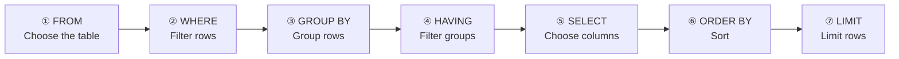

# Session 07 | SQL Basics 1 — SELECT / WHERE / ORDER BY

> 🇯🇵 Original (Japanese version): [20260721_資料_2.md](<../../../1年生_データ設計とアプリ開発/前期/20260721/20260721_資料_2.md>) <!-- original-ja-link -->

## Today's Goals
- Get data with SELECT
- Filter data by specifying conditions with WHERE
- Sort data with ORDER BY
- Limit the number of rows returned with LIMIT

---

## Preparation: Insert Practice Data

Run the following in the SQL tab of TablePlus:

```sql
-- Create the database and table
CREATE DATABASE IF NOT EXISTS school_db;
USE school_db;

-- Students table
CREATE TABLE IF NOT EXISTS students (
    id         INT AUTO_INCREMENT PRIMARY KEY,
    name       VARCHAR(100) NOT NULL,
    age        INT NOT NULL,
    class      VARCHAR(10) NOT NULL,
    score      INT NOT NULL,
    enrolled_at DATE NOT NULL
);

-- Insert test data
INSERT INTO students (name, age, class, score, enrolled_at) VALUES
('田中太郎', 18, 'A', 85, '2024-04-01'),
('鈴木花子', 19, 'A', 72, '2024-04-01'),
('山田次郎', 18, 'B', 91, '2024-04-01'),
('佐藤三郎', 20, 'B', 58, '2024-04-01'),
('伊藤美咲', 18, 'A', 78, '2024-04-01'),
('渡辺一郎', 19, 'C', 95, '2024-04-01'),
('加藤幸子', 18, 'C', 45, '2024-04-01'),
('吉田健太', 20, 'B', 88, '2024-04-01'),
('山本麻衣', 19, 'A', 67, '2024-04-01'),
('中村龍一', 18, 'C', 73, '2024-04-01');
```

---

## 1. SELECT — Getting Data

```sql
-- Get all columns and all rows (* = all columns)
SELECT * FROM students;

-- Get only specific columns
SELECT name, score FROM students;

-- Give a column an alias (AS)
SELECT name AS 名前, score AS 点数 FROM students;
```

---

## 2. WHERE — Filtering by Conditions

```sql
-- Students with a score of 80 or higher
SELECT * FROM students WHERE score >= 80;

-- Students whose class is 'A'
SELECT * FROM students WHERE class = 'A';

-- age is 18 and score is 70 or higher
SELECT * FROM students WHERE age = 18 AND score >= 70;

-- class is 'A' or 'B'
SELECT * FROM students WHERE class = 'A' OR class = 'B';

-- class is 'A' or 'B' (IN lets you write it more briefly)
SELECT * FROM students WHERE class IN ('A', 'B');

-- score is 60 or higher and below 90 (BETWEEN)
SELECT * FROM students WHERE score BETWEEN 60 AND 89;

-- name contains "太" (LIKE = partial match)
SELECT * FROM students WHERE name LIKE '%太%';
-- % = any number of characters (wildcard)

-- score is not NULL (IS NOT NULL)
SELECT * FROM students WHERE score IS NOT NULL;
```

---

## 3. ORDER BY — Sorting

```sql
-- score in ascending order (lowest first)
SELECT * FROM students ORDER BY score ASC;   -- ASC = ascending

-- score in descending order (highest first)
SELECT * FROM students ORDER BY score DESC;  -- DESC = descending

-- class in ascending order; within the same class, score in descending order
SELECT * FROM students ORDER BY class ASC, score DESC;
```

---

## 4. LIMIT — Limiting the Number of Rows

```sql
-- Get only the top 5 rows
SELECT * FROM students ORDER BY score DESC LIMIT 5;

-- Get 5 rows starting from the 6th row (used for pagination)
-- LIMIT row_count OFFSET start_position
SELECT * FROM students ORDER BY id ASC LIMIT 5 OFFSET 5;
```

---

## 5. Aggregate Functions

```sql
-- Count the rows
SELECT COUNT(*) FROM students;
-- → 10

-- Total, average, maximum, and minimum of score
SELECT
    COUNT(*)    AS 人数,
    SUM(score)  AS 合計点,
    AVG(score)  AS 平均点,
    MAX(score)  AS 最高点,
    MIN(score)  AS 最低点
FROM students;

-- GROUP BY: average score by class
SELECT class, AVG(score) AS 平均点, COUNT(*) AS 人数
FROM students
GROUP BY class
ORDER BY 平均点 DESC;
```

---

## 6. The Execution Order of SELECT (Important!)

SQL is not executed in the order you write it. It runs in this order:



```sql
SELECT name, score       -- ⑤ Choose the columns to get
FROM students            -- ① Choose the table
WHERE score >= 70        -- ② Filter by conditions
GROUP BY class           -- ③ Group rows
HAVING AVG(score) >= 75  -- ④ Filter groups (after WHERE)
ORDER BY score DESC      -- ⑥ Sort
LIMIT 5;                 -- ⑦ Limit rows
```

---

## Summary

| SQL | Meaning |
|-----|------|
| `SELECT * FROM table` | Get all data |
| `WHERE condition` | Filter by conditions |
| `AND` / `OR` | Combine multiple conditions |
| `IN (value1, value2)` | Match any of several values |
| `LIKE '%text%'` | Partial-match search |
| `ORDER BY column ASC/DESC` | Sort |
| `LIMIT number` | Limit the number of rows |
| `COUNT(*)` / `AVG()` / `SUM()` | Aggregate functions |
| `GROUP BY column` | Grouping |

---

## Coming Up Next Time (Session 08)

We'll learn INSERT / UPDATE / DELETE.  
You'll be able to add, update, and delete data.

<!-- nav:start -->

---

| ⬅️ Previous | 🗺️ Overview | Next ➡️ |
|:--|:--:|--:|
| [07/21 Why Do We Need a Database?](20260721_資料.md) | [Overview of the Materials](../../README.md) | [07/21 Exercises](20260721_演習.md) |

<!-- nav:end -->
