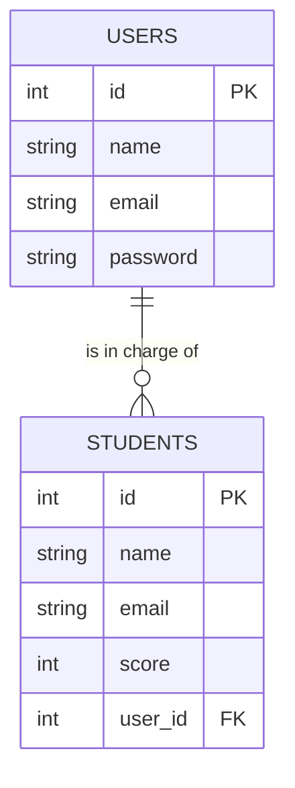

> 🇯🇵 Original (Japanese version): [リレーショナルデータベース入門.md](<../../../1年生_データ設計とアプリ開発/前期/20260721/リレーショナルデータベース入門.md>) <!-- original-ja-link -->

## What You'll Learn in This Article

- Tables, rows, and columns
- Primary keys
- Foreign keys and how tables connect to each other
- Why we split data into separate tables

## Database = A Collection of Organized Tables

Instead of scribbling notes all over pieces of paper, a "database" is a system for organizing and storing data in table form. What makes an RDB (relational database) special is that it can connect (= create "relations" between) several of these tables and work with them together.

## Tables, Rows, and Columns

This app has two tables with different roles. Let's use each one as an example to learn the names of the parts.

### 🎓 The students Table (Student Data)

| id | name | email | score |
|----|------|-------|-------|
| 1  | 田中太郎 | tanaka@example.com | 80 |
| 2  | 佐藤花子 | sato@example.com | 95 |

- **Table**: The table itself (you create one for each purpose)
- **Column**: A field that runs vertically in the table, such as `id`, `name`, `email`, or `score`
- **Row (record)**: One entry of data (here, the information for one student)

### 🔑 The users Table (Login Information for Teachers and Administrators)

| id | name | email | password |
|----|------|-------|----------|
| 1  | 小山先生 | koyama@example.com | $2y$10$abcdefGhIjKlmn...(hashed) |
| 2  | 田中先生 | tanaka-t@example.com | $2y$10$OpQrStUvWxYz...(hashed) |

- **Table**: `users` (account information for logging in; it has a different role from students)
- **Column**: `id`, `name`, `email`, `password`
- **Row (record)**: One entry of data (here, the login information for one teacher or administrator)

> 💡 `password` is not saved as the exact string that was entered (plain text). Instead, it goes through a one-way transformation called hashing before it is saved. This way, even if the contents of the database were ever leaked, no one could find out the original passwords.

## Primary Key: An ID That Uniquely Identifies Data

If you search only by `name`, you can't tell people apart when two of them have the same name. That's why we use a number that never repeats in any other row (a **primary key**). The `id` in the table above is the primary key. If you say "give me the data where id = 1," you can narrow it down to exactly one record: Taro Tanaka (田中太郎). It's easy to picture a primary key as something like a national ID number or a membership number.

## Foreign Key: Connecting Tables

The core idea of an RDB is that you can link multiple tables using IDs (this is where the word "relational" comes from).

This app has two tables: the `users` table for logging in (teacher and administrator accounts) and
the `students` table for student data. Right now, these two tables are
independent and are not connected by IDs.

If you want to record "which teacher (user) registered or is in charge of which student,"
you add a column called `user_id` to the `students` table to connect them.

If `STUDENTS.user_id` (a foreign key) refers to `USERS.id` (the primary key),
you can represent a relationship where one teacher (user) can be in charge of many students (one-to-many).

## Why Split Data into Separate Tables?

If you put everything into one table instead of splitting it, the name and email address of the teacher in charge get repeated once for every student that teacher is in charge of.

| student_id | student_name | staff_name | staff_email |
|-----------|-------|-------------|---------------|
| 101 | 田中花子 | 小山先生 | koyama@example.com |
| 103 | 田中次郎 | 小山先生 | koyama@example.com |

With this setup, if Koyama-sensei (小山先生) changes their email address, you have to find and update every matching row, and it's easy to miss some. If you split the data into a users table and a students table and link them by ID, Koyama-sensei's information is stored in only one place, so you only need to update it in one place. This idea of "splitting tables to avoid duplication" is called **normalization**.

## Summary

- A database is a system for organizing and storing data
- An RDB manages data in tables, each of which consists of columns (fields) and rows (individual records)
- A primary key is an identifier (ID) that uniquely identifies each record
- A foreign key is a way to link tables by referring to the primary key of another table
- By splitting tables and linking them, you can avoid duplicating the same information and keep your data well organized

Later on, you'll also see things like "SQL," "indexes," and "transactions," but for now, it's enough to have a picture of these basics.

<!-- nav:start -->

---

| ⬅️ Back | 🗺️ Overview | Next ➡️ |
|:--|:--:|--:|
| [07/21 Why Do We Need a Database?](20260721_資料.md) | [Course Material Overview](../../README.md) | [07/21 SQL Basics 1 (SELECT)](20260721_資料_2.md) |

<!-- nav:end -->
