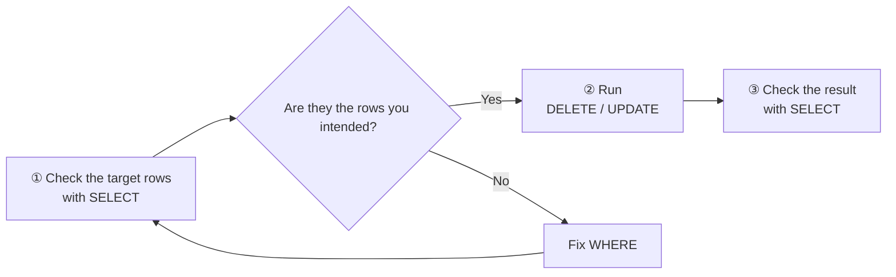
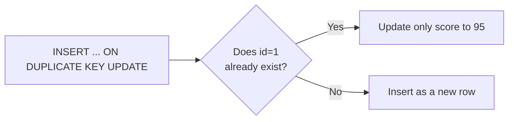

# Lesson 08 | SQL Basics 2 — INSERT / UPDATE / DELETE

> 🇯🇵 Original (Japanese version): [20260723_資料.md](<../../../1年生_データ設計とアプリ開発/前期/20260723/20260723_資料.md>) <!-- original-ja-link -->

## Today's Goals
- You can add data with INSERT
- You can update data with UPDATE
- You can delete data with DELETE
- You understand why WHERE is important (if you forget it, every row gets changed)

---

## 1. INSERT — Adding Data

```sql
-- When you provide values for every column (you can leave out the column names)
INSERT INTO students VALUES (NULL, '新入生A', 18, 'A', 80, '2024-04-01');
-- ↑ id is AUTO_INCREMENT, so NULL is fine

-- Specify only certain columns (recommended)
INSERT INTO students (name, age, class, score, enrolled_at)
VALUES ('新入生B', 19, 'B', 75, '2024-04-01');

-- Insert multiple rows at once
INSERT INTO students (name, age, class, score, enrolled_at)
VALUES
    ('新入生C', 18, 'C', 88, '2024-04-01'),
    ('新入生D', 20, 'A', 62, '2024-04-01'),
    ('新入生E', 19, 'B', 71, '2024-04-01');
```

---

## 2. UPDATE — Updating Data

```sql
-- !! VERY IMPORTANT !!
-- If you forget WHERE, every row will be updated!
-- Always check WHERE before you run it!

-- Update the score of the student whose id is 1 to 90
UPDATE students SET score = 90 WHERE id = 1;

-- Update multiple columns at once (comma-separated)
UPDATE students SET score = 95, class = 'S' WHERE id = 1;

-- Without WHERE (dangerous! every row gets updated)
-- UPDATE students SET score = 0;  ← If you do this, everyone gets 0 points!

-- Update using the current value (example: +5 points for everyone)
UPDATE students SET score = score + 5;  -- This is OK if you mean to do it
```

---

## 3. DELETE — Deleting Data

```sql
-- !! VERY IMPORTANT !!
-- If you forget WHERE, every row will be deleted!
-- DELETE cannot be undone!

-- Delete the student whose id is 5
DELETE FROM students WHERE id = 5;

-- Delete every student whose score is less than 50
DELETE FROM students WHERE score < 50;

-- Without WHERE (never do this)
-- DELETE FROM students;  ← The table becomes empty!
```

> **Golden rules on the job:**  
> 1. Before UPDATE/DELETE, check the target rows with SELECT  
> 2. Make a backup before running it  
> 3. Always double-check WHERE

---

## 4. How to Run UPDATE/DELETE Safely

Don't run it right away. Follow these steps in order.



```sql
-- Step 1: First, check the target rows with SELECT
SELECT * FROM students WHERE score < 50;
-- → Visually check which rows will be deleted

-- Step 2: If everything looks right, run DELETE
DELETE FROM students WHERE score < 50;

-- Check
SELECT * FROM students;
```

---

## 5. A Common Pattern: UPSERT

```sql
-- INSERT OR UPDATE (update if the data already exists, insert if it doesn't)
-- In MySQL, use INSERT ... ON DUPLICATE KEY UPDATE
INSERT INTO students (id, name, score)
VALUES (1, '田中太郎', 95)
ON DUPLICATE KEY UPDATE score = 95;
-- If id=1 already exists → only score is updated to 95
-- If id=1 does not exist → a new row is inserted
```

The diagram below shows the two possible outcomes.



---

## 6. CRUD Summary

| Operation | SQL | Meaning |
|------|-----|------|
| **C**reate | `INSERT INTO ... VALUES ...` | Add data |
| **R**ead | `SELECT ... FROM ...` | Get data |
| **U**pdate | `UPDATE ... SET ... WHERE ...` | Update data |
| **D**elete | `DELETE FROM ... WHERE ...` | Delete data |

> **CRUD = Create / Read / Update / Delete** represents the basic operations of a web app.  
> You'll see exactly the same idea in the Laravel exercises, too.

---

## Coming Up Next (Lesson 09)

We'll learn about relationships between tables and JOIN.  
You'll be able to join a users table and an orders table to find out who ordered what with a single SQL statement.

<!-- nav:start -->

---

| ⬅️ Previous | 🗺️ Overview | Next ➡️ |
|:--|:--:|--:|
| [07/21 Exercises](../20260721/20260721_演習.md) | [Course Material Overview](../../README.md) | [07/23 Exercises](20260723_演習.md) |

<!-- nav:end -->
