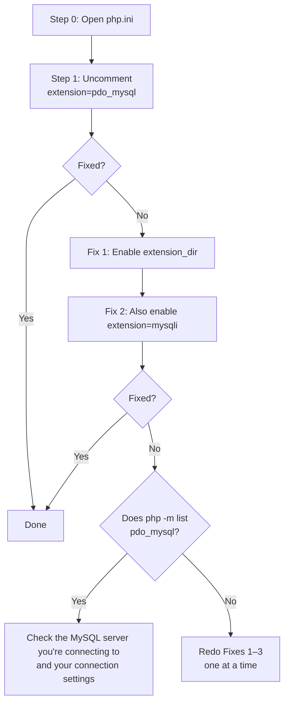

# What to Do When the PDO MySQL Extension Isn't Enabled

> 🇯🇵 Original (Japanese version): [PDO_MySQL接続エラー対処法.md](<../../../1年生_データ設計とアプリ開発/前期/20260723/PDO_MySQL接続エラー対処法.md>) <!-- original-ja-link -->

## The Error This Covers

This guide explains what to do if you see an error like the one below.

```
Fatal error: Uncaught PDOException: could not find driver in C:\Users\nishida\Desktop\apple\5.php:2
Stack trace:
#0 C:\Users\nishida\Desktop\apple\5.php(2): PDO->__construct('mysql:host=127....', 'root', Object(SensitiveParameterValue))
#1 {main}
  thrown in C:\Users\nishida\Desktop\apple\5.php on line 2
```

### What This Error Means

When PHP connects to MySQL (a database), it uses a mechanism called `PDO`. But to actually talk to MySQL, it also needs a separate component called a "driver."

`could not find driver` is an error that means "that driver can't be found." In other words, it happens because **PHP can't load the extension (driver) called `pdo_mysql`**.

In almost every case, the cause is a setting in php.ini (PHP's configuration file). Try the steps below in order, from top to bottom. After each step, always "restart the server" ([Fix 3](#fix-3-restart-the-server-completely)) before checking in your browser. Just changing the settings is not enough for PHP to pick them up.

Here is the overall flow.



Note: At every step, after you make a change and save it, always do Fix 3 (restart the server) before checking.

---

## Step 0: Open php.ini

You'll be editing a file called php.ini many times. First, let's see how to open it.

1. Open `C:\php\php.ini` from File Explorer (a folder window) or VS Code.
   - If you can't find it, type `php --ini` in the terminal, and it will show the location of the php.ini file that is being used.
2. From here on, you'll be editing the contents of this php.ini file.

---

## Step 1: Uncomment extension=pdo_mysql

php.ini contains a long list of settings that turn many features (extensions) on and off. If a line starts with `;` (a semicolon), it means "this line is disabled (commented out)."

1. With php.ini open, press `Ctrl + F` (Find), type `extension=pdo_mysql`, and search.
2. You should find a line that starts with `;`, like this.

   ```ini
   ;extension=pdo_mysql
   ```

3. Delete only the `;` at the start of the line.

   ```ini
   extension=pdo_mysql
   ```

4. Press `Ctrl + S` to save.
5. Restart the server using the steps in [Fix 3](#fix-3-restart-the-server-completely), and check that it works in your browser.

This often fixes the problem. If it doesn't, go on to the next section.

---

## If the Problem Still Isn't Solved

If uncommenting `;extension=pdo_mysql` didn't solve the problem, PHP most likely can't find "the folder that contains the actual extension files (DLL files)."

Check the following fixes in order.

## Fix 1: Enable the extension_dir Setting (★ The Most Common Cause)

`extension=pdo_mysql` is only an instruction that says "use the pdo_mysql feature." The setting that tells PHP where the files that actually provide that feature (DLL files) are located is `extension_dir`. If this isn't set correctly, PHP has the instruction but can't find the files it needs.

1. Open `C:\php\php.ini`.
2. Press `Ctrl + F` on your keyboard and search for `extension_dir`.
3. Look for a line like the one below (it should start with `;`).

   ```ini
   ;extension_dir = "ext"
   ```

4. Delete the `;` (semicolon) at the start to enable it.

   ```ini
   extension_dir = "ext"
   ```

5. Press `Ctrl + S` to save, then restart the server using [Fix 3](#fix-3-restart-the-server-completely) and check.

   Note: If this still doesn't solve it, try using a full path (absolute path) instead of the relative path `"ext"`.

   ```ini
   extension_dir = "C:\php\ext"
   ```

   This tells PHP to look in the `ext` folder inside `C:\php`, leaving no ambiguity about the location. After changing it, save the file and restart the server again.

## Fix 2: Try Enabling extension=mysqli as Well

`mysqli` is another extension for connecting to MySQL. Depending on your environment, `mysqli` may also need to be enabled for `pdo_mysql` to work properly. Just to be safe, let's enable it too.

1. Search for `extension=mysqli` in php.ini.
2. If it starts with `;`, delete it.

   ```ini
   extension=mysqli
   ```

3. Press `Ctrl + S` to save, then restart the server and check.

## Fix 3: Restart the Server Completely

Even if you edit php.ini, the change is not automatically applied to a PHP server that is already running. This is because the configuration file is read only when the server starts. Whenever you change a setting, you must completely stop the server and then start it again.

1. Open the terminal (the black screen) at the bottom of VS Code.
2. Click in the terminal and press `Ctrl + C` a few times to stop the server completely. If the terminal shows `^C` and returns to a state where you can type commands (the prompt), the server has stopped.
3. Type the command to start the server again.

   ```bash
   php -S localhost:8000
   ```

4. In your browser, reload (refresh) the page you're testing (for example, `http://localhost:8000/5.php`).

---

## What to Check If the Problem Persists

You can check directly whether pdo_mysql is currently loaded.

1. Run the following command in the terminal.

   ```bash
   php -m
   ```

   This command lists the extensions currently loaded by PHP.

2. Look for `pdo_mysql` in the list that appears.
   - **If it's there** → The extension itself is loaded. If the error continues, check whether the MySQL server you're connecting to is running, and whether your connection settings (host name, user name, password, etc.) are correct.
   - **If it's not there** → The extension still isn't loaded. Redo Fixes 1–3 above carefully, one at a time, saving your changes and restarting the server after each one.

<!-- nav:start -->

---

| ⬅️ Back | 🗺️ Overview | Next ➡️ |
|:--|:--:|--:|
| [Starting the Todo Management App](Todo管理アプリ起動する流れ.md) | [Course Material Overview](../../README.md) | [07/28 Table Relationships and JOIN](../20260728/20260728_資料.md) |

<!-- nav:end -->
