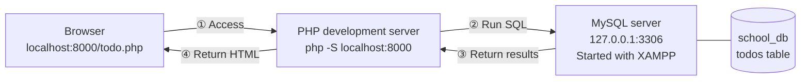
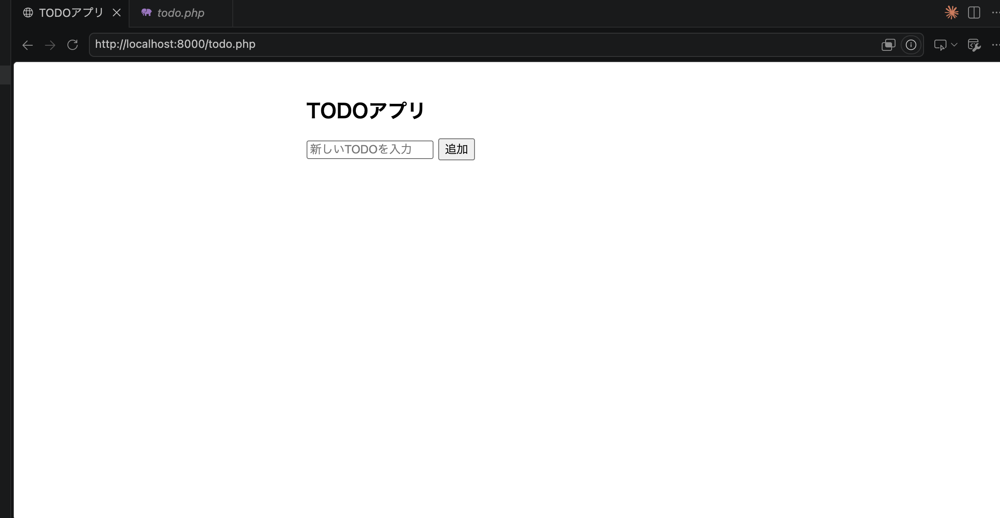
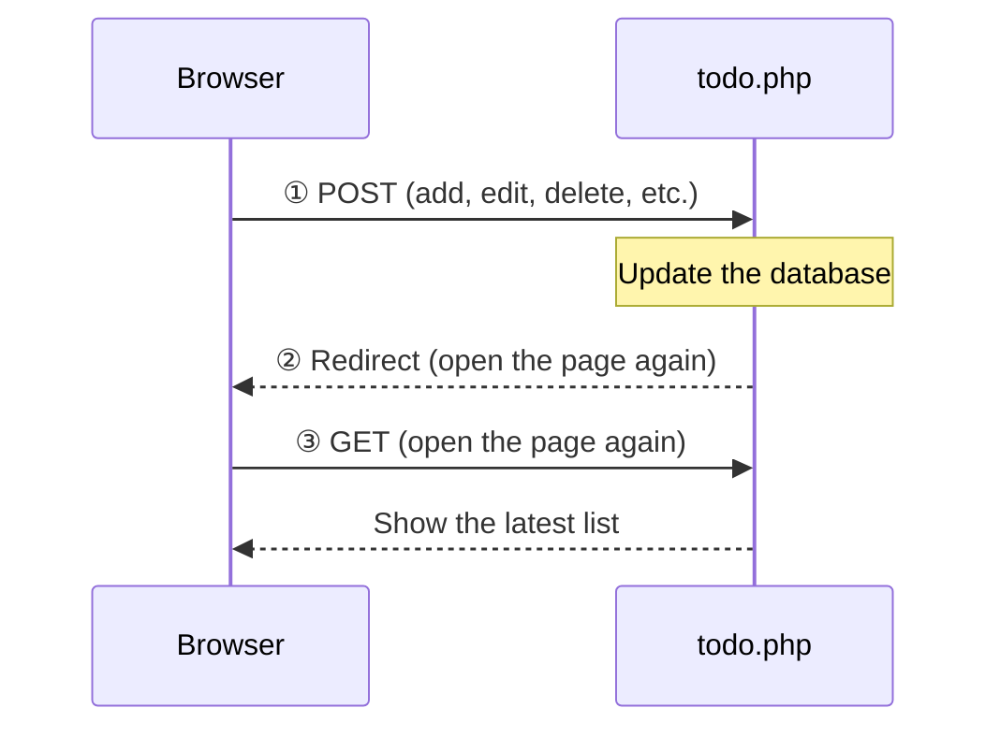

# Starting the Todo Management App

> 🇯🇵 Original (Japanese version): [Todo管理アプリ起動する流れ.md](<../../../1年生_データ設計とアプリ開発/前期/20260723/Todo管理アプリ起動する流れ.md>) <!-- original-ja-link -->

`todo.php` is an app that uses PHP + PDO to connect to MySQL and lets you add, edit, mark as done/not done, and delete TODOs. To run it, you need to have **two** things running: a "database server" and a "PHP development server."

## The Big Picture (What It Looks Like When Everything Is Running)



- **PHP development server**: Its job is to run `todo.php` (the program itself). It receives requests from the browser and executes the PHP code.
- **MySQL server (XAMPP)**: Its job is to store the data itself (the `todos` table in `school_db`). It executes SQL queries from PHP and returns the data.
- These two run as **separate processes**, and you need to keep each one running the whole time (if either one is stopped, you'll get an error).

## Before You Start

- XAMPP is installed
- PHP is installed (check with `php -v`)
- In the commands below, replace `<ユーザー名>` with the user name on your own computer

---

## 0. Put todo.php in Your study Directory

Copy the `todo.php` file you were given into your `study` directory on your computer (for example, `study/20260723/`).

- Either copy the file directly by dragging and dropping it
- Or copy its contents and paste them into a new `todo.php` file that you create in your own environment

Either way is fine. Just make sure `todo.php` is inside the `study` directory where you will run `php -S`.

---

## 1. Start MySQL with XAMPP

Open the XAMPP Control Panel and check that the `Actions` button for `MySQL` shows `Stop` (= it's running). If it shows `Start`, click it to start MySQL.

(For detailed steps, see [How to Set Up a Database Server](../データベースサーバーの立て方/データベースサーバーの立て方.md))

`todo.php` connects to MySQL using the connection settings below, so your MySQL setup needs to match them.

```php
$pdo = new PDO(
    'mysql:host=127.0.0.1;port=3306;dbname=school_db;charset=utf8mb4',
    'root',
    '' // The default for XAMPP/DBngin is an empty password
);
```

- Host: `127.0.0.1` (your own computer)
- Port: `3306` (MySQL's standard port)
- Database name: `school_db`
- User name: `root`　Password: empty

You need to create the `school_db` database itself ahead of time, using a tool such as phpMyAdmin (`todo.php` creates the `todos` table automatically when it starts, so you don't have to create the table by hand).

---

## 2. Start the PHP Development Server

Open a terminal, move into the `study` directory where `todo.php` is located, and start PHP's development server.

```bash
cd /Users/<ユーザー名>/Desktop/study
php -S localhost:8000
```

(For detailed steps, see [How to Set Up a PHP Development Server](../PHP開発サーバーの立て方.md))

---

## 3. Open It in Your Browser

With the server still running, open the URL in your browser that matches where you put `todo.php`.

```
http://localhost:8000/20260723/todo.php
```

Copy the URL above, paste it into your browser's address bar, and open it.

Note: This example assumes you put the file in `study/20260723/`. Adjust the URL to match the path relative to the directory where you started `php -S` (`study/`).

If the TODO app screen appears, it has started successfully.

---

## 4. Check That It Works

### If You See This Screen, You're Good!




- Type some text in the input field and click "追加" (Add) → Is it added to the list?
- Check the checkbox → Does the item appear crossed out and marked as done?
- Click "編集" (Edit) → Can you change the content and click "保存" (Save)?
- Click "削除" (Delete) → Is the item deleted after the confirmation dialog?

If you are returned to `index.php` (= `todo.php`) and all your changes appear, the app is working correctly (thanks to the PRG pattern, the page reloads automatically after each action).

Here is how the PRG (Post → Redirect → Get) pattern works.



---

## Stopping the Servers

Press `Ctrl + C` in the terminal where you ran `php -S` to stop the PHP development server. You can stop MySQL with the `Stop` button in the XAMPP Control Panel.

---

## If It Doesn't Work

If you get a PDO-related error such as `could not find driver`, see [Fixing PDO MySQL Connection Errors](./PDO_MySQL接続エラー対処法.md).

<!-- nav:start -->

---

📎 See also → [Fixing PDO MySQL Connection Errors](PDO_MySQL接続エラー対処法.md)

| ⬅️ Previous | 🗺️ Overview | Next ➡️ |
|:--|:--:|--:|
| [07/23 Exercises](20260723_演習.md) | [Course Material Overview](../../README.md) | [07/28 Table Relationships and JOIN](../20260728/20260728_資料.md) |

<!-- nav:end -->
